<h1 align="center"> Shou · 收拾一下</h1>

<p align="center"><strong>Mac に、もう少しゆとりを。</strong><br />Tidy up. That's it.</p>

[English](README.md) · [简体中文](README.zh-CN.md) · [繁體中文](README.zh-TW.md) · [日本語](README.ja.md) · [한국어](README.ko.md) · [Deutsch](README.de.md) · [Français](README.fr.md) · [Español](README.es.md) · [Português (Brasil)](README.pt-BR.md) · [Русский](README.ru.md) · [Українська](README.uk.md)

<p align="center">
  <a href="https://github.com/limecloud/shou/releases/latest"></a>
  
  
  <a href="LICENSE"></a>
</p>

アプリのキャッシュ、開発プロジェクト、増え続けるフォルダを整理するネイティブ macOS クリーナー。容量を調べ、対象を確認し、自分用のルールを再利用できます。

## ダウンロードとインストール

Shou v0.7.0 は **macOS 14 以降**に対応。ユニバーサル版は Apple Silicon と Intel Mac で動作します。ディスクイメージから **Shou.app** を **Applications** に移動してください。UI は英語と簡体字中国語です。

[**Shou v0.7.0 · macOS (.dmg)**](https://github.com/limecloud/shou/releases/download/v0.7.0/Shou-0.7.0-macos-universal.dmg) · [.zip](https://github.com/limecloud/shou/releases/download/v0.7.0/Shou-0.7.0-macos-universal.zip) · [CLI](https://github.com/limecloud/shou/releases/download/v0.7.0/shou-0.7.0-macos-universal.tar.gz) · [Releases](https://github.com/limecloud/shou/releases)

この版は ad-hoc 署名で、Apple の公証は受けていません。初回起動がブロックされた場合は、配布元を確認してから**システム設定 → プライバシーとセキュリティ**で開く許可を確認してください。

## Shou の機能

| | |
| --- | --- |
| **アプリのアンインストール** | アプリと明確に関連するファイルを確認してから削除。個人データには別の同意が必要で、ゴミ箱から復元できます。 |
| **起動項目** | 起動定義を確認し、macOS のログイン項目設定を開けます。Shou は項目を直接有効・無効にしません。 |
| **除外設定** | 全体またはプロジェクト単位でフォルダを保護。個人ルールの変更は無効な新バージョンとして保存。 |
| **アプリのキャッシュ** | Chrome、Edge、Firefox、Codex、Claude、QQ、WeChat などをまとめて確認。 |
| **開発ツールとプロジェクト** | npm、Cargo、Xcode、Python、Go のキャッシュ、Rust target、Node.js の依存関係、Swift 成果物を検出。 |
| **容量の分析** | ツリーマップとフォルダ一覧で容量を階層ごとに確認。 |
| **個人ルール** | 再生成可能なフォルダのルールを作成し、プレビューして再利用。 |
| **履歴と復元** | 結果を確認して選択項目を復元。完全削除は別途確認。 |
| **オンライン更新** | 設定や Shou メニューから更新を確認。インストール前に署名を検証。 |

## 3 ステップで整理

1. **スキャン。** アプリの整理を選ぶか、ワークスペースを追加。スキャンは削除しません。
2. **確認。** パス、容量、リスク、再生成条件を確認して対象を選択。
3. **実行。** 選択項目をゴミ箱へ移動。必要なら履歴から復元。

ゴミ箱への移動では空き容量はすぐに増えません。完全削除には別の確認が必要で、取り消せません。保護対象、除外設定、実行中のアプリやビルドは整理をブロックすることがあります。

## ファイルの扱いは自分で決める

ルールはローカルで動作し、Shell コマンドは実行しません。アカウント、モデル接続、クラウドスキャンは不要。ルールと履歴は Mac に保存されます。

## ターミナルで使う

独立 CLI でルール、スキャン、計画、履歴を管理。整理と復元には対話的な確認が必要です。

```sh
/Applications/Shou.app/Contents/Helpers/shou --help
/Applications/Shou.app/Contents/Helpers/shou capabilities --json
/Applications/Shou.app/Contents/Helpers/shou system scan --json
```

## ドキュメントと参加

ビルド、テスト、ルール例、CLI はドキュメントを参照してください。不具合や提案は Issues へ。

[Documentation](docs/README.md) · [Development](docs/engineering/development.md) · [Rules](docs/rules/rule-specification.md) · [CLI](docs/ai/agent-and-cli-contract.md) · [Issues](https://github.com/limecloud/shou/issues)

## 謝辞

[MangoDisk](https://github.com/harry0703/MangoDisk) · [Mole](https://github.com/tw93/mole) · [Pulse](https://pulse.egoist.dev/) · [BuhoCleaner](https://www.drbuho.com/buhocleaner) · [Sparkle](https://sparkle-project.org/)

## ライセンス

[Apache License 2.0](LICENSE).
