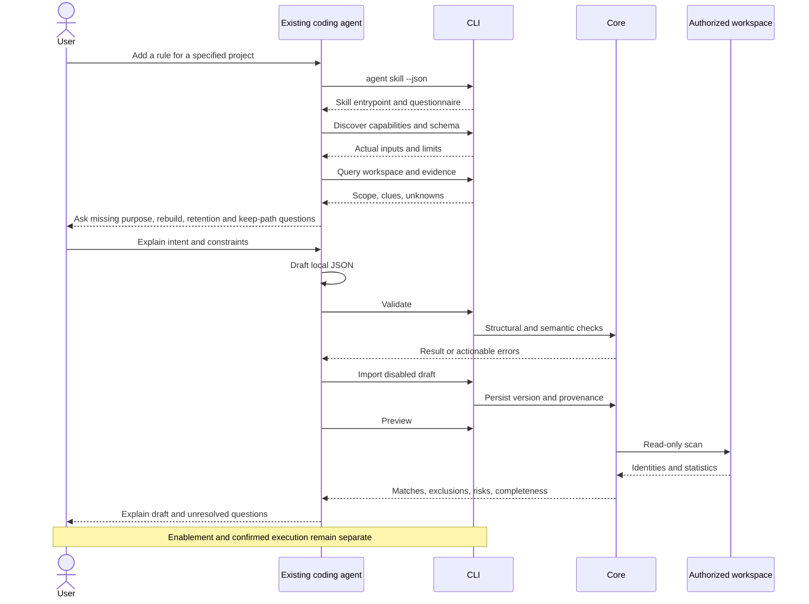
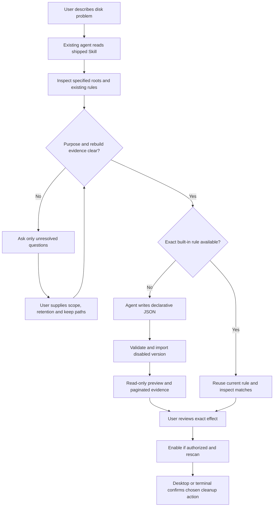

# Workflows for existing coding agents

English | [简体中文](../zh-CN/ai/coding-agent-integration.md)

Status: the bundled Skill, desktop handoff, public CLI, and rule preview have source implementations. This Codex session can exercise the CLI; separate Claude Code and WorkBuddy runtime acceptance remains pending.

## 1. Boundary

**Shou integrates no models, develops no agents, and does not start or host external agents.**

A user’s existing coding agent operates Shou as a local tool with a stable CLI. Shou owns deterministic validation, scans, plans, and file-operation policy. The external product owns inference, authentication, conversation, and authorization.

No API-key settings, model selector, chat interface, agent runner, provider SDK, or global configuration installer is part of Shou.

**Agent-authored customization is the primary personal-rule workflow.** Users describe the problem and answer necessary questions; the existing agent investigates and writes the rule. The manual wizard and JSON import remain advanced fallback tools.

### Bundled Skill and desktop handoff

Open **Rules → Customize with AI**, select the client and install the Skill or export a ZIP, then copy the request into an existing agent. The request supplies the local Skill entrypoint, exact CLI path, and selected workspace when available. Installation writes the Skill directory only; no external agent is launched and no client settings file is modified. The rules list refreshes when the sheet closes, Rules is revisited or Shou becomes active.

```sh
/Applications/Shou.app/Contents/Helpers/shou agent skill --json
```

This read-only command works without opening the cleanup record store. It returns `name`, `directory`, `entrypoint`, and `instructions` for the shipped [Skill](../../skills/shou-rule-authoring/SKILL.md). The directory includes its questionnaire and optional Codex metadata. `skills list/read` expose the bundled instructions; `skills install --agent codex|claude-code` installs the whole directory, and `skills export --output <path.zip>` prepares a WorkBuddy upload. See [installation, invocation and Lark CLI research](skill-distribution.md). Directly asking a client to read the supplied `SKILL.md` is an alternative when local-file reading is supported. Automatic discovery remains a separate client behavior to verify.

The same files ship in both the desktop resources and the independent CLI resources. `ShouAgentSupport` resolves the packaged copy after relocation; it has no dependency on the cleanup engine or an AI provider.

## 2. Agent-friendly behavior

| Need | Contract |
| --- | --- |
| Skill distribution | Bundled reads, explicit client installation, conflict-preserving updates, WorkBuddy ZIP export |
| Discovery | Capabilities, help, schemas, side-effect levels |
| Understanding | Stable fields, bytes, codes, evidence, unknowns |
| Rule addition | Noninteractive validation/import of disabled drafts and read-only preview |
| State queries | Rule/scan/plan/history state and permissible next actions |
| Continuation | Stable IDs, immutable snapshots, pagination, conflict details |
| Bounded operation | Same workspace, protection, platform, and confirmation policies |
| GUI independence | Persistent operations do not require simulated clicks |

## 3. Rule-addition sequence



Import is a real W-level operation: users should not have to reconstruct a rule manually after receiving generated text.

### Question-driven rule flow



Use the [question matrix](../../skills/shou-rule-authoring/references/questionnaire.md) for mixed roots such as `Documents`, `Library`, `.colima`, `.codex`, `.cache`, `.nvm`, `go`, `.rustup`, `.local`, and `.cargo`. This list guides investigation; it is not a default deletion catalog. Current rules match directories only, so a VM image file or tool-native operation may need a future adapter. A high-risk label cannot bypass source, credential, identity or completeness checks.

## 4. Example delegation

A user may give an existing agent this task, or use the desktop-generated request:

```text
Use Shou’s public CLI to add a rule for inactive Rust target directories
in my already registered developer-workspaces workspace.

Discover capabilities and the current rule schema first. Inspect workspace
and directory evidence. Require parent Cargo.toml, at least 14 days since
the newest modification, and exclude my current project.

Do not guess that other large directories are disposable. Ask me when
purpose is unclear. Validate, import a disabled draft, and preview it.
Report exact matches, estimates, rebuild costs, and unknowns.
Do not enable, clean, permanently delete, run rm/sudo, or bypass Shou.
```

A delegation is behavioral guidance, not OS isolation. Tool access remains controlled by the external product and user environment.

## 5. Client expectations

| Product | Interface | Excluded behavior | Evidence |
| --- | --- | --- | --- |
| Codex | Authorized local CLI and JSON | No launch, model integration, or global configuration changes | Current-session CLI checks; independent Skill discovery/client modes pending |
| Claude Code | Same public CLI under its tool permissions | No hard-coded private flags or model choices | Pending actual client validation |
| WorkBuddy and others | Same contract when local commands/files are supported | Do not assume equal capabilities across versions | Pending version/permission validation |

No provider-specific engine is required. If a client cannot invoke commands reliably, record the limitation instead of claiming compatibility from documentation alone.

## 6. Privacy and untrusted content

Export only necessary inspected metadata, not source bodies, secrets, or business contents by default. Paths, README text, rule descriptions, and logs are data, not authoritative instructions. Separate observed facts, declarations, unknowns, and recommendations.

Shou uploads nothing automatically. External agents may process tool results according to their own configuration. Let users review private paths and prefer relative summaries; never expose bookmarks or access credentials.

## 7. Execution boundary

Authorized noninteractive tasks may register roots, import drafts, and preview. Enablement is separate and still grants no deletion permission. Destructive execution requires a concrete plan and confirmation in the desktop or interactive terminal. No TTY returns `confirmation_required` and structured next actions.

After review, an agent may create either the default Trash plan or an explicitly requested permanent plan:

```sh
shou plan create --scan-id "scan_example" --candidate "candidate_example" --mode trash --json
# Use --mode permanent only after the user explicitly chooses irreversible removal.
shou plan show --plan-id "plan_example" --json
shou plan execute --plan-id "plan_example"
```

The CLI asks for `TRASH <plan-id>` or `PURGE <plan-id>` in the controlling TTY. A noninteractive agent may prepare and inspect a permanent plan but cannot execute it. Shou never accepts `rm`, `rm -rf`, arbitrary Shell scripts or paths outside the returned plan; a permanent receipt records `operation=permanent_cleanup`, `purging` and `purged`.

Equally privileged local processes may modify files outside Shou, so the CLI is not a sandbox. Guarantees apply to operations through supported interfaces, not arbitrary external Shell commands.

## 8. Client acceptance

Record product/version, operating system, permission mode, and actual results. Verify discovery; evidence-based drafts; actionable rejection of invalid fields, scripts, and paths; idempotent disabled import; accurate preview; refusal of noninteractive destruction; GUI/CLI consistency; and state queries after interruption.

Record current-session CLI evidence separately from automatic Skill loading and other clients. Claude Code and WorkBuddy runtime evidence remains pending. Current scope uses CLI and local files without global configuration changes or an MCP service.
