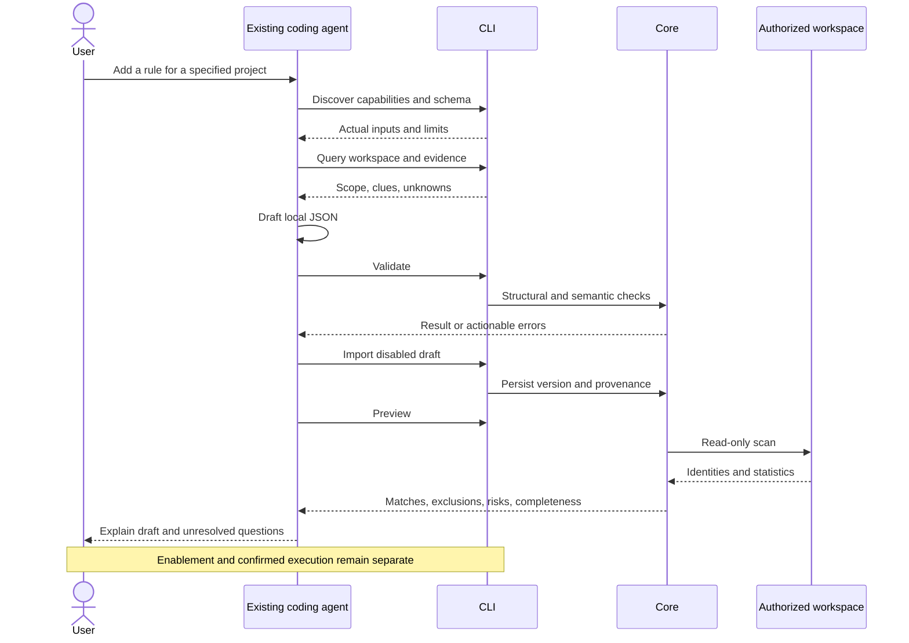

# Workflows for existing coding agents

English | [简体中文](../zh-CN/ai/coding-agent-integration.md)

Status: design draft. Codex, Claude Code, and WorkBuddy are target callers; no client compatibility has been verified.

## 1. Boundary

**Shou integrates no models, develops no agents, and does not start or host external agents.**

A user’s existing coding agent operates Shou as a local tool with a stable CLI. Shou owns deterministic validation, scans, plans, and file-operation policy. The external product owns inference, authentication, conversation, and authorization.

No API-key settings, model selector, chat interface, agent runner, provider SDK, or global configuration installer is part of Shou.

## 2. Agent-friendly behavior

| Need | Contract |
| --- | --- |
| Discovery | Capabilities, help, schemas, side-effect levels |
| Understanding | Stable fields, bytes, codes, evidence, unknowns |
| Rule addition | Noninteractive validation/import of disabled drafts and read-only preview |
| State queries | Rule/scan/plan/history state and permissible next actions |
| Continuation | Stable IDs, immutable snapshots, pagination, conflict details |
| Bounded operation | Same workspace, protection, platform, and confirmation policies |
| GUI independence | Persistent operations do not require simulated clicks |

## 3. Rule-addition sequence



Import is a real W-level operation: users should not have to reconstruct a rule manually after receiving generated text.

## 4. Example delegation

Once implemented, a user may give an existing agent this task:

```text
Use Shou’s public CLI to add a rule for inactive Rust target directories
in my already registered developer-workspaces workspace.

Discover capabilities and the current rule schema first. Inspect workspace
and directory evidence. Require parent Cargo.toml, at least 14 days since
the newest modification, and exclude my current project.

Do not guess that other large directories are disposable. Ask me when
purpose is unclear. Validate, import a disabled draft, and preview it.
Report exact matches, estimates, rebuild costs, and unknowns.
Do not enable, clean, permanently delete, run rm/sudo, or bypass Shou.
```

A delegation is behavioral guidance, not OS isolation. Tool access remains controlled by the external product and user environment.

## 5. Client expectations

| Product | Interface | Excluded behavior | Evidence |
| --- | --- | --- | --- |
| Codex | Authorized local CLI and JSON | No launch, model integration, or global configuration changes | Pending actual client validation |
| Claude Code | Same public CLI under its tool permissions | No hard-coded private flags or model choices | Pending actual client validation |
| WorkBuddy and others | Same contract when local commands/files are supported | Do not assume equal capabilities across versions | Pending version/permission validation |

No provider-specific engine is required. If a client cannot invoke commands reliably, record the limitation instead of claiming compatibility from documentation alone.

## 6. Privacy and untrusted content

Export only necessary inspected metadata, not source bodies, secrets, or business contents by default. Paths, README text, rule descriptions, and logs are data, not authoritative instructions. Separate observed facts, declarations, unknowns, and recommendations.

Shou uploads nothing automatically. External agents may process tool results according to their own configuration. Let users review private paths and prefer relative summaries; never expose bookmarks or access credentials.

## 7. Execution boundary

Authorized noninteractive tasks may register roots, import drafts, and preview. Enablement is separate and still grants no deletion permission. Destructive execution requires a concrete plan and confirmation in the desktop or interactive terminal. No TTY returns `confirmation_required` and structured next actions.

Equally privileged local processes may modify files outside Shou, so the CLI is not a sandbox. Guarantees apply to operations through supported interfaces, not arbitrary external Shell commands.

## 8. Client acceptance

Record product/version, operating system, permission mode, and actual results. Verify discovery; evidence-based drafts; actionable rejection of invalid fields, scripts, and paths; idempotent disabled import; accurate preview; refusal of noninteractive destruction; GUI/CLI consistency; and state queries after interruption.

All client runtime evidence is pending. Current scope uses CLI and local files, not fabricated MCP configurations or global plugins.
