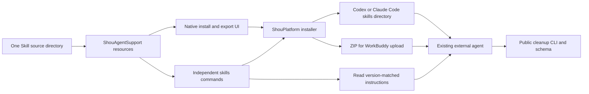
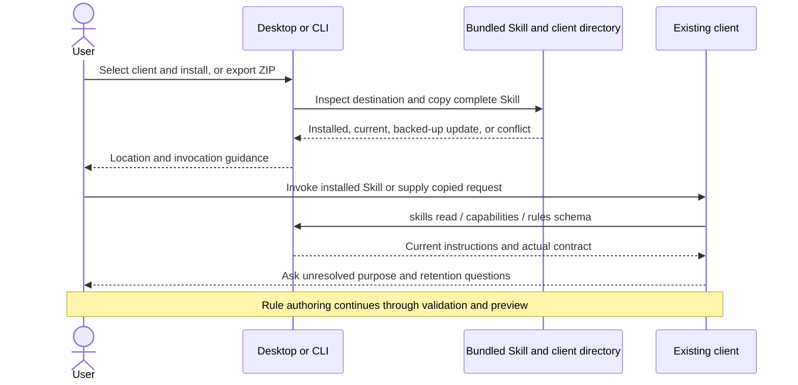

# Skill installation and distribution

English | [简体中文](../zh-CN/ai/skill-distribution.md)

Reviewed: 2026-10-20. Local installation, bundled reads and ZIP export are implemented. Client discovery and task execution need separate runtime acceptance; distributing instructions alone does not establish compatibility.

Validation: 137 core tests, 114 real CLI contract checks, four terminal-confirmation checks, and isolated native cleanup/restoration/permanent-removal checks passed. Installation tests cover repeated installs, managed-update backups, preservation of local changes, invalid files, links and ZIP contents without writing real client directories. Computer Use verified the installed Chinese handoff, Codex/Claude Code guidance and Copy Request; a separate-data application copy verified WorkBuddy export through the native save panel and the English Rules page. The exported ZIP matched all three source files. Later UI observation returned timeout/no-window errors, so a complete English handoff and a new return-to-Chinese pass are not counted. No external client was configured or launched for acceptance.

## What Lark CLI does

The official [Lark CLI guide](https://github.com/larksuite/cli/blob/main/README.zh.md) offers `npx @larksuite/cli@latest install`. Its [installation wizard](https://github.com/larksuite/cli/blob/main/scripts/install-wizard.js) installs the CLI and delegates Skill installation to `npx skills add <repository> -y -g`. Source installations document `npx skills add larksuite/cli -y -g`.

Its [skills commands](https://github.com/larksuite/cli/blob/main/cmd/skill/skill.go) also expose `skills list` and `skills read <name> [relative-file]`. Instructions and references are embedded at build time, so an agent can read the copy matching that CLI version without locating a source checkout. Reading skills does not require business authentication.

Shou adopts these distribution and discovery ideas with its own Swift implementation. One standard Skill is sufficient for the current rule-authoring task. The native installer copies bundled files without requiring Node.js, an account or a network request. Shou has no dependency on Lark CLI or the Skills CLI.

## Install the bundled Skill

Open **Rules → Customize with AI**, select a client, then choose **Install Skill** or **Export Skill ZIP…**. Installation writes only the named Skill directory. It does not launch the client or edit its settings files. Copy the prepared request into the client to supply the exact CLI path and chosen workspace.

The same operations are available in the app's independent CLI. Examples elsewhere use `shou` as shorthand; use this full path when it is not on `PATH`:

```sh
"/Applications/Shou.app/Contents/Helpers/shou" skills install --agent codex --json
"/Applications/Shou.app/Contents/Helpers/shou" skills install --agent claude-code --json
"/Applications/Shou.app/Contents/Helpers/shou" skills export --output "$HOME/Downloads/shou-rule-authoring.zip" --json
```

Choose the relevant command; installing every client is unnecessary.

| Client | Installed location / import | Invocation |
| --- | --- | --- |
| Codex | `~/.agents/skills/shou-rule-authoring/SKILL.md` | `$shou-rule-authoring`, or a matching natural-language task |
| Claude Code, local session | `~/.claude/skills/shou-rule-authoring/SKILL.md` | `/shou-rule-authoring`, or a matching natural-language task |
| WorkBuddy | Export ZIP, then **Experts · Skills · Connectors → Skills → Add Skill → Upload Skill**; enable the imported skill | Start a task asking it to use the Shou rule-authoring skill |

[Codex documentation](https://developers.openai.com/codex/skills/) specifies user-level `~/.agents/skills` and repository `.agents/skills` locations. Codex detects changes automatically; restart it if the Skill does not appear. [Claude Code documentation](https://code.claude.com/docs/en/skills) specifies `~/.claude/skills` and project `.claude/skills`; local files are not automatically available in a remote environment.

[WorkBuddy documentation](https://www.workbuddy.cn/docs/workbuddy/From-Beginner-to-Expert-Guide/Function-Description/Skills-Market) specifies uploading custom skill packages. Conversation-based installation is for market skills. The reviewed page does not establish a stable user-level automatic-discovery path. WorkBuddy and CodeBuddy are separate products; do not use CodeBuddy's directory or agent identifier as a WorkBuddy contract. ZIP export is implemented; actual WorkBuddy upload acceptance remains pending.

To install for one project, explicitly choose its parent skills directory:

```sh
shou skills install --agent codex --directory "/path/to/project/.agents/skills" --json
shou skills install --agent claude-code --directory "/path/to/project/.claude/skills" --json
```

The installer appends `shou-rule-authoring`; `--directory` is the parent folder, not the final Skill folder. It refuses symbolic links in the destination path or installed contents. If a client uses a linked skills directory, choose a real directory explicitly or manage the copy through the client's supported installer.

## Read without installation

```sh
shou skills list --json
shou skills read
shou skills read shou-rule-authoring references/questionnaire.md --json
shou skills read --file references/questionnaire.md --json
shou agent skill --json
```

`skills read` emits the original Markdown by default; `--json` returns `name`, `file`, and `content` inside the standard envelope. Only the three shipped files are readable: `SKILL.md`, `references/questionnaire.md`, and `agents/openai.yaml`. `agent skill` additionally returns local `directory` and `entrypoint` paths. All these commands work without opening cleanup storage.

As in Lark CLI, named reads accept `skills read shou-rule-authoring`, a separate relative-file argument, or `skills read shou-rule-authoring/references/questionnaire.md`. Duplicate positional/flag file selections are rejected. `shou skills --help` describes only the Skill group; `shou capabilities --command skills --json` returns its machine contract. Capability discovery also works when cleanup storage is unavailable.

For a client with local file/command access, the desktop's copied request is also usable without installation: ask it to read the bundled `SKILL.md`. This is an explicit handoff, not a claim of automatic Skill discovery. The exact installed CLI's capabilities, schema and bundled instructions remain authoritative when an installed Skill copy is older.

## Updates and conflicts

The app and independent CLI carry the same source Skill. Updating Shou replaces that bundled copy; it does not silently modify installed client copies. Run **Install Skill** again after an update:

- Identical files return `already_current`.
- A previous Shou-managed copy with matching recorded digests is moved to a sibling `.shou-rule-authoring-backup-<id>` before the new version is installed.
- Local modifications, unknown files or unmanaged conflicting content return `version_conflict`; existing files are preserved.
- ZIP export never overwrites an existing output file.

These checks prevent routine accidental overwrites. They do not isolate Shou from another process with the same filesystem permissions or guarantee immunity to concurrent path changes.

## Optional repository distribution

After this Skill has been published to the remote repository, users of the [Vercel Skills CLI](https://github.com/vercel-labs/skills/blob/main/docs/commands.md) can choose:

```sh
npx skills add limecloud/shou --skill shou-rule-authoring -g -a codex
npx skills add limecloud/shou --skill shou-rule-authoring -g -a claude-code
```

These are publication-dependent examples. Local implementation is not evidence that the remote repository contains the new files. The reviewed [supported-agent list](https://github.com/vercel-labs/skills/blob/main/docs/agents.md) includes CodeBuddy, but does not establish WorkBuddy support. The bundled installer and ZIP export remain available without this optional tool.

## Architecture and sequence





See the [rule-authoring workflow](coding-agent-integration.md) and [CLI contract](agent-and-cli-contract.md). Skill installation changes instructions, not rule enablement or cleanup authorization.
