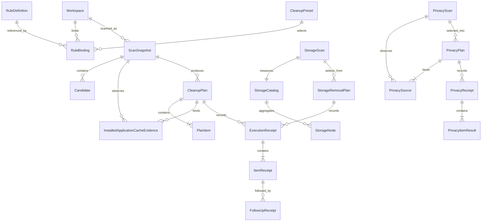
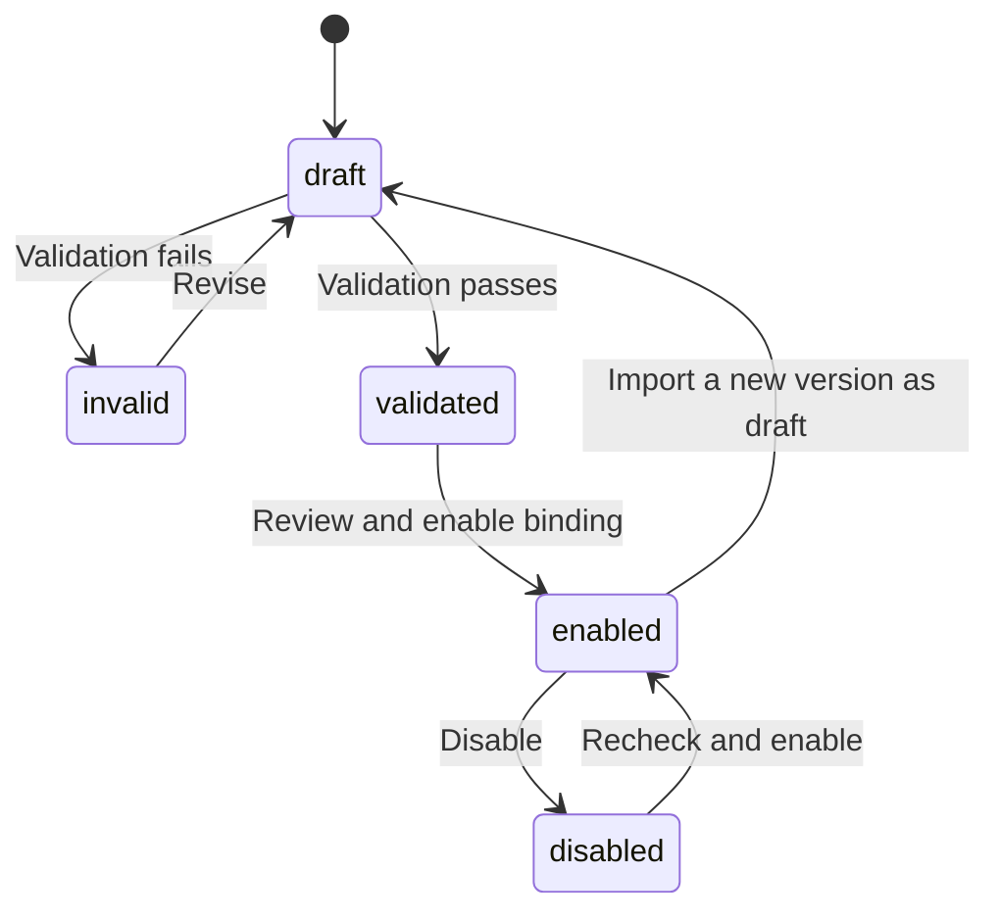
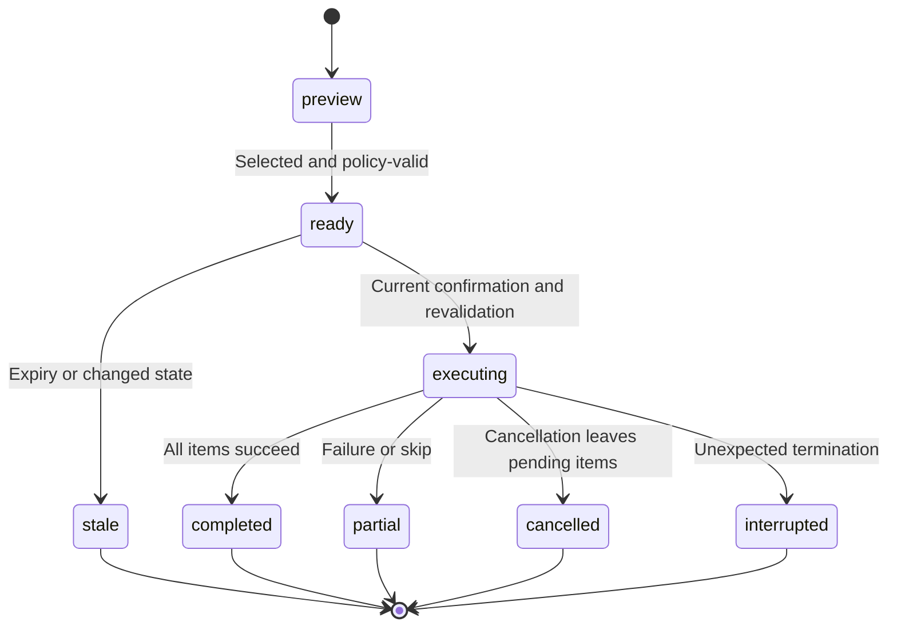
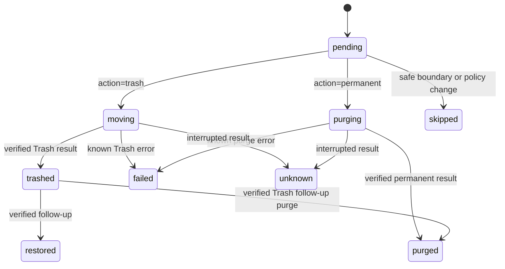

# Domain data model

English | [简体中文](../zh-CN/architecture/data-model.md)

Status: development contract. [Swift models](../../packages/shou-core/Sources/Models.swift) implement the current entities; complete state and interruption acceptance remain pending.

## 1. Relationships

Relationships are conceptual; bindings may be shared across presets. Plan items retain scan provenance and rule-version snapshots.

## 2. Entities

| Entity | Important data | Constraint |
| --- | --- | --- |
| Configuration | Storage version, revision, workspaces, bindings, optional `global_exclusions` | Any policy change invalidates earlier scan/plan evidence |
| Workspace | ID, logical root, local path, volume/root identity, access credential | Never share credentials; verify access per entry point |
| RuleDefinition | ID, version, schema version, provenance, content digest, body | No silent same-version changes; draft is not enabled |
| RuleBinding | Workspace, rule version, enablement, exclusion/override digest | Local explicit binding; changes invalidate plans |
| CleanupPreset | Name, binding references, selection preferences | Stores logic, not execution permission |
| ScanSnapshot | ID, `scope`, `treeComplete`, `completedPaths`, configuration digest, status, statistics | Only independently complete, policy-valid candidates produce executable plan items |
| Candidate | ID, relative path, project clues, identity, estimates, risk, evidence | Unclassified directories remain visible but not executable |
| CleanupPlan | ID, API version, digest, creation/expiry, configuration, `action` (`trash` or `permanent`), state | Concrete targets/action; no dynamic expansion; action is immutable after confirmation |
| PlanItem | Candidate, original path, identity, full manifest digest | No duplicate or unresolved parent/child targets; manifest is the permanent-removal boundary |
| InstalledApplicationCacheEvidence | `rule_id`, full `application` definition and optional `ownership_coverage_incomplete` | Exact installed-owner evidence and coverage limitation for one cache rule; never authorizes bundle removal |
| Confirmation | Plan/digest, action, entry point, time | One-time in-process confirmation, not a stored boolean |
| ExecutionReceipt | Execution/plan IDs, entry point, stage, overall outcome | Durable intent first; item records; partial outcomes possible |
| ItemReceipt | Original/result path, before/after identity, state, Trash path, error | `purging` is durable intent; `purged` requires a successful platform result; reverify before restore or purge |
| FollowUpReceipt | Item reference, restore/purge action, time, outcome | Separate confirmation; never rewrite original facts |
| StorageScan | Root identity, catalog ID, measured count, coverage issues | Measurement is separate from the deletion manifest |
| StorageCatalog / StorageNode | Parent ID, basename, identity, allocated/logical totals, per-directory completeness | SQLite stores the full measured inventory; directory queries load immediate children |
| StorageRemovalPlan | Selected paths, current full manifests, exact action and digest | Fresh independent verification before execution; skipped coverage never supplies deletion evidence |
| PrivacyScan | Fixed range, home/configuration identity, aggregate source observations and expiry | Counts and source descriptors only; source availability does not grant deletion authority |
| PrivacyPlan | Exact ready sources, fixed bounds, evidence, sign-out acknowledgement, digest and state | Permanent record deletion; separate current execution consent; five-minute maximum lifetime |
| PrivacyReceipt / PrivacyItemResult | Source IDs, fixed bounds, counts, item states and sanitized errors | Separate from file-removal history; no record contents, Trash path or restore capability |

## 3. Rule lifecycle

A new version does not overwrite historical definitions. Enabling its binding invalidates pending plans using old configuration. Validation establishes structure and semantics, not disposability.

## 4. Scan and plan states

Scan states are `running`, `complete`, `partial`, `cancelled`, and `failed`. Status describes completion of the requested scan mode; it does not alone authorize a candidate. Permission gaps, budget interruption and cancellation remain visible. A fully measured candidate may remain eligible when an unrelated subtree is incomplete; incomplete targets cannot enter a plan.

| Snapshot field | Meaning |
| --- | --- |
| `scope` | `full` inspects the workspace tree; `cleanup` discovers only paths that can match enabled rule prefixes and fully measures matched targets |
| `treeComplete` | Whether the entire workspace tree was inspected; `complete` status in cleanup mode does not imply this is true |
| `completedPaths` | Relative roots of independently complete subtrees; a candidate requires full-tree completeness or positive coverage of its own subtree |

These fields are additive and optional for existing records. For legacy records without `treeComplete`, use the previous whole-tree status interpretation. Missing `completedPaths` supplies no independent coverage: an old partial snapshot does not gain execution eligibility. Plans retain the scan scope and budget for fresh policy reproduction, and every selected target still requires an unchanged complete manifest.

`ScanSnapshot.installedApplicationCaches` and `CleanupPlan.installedApplicationCaches` encode as optional `installed_application_caches`. A snapshot retains enabled dynamic-rule evidence; a plan copies only owners referenced by selected candidates and includes it in its digest. Each entry binds `rule_id` to a full `ApplicationDefinition`: `id`, `path`, `source`, `identity`, `name`, optional `bundle_identifier`, `version`, `executable_name`, and `info_digest`. Partial discovery adds optional `ownership_coverage_incomplete: true`; complete discovery omits the key. This flag binds the visible limitation into the plan digest. `CleanupReview` projects these candidates as selectable but not recommendation-eligible. Rule IDs use the reserved built-in namespace plus a SHA-256 hexadecimal identifier hash; names and metadata alone cannot authorize cleanup.

Absent optional arrays and coverage flags remain omitted when re-encoded, preserving old snapshot decoding and plan digest bytes. Legacy plans with static rules need no new evidence. A candidate referring to a dynamic cache rule without matching evidence is refused. Plan creation, execution preflight and each mutation re-read the inventory, exact owner and activity. An observed duplicate, an unavailable/uninspected owner source or an issue on the owner, its descendants or ancestors invalidates that owner. Unrelated issues retain partial status and permit only explicitly reviewed candidates with the flag already bound. A complete scan becoming partial requires a new scan; partial evidence may remain conservative when the inventory becomes complete. Normal `ExecutionReceipt`/`ItemReceipt` and follow-up origins remain unchanged because the target is a cache inside the original workspace, not an uninstall component.

Application discovery issues are independent of filesystem completeness. `installed_application_cache:application_discovery_unavailable`, `installed_application_cache:application_discovery_incomplete` and `installed_application_cache:ambiguous_application_owner` are snapshot issues, projected to visible per-location system issues. A complete tree does not imply complete generic coverage. Static rules can still supply independently eligible targets.

The validated time budget also bounds candidate analysis during scanning, planning, and execution. Candidate analysis uses a monotonic deadline in each phase; persisted budgets outside the supported limits are rejected before policy reproduction.

Space analysis requires a `full` scan. A cleanup snapshot is sparse evidence: absent directories and unvisited bytes are unknown, not zero. UI and machine consumers must show this limitation rather than present its root aggregate or treemap as complete disk usage.

A provisional plan lifetime is 10 minutes, subject to prototype evidence. Unexpired plans still require object revalidation. Scope, action, rule, or exclusion changes produce a new digest. `trash` and `permanent` are separate first-class actions; an action cannot be changed after the plan is confirmed. Never automatically replay partial, cancelled, or interrupted plans.

## 5. Item states

`pending`: no item-start boundary recorded. `moving`: durable Trash intent saved before the filesystem call; an unfinished result needs verification. `trashed`: verified move with actual location. `purging`: durable permanent-removal intent saved before the platform call; outcome is not yet known. `purged`: the bound original target was permanently removed and the result was saved. `skipped`: intentionally unprocessed. `failed`: known operation error. `unknown`: interruption prevents determining outcome. `restored` and follow-up `purged`: current status derived from follow-up receipts. Legacy pending records cannot prove no filesystem operation happened.

Execution progress is transient: `stage`, `processedCount`, `itemCount` and `path` describe actual work, not a new authorization or durable outcome. A stop request prevents new item operations at a safe boundary; an in-progress system Trash operation may finish and must be reconciled before the final receipt.

Follow-up progress uses the same transient type without changing persisted receipts or CLI JSON. Its total counts only explicitly selected items. `preflight` reports read-only verification; `restoring` or `purging` starts after the pending follow-up intent is saved. `processedCount` increases only after the completed or failed outcome is saved, so it counts persisted outcomes rather than successful actions. Cancellation before intent leaves the item unstarted; after a restore intent, the current item finishes and records its result before the next-item cancellation boundary. Neither progress nor a batch checkbox authorizes retrying a pending follow-up.

Do not rewrite initial facts or retry unknown items by old path. Permanent removal and external Trash actions can eliminate recovery. A `permanent` plan records `operation=permanent_cleanup`; its byte estimate is reported separately from volume availability.

`HistoryInspection` is a transient read result, separate from execution and follow-up facts. It retains the original recorded state, check time, unfinished flag and per-item observations of the exact saved paths. The mutation lease prevents concurrent Shou mutations during inspection; a shared entry/time budget bounds the directory checks. Full manifests and identities are compared, with the same recorded-root ctime exception as follow-up verification. This does not hash contents or promote unknown items into executable follow-ups. Missing destination paths are reported without searching the user's Trash. A pending restore/purge remains pending and blocked; observations do not manufacture a completion receipt.

## 6. Risk and explanation

Effective risk is the highest level required by declarations, provenance review, protection, and runtime evidence: `review`, `high`, or `blocked`. No level promises absolute safety or automatic execution.

Store matching conditions, rule/version, missing evidence, rebuild notes, exclusions, and protection reasons. Translation affects presentation only.

## 7. Identity and paths

Rules contain relative patterns; local bindings/previews/receipts may contain absolute paths. Use platform volume/object identifiers and available type, size, modification, and metadata-change evidence.

Directory manifests cover descendants, including opaque symlink entries without target traversal. A manifest digest is not a content hash or proof of reproducibility. Never infer identity from a path prefix, Unicode normalization, or case-folded string.

## 8. Capacity fields

| Field | Meaning | Limitation |
| --- | --- | --- |
| `logical_bytes` | Logical file lengths | Not allocated storage for sparse files |
| `allocated_bytes_estimate` | Reported allocation estimate | Hard links, clones, compression complicate attribution |
| `trashed_bytes_estimate` | Original estimate for successfully trashed targets | Not freed space |
| `purged_bytes_estimate` | Original estimate for permanently removed targets | Not guaranteed newly available space |
| `volume_available_before/after` | System-reported volume availability | Concurrent activity and snapshots affect observation |

Use integer bytes and UTC timestamps in machine contracts; localized UI uses explicit decimal units, not interchangeable GB/GiB labels.

## 9. Persistence and retention

Version configuration/rule/receipt formats; failed migrations preserve previous data. Scan caches and stale plans may be budget-managed, but history does not control file deletion.

Determine history retention from measured storage costs. Deleting history must explain potential loss of application recovery/ownership verification; it never deletes unrelated Trash items. User-scoped storage is not isolation from equally privileged local processes.

## 10. Exclusion policy and configuration compatibility

`Configuration.global_exclusions` is an optional array of validated relative patterns. Persistent `Workspace.exclusions` contains only that workspace's patterns; project exclusions are exact project prefixes combined with relative patterns. `ExclusionSettings` reports the global and workspace arrays and a stable, deduplicated effective array. Rule-specific exclusions remain independent.

Scanning and draft preview merge workspace and global protection before matching. The snapshot and plan retain this effective policy in `workspace.exclusions`. Planning and execution recheck the current configuration digest, recompute effective protection and reproduce eligibility; a stored plan is not authority to bypass a later exclusion. A protected descendant blocks its containing cleanup target.

Configuration version `1` remains readable when global protection is absent or empty. The first saved nonempty global exclusion upgrades storage to version `2`; removing the last pattern preserves version `2`. Earlier builds reject version `2`, preventing silent omission of protection during a downgrade. Version `1` containing nonempty global exclusions is rejected. This storage version is independent of CLI API `1.0` and rule schema `1.0`.

## 11. Startup discovery

`StartupInventory` is a transient read result independent of cleanup storage. `StartupDefinition` retains source/path, label, an optional absolute executable, trigger clues and a definition-only Disabled hint. For current-user LaunchAgents, configured and runtime states are best-effort point-in-time observations from bounded `launchctl` queries; unsupported or expired reads remain `unknown`, and no execution authority is derived from these facts. `StartupSourceCoverage` distinguishes inspected, missing, partial, unavailable and uninspected sources. The `launchd_definitions` scope and explicit unavailable source families prevent a complete source read from implying complete macOS registration coverage. See [startup discovery](../product/startup-items.md).

## Application review, plan and receipt origins

`ApplicationCatalog` distinguishes physical installations even when bundle identifiers match, and retains source coverage and issues. `ApplicationUninstallReview` contains nine exact component families, complete manifests, eligibility, personal-data consent requirements, blocking reasons and non-authorizing coverage warnings. `ApplicationUninstallPlan` binds selected components, app metadata, configuration, consent, budget and a 15-minute expiry. Initial configuration has a stable `unconfigured` revision until a real configuration is saved.

`ExecutionReceipt.operation` is optional for compatibility; `application_uninstall` items each carry `UninstallReceiptOrigin` with component kind, application path, bundle identifier and exact parent identity. Ordinary receipts cannot opt into these origins. Restoration validates component-kind paths and parent identity independently of discovery or a later application installation. Single and batch Trash operations allow verified restoration. `application_permanent_uninstall` and `application_batch_permanent_uninstall` record irreversible outcomes and reject restoration. `ApplicationUninstallBatchPlan` binds child plans, mode, expiry and one digest; identical or ancestor/descendant component paths are rejected. Legacy single plans omit `action` and retain their Trash semantics and original digest encoding.

`FileEntry.contentDigest` is optional and omitted when absent, preserving legacy directory-manifest encoding. A standalone file target carries one root entry and a bounded SHA-256 digest. Its Trash-root comparison allows only ctime normalization while preserving content and every other metadata field. Directory descendants retain exact metadata comparison. See [application uninstall](../product/application-uninstall.md).

## Explicit space-analysis removal

Space analysis now supports local volume/folder discovery and direct explicit file/directory removal, independently of cleanup-rule workspaces. Desktop list and treemap share navigation and normalized selection. Current manifests and exclusions are checked before confirmation and execution. It reuses existing mutation journals and history. See [space analysis architecture, flow and sequence](../product/space-analysis.md).

Default space measurement is separate from deletion manifests. A read-only worker streams all measured files into a private SQLite catalog with per-directory totals and completeness. Desktop and CLI query directories on demand; measurement no longer stops at the one-million-entry deletion-manifest cap. `StorageScan` references its catalog and records `measured_entry_count`; nodes expose `is_complete`, and partial sizes are lower bounds. Removal still requires fresh complete target manifests and independent verification. Legacy JSON and paged records remain readable.

## Large-file query state

`StorageFileType` and `StorageLargeFilePage` are read models over a saved scan. A page contains items, the matching count and attributed allocated-byte estimate, plus an optional cursor. The cursor binds the scan ID, minimum allocated bytes, extension category and stable order (allocated bytes descending, full UTF-8 path ascending); changing a filter invalidates the cursor. File type is inferred from its filename extension, not content inspection. A catalog query does not traverse the source filesystem or confer removal authority. Cross-page selection materializes concrete eligible paths and goes through the existing `StorageRemovalPlan` and fresh verification.

## Privacy scan, plan and receipt contracts

The actual models live in [PrivacyModels.swift](../../packages/shou-core/Sources/PrivacyModels.swift). They use separate `privacy-scans`, `privacy-plans` and `privacy-history` collections; privacy receipts are not file-removal `ExecutionReceipt` values. [Architecture, flow and sequence](../engineering/privacy-cleaning.md#architecture) describe the shared Core service and browser/schema limits. JSON keys below use the existing snake-case codec and UTC timestamps.

| Model | Persisted fields | Boundary |
| --- | --- | --- |
| `PrivacyScan` | `id`, `created_at`, `expires_at`, `range`, optional `range_start`, `range_end`, `configuration_digest`, `home_identity`, `sources`, `issues` | Fixed at scan time; 15-minute validity. It has no aggregate `state` field: each source reports availability independently |
| `PrivacySource` | `id`, `definition`, `status`, optional `record_count`, optional `reason`, `evidence` | `definition` contains browser/name, bundle identifier, profile, kind, relative database path and unsupported flag. Evidence is directory/database/nonempty-WAL metadata; no browsing-record rows |
| `PrivacyPlan` | `id`, `scan_id`, `created_at`, `expires_at`, `range`, optional `range_start`, `range_end`, `configuration_digest`, `home_identity`, selected `sources`, `sign_out_acknowledged`, `state`, `digest` | Exact selection copied from a scan. Expiry is the earlier of scan expiry and five minutes after planning. Digest normalizes `state` to `ready` and blanks its own field; current state is checked separately |
| `PrivacyReceipt` | `id`, `plan_id`, `created_at`, `range`, optional `range_start`, `range_end`, `state`, `items` | Creation time is execution start. Contains no source descriptors, profile paths, record values, restore paths or SQL text |
| `PrivacyItemResult` | `source_id`, `state`, `removed_records`, optional `reason` | A completed aggregate count and sanitized error code; a zero count in an unfinished/failed result is not proof that no transaction ever committed |

`range` is `last-hour`, `last-day` (rolling 24 hours), `last-seven-days`, or `all-time`. `range_start` is absent for all-time; `range_end` remains an audit timestamp, and all-time intentionally has no timestamp predicate. Computed `eligible`, `requiresSignOutConsent` and total record counts are not persisted fields. `PrivacyConsent` is a non-Codable current-call value with `irreversibleDeletion` and `signOut`; a stored plan acknowledgement cannot replace it.

| State owner | Stored values and meaning |
| --- | --- |
| Source | `ready` means a supported source with a positive matching count; `empty` means zero matching records. `browser-running`, `permission-required`, `unsupported`, `schema-unsupported` and `unavailable` are ineligible; unavailable counts remain unknown rather than becoming zero |
| Plan | `ready` → `executing` → `completed` or `partial`. Expiry, a changed configuration/identity/count, or a running owner causes `plan_stale` or a specific refusal; no synthetic stored `stale` state is added |
| Receipt | `executing` precedes the first database mutation. `completed` requires all source items completed; any failed/cancelled item produces `partial`. There is no overall `cancelled`, `restored` or `purged` privacy state |
| Item | `pending` → `executing` → `completed` or `failed`; unstarted items can become `cancelled`. Identity/activity failures before item intent can go directly from `pending` to `failed` |

Plan execution intent is saved before its receipt, and per-item intent before the transaction. A crash or failed result write may leave `executing` or `pending` values; neither proves absence of mutation. They remain unresolved, are not promoted to success, and are never automatically retried. Each database commits independently; earlier successful sources remain completed after a later failure. Privacy has no restoration follow-up model. Logical record deletion does not establish forensic erasure or freed bytes.
