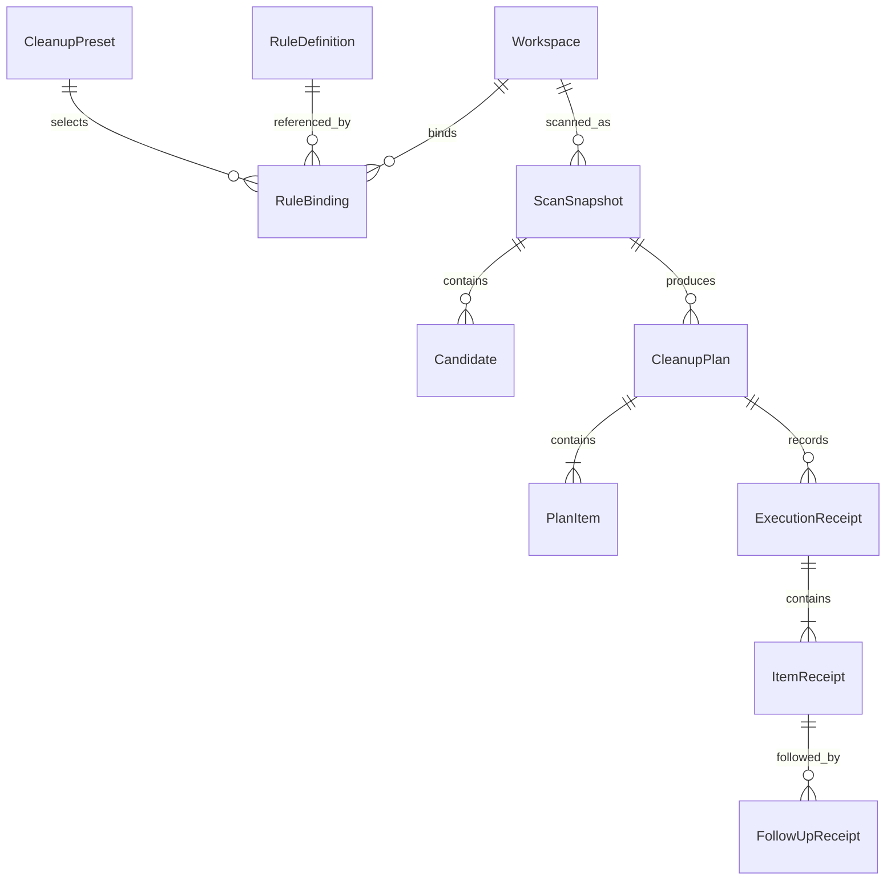
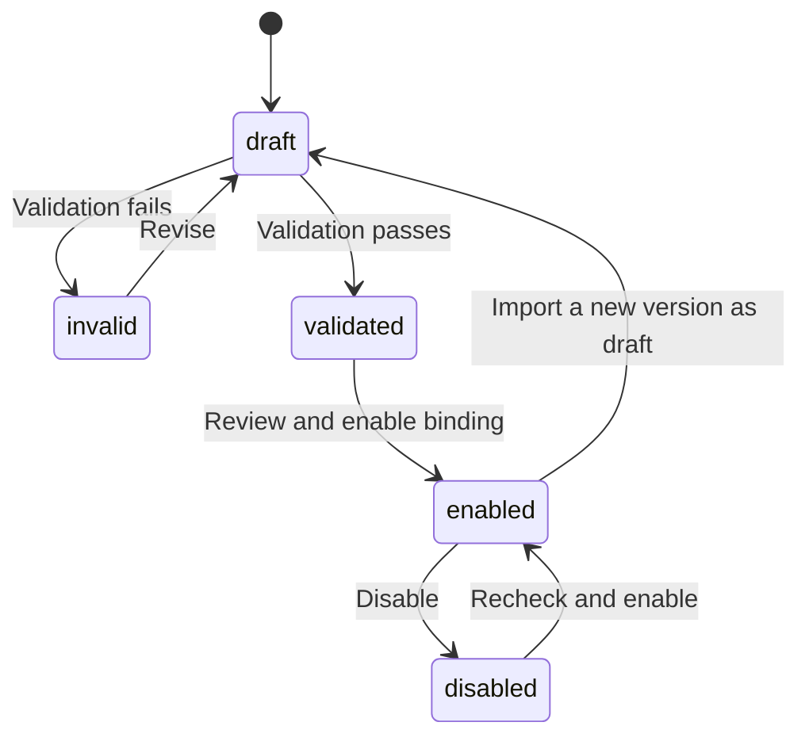
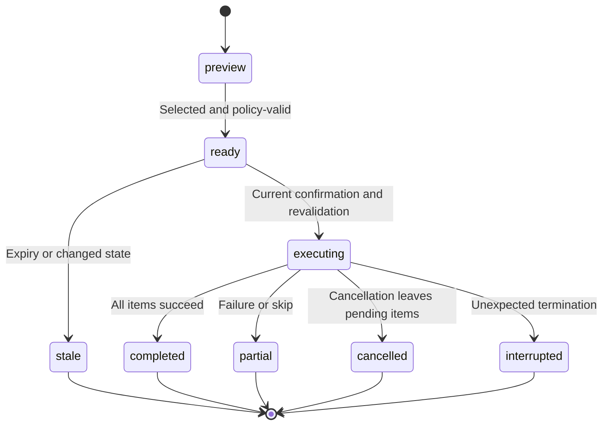

# Domain data model

English | [简体中文](../zh-CN/architecture/data-model.md)

Status: development contract. [Swift models](../../packages/shou-core/Sources/Models.swift) implement the current entities; complete state and interruption acceptance remain pending.

## 1. Relationships

Relationships are conceptual; bindings may be shared across presets. Plan items retain scan provenance and rule-version snapshots.

## 2. Entities

| Entity | Important data | Constraint |
| --- | --- | --- |
| Workspace | ID, logical root, local path, volume/root identity, access credential | Never share credentials; verify access per entry point |
| RuleDefinition | ID, version, schema version, provenance, content digest, body | No silent same-version changes; draft is not enabled |
| RuleBinding | Workspace, rule version, enablement, exclusion/override digest | Local explicit binding; changes invalidate plans |
| CleanupPreset | Name, binding references, selection preferences | Stores logic, not execution permission |
| ScanSnapshot | ID, `scope`, `treeComplete`, `completedPaths`, configuration digest, status, statistics | Only independently complete, policy-valid candidates produce executable plan items |
| Candidate | ID, relative path, project clues, identity, estimates, risk, evidence | Unclassified directories remain visible but not executable |
| CleanupPlan | ID, API version, digest, creation/expiry, configuration, state | Concrete targets/action; no dynamic expansion |
| PlanItem | Candidate, original path, identity, full manifest digest, action | No duplicate or unresolved parent/child targets |
| Confirmation | Plan/digest, action, entry point, time | One-time in-process confirmation, not a stored boolean |
| ExecutionReceipt | Execution/plan IDs, entry point, stage, overall outcome | Durable intent first; item records; partial outcomes possible |
| ItemReceipt | Original/result path, before/after identity, action, error | Reverify before restore or purge |
| FollowUpReceipt | Item reference, restore/purge action, time, outcome | Separate confirmation; never rewrite original facts |

## 3. Rule lifecycle

A new version does not overwrite historical definitions. Enabling its binding invalidates pending plans using old configuration. Validation establishes structure and semantics, not disposability.

## 4. Scan and plan states

Scan states are `running`, `complete`, `partial`, `cancelled`, and `failed`. Status describes completion of the requested scan mode; it does not alone authorize a candidate. Permission gaps, budget interruption and cancellation remain visible. A fully measured candidate may remain eligible when an unrelated subtree is incomplete; incomplete targets cannot enter a plan.

| Snapshot field | Meaning |
| --- | --- |
| `scope` | `full` inspects the workspace tree; `cleanup` discovers only paths that can match enabled rule prefixes and fully measures matched targets |
| `treeComplete` | Whether the entire workspace tree was inspected; `complete` status in cleanup mode does not imply this is true |
| `completedPaths` | Relative roots of independently complete subtrees; a candidate requires full-tree completeness or positive coverage of its own subtree |

These fields are additive and optional for existing records. For legacy records without `treeComplete`, use the previous whole-tree status interpretation. Missing `completedPaths` supplies no independent coverage: an old partial snapshot does not gain execution eligibility. Plans retain the scan scope and budget for fresh policy reproduction, and every selected target still requires an unchanged complete manifest.

The validated time budget also bounds candidate analysis during scanning, planning, and execution. Candidate analysis uses a monotonic deadline in each phase; persisted budgets outside the supported limits are rejected before policy reproduction.

Space analysis requires a `full` scan. A cleanup snapshot is sparse evidence: absent directories and unvisited bytes are unknown, not zero. UI and machine consumers must show this limitation rather than present its root aggregate or treemap as complete disk usage.

A provisional plan lifetime is 10 minutes, subject to prototype evidence. Unexpired plans still require object revalidation. Scope, action, rule, or exclusion changes produce a new digest. Never automatically replay partial, cancelled, or interrupted plans.

## 5. Item states

`pending`: not started. `trashed`: verified move with actual location. `skipped`: intentionally unprocessed. `failed`: known operation error. `unknown`: interruption prevents determining outcome. `restored` and `purged`: current status derived from follow-up receipts.

Execution progress is transient: `stage`, `processedCount`, `itemCount` and `path` describe actual work, not a new authorization or durable outcome. A stop request prevents new item operations at a safe boundary; an in-progress system Trash operation may finish and must be reconciled before the final receipt.

Do not rewrite initial facts or retry unknown items by old path. Permanent removal and external Trash actions can eliminate recovery.

## 6. Risk and explanation

Effective risk is the highest level required by declarations, provenance review, protection, and runtime evidence: `review`, `high`, or `blocked`. No level promises absolute safety or automatic execution.

Store matching conditions, rule/version, missing evidence, rebuild notes, exclusions, and protection reasons. Translation affects presentation only.

## 7. Identity and paths

Rules contain relative patterns; local bindings/previews/receipts may contain absolute paths. Use platform volume/object identifiers and available type, size, modification, and metadata-change evidence.

Directory manifests cover descendants, including opaque symlink entries without target traversal. A manifest digest is not a content hash or proof of reproducibility. Never infer identity from a path prefix, Unicode normalization, or case-folded string.

## 8. Capacity fields

| Field | Meaning | Limitation |
| --- | --- | --- |
| `logical_bytes` | Logical file lengths | Not allocated storage for sparse files |
| `allocated_bytes_estimate` | Reported allocation estimate | Hard links, clones, compression complicate attribution |
| `trashed_bytes_estimate` | Original estimate for successfully trashed targets | Not freed space |
| `purged_bytes_estimate` | Original estimate for permanently removed targets | Not guaranteed newly available space |
| `volume_available_before/after` | System-reported volume availability | Concurrent activity and snapshots affect observation |

Use integer bytes and UTC timestamps in machine contracts; localized UI uses explicit decimal units, not interchangeable GB/GiB labels.

## 9. Persistence and retention

Version configuration/rule/receipt formats; failed migrations preserve previous data. Scan caches and stale plans may be budget-managed, but history does not control file deletion.

Determine history retention from measured storage costs. Deleting history must explain potential loss of application recovery/ownership verification; it never deletes unrelated Trash items. User-scoped storage is not isolation from equally privileged local processes.
