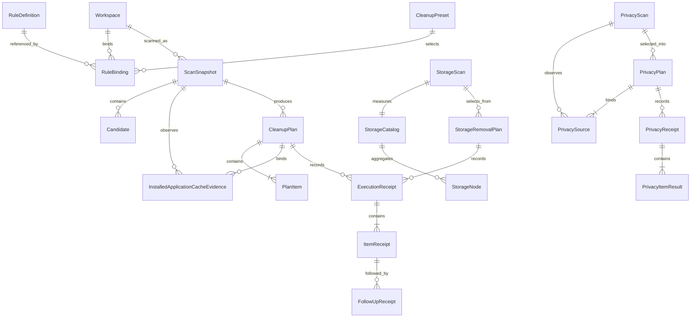
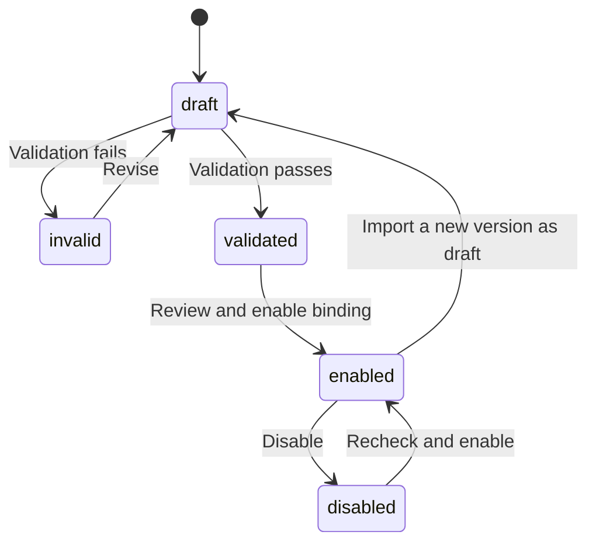
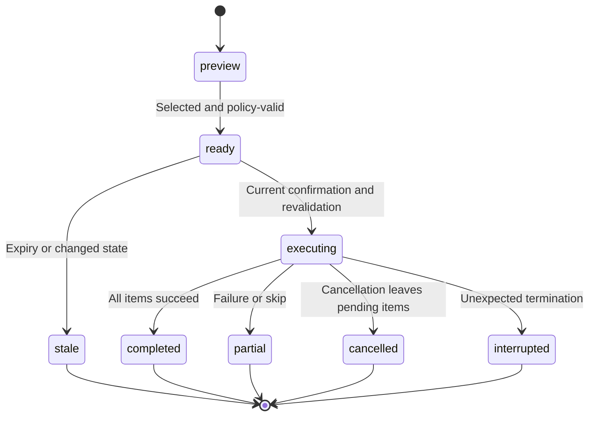
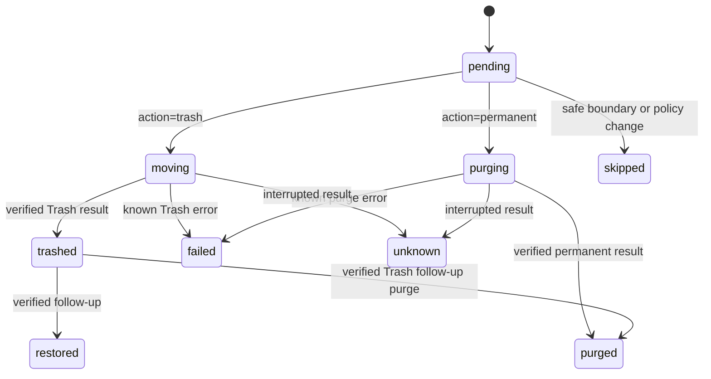

# Domain data model

See [AI data/persistence contracts](embedded-ai.md) for existing connections, investigations, evidence, Jev reviews/checkpoints and proposed switches/routing/service metrics. Investigation state is distinct from cleanup-plan/receipt state; model results grant no deletion permission.

English | [简体中文](../zh-CN/architecture/data-model.md)

Status: development contract. [Swift models](../../packages/shou-core/Sources/Models.swift) implement the current entities; complete state and interruption acceptance remain pending.

Entities and safety semantics align across platforms. Swift fields and existing-record decoding policies belong to macOS storage. Windows owns a separate C# record format, described under [Windows native records](#windows-native-records); platform storage layouts are not a shared ABI.

## 1. Relationships

Relationships are conceptual; bindings may be shared across presets. Plan items retain scan provenance and rule-version snapshots.

## 2. Entities

| Entity | Important data | Constraint |
| --- | --- | --- |
| Configuration | Storage version, revision, workspaces, bindings, optional `global_exclusions` | Any policy change invalidates earlier scan/plan evidence |
| Workspace | ID, logical root, local path, volume/root identity, access credential | Never share credentials; verify access per entry point |
| RuleDefinition | ID, version, schema version, provenance, content digest, body | No silent same-version changes; draft is not enabled |
| RuleBinding | Workspace, rule version, enablement, exclusion/override digest | Local explicit binding; changes invalidate plans |
| CleanupPreset | Name, binding references, selection preferences | Stores logic, not execution permission |
| ScanSnapshot | ID, `scope`, `treeComplete`, `completedPaths`, configuration digest, status, statistics | Only independently complete, policy-valid candidates produce executable plan items |
| Candidate | ID, relative path, project clues, identity, estimates, risk, evidence | Unclassified directories remain visible but not executable |
| CleanupPlan | ID, API version, digest, creation/expiry, configuration, `action` (`trash` or `permanent`), state | Concrete targets/action; no dynamic expansion; action is immutable after confirmation |
| PlanItem | Candidate, original path, identity, full manifest digest | No duplicate or unresolved parent/child targets; manifest is the permanent-removal boundary |
| InstalledApplicationCacheEvidence | `rule_id`, full `application` definition and optional `ownership_coverage_incomplete` | Exact installed-owner evidence and coverage limitation for one cache rule; never authorizes bundle removal |
| Confirmation | Plan/digest, action, entry point, time | One-time in-process confirmation, not a stored boolean |
| ExecutionReceipt | Execution/plan IDs, entry point, stage, overall outcome | Durable intent first; item records; partial outcomes possible |
| ItemReceipt | Original/result path, before/after identity, state, Trash path, error | `purging` is durable intent; `purged` requires a successful platform result; reverify before restore or purge |
| FollowUpReceipt | Item reference, restore/purge action, time, outcome | Separate confirmation; never rewrite original facts |
| StorageScan | Root identity, catalog ID, measured count, coverage issues | Measurement is separate from the deletion manifest |
| StorageCatalog / StorageNode | Parent ID, basename, identity, allocated/logical totals, per-directory completeness | SQLite stores the full measured inventory; directory queries load immediate children |
| StorageRemovalPlan | Selected paths, current full manifests, exact action and digest | Fresh independent verification before execution; skipped coverage never supplies deletion evidence |
| PrivacyScan | Fixed range, home/configuration identity, aggregate source observations and expiry | Counts and source descriptors only; source availability does not grant deletion authority |
| PrivacyPlan | Exact ready sources, fixed bounds, evidence, sign-out acknowledgement, digest and state | Permanent record deletion; separate current execution consent; five-minute maximum lifetime |
| PrivacyReceipt / PrivacyItemResult | Source IDs, fixed bounds, counts, item states and sanitized errors | Separate from file-removal history; no record contents, Trash path or restore capability |

## Windows native records

Current source uses strict versioned JSON: unknown or duplicate fields, invalid references, mismatched digests and unsupported versions are refused. No stored approval field grants execution.

| Record | Version / limit | Contract |
| --- | --- | --- |
| `Configuration` | 1 / 16 MiB | Revision, workspace roots and identities, imported definitions, bindings and global exclusions; at most 256 workspaces, 512 rule versions, 4,096 bindings and 1,024 patterns per exclusion list |
| `Workspace` | Part of configuration | `ws_` ID, `root_ref`, absolute Windows path, volume/File ID/owner SID, directory case behavior, own exclusions and UTC registration time; replaced roots are not silently rebound |
| `CleanupScan` | 1 / 128 MiB metadata, 16 MiB pages | `scan_` ID, full workspace, scan budget, configuration revision/digest, exact rule definitions/digests, measured tree, candidates, analysis gaps and `preview_only` |
| `ScanSnapshot` | Part of scan | Root identity, UTC start, entries, issues, `scope` and required `completed_directories`; `full_tree` denotes whole-tree observation and `rule_targets` rule-directed observation; older records default to the former, unknown values are rejected; positive per-directory evidence preserves complete siblings under partial coverage |
| `CleanupPlan` | 2 / 128 MiB metadata, 16 MiB pages | `plan_` ID, scan ID/workspace identity/rules in each `sources` entry, common configuration and budget, action, target manifests/context and digest; each item binds one source through `scan_id`; 1–256 explicitly selected non-overlapping targets in total, valid for ten minutes |
| `CleanupExecution` | 1 / 1 MiB | One `execution_` ID per plan, plan digest, action, UTC timestamps, overall/item states; existing intent prevents replay |
| `ApplicationUninstallPlan` | 1 / 128 KiB | `uninstall_plan_` ID, current-user SID, UTC creation/expiry, full installation review, explicit installer-data acknowledgement and digest; fifteen-minute lifetime, public execution disabled |
| `ApplicationUninstallExecution` | 1 / 16 KiB | One `uninstall_execution_` ID per plan, plan digest/actor/UTC times, durable `uninstalling` intent and separate native outcome/presence; any intent blocks replay |

Importing the same ID/version with different content returns `version_conflict`. New versions do not upgrade existing bindings automatically. Global, workspace and rule exclusions combine for classification. Any configuration change produces a new revision; scan publication re-reads and compares the configuration digest under the storage lease. Regular scans freeze all enabled versions; draft previews contain only the requested rule and use `preview_only=true`, which prevents planning.

Built-in definitions are generated only from the current bundled catalog and default to enabled. A built-in `RuleBinding` stores the `Enabled` preference by workspace and stable rule ID; its version/digest describe the last selection and neither inject definitions nor pin later scans to old resources. Resource upgrades retain disabled preferences; unknown but well-formed historical preferences produce no rules. Personal imports cannot use `shou.builtin.` IDs. Regular scans freeze the actual current built-in definitions; planning and confirmation compare effective versions/digests again, so resource changes invalidate old evidence.

Location discovery returns a configuration revision, candidate paths, origins, availability, issues and verified identities as transient observations. Batch registration reinspects identities and refuses revision changes or overlapping scopes in one configuration transaction; a discovery list is not durable authorization. Batch scanning saves a separate `CleanupScan` per workspace and creates no merged home-directory plan. The transient `SystemScan` groups these snapshots with `issues` and `state`; registered-location UI batches can report `complete`, `partial` or `cancelled`. Cancellation preserves previously published scans without granting plan or execution permission.

Application registration discovery is not independently persisted. `ApplicationCatalogSnapshot` contains an `applications_` observation ID, UTC time, state, applications, source coverage and limitations. Each stable `application_` ID hashes the source and exact registration key with SHA-256; entries include `source`, `registration_key`, `name`, nullable version/publisher/unverified installation location/registered size, `is_system_package`, `uses_windows_installer` and issues. Registered size is in bytes converted from the installer's KiB estimate. IDs are neither file identities nor uninstall permission. `ApplicationCatalogPage` returns `snapshot_id`, matching total, offset, items and `has_next`; the GUI retains a snapshot and the CLI does not retain it across calls. The [application contract](../product/application-uninstall.md#windows-application-discovery-and-uninstall-boundaries) owns sources and budgets.

`ApplicationUninstallReview` contains the exact registration, system installation identity, nullable directory identity, protection/issues, `activity` state/reason, UTC observation time, blockers, warnings and digest. The digest excludes observation time and binds the other facts. MSI identity contains ProductCode/PackageCode/context/SID; MSIX contains exact full name/family name/SID. A review is not independently saved; planning reinspects and embeds it in the record. Eligible plans require a verified directory identity and an `idle` activity observation; this describes the installation directory at inspection time and grants no future execution. Plans reuse the private storage lease and reject unknown/duplicate fields, invalid identity, wrong owner, missing acknowledgement and digest mismatch. A local digest is not a tamper-proof signature. Reading a plan does not revalidate the current installation or authorize execution. `execution_available` is a read-only `false`; JSON flags cannot enable it. `ApplicationUninstallConsent` is process-local and non-serializable, binds the exact plan/digest and expires within one minute and the plan lifetime. `ApplicationUninstallExecution` stores `outcome` and independent `presence`, native code, restart requirement and reason. `completed` requires installer success plus original identity absence; an unfinished intent or uncertain result requires observation. `RetryAvailable` and `RestoreAvailable` remain false. Read-only execution lookup validates plan binding without refreshing state or granting replay.

`ApplicationUninstallViewModel.ExecutionPlanId` is page-local query context, not stored authority. Execution clears the executable plan, review and data acknowledgement; `Executing` lasts until the domain task returns, and Stop cannot discard a real execution outcome. `ReadingExecution` can cancel and discard late reads; results must match plan ID, digest and owner. Errors retain query context; refresh, a new selection or disposal clears it.

Candidates contain identity, relative path, allocated/logical estimates, newest modification time, risk, coverage, blocked reasons and a manifest digest for complete targets. `review` means reviewable; the public CLI still returns `execution_available=false` because mutation awaits native acceptance. Paged results retain configuration provenance and the preview marker, and cursors bind the scan ID, saved bytes and offset. Saved observations never replace fresh execution checks.

Core planning and execution orchestration are tested with simulated capability ports. The CLI assembles plan creation and native adapters, but execution remains disabled pending native acceptance. Planning freshly checks exact file use and known tools' verified working-directory overlap with the project; unknown activity blocks, and activity observations are never reusable approval records. Plan digests bind every frozen field. Current confirmation exists only in its issuing service instance, lasts at most one minute within the plan lifetime, is consumed once and cannot be restored from storage. Item journals are stored separately from large manifests, persisting `purging`/`moving` before observed outcomes. Journal failures stop dispatch. Unfinished intent remains uncertain and a missing receipt never permits replay.

History listing validates journal structure only and explicitly reports `plan_verified=false`. Details and inspection re-read the plan to validate digest, action, current-user ownership, timestamps and item results. A `trashed` receipt requires zero removed entries, a new location and the original root identity; terminal overall states must agree with item states. List cursors bind the complete journal set's raw-byte digests and page size. Inspection holds one read lease with shared entry/time budgets across locations, never rewrites journals, grants recovery or upgrades unfinished intent to success. See the [Windows history guide](../engineering/windows.md#history-queries-and-inspection) for commands, location states and assessments. Recovery remains unavailable.

Windows owns its data root and ACLs. Publication is atomic per record, not across several records. The current format and storage limits are independent of macOS storage versions, CLI API `1.0` and rule Schema `1.0`. See [Windows development](../engineering/windows.md) for commands, budgets and private-store behavior, and [SYNC.md](../../SYNC.md) for verification evidence.

## Immutable manifest pages

macOS `StorageRemovalPlan` records use a version-1 envelope with compact plan metadata and manifest references; `storage-plan-manifests` contains at most 4,096 entries per page. IDs bind the parent, item ordinal, page ordinal and SHA-256 content digest. The plan digest binds compact metadata and all page digests. All pages must be durably written before publishing metadata. State updates rewrite only metadata. Journal version 2 uses the same paging primitive in `history-manifests`; small and legacy inline records remain readable. Retention protects active parent records and all referenced pages, and removes parent metadata before reclaiming derived pages.

Windows large scans and plans use independent format-version-1 envelopes over the existing `CleanupScan` version 1 and `CleanupPlan` version 2 contracts. A page has at most 4,096 entries and 16 MiB; small records retain inline encoding. Scan pages bind measured entries and positive directory-completion evidence. Plan pages bind exact target manifests; separate execution journals reference the unchanged public plan digest. Digests stream into SHA-256 without allocating a complete serialized tree. Readers hold one record lease, verify envelope/page digests, counts, keys and the reconstructed domain record, and reject missing, changed or reordered pages. Interrupted publication leaves unreferenced pages without authority. Existing inline records remain readable; no user records are migrated. Windows history listing still reads only compact journals, while details verify the referenced plan pages. Windows record retention is not added by this change.

## 3. Rule lifecycle

A new version does not overwrite historical definitions. Enabling its binding invalidates pending plans using old configuration. Validation establishes structure and semantics, not disposability.

## 4. Scan and plan states

Scan states are `running`, `complete`, `partial`, `cancelled`, and `failed`. Status describes completion of the requested scan mode; it does not alone authorize a candidate. Permission gaps, budget interruption and cancellation remain visible. A fully measured candidate may remain eligible when an unrelated subtree is incomplete; incomplete targets cannot enter a plan.

| Snapshot field | Meaning |
| --- | --- |
| `scope` | `full` inspects the workspace tree; `cleanup` discovers only paths that can match enabled rule prefixes and fully measures matched targets |
| `treeComplete` | Whether the entire workspace tree was inspected; `complete` status in cleanup mode does not imply this is true |
| `completedPaths` | Relative roots of independently complete subtrees; a candidate requires full-tree completeness or positive coverage of its own subtree |

These fields are additive and optional for existing records. For legacy records without `treeComplete`, use the previous whole-tree status interpretation. Missing `completedPaths` supplies no independent coverage: an old partial snapshot does not gain execution eligibility. Plans retain the scan scope and budget for fresh policy reproduction, and every selected target still requires an unchanged complete manifest.

`ScanSnapshot.installedApplicationCaches` and `CleanupPlan.installedApplicationCaches` encode as optional `installed_application_caches`. A snapshot retains enabled dynamic-rule evidence; a plan copies only owners referenced by selected candidates and includes it in its digest. Each entry binds `rule_id` to a full `ApplicationDefinition`: `id`, `path`, `source`, `identity`, `name`, optional `bundle_identifier`, `version`, `executable_name`, and `info_digest`. Partial discovery adds optional `ownership_coverage_incomplete: true`; complete discovery omits the key. This flag binds the visible limitation into the plan digest. `CleanupReview` projects these candidates as selectable but not recommendation-eligible. Rule IDs use the reserved built-in namespace plus a SHA-256 hexadecimal identifier hash; names and metadata alone cannot authorize cleanup.

Absent optional arrays and coverage flags remain omitted when re-encoded, preserving old snapshot decoding and plan digest bytes. Legacy plans with static rules need no new evidence. A candidate referring to a dynamic cache rule without matching evidence is refused. macOS plan creation freezes saved evidence; execution re-reads the inventory, exact owner and activity for the current item before mutation. An observed duplicate, an unavailable/uninspected owner source or an issue on the owner, its descendants or ancestors invalidates that owner. Unrelated issues retain partial status and permit only explicitly reviewed candidates with the flag already bound. A complete scan becoming partial requires a new scan; partial evidence may remain conservative when the inventory becomes complete. Normal `ExecutionReceipt`/`ItemReceipt` and follow-up origins remain unchanged because the target is a cache inside the original workspace, not an uninstall component.

Application discovery issues are independent of filesystem completeness. `installed_application_cache:application_discovery_unavailable`, `installed_application_cache:application_discovery_incomplete` and `installed_application_cache:ambiguous_application_owner` are snapshot issues, projected to visible per-location system issues. A complete tree does not imply complete generic coverage. Static rules can still supply independently eligible targets.

The validated time budget also bounds candidate analysis during scanning, planning, and execution. Candidate analysis uses a monotonic deadline in each phase; persisted budgets outside the supported limits are rejected before policy reproduction.

Space analysis requires a `full` scan. A cleanup snapshot is sparse evidence: absent directories and unvisited bytes are unknown, not zero. UI and machine consumers must show this limitation rather than present its root aggregate or treemap as complete disk usage.

A provisional plan lifetime is 10 minutes, subject to prototype evidence. Unexpired plans still require object revalidation. Scope, action, rule, or exclusion changes produce a new digest. `trash` and `permanent` are separate first-class actions; an action cannot be changed after the plan is confirmed. Never automatically replay partial, cancelled, or interrupted plans.

## 5. Item states

`pending`: no item-start boundary recorded. `moving`: durable Trash intent saved before the filesystem call; an unfinished result needs verification. `trashed`: verified move with actual location. `purging`: durable permanent-removal intent saved before the platform call; outcome is not yet known. `purged`: the bound original target was permanently removed and the result was saved. `skipped`: intentionally unprocessed. `failed`: known operation error. `unknown`: interruption prevents determining outcome. `restored` and follow-up `purged`: current status derived from follow-up receipts. Legacy pending records cannot prove no filesystem operation happened.

Execution progress is transient: `stage`, `processedCount`, `itemCount` and `path` describe actual work, not a new authorization or durable outcome. A stop request prevents new item operations at a safe boundary; an in-progress system Trash operation may finish and must be reconciled before the final receipt.

Follow-up progress uses the same transient type without changing persisted receipts or CLI JSON. Its total counts only explicitly selected items. `preflight` reports read-only verification; `restoring` or `purging` starts after the pending follow-up intent is saved. `processedCount` increases only after the completed or failed outcome is saved, so it counts persisted outcomes rather than successful actions. Cancellation before intent leaves the item unstarted; after a restore intent, the current item finishes and records its result before the next-item cancellation boundary. Neither progress nor a batch checkbox authorizes retrying a pending follow-up.

Do not rewrite initial facts or retry unknown items by old path. Permanent removal and external Trash actions can eliminate recovery. A `permanent` plan records `operation=permanent_cleanup`; its byte estimate is reported separately from volume availability.

`HistoryInspection` is a transient read result, separate from execution and follow-up facts. It retains the original recorded state, check time, unfinished flag and per-item observations of the exact saved paths. The mutation lease prevents concurrent Shou mutations during inspection; a shared entry/time budget bounds the directory checks. Full manifests and identities are compared, with the same recorded-root ctime exception as follow-up verification. This does not hash contents or promote unknown items into executable follow-ups. Missing destination paths are reported without searching the user's Trash. A pending restore/purge remains pending and blocked; observations do not manufacture a completion receipt.

## 6. Risk and explanation

Effective risk is the highest level required by declarations, provenance review, protection, and runtime evidence: `review`, `high`, or `blocked`. No level promises absolute safety or automatic execution.

Store matching conditions, rule/version, missing evidence, rebuild notes, exclusions, and protection reasons. Translation affects presentation only.

## 7. Identity and paths

Rules contain relative patterns; local bindings/previews/receipts may contain absolute paths. Use platform volume/object identifiers and available type, size, modification, and metadata-change evidence.

Directory manifests cover descendants, including opaque symlink entries without target traversal. A manifest digest is not a content hash or proof of reproducibility. Never infer identity from a path prefix, Unicode normalization, or case-folded string.

## 8. Capacity fields

| Field | Meaning | Limitation |
| --- | --- | --- |
| `logical_bytes` | Logical file lengths | Not allocated storage for sparse files |
| `allocated_bytes_estimate` | Reported allocation estimate | Hard links, clones, compression complicate attribution |
| `trashed_bytes_estimate` | Original estimate for successfully trashed targets | Not freed space |
| `purged_bytes_estimate` | Original estimate for permanently removed targets | Not guaranteed newly available space |
| `volume_available_before/after` | System-reported volume availability | Concurrent activity and snapshots affect observation |

Use integer bytes and UTC timestamps in machine contracts; localized UI uses explicit decimal units, not interchangeable GB/GiB labels.

## 9. Persistence and retention

Version configuration/rule/receipt formats; failed migrations preserve previous data. Scan caches and stale plans may be budget-managed, but history does not control file deletion.

Determine history retention from measured storage costs. Deleting history must explain potential loss of application recovery/ownership verification; it never deletes unrelated Trash items. User-scoped storage is not isolation from equally privileged local processes.

## 10. Exclusion policy and configuration compatibility

`Configuration.global_exclusions` is an optional array of validated relative patterns. Persistent `Workspace.exclusions` contains only that workspace's patterns; project exclusions are exact project prefixes combined with relative patterns. `ExclusionSettings` reports the global and workspace arrays and a stable, deduplicated effective array. Rule-specific exclusions remain independent.

Scanning and draft preview merge workspace and global protection before matching. The snapshot and plan retain this effective policy in `workspace.exclusions`. Planning and execution recheck the current configuration digest, recompute effective protection and reproduce eligibility; a stored plan is not authority to bypass a later exclusion. A protected descendant blocks its containing cleanup target.

Configuration version `1` remains readable when global protection is absent or empty. The first saved nonempty global exclusion upgrades storage to version `2`; removing the last pattern preserves version `2`. Earlier builds reject version `2`, preventing silent omission of protection during a downgrade. Version `1` containing nonempty global exclusions is rejected. This storage version is independent of CLI API `1.0` and rule schema `1.0`.

## 11. Startup discovery

Windows uses independent transient `StartupSnapshot` / `StartupPage` records with a `startup_` observation ID, UTC time, state, ten source coverage entries, items and explicit limitations. Each `startup_item_` ID hashes the source and registration key; registry names and scheduled-task identifiers ignore case, while folder paths retain their observed case; scheduler paths are not file paths and XML/task arguments are not retained; packaged keys bind the installed version, application ID and a case-sensitive TaskId digest, without deriving effective state from manifest Enabled. Items carry no command line, arguments or environment values. Nullable executable/definition paths are metadata clues, `enablement=unknown`, `running_state=not_observed`, `is_orphan=null` and `control_available=false`. Source states are `complete`, `missing`, `partial`, `unavailable` and `not_read`; timed-out source counts may be null. The GUI queries one immutable snapshot; each CLI call observes fresh facts, without a cross-call cursor. These observations are not persisted and grant no mutation authority. The [Windows startup contract](../product/startup-items.md#windows-startup-contract) owns source scope, budgets and parsing.

`StartupItem.scheduled_task` is null or a `ScheduledTaskStatus` with boolean `enabled` and `state` (`unknown`, `disabled`, `queued`, `ready`, `running`). Only the `scheduled_tasks` source may supply it. Platform double-reads the public task properties and rechecks the definition; Core validates the source and enum. Status gaps preserve the registration with item/source issues and partial coverage. Task engine state never changes `enablement`, `running_state`, orphan or control fields; new snapshots do not inherit old status.

`StartupInventory` is a transient read result independent of cleanup storage. `StartupDefinition` retains source/path, label, an optional absolute executable, trigger clues and a definition-only Disabled hint. For current-user LaunchAgents, configured and runtime states are best-effort point-in-time observations from bounded `launchctl` queries; unsupported or expired reads remain `unknown`, and no execution authority is derived from these facts. `StartupSourceCoverage` distinguishes inspected, missing, partial, unavailable and uninspected sources. The `launchd_definitions` scope and explicit unavailable source families prevent a complete source read from implying complete macOS registration coverage. See [startup discovery](../product/startup-items.md).

## Application review, plan and receipt origins

`ApplicationCatalog` distinguishes physical installations even when bundle identifiers match, and retains source coverage and issues. `ApplicationUninstallReview` contains nine exact component families, complete manifests, eligibility, personal-data consent requirements, blocking reasons and non-authorizing coverage warnings. `ApplicationUninstallPlan` binds selected components, app metadata, configuration, consent, budget and a 15-minute expiry. Initial configuration has a stable `unconfigured` revision until a real configuration is saved.

`ExecutionReceipt.operation` is optional for compatibility; `application_uninstall` items each carry `UninstallReceiptOrigin` with component kind, application path, bundle identifier and exact parent identity. Ordinary receipts cannot opt into these origins. Restoration validates component-kind paths and parent identity independently of discovery or a later application installation. Single and batch Trash operations allow verified restoration. `application_permanent_uninstall` and `application_batch_permanent_uninstall` record irreversible outcomes and reject restoration. `ApplicationUninstallBatchPlan` binds child plans, mode, expiry and one digest; identical or ancestor/descendant component paths are rejected. Legacy single plans omit `action` and retain their Trash semantics and original digest encoding.

`FileEntry.contentDigest` is optional and omitted when absent, preserving legacy directory-manifest encoding. A standalone file target carries one root entry and a bounded SHA-256 digest. Its Trash-root comparison allows only ctime normalization while preserving content and every other metadata field. Directory descendants retain exact metadata comparison. See [application uninstall](../product/application-uninstall.md).

## Explicit space-analysis removal

Space analysis now supports local volume/folder discovery and direct explicit file/directory removal, independently of cleanup-rule workspaces. Desktop list and treemap share navigation and normalized selection. Current manifests and exclusions are checked before confirmation and execution. It reuses existing mutation journals and history. See [space analysis architecture, flow and sequence](../product/space-analysis.md).

Default space measurement is separate from deletion manifests. A read-only worker streams all measured files into a private SQLite catalog with per-directory totals and completeness. Desktop and CLI query directories on demand; measurement no longer stops at the one-million-entry deletion-manifest cap. `StorageScan` references its catalog and records `measured_entry_count`; nodes expose `is_complete`, and partial sizes are lower bounds. Removal still requires fresh complete target manifests and independent verification. Legacy JSON and paged records remain readable.

macOS catalogs retain native device/inode/owner identity and read their supported local format versions. Windows will use independent volume/full File ID/owner SID models and a platform-local record format. Platforms share safety/state semantics, with separate native identity DTOs.

## Large-file query state

`StorageFileType` and `StorageLargeFilePage` are read models over a saved scan. A page contains items, the matching count and attributed allocated-byte estimate, plus an optional cursor. The cursor binds the scan ID, minimum allocated bytes, extension category and stable order (allocated bytes descending, full UTF-8 path ascending); changing a filter invalidates the cursor. File type is inferred from its filename extension, not content inspection. A catalog query does not traverse the source filesystem or confer removal authority. Cross-page selection materializes concrete eligible paths and goes through the existing `StorageRemovalPlan` and fresh verification.

## Privacy scan, plan and receipt contracts

The actual models live in [PrivacyModels.swift](../../packages/shou-core/Sources/PrivacyModels.swift). They use separate `privacy-scans`, `privacy-plans` and `privacy-history` collections; privacy receipts are not file-removal `ExecutionReceipt` values. [Architecture, flow and sequence](../engineering/privacy-cleaning.md#architecture) describe the shared Core service and browser/schema limits. JSON keys below use the existing snake-case codec and UTC timestamps.

| Model | Persisted fields | Boundary |
| --- | --- | --- |
| `PrivacyScan` | `id`, `created_at`, `expires_at`, `range`, optional `range_start`, `range_end`, `configuration_digest`, `home_identity`, `sources`, `issues` | Fixed at scan time; 15-minute validity. It has no aggregate `state` field: each source reports availability independently |
| `PrivacySource` | `id`, `definition`, `status`, optional `record_count`, optional `reason`, `evidence` | `definition` contains browser/name, bundle identifier, profile, kind, relative database path and unsupported flag. Evidence is directory/database/nonempty-WAL metadata; no browsing-record rows |
| `PrivacyPlan` | `id`, `scan_id`, `created_at`, `expires_at`, `range`, optional `range_start`, `range_end`, `configuration_digest`, `home_identity`, selected `sources`, `sign_out_acknowledged`, `state`, `digest` | Exact selection copied from a scan. Expiry is the earlier of scan expiry and five minutes after planning. Digest normalizes `state` to `ready` and blanks its own field; current state is checked separately |
| `PrivacyReceipt` | `id`, `plan_id`, `created_at`, `range`, optional `range_start`, `range_end`, `state`, `items` | Creation time is execution start. Contains no source descriptors, profile paths, record values, restore paths or SQL text |
| `PrivacyItemResult` | `source_id`, `state`, `removed_records`, optional `reason` | A completed aggregate count and sanitized error code; a zero count in an unfinished/failed result is not proof that no transaction ever committed |

`range` is `last-hour`, `last-day` (rolling 24 hours), `last-seven-days`, or `all-time`. `range_start` is absent for all-time; `range_end` remains an audit timestamp, and all-time intentionally has no timestamp predicate. Computed `eligible`, `requiresSignOutConsent` and total record counts are not persisted fields. `PrivacyConsent` is a non-Codable current-call value with `irreversibleDeletion` and `signOut`; a stored plan acknowledgement cannot replace it.

| State owner | Stored values and meaning |
| --- | --- |
| Source | `ready` means a supported source with a positive matching count; `empty` means zero matching records. `browser-running`, `permission-required`, `unsupported`, `schema-unsupported` and `unavailable` are ineligible; unavailable counts remain unknown rather than becoming zero |
| Plan | `ready` → `executing` → `completed` or `partial`. Expiry, a changed configuration/identity/count, or a running owner causes `plan_stale` or a specific refusal; no synthetic stored `stale` state is added |
| Receipt | `executing` precedes the first database mutation. `completed` requires all source items completed; any failed/cancelled item produces `partial`. There is no overall `cancelled`, `restored` or `purged` privacy state |
| Item | `pending` → `executing` → `completed` or `failed`; unstarted items can become `cancelled`. Identity/activity failures before item intent can go directly from `pending` to `failed` |

Plan execution intent is saved before its receipt, and per-item intent before the transaction. A crash or failed result write may leave `executing` or `pending` values; neither proves absence of mutation. They remain unresolved, are not promoted to success, and are never automatically retried. Each database commits independently; earlier successful sources remain completed after a later failure. Privacy has no restoration follow-up model. Logical record deletion does not establish forensic erasure or freed bytes.

## Windows scheduled-task switch records

`StartupControlTask` retains the exact task identifier, opaque definition digest, current actor SID, switch and owner/principal/context eligibility. Other account identities become mismatch booleans. Version-1 `StartupControlReview` uses `startup_control_<32 hex>`, with action, task facts, UTC creation/five-minute expiry, blocking reasons and digest. The digest binds action/facts/reasons, excluding random ID and times. Review exists only in memory; persisted objects contain no restorable execution approval.

`StartupControlExecution` uses the same ID, format version 1, embedded review, start/update times, `applying|completed|failed|cancelled|unknown` and nullable result. Results separately retain native `applied|not_started|unknown`, nullable `observed_enabled` and `definition_matches`, plus a structured reason. Completed requires a returned setter, matching definition/identity and requested switch; applying/unknown require independent observation. Records are limited to 256 KiB and use current-user private storage and the existing mutation lease. Any existing intent prevents reexecution; reads neither replay changes nor restore authority. This chain is separate from storage-independent startup discovery. The [startup contract](../product/startup-items.md#scheduled-task-switch-review-and-control) owns eligibility and lifecycle.

## Windows privacy observations

Windows stores `privacy_scan_<id>` records through the existing private `IRecordStore`. `PrivacyScan` version 1 contains `id`, UTC `created_at`/`expires_at`, fixed `window` (`range`, nullable `start`, `end`), `configuration_digest`, `sources`, `issues`, `complete` and `digest`. Range enum values in this platform's JSON are `last_hour`, `last_day`, `last_seven_days`, `all_time`; CLI option values retain hyphens. The digest clears its own field. Reading an expired observation is permitted for review and grants no action authority.

Each source binds a canonical `PrivacySourceDefinition` (`id`, browser, profile, kind, fixed database location/path), state, nullable count/reason/schema digest and identity/ACL evidence. `ready` and `empty` require a nonnegative count, schema digest, complete AppData-anchor-to-parent directory evidence, one main database and optional nonempty WAL. All entries have distinct identities, the current owner and one volume; files have one link. Other states (`browser_running`, `activity_unknown`, `permission_required`, `schema_unsupported`, `unavailable`, `excluded`) contain only a redacted reason and no count or evidence. Issues remain browser/code pairs. Strict version, unknown-field, canonical-source, state, evidence and digest validation prevents corrupt records from becoming usable observations. Record size is capped at 16 MiB.

`PrivacyPlan` version 1 is stored separately as `privacy_plan_<id>`. It binds scan ID/digest, current owner SID, UTC creation/expiry, fixed window, configuration digest, exact source observations, Cookie impact acknowledgement and its own digest. At most 256 ready sources with positive counts fit an 8 MiB record; order and evidence must match the original scan. Stored acknowledgement cannot replace in-memory `PrivacyConsent`, which binds the current service, plan and digest for one use within one minute and never outlives the plan.

`PrivacyReceipt` uses `privacy_receipt_<id>` derived from the plan ID. Version 1 records plan ID/digest, window, UTC start/update times, batch `executing|completed|partial`, item states and its own digest within 128 KiB. Items contain only source ID, `pending|executing|completed|failed|cancelled|skipped|unknown`, nullable removed count and controlled reason code. Receipts contain no paths, profiles, SIDs, SQL or browser records. Any batch intent blocks replay; failed intent/outcome publication does not establish that mutation never started, and reads grant no retry authority. Native transactional mutation and public integration remain pending; see the [privacy implementation boundary](../engineering/privacy-cleaning.md#windows-platform-boundary).

For macOS uninstall receipts, `UninstallReceiptOrigin.bundle_identifier` is optional only for an application bundle lacking valid metadata. Associated components still require a valid exact identifier. Authorization-session state is transient and is never persisted as cleanup consent.
