# Built-in AI: architecture, states, flows and sequences

English | [简体中文](../zh-CN/architecture/embedded-ai.md)

Date: 2026-10-23. The [product contract](../product/embedded-ai.md) owns user behavior; this document explains shared implementation. The gate, router, shared launch and desktop waiting-record continuation after restart are implemented. Interrupted-running recovery and additional adapters remain future work. Diagrams do not establish acceptance on every platform. See the [acceptance matrix](../engineering/embedded-ai-acceptance.md).

## 1. Context and trust boundaries

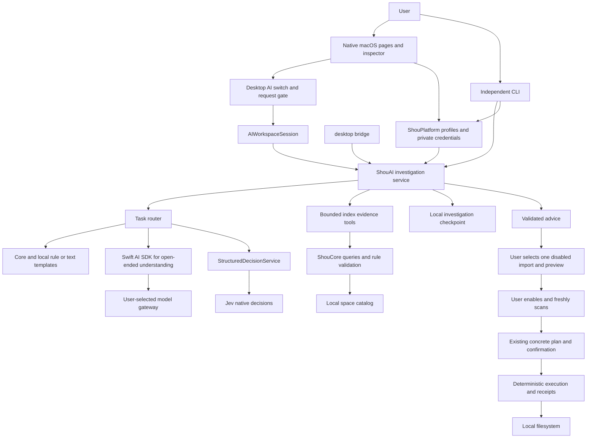

External services receive bounded evidence and user answers. Model output, names and answers remain untrusted. Neither model has deletion tools. The route to execution crosses user review, enablement, a fresh scan and current confirmation; it is not one model-callable action.

## 2. Structured-decisions-first routing and escalation

`InvestigationRouter` implements a bounded cleanup workflow reusing evidence, rules and questions. Route by required output, available evidence, explicit policy and configured connections. Swift owns rules/budgets; Jev chooses only from allowed actions.

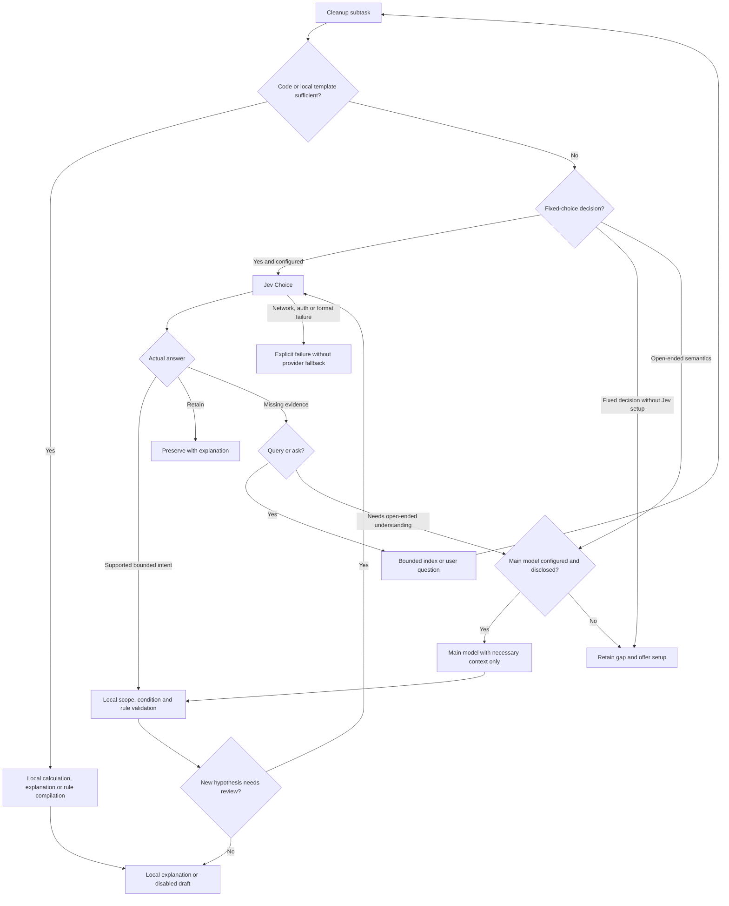

All loops respect step/evidence/question/time/token budgets. Deduplicate identical evidence/question/intent fingerprints within the same investigation/connection while evidence is unchanged. New evidence can justify a new decision; exhausted budgets preserve incomplete findings. Repeated uncertainty must not cause unbounded calls.

| Fixed decision contract | Bounded outputs | Local next step |
| --- | --- | --- |
| Purpose classification | Generated/dependency/user data/mixed/unknown | Select known template or gather evidence, never deletion permission |
| Local next action | Bounded descent/ask/retain/escalate/finish from classification and existing answers | Current code selects the action without an extra paid decision |
| Local template compilation | Controlled draft for an exact generated folder | Swift compiles and Core validates; disabled by default |
| Rebuild review: existing | supported/needs_information/retain | Disabled draft, evidence or retention |

Jev generates no tool code, arbitrary paths, arbitrary rule JSON or free-form explanations. Explicit user retention takes precedence. Localized templates handle known questions/explanations; do not call GPT merely to rephrase a sufficient result.

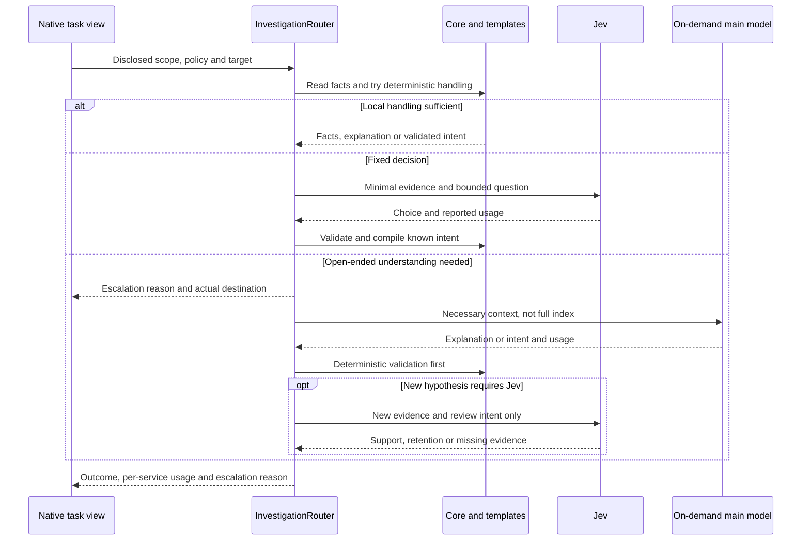

`AIConnection` supports an independent `DecisionConnection`, required main model and decision switch, `decision_first / main_only` policy and task goals. Checkpoints retain routing queues, answers, fingerprints, service usage and escalation reasons, shared by CLI/bridge. Old records stay readable with missing historical metrics shown as unrecorded, never invented. Routing/templates belong to ShouAI; Core stays model-independent.

## 3. Modules and interface reuse

| Module | Base responsibilities | Implemented changes |
| --- | --- | --- |
| `ShouCore` | DTOs, evidence policy, rules, scans, plans, execution | Keep UI switches out of matching/deletion eligibility |
| `ShouPlatform` | Profiles, private local/system/explicit environment credentials, native selection | No interactive Keychain access; private local files by default on macOS |
| `ShouAI` | SDK adapter, investigation actor, evidence, Jev, budgets/checkpoints | Retain shared semantics; new tools require separate contracts |
| `InvestigationRouter` | Bounded workflow | Local first, Jev fixed decisions, main-model escalation, deduplication and service usage |
| `AIWorkspaceSession` | Window connection/task/answers/preview coordination | Desktop gate, cross-page targets and stopping state |
| Connection editor | Form, SecureField, test/save | Gated tests and separate model/Jev outcomes |
| Investigation inspector | Scope/disclosure/questions/evidence/advice | Complete empty, no-advice, stale, failure, usage and next-action states |
| `AILaunchView` | Native target review | Shared folder selection, index reuse, task conflicts and explicit start |
| CLI/bridge | Shared service, discovery, results, continuation/cancellation | Do not claim desktop preference enforces OS-wide network denial; report unavailable platforms |

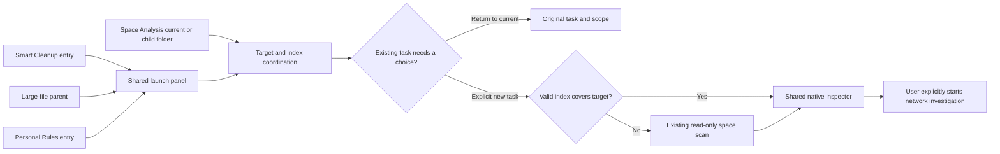

Pages provide intent and exact targets without independent model loops. Multiple files must not silently expand scope to an ancestor. Reuse a valid `StorageScan`/catalog and relative folder, not a sparse cleanup `ScanSnapshot`. Otherwise scan locally. Navigation, inspector visibility and task lifetime are separate.

## 4. Data and persistence

| Object | Contents | Semantics |
| --- | --- | --- |
| `AIConnection` | ID/name/required main-model setup/decision/routing policy | No key; protocol and gateway prefix remain independent |
| `DecisionConnection` | Provider/root/model/credential reference | Jev uses `/systemone`; future adapters own their native protocol; `JevConnection` alias retained |
| `AIInvestigation` | IDs/scope/connection snapshot/status/time/questions/evidence/advice/usage | Resume uses original connection |
| `InvestigationCheckpoint` | State/SDK continuation/pending calls/observed folders/retention answers/routing queue/decision fingerprints | Private local record without credentials, not generic chat export |
| `AIAdvice` | Exact observed folder/explanation/validated rule | No execution authorization |
| `AIDecisionReview` | Path/actual model/verdict/probabilities/usage | Decision probability is not cleanup safety probability |
| Desktop preference | Enabled boolean | Local default false; independent of profiles, credentials, rules and task states |

Existing domain states are only `running / waiting / complete / limited / cancelled / failed`. Ready, off, unconfigured, stopping and stale are UI states, not fabricated domain completion states. No separate persistent retained/unknown-item entity currently exists; summaries/reviews hold that information. Structured lists would require DTO, CLI/bridge and compatibility changes.

## 5. Switch and task state machine

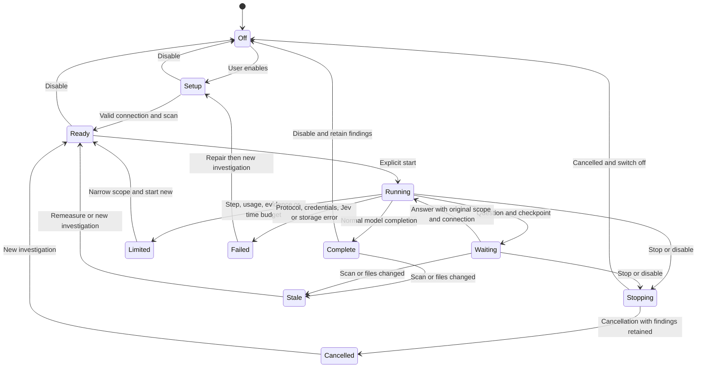

This is the current UI state contract; complete interaction evidence is tracked per scenario. Off can display previous findings and does not clear them. Stopping is feedback; actual service outcomes determine final domain state. Completion racing with a switch event must not turn completed facts into false cancellation. No new request may start while off regardless of final state.

## 6. Connection and credential test sequence

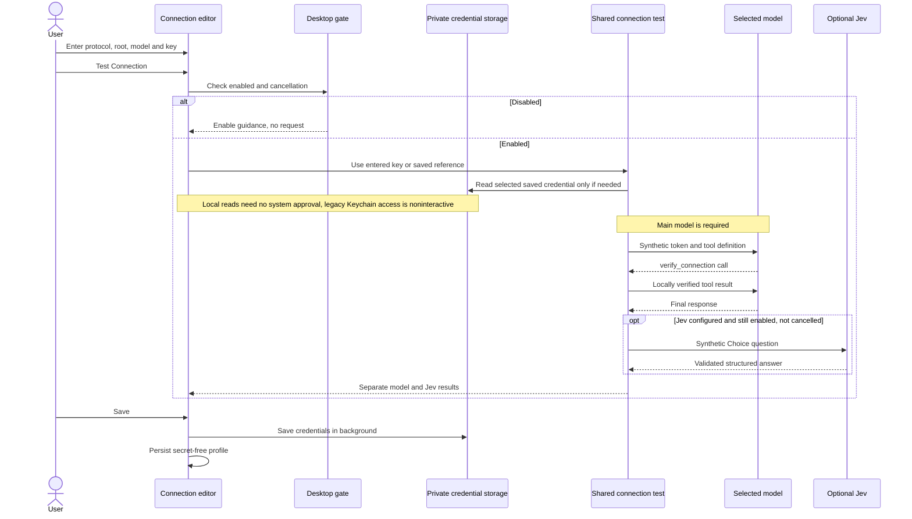

A synthetic test verifies that configuration's round trip. HTTP 200, main-model success or high Jev probability alone cannot mean overall success. Saving is local while disabled; testing is gated. The gate is implemented and rechecked after credential access. Save progress prevents duplicates/dismissal; no default path requests system approval. Local files use per-user permissions, not Keychain encryption.

## 7. On-demand main-model loop, questions and decision review

This describes only the escalated or explicitly main-only SDK branch; section 2 describes default decision-first routing.

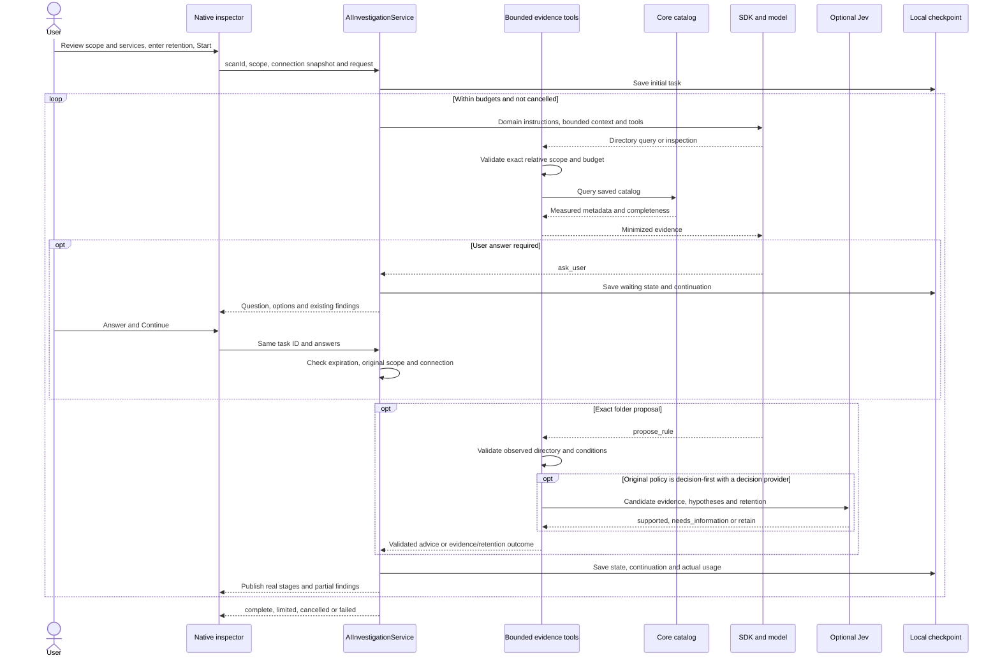

Main-only policy never calls the decision provider. When decision-first review is required, only `supported` can yield a disabled draft. Uncertainty never invents answers; retention produces no cleanup advice. Failed/malformed review must not be hidden by tool-error handling and reported complete. Completion without advice is valid. Decision accuracy still requires calibration.

## 8. Individual rule through cleanup flow

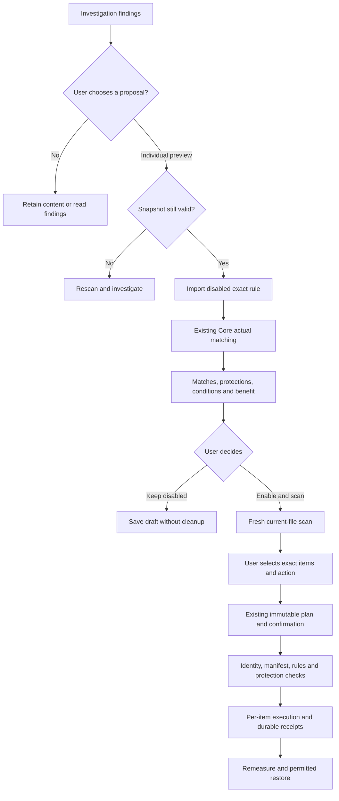

Reuse existing rule/plan/execution services, with no second engine or AI confirmation bypass. Generated fixtures passed native investigation through Trash receipt and restoration with matching file hashes; live-service evidence remains package-specific.

## 9. Disable and cancellation sequence

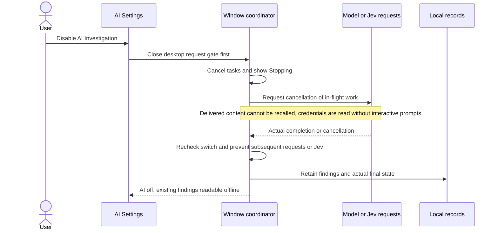

The behavior is implemented. Automation covers default-off, revoked permits and post-credential checks; native slow-request cancellation showed stable counts after disable. Hiding a button is insufficient: tests, answer continuation, automatic steps and Jev all need coordination/cancellation checks. Disabling does not delete credentials/rules/history or rewrite independent CLI authorization.

## 10. Protocol, evidence and resource contracts

Swift AI SDK `0.20.0` supplies loops for `responses`, `chat_completions` and `anthropic`, appending `/responses`, `/chat/completions` and `/messages` while preserving the API-root prefix. Jev independently uses `POST /systemone`. Require remote HTTPS, allowing HTTP only on loopback; no retries or redirects. Apple SDK dependencies remain macOS-only; Windows uses a bounded non-streaming three-protocol adapter for the same evidence tools/service. Runtime checkpoint formats are explicit and incompatible messages are not silently migrated.

| Limit | Current value/meaning |
| --- | --- |
| Evidence | 30 rows/page, 300 rows/64 KiB total; relative path/kind/allocation/count/time/completeness |
| Main loop | 12 steps, 32 tools, 8 suggestions, 3 questions; 180 seconds/turn, 3072 output tokens |
| Tokens | Stop subsequent steps at 32000 reported tokens; one response can cross the threshold, so no exact spending cap |
| Jev | 8 reviews, 24 KiB inputs/64 KiB responses; usage joins the shared threshold |
| Model response/checkpoint | Each at most 1 MiB; provider error bodies excluded from user results |
| Continuation | Waiting questions resume across CLI processes within 24 hours; both desktops list local waiting/finished records; interrupted-running recovery remains open |

No file/configuration contents, Shell, web fetches, arbitrary plugins or project Agent instructions are exposed. Filter private names, links and special files. Relative names and user answers can still contain private information; disclosure must not claim anonymization. New configuration/activity/uninstall/startup/privacy tools need their own evidence, destination, UI, budgets and acceptance before extending this design.

## 11. Implementation status and verification order

1. Implemented default-off desktop gate covering tests, start/resume, Jev and disable races.
2. Implemented structured-decisions-first routing, bounded questions/templates, independent configuration and service usage; prove zero main-model calls for sufficient cases.
3. Implemented shared launch panel and four P0 page entries reusing scans/inspector.
4. Empty, stopping, stale/error/no-advice states and post-preview next actions are implemented; full interaction combinations remain under acceptance.
5. Generated fixtures for scope/disclosure, languages, keyboard/appearance, then the selected providers' live desktop flow.
6. Keep interrupted-running recovery, domain adapters, content tools, quality, native Windows CI for this revision and UI acceptance as explicit open gates.

Acceptance conditions/evidence belong to the [matrix](../engineering/embedded-ai-acceptance.md); runtime observations belong to the [implementation record](../engineering/embedded-ai-implementation.md).

## 12. Replaceable structured decision adapters

Routing depends on `StructuredDecisionProvider`; `StructuredDecisionService` selects an adapter using `decision.provider` in the connection. Jev is the only bundled adapter today. Future services such as Clef implement the same interface using their own endpoint, authentication and native protocol. A non-Jev service must never be forwarded to `/systemone` or presented as integrated by merely changing a model name.

`StructuredDecisionRequest` carries a controlled relative path, minimal evidence and fixed choices/criteria. The common result contains a validated choice, model, probabilities and reported usage. Routing, local templates, retention conditions, budgets and cleanup permissions remain independent of the provider. Failures never silently switch services; an active task retains its original connection snapshot, and connection changes affect new tasks.

`DecisionConnection` stores the provider identifier and non-secret settings; `JevConnection` remains a source-compatible alias. Old profiles without `provider` mean Jev; legacy `jev_first` is accepted while new policy uses `decision_first`. Existing Jev Keychain accounts remain valid; other providers use separate credential references. An unknown provider is explicitly unavailable, with no silent fallback. Every new adapter must pass the same contract, scope, cancellation, budget and redaction gates.

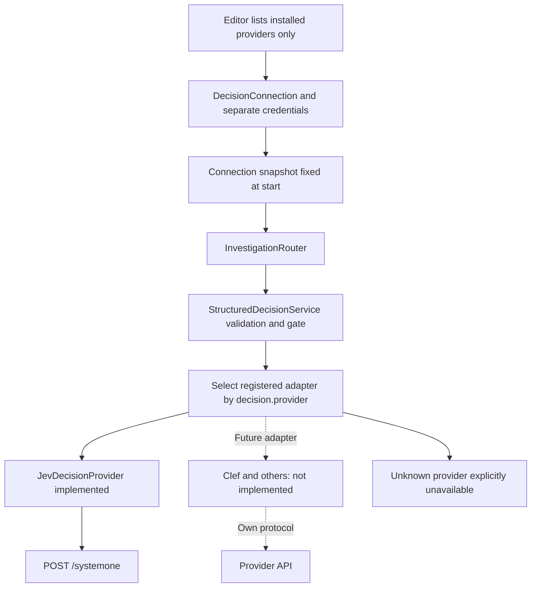

To switch, select an installed provider, enter its settings, explicitly test, save and start a new investigation. Existing Jev credentials remain stored. CLI `--service decision` writes the selected provider's separate local or system credential account; `--service jev` remains a Jev-only compatibility alias. Protocol-specific suffix checks belong to that provider's configuration; the main model is required; disabling decisions changes routing while retaining provider settings and credentials. New adapters require code registration and contract acceptance; Clef is not selectable today.

## Cross-platform runtime and cancellation

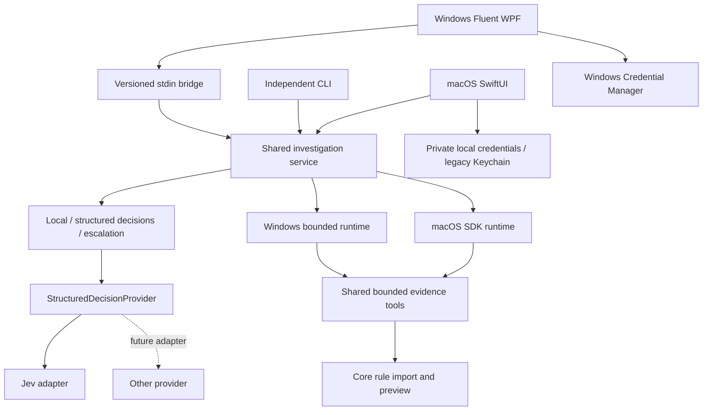

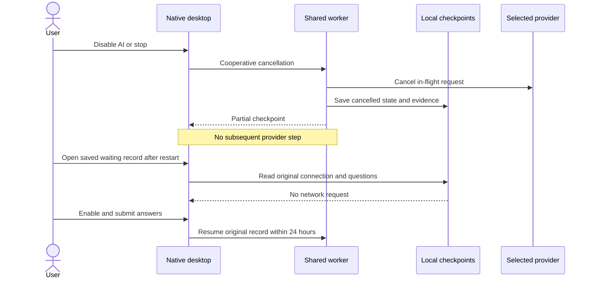

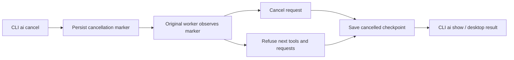

## 14. Configuration lifecycle and Jev switch

`main_model_enabled: false` identifies legacy records only; new saves, starts and continuations require a valid main model. `routing_strategy: main_only` disables decisions even when the retained `decision` object exists: no decision credential read or request. `decision_first` enables them. A single routing field represents the switch without a conflicting duplicate Boolean.

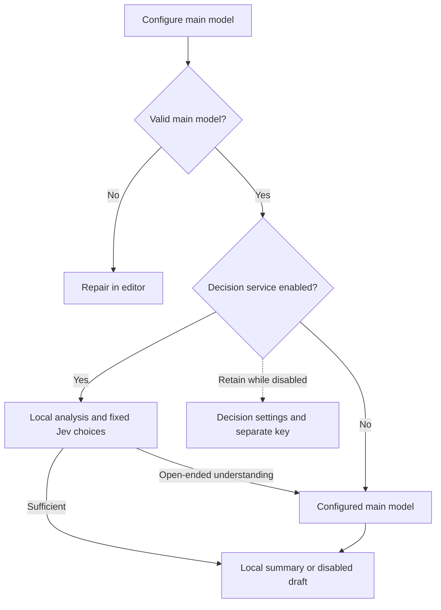

Profiles live in `ai-connections`; recoverable removal state lives in `ai-connection-states`. Removal writes state only, retaining investigation snapshots and credentials. Default lists exclude deleted profiles; explicit reads return key-free profiles. Editing checks deletion before profile and credential writes; restore is required first.

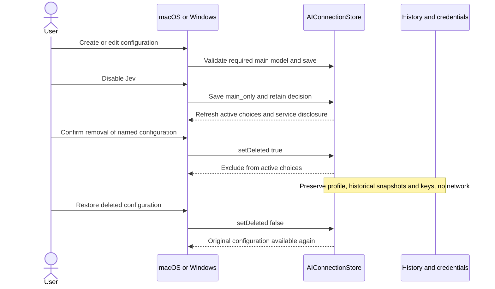
