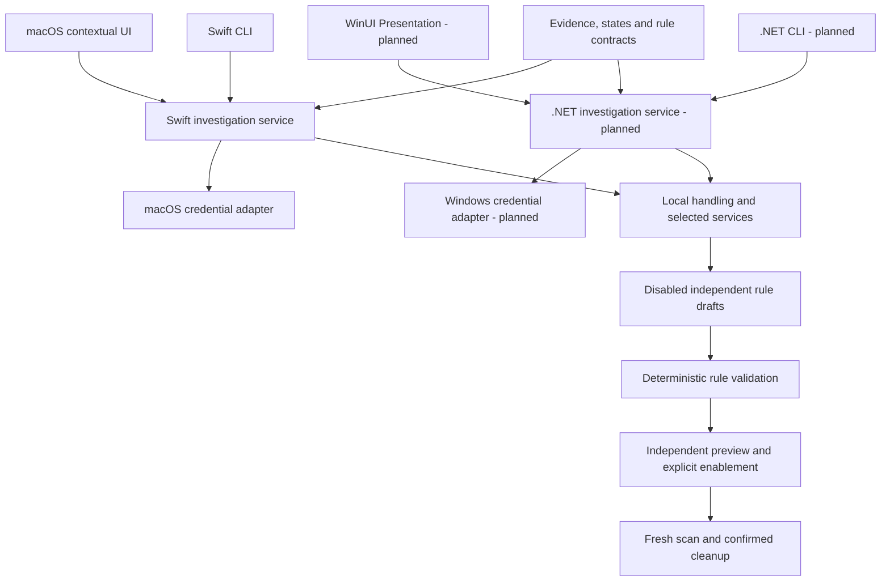
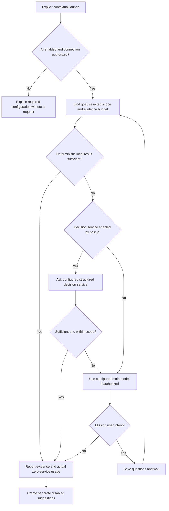
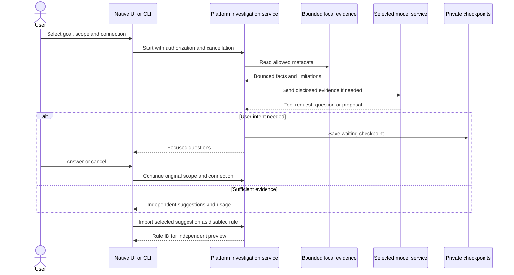

# Cleanup AI architecture

English | [简体中文](../zh-CN/architecture/embedded-ai.md)

Status: macOS has a Swift investigation implementation. Windows uses the same product contract with an independent .NET implementation, currently planned.

## Ownership

The investigation service owns goals, bounded evidence, questions, routing, budgets and checkpoints. Core owns rules and cleanup safety; Platform owns credentials, local records and system facts. SDK types do not enter Core. Each platform's UI and CLI share its investigation service directly.

## Routing flow

Jev is the current optional structured-decision adapter. Main-only routing must not call it. Unavailable disabled-service credentials cannot block an authorized main-only path. Do not silently move evidence between providers. Explain escalation and record actual usage per service.

## Investigation sequence

## State and cancellation

Domain states are `running`, `waiting`, `complete`, `limited`, `cancelled` and `failed`. UI additionally represents off, unconfigured, ready, stopping and stale. Unknown or incomplete evidence cannot become a confident cleanup decision.

Save the original scope, goal, connection identity, expiry, questions, answers and observed usage. Continue only after revalidation. An interrupted running record does not imply a resumable waiting record. Cancellation revokes subsequent transport and tool work, preserves completed evidence and records the actual terminal state.

## Connections and transport

Configure protocol, API root, model and credential reference independently. macOS supports Responses, Chat Completions and Messages with its pinned adapter; the .NET service must establish its own equivalent evidence. Remote endpoints require HTTPS; loopback HTTP serves generated fixtures. Credentials stay in private local or native credential storage. Apply request/response limits, deadlines, redirect policy and budgets explicitly.

Saving or editing configuration does not send a network request. A separate test action states its destination and effect. Deletion removes a connection from active choices while retaining investigation references; restoration and credential behavior are validated independently. Machine output and diagnostics redact secrets.

## Rule closure

```mermaid
flowchart LR
    Suggestion[Independent suggestion] --> Import[Disabled draft]
    Import --> Validate[Closed parser]
    Validate --> Preview[Read-only exact-scope preview]
    Preview --> Enable[Explicit enablement]
    Enable --> Scan[Fresh scan]
    Scan --> Select[User-adjustable selection]
    Select --> Confirm[Exact action confirmation]
    Confirm --> Execute[Existing deterministic executor]
    Execute --> Verify[Receipt and remaining-scope verification]
```

A model never owns deletion authority. Protected paths, exclusions, active applications, incomplete targets, expired evidence and journal failures remain enforced by deterministic services. Imported content and project metadata are untrusted input.

## Verification

Use generated fixtures for protocol, scope, credential isolation, provider substitution, revocation, questions, budget limits, injection, independent drafts and offline cleanup. Validate native interaction and actual model quality separately. Windows source, pure .NET tests, native APIs, UI and signed distribution have separate gates in the [implementation plan](../engineering/windows-native-plan.md). See [product journeys](../product/embedded-ai.md) and [acceptance](../engineering/embedded-ai-acceptance.md).
