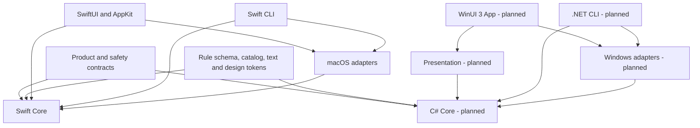

# Repository and platform boundaries

English | [简体中文](../zh-CN/architecture/monorepo-and-platforms.md)

Status: the macOS application and Swift CLI have source implementations. The Windows architecture is specified; its implementation is pending.

## Architecture decision

Each operating system owns its native UI, domain implementation and system adapters. On macOS, the desktop and CLI share Swift services. On Windows, the desktop and CLI share C# services. Shared product contracts, declarative resources and acceptance cases keep behavior aligned.

Core defines the small capability interfaces it consumes. Platform implements those interfaces. Entry points compose dependencies; business services do not depend on UI frameworks or concrete adapters. Both native implementations apply the same safety requirements independently.

## Directory ownership

| Path | Owner and responsibility | Status |
| --- | --- | --- |
| `apps/macos` | SwiftUI/AppKit application, macOS interaction | Implemented source |
| `apps/cli` | macOS Swift command entry and terminal confirmation | Implemented source |
| `packages/shou-core` | Swift rules, scanning, plans and receipts | Implemented source |
| `packages/shou-platform` | macOS filesystem, access, processes and persistence | Implemented source |
| `packages/shou-ai` | macOS investigation and model transports | Implemented source |
| `packages/shou-contracts` | Language-independent rule schema | Shared specification |
| `apps/windows` | C# Core, Platform, Presentation, App and CLI | Planned; README only |
| `tests/core` | Swift domain and native fixture regression | Available |
| `SYNC.md` | Cross-platform feature and safety acceptance | Required ledger |

The Windows plan defines its target project tree. Do not create empty abstractions for future features or a second build system around the Swift application.

## Shared assets

The rule schema remains authoritative at `packages/shou-contracts/rule.schema.json`. Built-in rule and known-location JSON are maintained once in `packages/shou-core/Sources/Resources`; Windows will consume a generated, validated copy. Platform applicability identifies data scope and does not assert runtime support.

The current text source is `packages/shou-core/Localizable.xcstrings`. The Windows resource generator will convert stable keys and validate placeholders, plural forms, fallback and all currently supported runtime locales. A canonical design-token file will be extracted from approved macOS values and generate Swift/XAML resources. Brand assets remain in `assets/brand`. Generators must be deterministic and support a no-diff check.

Shared acceptance cases specify input evidence, expected selection, blocked reasons, confirmation and outcomes. Native identity, access and race checks belong to each operating system. Neither runtime reads the other platform's local records.

## Change procedure

1. Read the relevant product, safety and schema contracts.
2. Record the macOS baseline commit and feature-level changes in `SYNC.md`.
3. Implement in the owning platform; generate shared assets from their source.
4. Run portable semantics and affected native checks; record platform, architecture, commit and evidence.
5. Mark every platform as implemented, planned, intentionally different or not applicable, with a reason.

A macOS fix to a safety contract requires a Windows ledger entry even while Windows remains unimplemented. An unverified capability remains unavailable.
