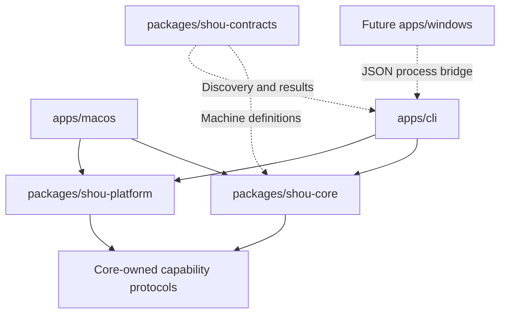

# Monorepo and platform boundaries

English | [简体中文](../zh-CN/architecture/monorepo-and-platforms.md)

Status: design draft. macOS ships first; Windows is a formal future target.

## 1. Organization principles

Organize native entry points, shared business logic, platform adapters, contracts, scripts, documentation, examples, and assets separately. Native interfaces consume shared behavior rather than reimplement rules. A structured process bridge can cross language boundaries.

Mobile projects, model integrations, and agent hosting are outside scope. Build success, native runtime success, and complete distribution acceptance are separate evidence.

## 2. Target layout

The repository currently contains documentation, schemas, and examples. This layout describes future code organization.

```text
shou/
├── apps/
│   ├── macos/                  Swift / SwiftUI / AppKit
│   ├── cli/                    Swift CLI with current-platform adapters
│   └── windows/                Future native Windows UI
├── packages/
│   ├── shou-core/              Portable domain services and state machines
│   ├── shou-platform/          Concrete filesystem and permission adapters
│   └── shou-contracts/         Schemas and language-independent contracts
├── tests/fixtures/             Fictional filesystem and protocol cases
├── scripts/                    Verification, build, package, benchmark
├── examples/rules/             Reviewable declarative rules
├── assets/brand/               Brand sources
├── docs/                       English and localized technical docs
├── README.md
└── LICENSE
```

Use local SwiftPM dependencies for Swift packages and an Xcode project/workspace where signing/resources require it. A monorepo does not require one build tool for every language, JavaScript workspaces, or a web interface.

## 3. Dependency direction



Core owns its required protocols; adapters depend on core and implement them. Schema files are authoritative data contracts, not a runtime service. Avoid scattered platform conditionals throughout domain logic.

## 4. Shared versus platform responsibilities

| Shared core | Platform adapters |
| --- | --- |
| Rules, versions, provenance, normalization | Permission panels, TCC/ACLs, access credentials |
| Pattern/condition semantics and risk | Traversal, identities, links, volume boundaries |
| Exclusions, deduplication, immutable plans | Allocated-size and volume-availability queries |
| Confirmation binding and state machines | Trash/Recycle Bin, restoration, permanent removal |
| Structured errors, results, next actions | Locks, durable writes, process cancellation, data roots |

Portable Foundation usage must be verified on Windows. Shared code must not import SwiftUI, AppKit, Darwin, or Win32 directly.

## 5. Windows direction

Windows uses a native desktop UI and `shou.exe`, with the same rule, plan, error, and state semantics. Platform-specific rules declare their applicability.

Prefer a structured process bridge to the shared Swift CLI rather than an early Swift/C# ABI bridge or duplicate engine. Use argument arrays, bounded JSON stdin/stdout, explicit exit handling, and no concatenated Shell command.

Select one of WinUI 3 or WPF after a native prototype; do not maintain both. Lock Swift/.NET versions, architectures, minimum Windows version, runtime delivery, and Recycle Bin/identity/locking APIs through evidence.

A future GUI confirmation bridge needs an explicit contract; do not introduce a global `--yes` bypass just to support IPC. Swift language support does not make Apple frameworks portable.

## 6. Path contract

Rules use `/`-separated relative patterns. Reject absolute paths, `..`, drive/UNC/device syntax, and alternate-data-stream syntax. Respect actual filesystem case behavior and identity rather than string folding.

Do not follow root/ancestor symlinks, junctions, or unknown reparse points. Known internal POSIX symlinks are opaque entries. Never cross volumes, including mount points. Cloud placeholders and network volumes are outside the initial executable scope.

## 7. Capability discovery

Expose platform, build, contract versions, actual supported operations, and reasons for unavailable capabilities. An unavailable Recycle Bin implementation must never silently fall back to permanent deletion.

The rule schema accepting `windows` expresses applicability only. Windows support requires native build, runtime, filesystem-safety, UI, and clean-install evidence.

## 8. Repository and release boundaries

Review entry points and contracts together. Keep application and rule-format versions distinct. Do not commit real workspace scans or generated distributions as fixtures. Verify macOS signing/notarization and Windows signing/runtime/installation independently.

Do not install global plugins or change global coding-agent configuration as part of integration.

## 9. Evolution

Define contracts and minimal interfaces, implement the macOS CLI loop, then native UI. Check core portability continuously. Prototype the Windows core/CLI before native adapters and UI. Reuse fictional semantic fixtures while independently testing platform behavior.

Isolate real dependencies now; avoid a speculative universal plugin framework.
