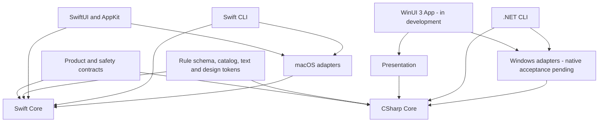

# Repository and platform boundaries

English | [简体中文](../zh-CN/architecture/monorepo-and-platforms.md)

Status: macOS has source implementations. Windows implementation is in progress; native acceptance and distribution are pending.

## Architecture decision

Each operating system owns its native UI, domain implementation and system adapters. On macOS, the desktop and CLI share Swift services. On Windows, the desktop and CLI share C# services. Shared product contracts, declarative resources and acceptance cases keep behavior aligned.

Core defines the small capability interfaces it consumes. Platform implements those interfaces. Entry points compose dependencies; business services do not depend on UI frameworks or concrete adapters. Both native implementations apply the same safety requirements independently.

## Directory ownership

| Path | Owner and responsibility | Status |
| --- | --- | --- |
| `apps/macos` | SwiftUI/AppKit application, macOS interaction | Implemented source |
| `apps/cli` | macOS Swift command entry and terminal confirmation | Implemented source |
| `packages/shou-core` | Swift rules, scanning, plans and receipts | Implemented source |
| `packages/shou-platform` | macOS filesystem, access, processes and persistence | Implemented source |
| `packages/shou-ai` | macOS investigation and model transports | Implemented source |
| `packages/shou-contracts` | Language-independent rule schema | Shared specification |
| `apps/windows` | C# Core, Platform, Presentation, App and CLI | Source implementation in progress; native acceptance pending |
| `tests/core` | Swift domain and native fixture regression | Available |
| `SYNC.md` | Cross-platform feature and safety acceptance | Required ledger |

The Windows plan defines its target project tree. Do not create empty abstractions for future features or a second build system around the Swift application.

Noninteractive macOS Keychain queries use `LAContext.interactionNotAllowed`. Per-executable ACLs in the legacy file Keychain and third-party login registrations have no equivalent modern public API. Required calls stay in the Platform `Legacy` C target, with deprecated diagnostics handled only within that implementation file. `SMAppService` manages the calling app itself and cannot replace third-party registration management. Warning fixes must preserve the signing, trust and authorization contracts.

## Shared assets

The rule schema remains authoritative at `packages/shou-contracts/rule.schema.json`. Built-in rule and known-location JSON are maintained once in `packages/shou-core/Sources/Resources`; the Windows generator selects applicable declarations into `apps/windows/Generated`. Platform applicability identifies data scope and does not assert runtime support.

The current text source is `packages/shou-core/Localizable.xcstrings`. The Windows generator converts the current two runtime locales and validates placeholders and source digests. `assets/design/tokens.json` owns extracted accent, spacing, radius, padding, primary-action sizing and cleanup-motion values. The same generator produces WinUI `Design.xaml` and SwiftUI `ShouDesign.generated.swift`; native views consume generated constants. Shared design values stay in the application layer. Typography and the remaining visual values still need extraction. Generating cleanup-motion values does not implement Windows animation. Brand assets remain in `assets/brand`. Generators are deterministic and support a no-diff check. Any additional plural or formatting form needs explicit generator support and fixtures.

Shared acceptance cases specify input evidence, expected selection, blocked reasons, confirmation and outcomes. Native identity, access and race checks belong to each operating system. Neither runtime reads the other platform's local records.

## Change procedure

1. Read the relevant product, safety and schema contracts.
2. Record the macOS baseline commit and feature-level changes in `SYNC.md`.
3. Implement in the owning platform; generate shared assets from their source.
4. Run portable semantics and affected native checks; record platform, architecture, commit and evidence.
5. Mark every platform as implemented, planned, intentionally different or not applicable, with a reason.

A macOS fix to a safety contract requires a Windows ledger entry even when the affected Windows capability is not implemented. An unverified capability remains unavailable.

macOS and Windows session administrator access use small Core ports and Platform implementations. Scans, exact-manifest cleanup and supported system operations share process authorization; UI owns no passwords or deletion policy. See [system authorization and item execution](../engineering/system-authorization.md). Native acceptance and public gates remain separate.
