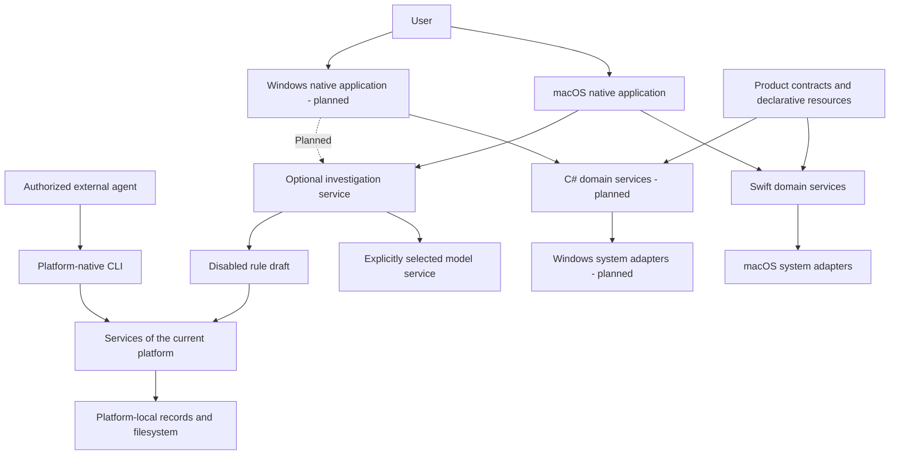
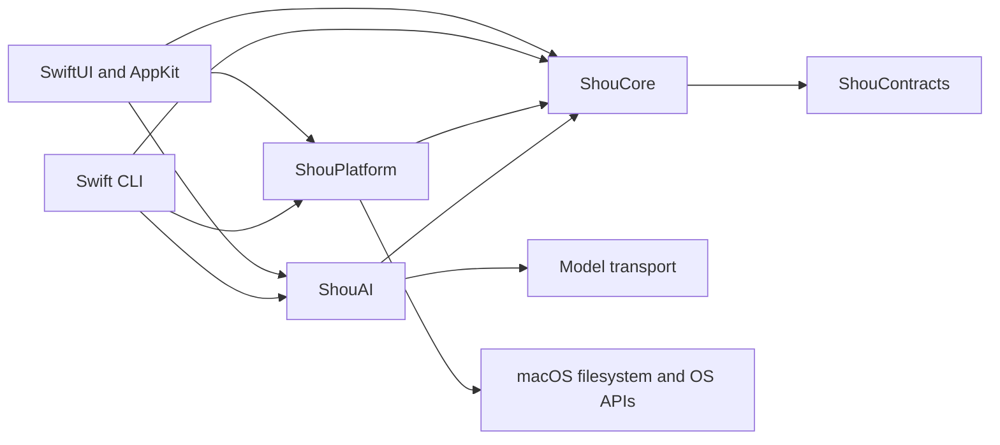
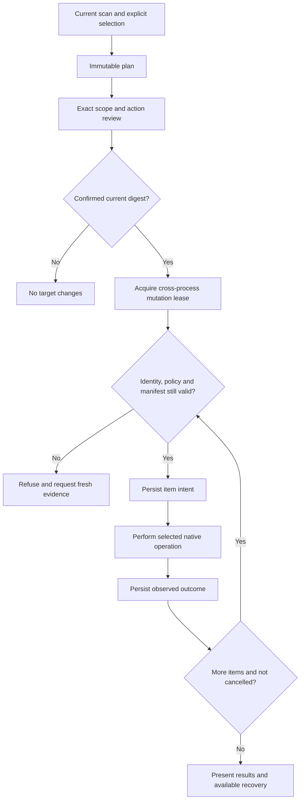

# System architecture

English | [简体中文](../zh-CN/architecture/system-design.md)

Status: macOS has source implementations. Windows follows the [native implementation plan](../engineering/windows-native-plan.md); its runtime and distribution are pending.

## System context

Desktop and CLI are independent product entry points within each operating system. Both use the same platform-local domain services. Ordinary scans and cleanup operate offline. A model proposes evidence-backed rule drafts; deterministic validation, explicit enablement, a fresh scan and confirmed execution remain separate steps.

## Domain responsibilities

| Responsibility | Contract |
| --- | --- |
| Rules | Closed schema, immutable version, applicability, scope and protected data |
| Discovery | Explicit known roots and bounded project hints; missing and inaccessible remain distinct |
| Scan | Bounded work, stable identities, complete-target evidence and honest partial coverage |
| Analysis | Allocated-byte estimates, hard-link deduplication, paged directory and large-file queries |
| Plan | Exact selected targets, action, evidence digest, policy revision and expiry |
| Confirmation | One reviewed action bound to the current plan and entry point |
| Execution | Mutation lease, fresh validation, durable intent and per-item outcome |
| Recovery | Verified receipt-based restore without overwrite; uncertain work is reconciled |
| Retention | Quotas/expiry protect active plans, recovery evidence and consumed authorization |
| AI | Bounded authorized evidence, provider isolation, cancellation and disabled drafts |

Core owns these decisions and required capability interfaces. Platform owns native access, identities, processes and persistence. UI owns navigation, selection, rendering and scheduling. The Windows Presentation layer keeps state independently testable on macOS. See [repository boundaries](monorepo-and-platforms.md).

## macOS implementation

`apps/macos` composes SwiftUI/AppKit, `ShouCore`, `ShouPlatform`, `ShouAI` and bundled agent instructions. `apps/cli` independently composes the same Swift services and terminal confirmation. `Package.swift` builds the macOS products; it does not define Windows targets.

The macOS adapter uses bounded native metadata readers, a disk-backed SQLite storage catalog and short-lived read workers where needed. Read-worker requests authorize identity/inspection only. The parent process owns confirmed mutations. Timeouts, cancellation, child limits and partial results remain explicit. [Storage performance](../engineering/storage-scan-performance.md) defines scheduler and measurement details.

Known roots and declarative rule data are maintained in JSON. `ShouEngine` registers available roots before capturing configuration-bound evidence. Rules cannot gain authority from a matching directory name alone. Application-cache discovery requires exact installed-owner evidence and observed inactivity; unknown ownership or activity blocks affected targets.

## Windows implementation contract

WinUI App → Presentation → C# Core is the UI dependency chain. Windows Platform implements Core-owned filesystem, registry, process, credential and record interfaces. App and .NET CLI compose these implementations directly. The C# domain uses an explicit Windows path model, with real Win32 behavior verified separately. Module names, framework targets and stage exits are specified in the [Windows plan](../engineering/windows-native-plan.md).

## Cleanup and concurrency

Read operations are cancellable and bounded. Whole-tree completeness and complete target subtrees are separate facts; only complete, current target evidence can authorize mutation. Sparse cleanup scans cannot stand in for full space analysis.

Desktop cleanup defaults to permanent removal with an irreversible exact-scope confirmation. Trash/Recycle Bin is an explicit alternative with separately verified recovery. It never falls back to permanent deletion. CLI confirmation is interactive; no unattended destructive bypass is part of this contract.

A cancellation stops dispatching new mutations. An in-flight native result is recorded as observed or unknown. The journal and filesystem do not form an atomic cross-system transaction. Recovery must inspect current state rather than infer success from missing output. POSIX descriptor and Windows handle race protections are platform responsibilities.

## Data and resources

Rules and product contracts are language-independent; local records are platform-owned. Use stable IDs, explicit format versions and structured error categories. Windows volume/File ID/SID and macOS device/inode/owner are separate identity models. See [data contracts](data-model.md).

Text, design tokens, brand assets and rule resources use one canonical source per asset and deterministic generators. Generated resource changes carry source digests. Track each feature, safety change and intentional difference in [SYNC.md](../../SYNC.md).

## Engineering and verification

Build the smallest feature slice with explicit capabilities. Keep domain interfaces narrow and introduce them only for current operations. Avoid universal plugin systems and duplicated policy in UI.

Mac-hosted tests establish domain/state semantics. Windows native integration establishes Windows system behavior. UI, accessibility, signing, installation and updates each require independent evidence. Every supported capability must identify its platform, architecture, exact revision and executed checks; see [acceptance](../engineering/acceptance-and-testing.md).
