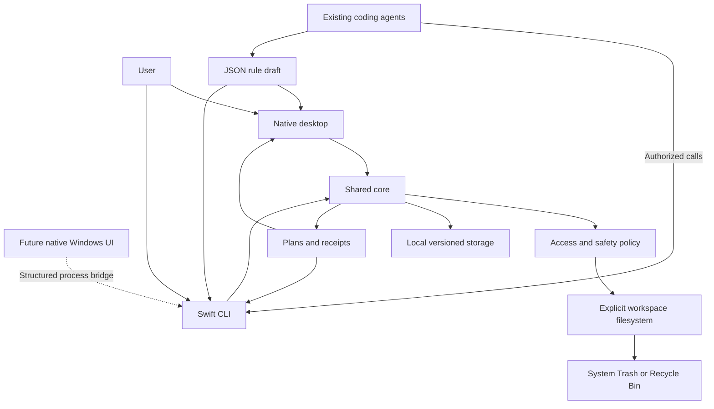
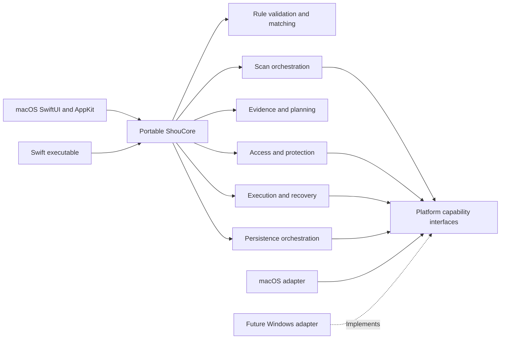

# System architecture

English | [简体中文](../zh-CN/architecture/system-design.md)

Status: design draft. Native macOS, independent CLI, and explicit platform boundaries are required; platform safety capabilities need prototype evidence.

## 1. Constraints

Share one portable Swift core between the native macOS application and Swift CLI. Windows later consumes the same contracts/core. Rules are declarative whether handwritten or generated externally.

Shou integrates no models and develops or hosts no agents. Initial operation needs no cloud service, account, privileged helper, or persistent daemon. Keep real platform dependencies isolated without a speculative plugin runtime.

## 2. Context



External agents, model-generated drafts, imported files, and project content remain outside the trust boundary.

## 3. Modules



Core declares the minimal protocols it consumes. Platform packages implement them; the core never depends on concrete adapters. Rules, planning, and scanning initially remain responsibilities within one core package rather than independently published packages.

Target layout, not implemented application scaffolding:

```text
apps/macos/                 Native SwiftUI and AppKit application
apps/cli/                   Swift CLI: shou / shou.exe
apps/windows/               Future native Windows application
packages/shou-core/         Portable models, rules, orchestration, plans
packages/shou-platform/     Concrete platform implementations
packages/shou-contracts/    Language-independent schemas and contracts
scripts/                    Build, check, package, benchmark
examples/rules/             Reviewable rules
assets/brand/               Brand source assets
tests/fixtures/             Fictional filesystem and contract fixtures
docs/                       English documentation and localized editions
```

See [monorepo and platforms](monorepo-and-platforms.md) for dependency rules.

## 4. Responsibilities

| Service | Owns | Excludes |
| --- | --- | --- |
| WorkspaceAccess | Root binding, actual access, expiration | Permission escalation through rules |
| RuleService | Parsing, versions, provenance, validation, enablement | Script execution or trusting model claims |
| Scanner | Bounded traversal, project clues, sizes, modification evidence | Declaring unknown directories disposable |
| Matcher | Deterministic predicates within bound scope | Searching unauthorized volumes |
| Planner | Deduplication, protection, selection, manifests, digests | Deletion or inherited authorization |
| Confirmation | Current plan/action confirmation in UI or TTY | Standing reusable permission |
| Executor | Revalidation, Trash operations, cancellation, outcomes | Blind path-based retries |
| ReceiptService | Verified restore and permanent batch removal | Emptying unrelated Trash contents |
| LocalStore | Atomic records, versions, locks, interruption data | Uploading file contents |

Presentation never owns a separate policy implementation. Localization changes display text, not business behavior.

## 5. Concurrency

Enable Swift 6 concurrency checks; provisional minimum macOS is 14. UI state is `@MainActor`; traversal and statistics run off the main thread. Use bounded structured concurrency, propagated cancellation, and coalesced progress updates. Unknown totals use counts/stages, not fabricated percentages.

Serialize destructive execution within a process and use platform-backed locks across processes. A Swift actor cannot protect independent GUI/CLI processes. Inject filesystem, clock, and persistence only at actual external boundaries.

## 6. Local persistence

Begin with versioned JSON objects and streamable large manifests. Adopt SQLite only if measured query/volume needs justify it.

Platform adapters select user-scoped data roots. Use same-directory temporary writes, atomic replacement, and tested durability for intent journals. Lock configuration changes and destructive execution. Permit at most one destructive task per user; immutable snapshots can be read independently.

Caches are rebuildable; rules, exclusions, and receipts are not disposable scan caches. Persist intent before processing files. Disk-full or journal failure prevents starting; unexpected post-operation failures produce unknown states and stop further work. Revalidate local files rather than trusting their storage location.

## 7. Access and distribution

The GUI uses native directory panels; sandboxed designs require security-scoped bookmarks and lifetime management. Expired access requires reauthorization.

CLI path registration is configuration, not an OS permission grant. Actual terminal/process/TCC/filesystem access must be checked. GUI access does not imply CLI access or the reverse. No initial privilege-borrowing service is planned.

Prefer directly distributed signed/notarized macOS packages, subject to M0 validation of Sandbox, signing, CLI location, and permissions. Windows signing, runtime delivery, and native permissions are independent concerns.

## 8. Filesystem races

Record root and object identity, volume, type, size, modification/metadata information, and full directory manifests. Top-level `mtime` alone is insufficient.

Before execution, recheck access, configuration, rules, expiry, paths, identities, and manifests. Resolve paths within a verified root without following ancestor links; string-prefix checks are insufficient. Changed or unverifiable targets are refused/skipped without scope expansion or blind recursive fallback.

Known internal POSIX symlinks are opaque entries, never traversal roots. Platform Trash APIs and descriptor-based identity constraints need actual race prototypes. A check followed by an unrelated path operation is not an atomic safety guarantee; unmet constraints block release or narrow support.

## 9. Existing-agent interface

Provide public rules, capability discovery, structured CLI results, and stable plan/history IDs. Existing Codex, Claude Code, and WorkBuddy tools may call these under their own authorization policies. No model SDK, agent runner, chat service, or global tool configuration is part of Shou.

MCP is outside current scope; additional protocols require demonstrated integration needs. See [agent workflow](../ai/coding-agent-integration.md).

## 10. Engineering principles

KISS: one core with limited declarative semantics. DRY: reuse validation, protection, plans, and execution. YAGNI: no speculative cloud, scripting, privileged daemon, or model platform. SOLID: explicit responsibilities and minimal platform-facing interfaces.
