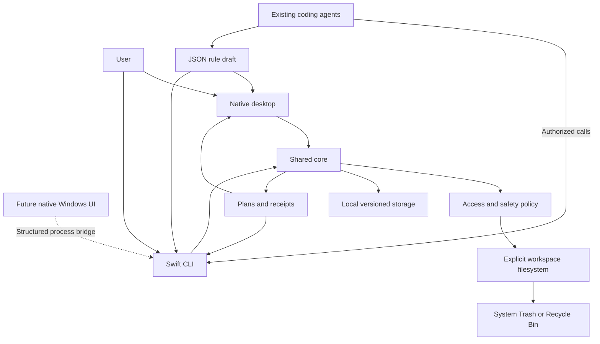
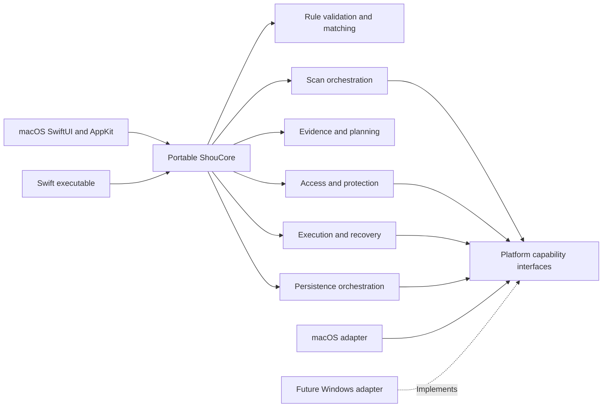
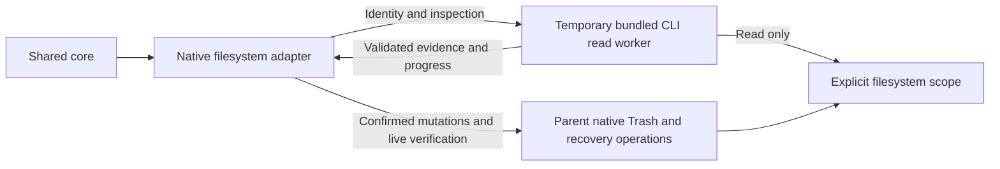

# System architecture

English | [简体中文](../zh-CN/architecture/system-design.md)

Status: development architecture. Shared scanning, planning, receipts and macOS adapters have source implementations; Windows, distribution and filesystem race acceptance remain pending.

## 1. Constraints

Share one portable Swift core between the native macOS application and Swift CLI. Windows later consumes the same contracts/core. Rules are declarative whether handwritten or generated externally.

Shou integrates no models and develops or hosts no agents. Initial operation needs no cloud service, account, privileged helper, or persistent daemon. Keep real platform dependencies isolated without a speculative plugin runtime.

## 2. Context



External agents, model-generated drafts, imported files, and project content remain outside the trust boundary.

## 3. Modules



Core declares the minimal protocols it consumes. Platform packages implement them; the core never depends on concrete adapters. Rules, planning, and scanning initially remain responsibilities within one core package rather than independently published packages.

### Isolated read operations

The desktop injects `NativeFileSystem(readWorkerExecutable:)` with the packaged `Contents/Helpers/shou` executable. Root-identity queries and full/cleanup traversal run in short-lived read workers so a stalled filesystem call does not keep the desktop waiting on that call. The CLI's hidden worker entry accepts only identity and inspection requests and runs before opening the record store. It is a platform implementation detail, not a public agent protocol, a second cleanup engine or a persistent service. The independent CLI keeps its normal direct adapter.



Each request uses a current-user temporary channel: a `0700` directory and `0600` files. Request/result versions, request identity, parent identity, output size, progress and snapshot structure are checked before evidence reaches Core. Malformed, missing, timed-out or cancelled work cannot become a complete snapshot. Scope, matching, candidate eligibility, plans and receipts remain owned by the shared core.

Cancellation or the wall-clock deadline requests termination of only the owned read child and returns without waiting for process exit. At most two live read children are retained, including a child still awaiting kernel exit; further work returns a resource limitation. A child watchdog also terminates it on parent exit or its deadline. This bounds desktop waiting and child accumulation; it does not promise immediate completion of a kernel request. Trash, restoration and permanent removal remain parent-process operations with native identity/manifests revalidation and existing confirmation/receipt gates. No model or agent is introduced. Worker source is implemented; packaged runtime and scan-stop acceptance remain pending.

### Common application scanning

`KnownLocations` defines explicit roots and rule associations without accessing disk. `PlatformFileSystem.locationAvailability` supplies current availability; `ShouEngine` owns registration and bounded scanning. `BuiltinCatalog` binds fixed rules only to their exact known root. Project rules remain usable in selected project workspaces. A path with the same folder name elsewhere does not activate an application rule.

`scanKnownLocations` inventories roots, registers all available roots, then produces one `ScanSnapshot` per root. Registration happens first so it cannot invalidate earlier configuration digests. Missing roots are skipped; inaccessible or incomplete roots produce separate issues. The desktop standard scan includes already registered project workspaces; CLI `system scan` includes them only with `--include-projects true` (default `false`). Both use cleanup scope by default. Neither discovers projects through an implicit home-wide scan, changes operating-system permissions nor deletes targets. Plans remain bound to one root and explicit candidates.

### Scan coverage and artifact evidence

`full` inspects the workspace tree for space analysis. `cleanup` uses enabled rule prefixes to decide which branches to discover, prunes `.git` during discovery, and fully measures a matched target before it can be eligible. Pruning discovery does not exempt protected content inside a matched target from inspection. Cleanup completion is not proof that the whole tree was measured: snapshots record `scope`, `treeComplete` and candidate coverage in `completedPaths`. A partial scan may authorize an independently complete target; missing legacy coverage never relaxes an incomplete target. UI must explain sparse cleanup results and request a full scan for directory-space exploration.

`ArtifactEvidenceChecking` is a read-only Core port implemented by `NativeArtifactEvidence`. Exact bundled definitions, not a rule ID prefix or user declaration, gate generated-source exceptions. Rust build-script `OUT_DIR`, Swift generated build products and Cargo extracted registry sources require their recognized layouts and native ownership/activity evidence. Cargo sources additionally require archive/checksum integrity and an available local restoration source. Tracked, modified, unknown or unverifiable data remains blocked. See [rule semantics](../rules/rule-specification.md).

`ApplicationActivityChecking` is a separate core port, implemented by `NativeApplicationActivity` using macOS running-application metadata. Known application rules are blocked while their application is running or activity cannot be checked. The engine checks during scanning and plan creation, then again immediately before each move. A late-running application produces a skipped item receipt; independent items continue. Shou never quits applications. This protects identified desktop applications; arbitrary compiler and package-manager tasks must still be stopped by the user. A process check cannot atomically prevent an application from launching after it.

| Layer | Concrete responsibility |
| --- | --- |
| `SmartScanView` / CLI | Start a scan, present progress and per-root evidence |
| `KnownLocations` / `BuiltinCatalog` | Explicit roots and declarative matching metadata |
| `ShouEngine` | Configuration, snapshots, policy, plans, revalidation and receipts |
| `PlatformFileSystem` | Availability, bounded inspection, identity and filesystem operations |
| `ApplicationActivityChecking` | Read application activity without controlling processes |
| `ArtifactEvidenceChecking` | Read tracked-content, build-process and Cargo-integrity facts; never supplied by rule documents |
| `RecordStore` | Atomic records and cross-process mutation lease |

These are package-internal responsibilities and small ports, not a plugin system or a separate service for each rule. The CLI runs without the desktop process. A future Windows adapter must implement and validate its own roots, activity and Recycle Bin behavior before enabling them.

Repository organization; Windows and brand-source entries remain future deliverables:

```text
apps/macos/                 Native SwiftUI and AppKit application
apps/cli/                   Swift CLI: shou / shou.exe
apps/windows/               Future native Windows application
packages/shou-core/         Portable models, rules, orchestration, plans
packages/shou-platform/     Concrete platform implementations
packages/shou-contracts/    Language-independent schemas and contracts
scripts/                    Build, check, package, benchmark
examples/rules/             Reviewable rules
assets/brand/               Brand source assets
tests/fixtures/             Fictional filesystem and contract fixtures
docs/                       English documentation and localized editions
```

See [monorepo and platforms](monorepo-and-platforms.md) for dependency rules.

## 4. Responsibilities

| Service | Owns | Excludes |
| --- | --- | --- |
| WorkspaceAccess | Root binding, actual access, expiration | Permission escalation through rules |
| RuleService | Parsing, versions, provenance, validation, enablement | Script execution or trusting model claims |
| Scanner | Bounded traversal, project clues, sizes, modification evidence | Declaring unknown directories disposable |
| Matcher | Deterministic predicates within bound scope | Searching unauthorized volumes |
| Planner | Deduplication, protection, selection, manifests, digests | Deletion or inherited authorization |
| Confirmation | Current plan/action confirmation in UI or TTY | Standing reusable permission |
| Executor | Revalidation, Trash operations, cancellation, outcomes | Blind path-based retries |
| ReceiptService | Verified restore and permanent batch removal | Emptying unrelated Trash contents |
| LocalStore | Atomic records, versions, locks, interruption data | Uploading file contents |

Presentation never owns a separate policy implementation. Localization changes display text, not business behavior.

## 5. Concurrency

Enable Swift 6 concurrency checks; provisional minimum macOS is 14. UI state is `@MainActor`; traversal and statistics run off the main thread. Use bounded structured concurrency, propagated cancellation, and coalesced progress updates. Unknown totals use counts/stages, not fabricated percentages.

Serialize destructive execution within a process and use platform-backed locks across processes. A Swift actor cannot protect independent GUI/CLI processes. Inject filesystem, clock, and persistence only at actual external boundaries.

## 6. Local persistence

Begin with versioned JSON objects and streamable large manifests. Adopt SQLite only if measured query/volume needs justify it.

Platform adapters select user-scoped data roots. Use same-directory temporary writes, atomic replacement, and tested durability for intent journals. Lock configuration changes and destructive execution. Permit at most one destructive task per user; immutable snapshots can be read independently.

Caches are rebuildable; rules, exclusions, and receipts are not disposable scan caches. Persist intent before processing files. Disk-full or journal failure prevents starting; unexpected post-operation failures produce unknown states and stop further work. Revalidate local files rather than trusting their storage location.

## 7. Access and distribution

The GUI uses native directory panels; sandboxed designs require security-scoped bookmarks and lifetime management. Expired access requires reauthorization.

CLI path registration is configuration, not an OS permission grant. Actual terminal/process/TCC/filesystem access must be checked. GUI access does not imply CLI access or the reverse. No initial privilege-borrowing service is planned.

Prefer directly distributed signed/notarized macOS packages, subject to M0 validation of Sandbox, signing, CLI location, and permissions. Windows signing, runtime delivery, and native permissions are independent concerns.

## 8. Filesystem races

Record root and object identity, volume, type, size, modification/metadata information, and full directory manifests. Top-level `mtime` alone is insufficient.

Before execution, recheck access, configuration, rules, expiry, paths, identities, and manifests. Resolve paths within a verified root without following ancestor links; string-prefix checks are insufficient. Changed or unverifiable targets are refused/skipped without scope expansion or blind recursive fallback.

Known internal POSIX symlinks are opaque entries, never traversal roots. Platform Trash APIs and descriptor-based identity constraints need actual race prototypes. A check followed by an unrelated path operation is not an atomic safety guarantee; unmet constraints block release or narrow support.

Trash follow-up verification tolerates a change only to the saved top-level directory's `ctime`, which macOS may update after the move. Its identity and every other saved root field must still match, as must all descendant entries. This exception applies only to recorded Trash follow-ups; it does not relax ordinary scan or pre-move verification.

## 9. Existing-agent interface

Provide public rules, capability discovery, structured CLI results, and stable plan/history IDs. Existing Codex, Claude Code, and WorkBuddy tools may call these under their own authorization policies. No model SDK, agent runner, chat service, or global tool configuration is part of Shou.

MCP is outside current scope; additional protocols require demonstrated integration needs. See [agent workflow](../ai/coding-agent-integration.md).

## 10. Engineering principles

KISS: one core with limited declarative semantics. DRY: reuse validation, protection, plans, and execution. YAGNI: no speculative cloud, scripting, privileged daemon, or model platform. SOLID: explicit responsibilities and minimal platform-facing interfaces.
