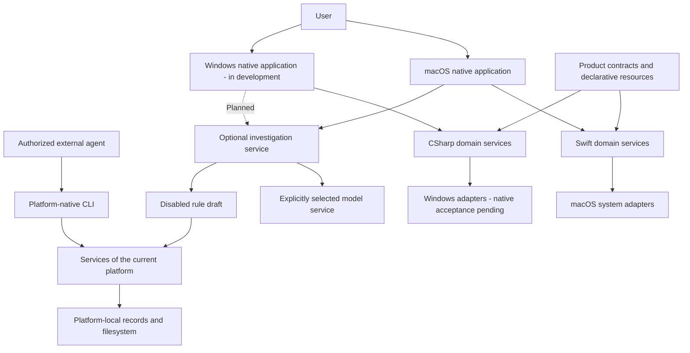
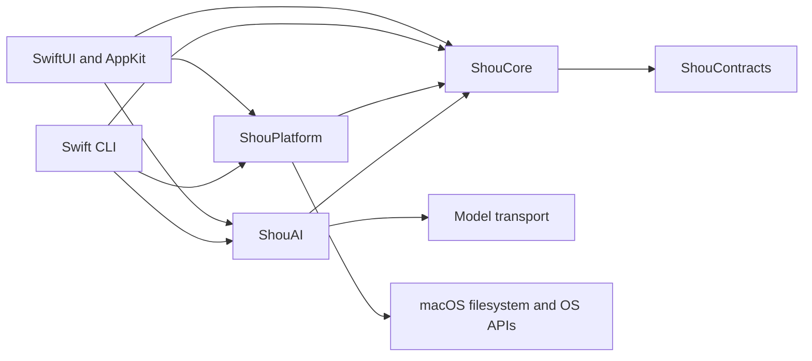
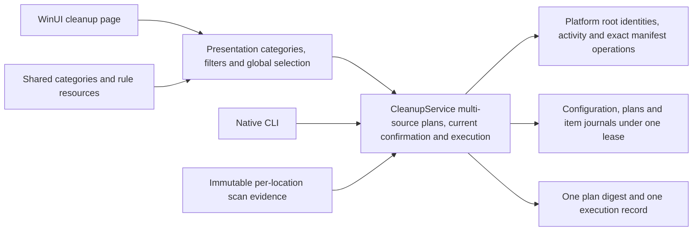
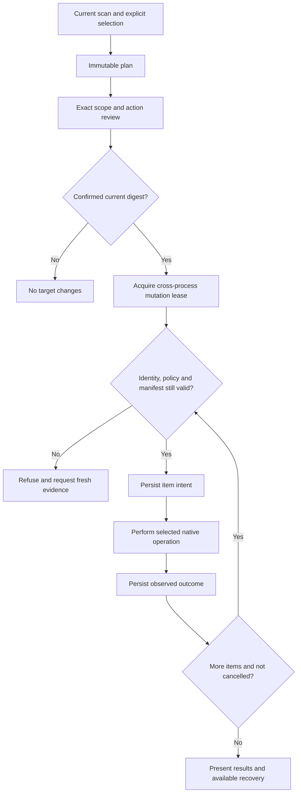

# System architecture

English | [简体中文](../zh-CN/architecture/system-design.md)

Status: macOS has source implementations. Windows is in progress under the [native implementation plan](../engineering/windows-native-plan.md), with location discovery, application registration and startup browsing, built-in/personal-rule configuration, storage browsing, cleanup review and read-only history source; native runtime and distribution acceptance are pending.

## System context

Desktop and CLI are independent product entry points within each operating system. Both use the same platform-local domain services. Ordinary scans and cleanup operate offline. A model proposes evidence-backed rule drafts; deterministic validation, explicit enablement, a fresh scan and confirmed execution remain separate steps.

## Domain responsibilities

| Responsibility | Contract |
| --- | --- |
| Rules | Closed schema, immutable version, applicability, scope and protected data |
| Discovery | Explicit known roots and bounded project hints; missing and inaccessible remain distinct |
| Scan | Bounded work, stable identities, complete-target evidence and honest partial coverage |
| Analysis | Allocated-byte estimates, hard-link deduplication, paged directory and large-file queries |
| Plan | Exact selected targets, action, evidence digest, policy revision and expiry |
| Confirmation | One reviewed action bound to the current plan and entry point |
| Execution | Mutation lease, fresh validation, durable intent and per-item outcome |
| Recovery | Verified receipt-based restore without overwrite; uncertain work is reconciled |
| Retention | Quotas/expiry protect active plans, recovery evidence and consumed authorization |
| AI | Bounded authorized evidence, provider isolation, cancellation and disabled drafts |

Core owns these decisions and required capability interfaces. Platform owns native access, identities, processes and persistence. UI owns navigation, selection, rendering and scheduling. The Windows Presentation layer keeps state independently testable on macOS. See [repository boundaries](monorepo-and-platforms.md).

## Shared traversal boundaries

Within each platform, directory enumeration, manifest comparison and immutable page storage are reusable lower-level capabilities. macOS measurement and target inspection share `NativeDirectoryReader`; Windows scanning and native verification share the handle-based `NativeDirectoryReader`. Core builds request-local indexes and policy contexts once and reuses them for classification, selection and review. They do not survive the operation or grant future authority.

Batch policy preflight remains distinct from the final mutation boundary. Adapters explicitly declaring complete manifest verification own that final tree read; Core avoids another immediately redundant traversal. The default capability is false, retaining conservative checks for other adapters. Native mutation still checks the complete current manifest, identities, context and each unlink. History inspection always obtains a fresh observation. Installer-managed Windows uninstall and SQLite privacy operations retain their separate system contracts.

## macOS implementation

`apps/macos` composes SwiftUI/AppKit, `ShouCore`, `ShouPlatform`, `ShouAI` and bundled agent instructions. `apps/cli` independently composes the same Swift services and terminal confirmation. `Package.swift` builds the macOS products; it does not define Windows targets.

The macOS adapter uses bounded native metadata readers, a disk-backed SQLite storage catalog and short-lived read workers where needed. Read-worker requests authorize identity/inspection only. The parent process owns confirmed mutations. Timeouts, cancellation, child limits and partial results remain explicit. [Storage performance](../engineering/storage-scan-performance.md) defines scheduler and measurement details.

Known roots and declarative rule data are maintained in JSON. `ShouEngine` registers available roots before capturing configuration-bound evidence. Rules cannot gain authority from a matching directory name alone. Application-cache discovery requires exact installed-owner evidence and observed inactivity; unknown ownership or activity blocks affected targets.

## Windows implementation contract

WinUI App → Presentation → C# Core is the UI dependency chain. Windows Platform implements Core-owned filesystem, registry, process, credential and record interfaces. App and .NET CLI compose these implementations directly. The C# domain uses an explicit Windows path model, with real Win32 behavior verified separately. Module names, framework targets and stage exits are specified in the [Windows plan](../engineering/windows-native-plan.md).

Core's `BuiltinRuleCatalog` produces current applicable definitions from shared JSON; configuration stores built-in enablement preferences and exact personal-rule versions. `ScanLocationService` discovers and reinspects bounded locations, then registers the batch in one configuration transaction before scanning. The GUI can scan one location or the exact configured locations listed on the page; the CLI can discover, register and scan a batch. Both share sequential scan budgets. GUI source aggregates categories, rules and paths across locations while filters retain global selection. Core validates sources under one lease and saves one multi-location plan, binding execution to one current confirmation, all-source preflight and item journals; public execution remains closed. Both use the same protection and planning services. Changed definitions after a resource upgrade invalidate old plans, and default scan participation never grants execution consent.

Application management has a separate read-only path: applications page or CLI → `ApplicationCatalog` → `IApplicationInventory` → registry/current-user MSIX. Core validates registration facts and queries immutable snapshots; Platform owns fixed-source budgets and gaps. This path does not open cleanup records or convert registration identity into deletion permission. The [application contract](../product/application-uninstall.md#windows-application-discovery-and-uninstall-boundaries) owns sources, estimates and future system-uninstall boundaries.

Uninstall preparation uses `ApplicationUninstallReviewer` and a Core installation-identity port implemented by Platform's exact MSI/MSIX reads. `ApplicationUninstallPlanner` reinspects, binds the reviewed digest/current user/separate data acknowledgement and saves a plan under the existing private-store lease. Presentation owns review/acknowledgement/cancellation state; App and CLI assemble the same services. Inspection does not open storage, and plans grant no execution. `ApplicationActivityService` reuses scan/file-use ports, while `WindowsApplicationProcesses` reads matching image paths with query-only rights. Active or unknown observations block planning. `ApplicationUninstallService` now implements current single-use consent, the mutation lease, fresh identity/activity checks, durable intent and outcome reads. Platform's `WindowsApplicationUninstallMutation` owns fixed MSI invocation, current-user MSIX deployment and independent identity observation. WinUI source now assembles separate confirmation, stop-and-wait, read-only outcomes and window lifecycle handling. GUI and CLI share a disabled execution gate; native acceptance, additional residuals and restore remain pending.

Startup discovery has its own read-only path: WinUI `StartupViewModel` or `startup list` → `StartupInventoryService` → `IStartupInventory` → `WindowsStartupInventory`. Core validates bounded metadata and queries an immutable snapshot; Platform reads six fixed registry sources, two local Startup folders and boot/logon scheduled tasks visible to the current identity and current-user registered package startup declarations. Arguments never enter Core, and registration presence does not establish enablement, activity or deletion/control permission. The path opens no cleanup store. Sources, exclusions and native evidence requirements belong to the [startup contract](../product/startup-items.md#windows-startup-contract).

Recognized scheduled tasks additionally expose a separate task-engine status observation. Platform double-reads public enablement/state and rechecks path/XML; Core rejects invalid source/state claims. A missing status preserves the registration with explicit coverage gaps. This observation does not establish effective startup conditions, application activity or control authorization.

Privacy scan source uses its own fixed-browser policy, integer time windows and read-only SQLite/identity adapters. `PrivacyScanViewModel` and CLI share `PrivacyScanService`; observations persist through the existing configuration lease. Core's `PrivacyCleanupService` implements exact-source plans, separate Cookie impact acknowledgement, current single-use confirmation, intent-first orchestration and sanitized receipts. Native transactional mutation, public integration and native acceptance remain pending. See [privacy boundaries](../engineering/privacy-cleaning.md#windows-platform-boundary).

## Cleanup and concurrency

Windows UI uses a separate `CleanupExecutionViewModel` for one current plan's confirmation attempt and record lookup. App composes the same Core confirmation, execution and record reads. GUI and CLI share the disabled Platform gate and do not request execution confirmation before native acceptance. Source includes UI-thread confirmation defaulting to Cancel, scope/navigation protection during execution, and stop-and-wait for normal closing. This state grants no recovery or automatic retry. See [confirmation and lifecycle](../engineering/windows.md#file-cleanup-confirmation-and-window-lifecycle).

Read operations are cancellable and bounded. Whole-tree completeness and complete target subtrees are separate facts; only complete, current target evidence can authorize mutation. Sparse cleanup scans cannot stand in for full space analysis.

Desktop cleanup defaults to permanent removal with an irreversible exact-scope confirmation. Trash/Recycle Bin is an explicit alternative with separately verified recovery. It never falls back to permanent deletion. CLI confirmation is interactive; no unattended destructive bypass is part of this contract.

A cancellation stops dispatching new mutations. An in-flight native result is recorded as observed or unknown. The journal and filesystem do not form an atomic cross-system transaction. Recovery must inspect current state rather than infer success from missing output. POSIX descriptor and Windows handle race protections are platform responsibilities.

## Data and resources

Rules and product contracts are language-independent; local records are platform-owned. Use stable IDs, explicit format versions and structured error categories. Windows volume/File ID/SID and macOS device/inode/owner are separate identity models. See [data contracts](data-model.md).

Text, design tokens, brand assets and rule resources use one canonical source per asset and deterministic generators. Generated resource changes carry source digests. Track each feature, safety change and intentional difference in [SYNC.md](../../SYNC.md).

## Engineering and verification

Build the smallest feature slice with explicit capabilities. Keep domain interfaces narrow and introduce them only for current operations. Avoid universal plugin systems and duplicated policy in UI.

Mac-hosted tests establish domain/state semantics. Windows native integration establishes Windows system behavior. UI, accessibility, signing, installation and updates each require independent evidence. Every supported capability must identify its platform, architecture, exact revision and executed checks; see [acceptance](../engineering/acceptance-and-testing.md).

Windows scheduled-task switches use separate `StartupControlReviewer` / `StartupControlService` and narrow inspection, confirmation and mutation ports. Platform implements exact COM reads and Enabled setting, Presentation owns review/execution/lookup state, and App/CLI compose the same services. Discovery opens no storage; confirmed control persists intent. Both entries share a disabled public gate. The [startup contract](../product/startup-items.md#scheduled-task-switch-review-and-control) defines scope.
