# Workflows and sequence diagrams

See [AI architecture, flows and sequences](embedded-ai.md) for Jev-first routing, contextual launch, switches/cancellation, connection tests, questions and rule closure. [AI use cases](../product/embedded-ai.md) define the user interactions; existing cleanup flows below remain shared.

English | [简体中文](../zh-CN/architecture/workflows-and-sequences.md)

Current desktop navigation and automatic discovery follow [Unified daily cleanup](../product/unified-cleanup.md).

The macOS space-analysis reader pool, catalog writer, postorder aggregation and cancellation sequence are documented in [storage scan performance](../engineering/storage-scan-performance.md).

Status: current workflow contract. Diagrams describe the implemented desktop fast path, reviewed desktop path, CLI/Agent contract and their remaining acceptance limits.


The desktop defaults to permanent cleanup with one exact-scope confirmation. Trash remains optional; choosing it never silently falls back to permanent removal. The CLI explicitly supports `--mode permanent` while preserving its existing default. Both modes share root/target verification, exclusions, mutation leases and item journals.

## 1. Discovery and personal rules

The default desktop action scans known application/developer-cache locations and automatically discovered and remembered projects without a directory picker. CLI `system scan` defaults to fixed locations; `--include-projects true` adds discovered and remembered projects. Both default to cleanup scope; project discovery probes conventional collections without recursively searching the whole home directory. Explicit project scanning remains available; space exploration uses full scope.

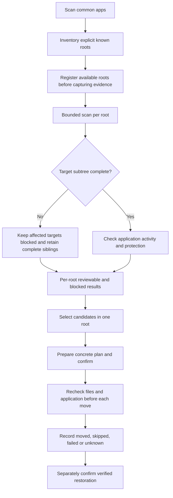

Moving to Trash is reported as a processed estimate, not freed disk space. Only independently complete targets may enter plans, even if the enclosing scan is partial. Missing legacy coverage does not authorize partial targets; cleanup-mode completion does not imply full-tree measurement.

## 2. Desktop fast path and detailed review

The initial view centers **Start Scan**, with scan modes in its adjacent menu and current disk capacity in the header. After the standard scan, eligible built-in and enabled personal-rule candidates are selected automatically. Category checkboxes and path details adjust the same selection; the fixed bottom bar shows its count, estimate and **Clean & Free Space** action. The immutable plan is created and revalidated behind that action; users do not navigate an internal plan screen. The scan-and-clean shortcut remains in the scan menu.

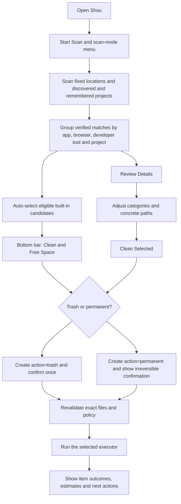

This path handles built-in and enabled personal rules together while retaining exact-scope review. The action is visible at the point of execution: **Move to Trash** is recoverable through the recorded batch; **Permanently Remove** is irreversible and remains bound to the selected plan.

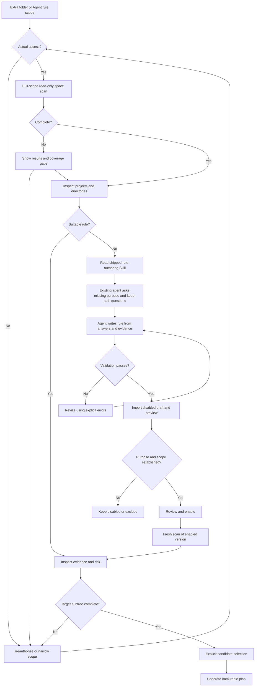

Large unknown directories remain visible. Rule cleanup requires eligible rule matches; explicit space-analysis removal can handle user-selected files or directories without a rule. Cleanup snapshots contain only rule-directed evidence. Repair access or rescan affected targets rather than planning from incomplete target evidence; an unrelated gap does not invalidate a complete sibling.

## 3. Confirmation and execution

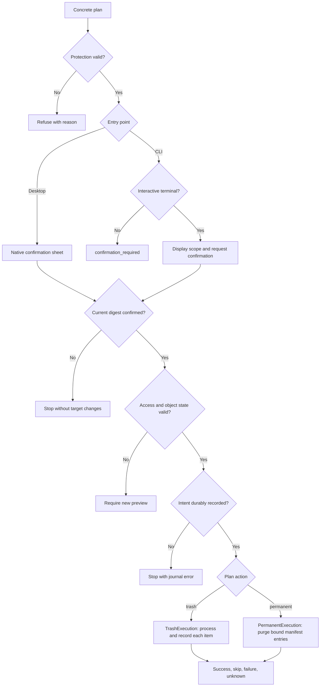

All entry points use the same policy. An unexpired plan still needs revalidation. Journal and filesystem operations are not a cross-system transaction.

Permanent removal uses an in-memory `PermanentRemovalContext` for one execution. The POSIX adapter pins shared regular files, checks exact metadata before `unlinkat`, then reads the same descriptor afterwards. Only a link count reduced by exactly one and the accompanying ctime change are recorded; every other field must remain unchanged. Subsequent entries and selected targets reconcile only that observed change against the original manifest. The context is discarded after the execution, so an earlier cleanup cannot authorize a stale plan. Windows retains its native verification and rejects unsupported hard-linked targets.

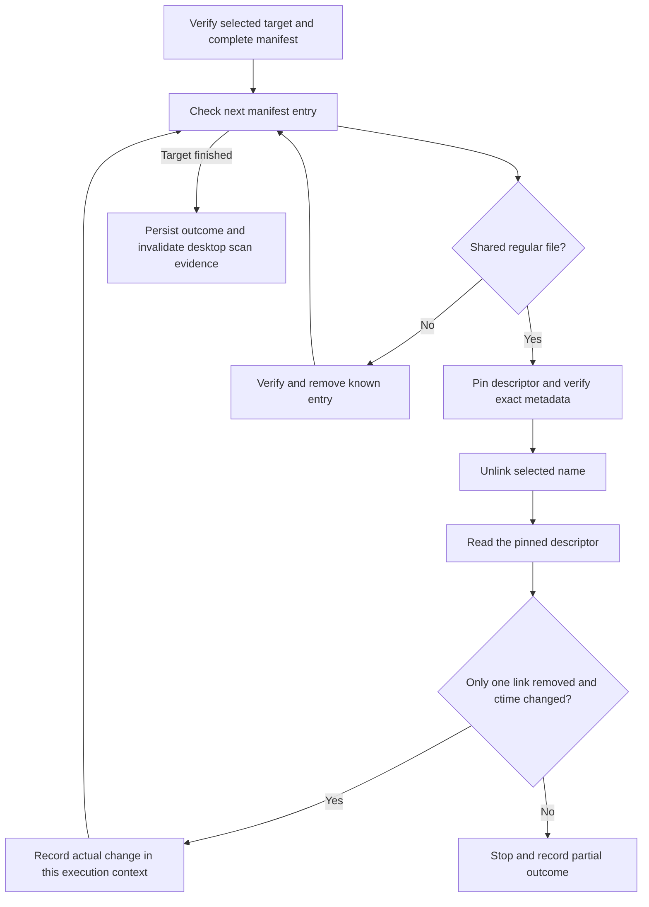

## 4. Native desktop sequence

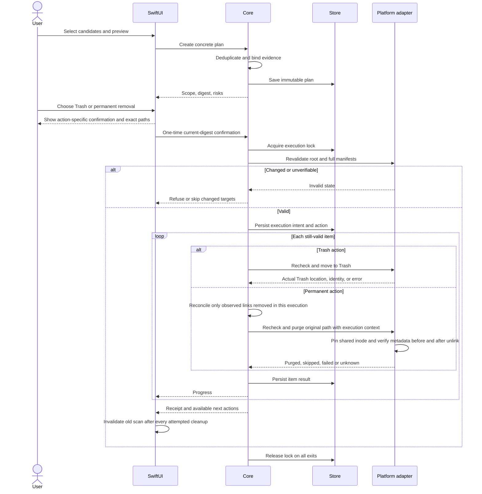

Recheck near each operation rather than relying only on one batch-start check. Resource release must cover every exception path.

## 5. Independent CLI sequence

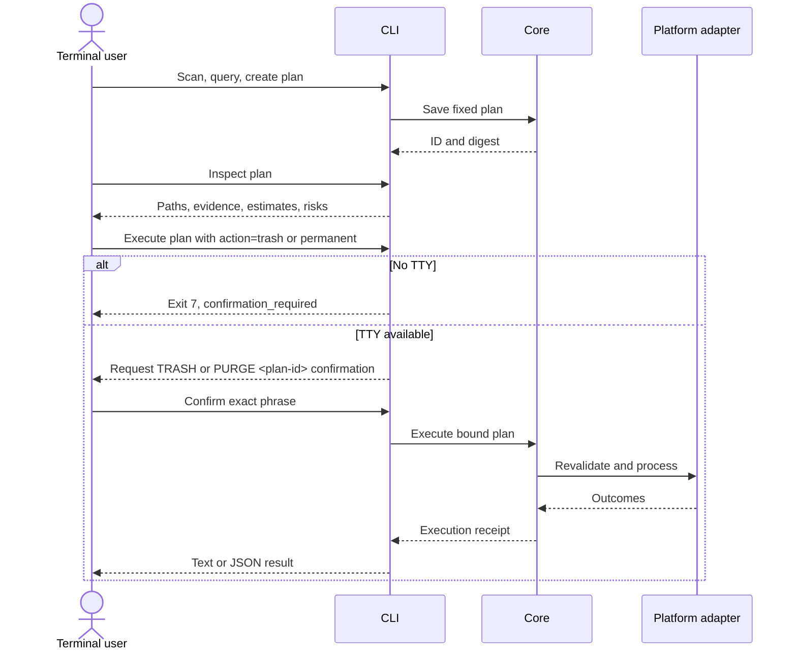

No desktop process starts. Existing-agent drafting/import is described in the [agent workflow](../ai/coding-agent-integration.md).

## 6. Recovery and permanent batch removal


Cancellation never triggers restoration. Permanent removal is irreversible and never empties unrelated Trash contents.

## 7. Interruption reconciliation

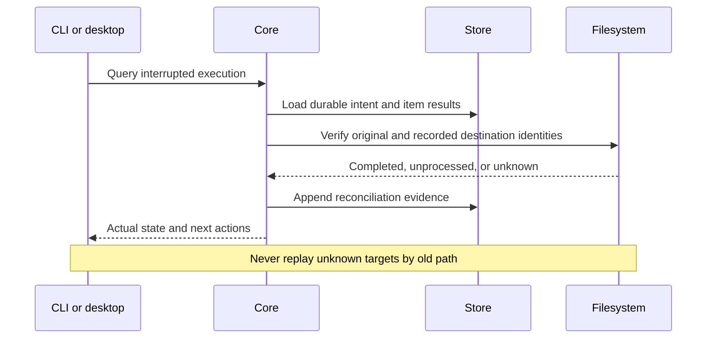

## 8. Invariants

Configuration/action/selection changes invalidate confirmation. Cancellation stops new items at safe boundaries while preserving completed facts; a single in-progress system Trash call may finish before stopping. Partial success is explicit. History records facts; current recovery availability requires inspection. Every exception has a CLI and GUI representation, not only a log entry.

For permanent execution, an item enters `purging` before the platform call and `purged` only after the result is durably recorded. A cancellation or unexpected failure leaves the batch `cancelled` or `partial`; Shou never reports an unverified item as permanently removed and never retries it by path alone.


## Explicit space-analysis removal

Space analysis now supports local volume/folder discovery and direct explicit file/directory removal, independently of cleanup-rule workspaces. Desktop list and treemap share navigation and normalized selection. Current manifests and exclusions are checked before confirmation and execution. It reuses existing mutation journals and history. See [space analysis architecture, flow and sequence](../product/space-analysis.md).

Default space measurement is separate from deletion manifests. A read-only worker streams all measured files into a private SQLite catalog with per-directory totals and completeness. Desktop and CLI query directories on demand; measurement no longer stops at the one-million-entry deletion-manifest cap. `StorageScan` references its catalog and records `measured_entry_count`; nodes expose `is_complete`, and partial sizes are lower bounds. Removal still requires fresh complete target manifests and independent verification. Legacy JSON and paged records remain readable.

Installation, access setup, limited-scope scanning and update identity follow the [installation flow and permission sequence](../product/installation-and-access.md).

## Application batches and privacy

Application uninstall follows incremental summaries → inline components → multi-application selection → one confirmation → batch preflight → per-component execution → shared history. Filtering preserves other selections. Permanent removal is the desktop default, with an explicit Trash alternative. See [application uninstall](../product/application-uninstall.md) for its flow, sequence and personal-data boundaries.

Privacy follows source/time-range scan → initially empty selection → separate Cookie consent → exact plan → irreversible confirmation → full preflight → per-source database transactions → aggregate receipt. Each source commits independently; later failures do not roll back already committed sources. There is no restore entry. See [privacy cleaning](../engineering/privacy-cleaning.md) for the architecture, flow and sequence diagrams.

## Space cleanup progress and return

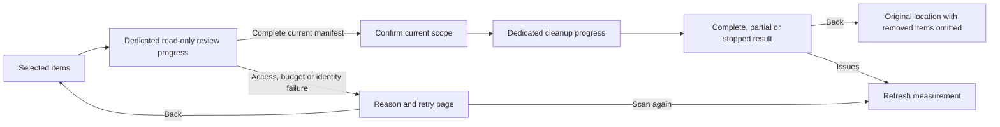

Discovery is a navigation snapshot. A directory may change before review if its object identity and owner remain the same; review creates a new complete manifest and updated size for confirmation. Regular files retain the discovery metadata check. After confirmation, the full manifest must match exactly. Incomplete reads expose their coverage cause and publish no removal plan. A result page preserves return navigation instead of ending in an acknowledgement-only alert.

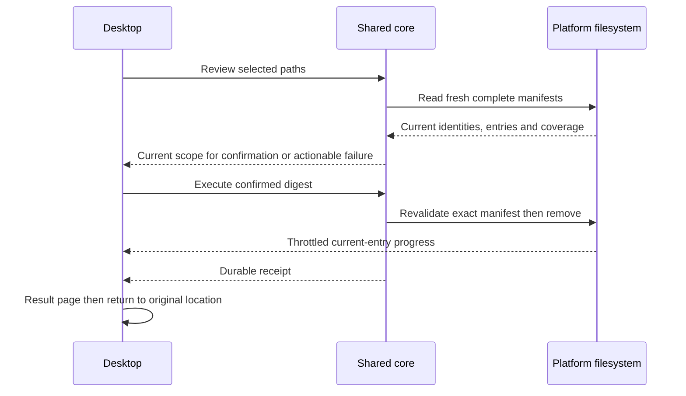

## History cleanup and actionable scan coverage

History shows an item, date, outcome and processed size by default. Execution IDs, per-item paths, recovery and verification are available in details. Clearing finished records removes local JSON receipts and related follow-ups while retaining recovery, unknown outcomes and unfinished operations. Removing one record explicitly acknowledges loss of Shou recovery links; active operations and pending follow-up intents remain protected. Referenced files and Trash contents are never removed. Consumed plan state remains intact, preventing replay.

Use `shou history cleanup-preview --json` to preview and `shou history clear` to confirm in a terminal. `--execution-id` selects one record; `--include-recoverable true` explicitly discards recovery links. Windows uses the same core through `history.cleanup-preview` and request-confirmed `history.clear`. Parent receipts are removed before follow-ups so interruption cannot make a restored item available for restoration again.

Coverage notices concern the current directory. Unreadable siblings elsewhere do not mark a complete project folder as incomplete. System-managed locations such as `.fseventsd`, `.Spotlight-V100` and `.DocumentRevisions-V100` use an informational scope note, with individual paths collapsed. The core preserves incomplete coverage facts. User-directory access failures offer setup and Finder actions; changed or temporarily unreadable folders can be rescanned directly. Full Disk Access does not override Unix ownership or system protection, and Shou does not change system permissions to inspect system-managed directories.

Only access/readability issues qualify as system-managed exclusions; resource limits and scan-time changes remain actionable, including when scanning a system root. After cleanup, the return page offers a measurement refresh instead of labeling changed totals as an access problem. Windows consumes the same coverage classification and directory completeness, with Explorer and focused rescan actions; its default bridge scan uses the shared disk-backed measurement path.

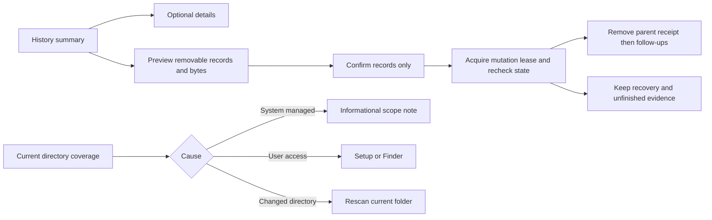

## 0.9.0 daily and custom cleanup

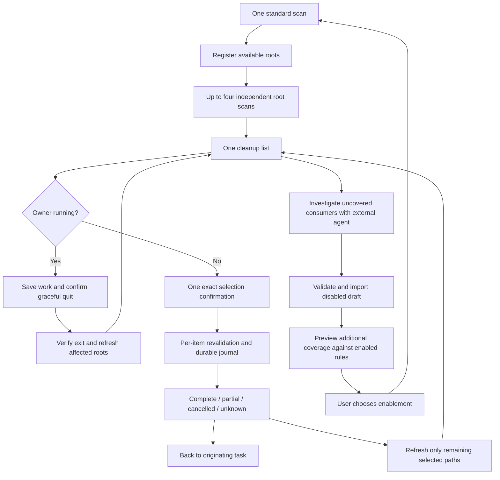

```mermaid
sequenceDiagram
    actor User
    participant UI as Desktop or CLI
    participant Core as ToolCleanupService
    participant Native as NativeCleanupTools
    participant Store as Local records
    User->>UI: Check tool storage
    UI->>Core: scan
    Core->>Native: Fixed read-only preview
    Native-->>Core: Bounded output and executable identity
    Core->>Store: Save targets and evidence
    User->>UI: Confirm one target and impact
    UI->>Core: Execute plan and digest
    Core->>Native: Repeat preview and compare evidence
    Core->>Store: Executing intent and consumed plan
    Core->>Native: Fixed owner cleanup in process group
    Native-->>Core: Exit / timeout / cancellation
    Core->>Native: Verify current tool storage when possible
    Core->>Store: Completed / partial / unknown receipt
    Core-->>UI: Typed result; no blind replay
```

Orphan removal first checks complete standard application coverage and native registration/activity. It rechecks absence, ownership, exclusions and the full component manifest before execution and again at each mutation boundary. Personal data is a separate opt-in. Permanent and Trash paths use shared per-item journals; Trash restoration remains separately confirmed. Derived-record maintenance never removes these journals or user targets.

```mermaid
sequenceDiagram
    participant Core as Shared execution
    participant Journal as ReceiptJournal
    participant Store as Local records
    participant FS as Native filesystem
    Core->>Journal: Complete manifest and pending receipt
    Journal->>Store: Persist immutable large manifest
    Journal->>Store: Publish small receipt referencing manifest
    Core->>FS: Revalidate identity and contents
    Core->>Journal: Save moving or purging intent
    Journal->>Store: Update state only
    Core->>FS: Execute explicit selection
    FS-->>Core: Verified or unknown outcome
    Core->>Journal: Save result
    Note over Journal,Store: Changed manifest gets a new version; failed result write preserves intent
    Journal->>Store: Publish final state and paged summary
```

The independent personal-rule flow and sequence—major-consumer investigation, separate disabled drafts, native review, a fresh chosen-rule scan, confirmation and receipt verification—are recorded in [space analysis and Agent design W09](../engineering/space-analysis-agent-design.md). External configuration changes invalidate old cleanup evidence without enabling other rules; daily cleanup reuses explicitly enabled choices.
