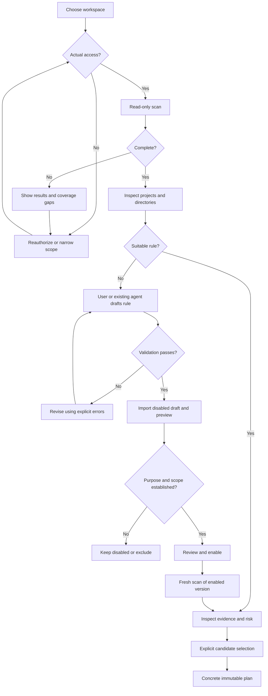
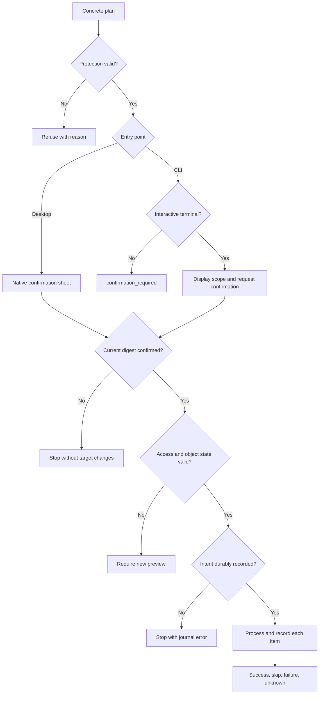
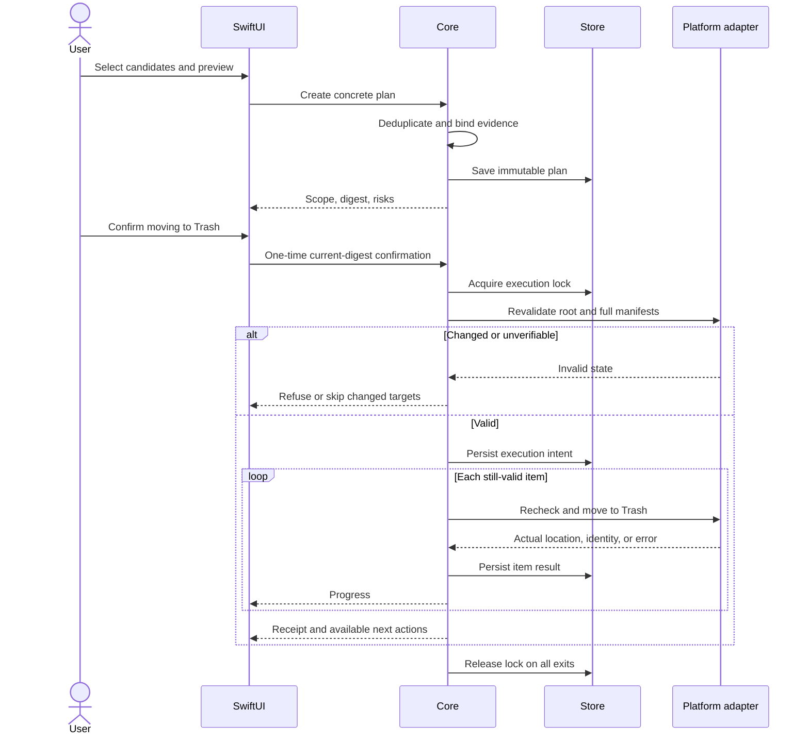
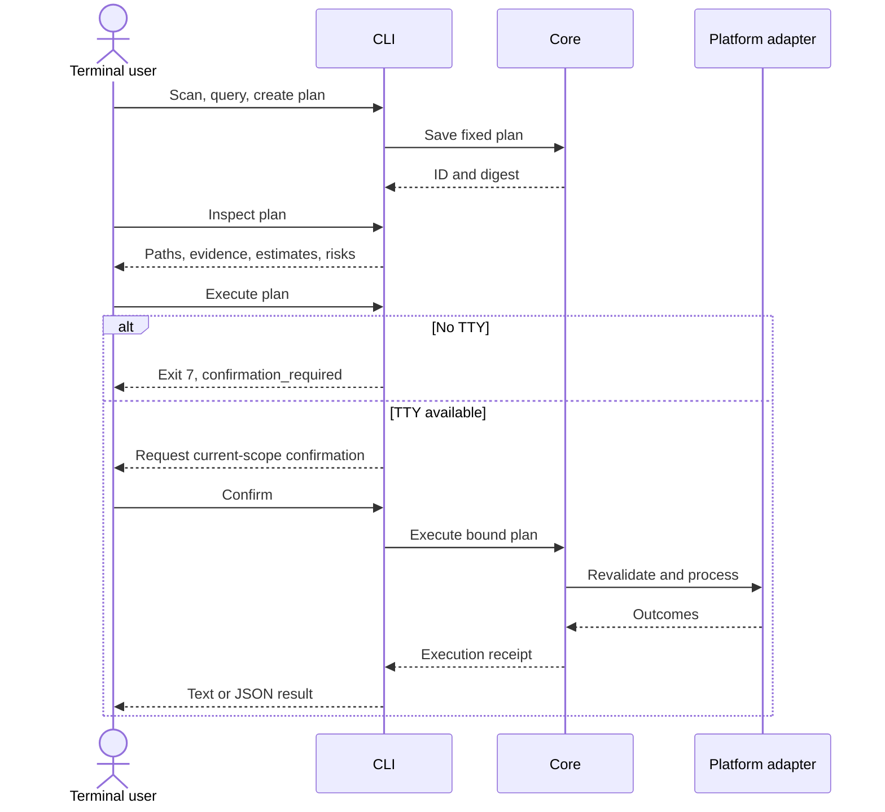
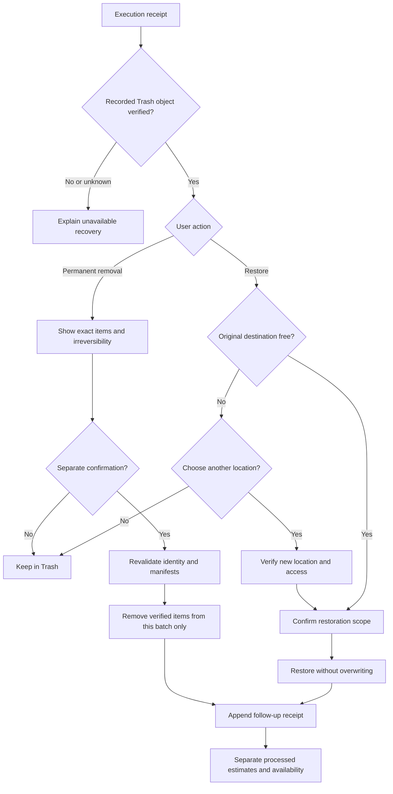
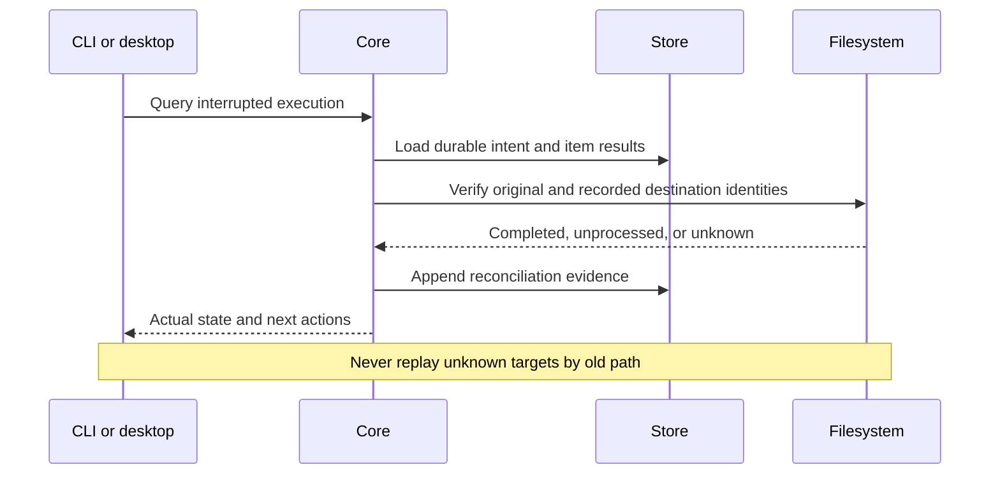

# Workflows and sequence diagrams

English | [简体中文](../zh-CN/architecture/workflows-and-sequences.md)

Status: design draft. Diagrams specify intended behavior, not implemented capabilities.

## 1. Discovery and personal rules

Large unknown directories stay visible but are not executable. Repair access or rescan narrower scope rather than planning from incomplete evidence.

## 2. Confirmation and execution

All entry points use the same policy. An unexpired plan still needs revalidation. Journal and filesystem operations are not a cross-system transaction.

## 3. Native desktop sequence

Recheck near each operation rather than relying only on one batch-start check. Resource release must cover every exception path.

## 4. Independent CLI sequence

No desktop process starts. Existing-agent drafting/import is described in the [agent workflow](../ai/coding-agent-integration.md).

## 5. Recovery and permanent batch removal

Cancellation never triggers restoration. Permanent removal is irreversible and never empties unrelated Trash contents.

## 6. Interruption reconciliation

## 7. Invariants

Configuration/action/selection changes invalidate confirmation. Cancellation stops new items while preserving completed facts. Partial success is explicit. History records facts; current recovery availability requires inspection. Every exception has a CLI and GUI representation, not only a log entry.
