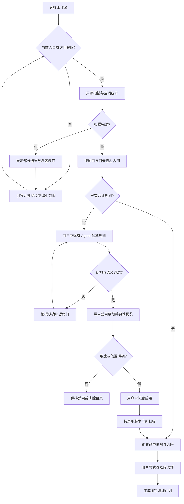
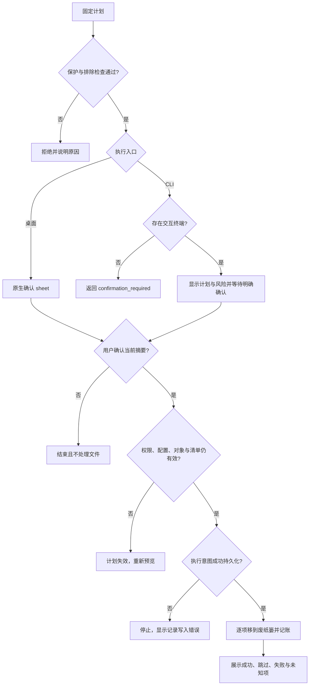
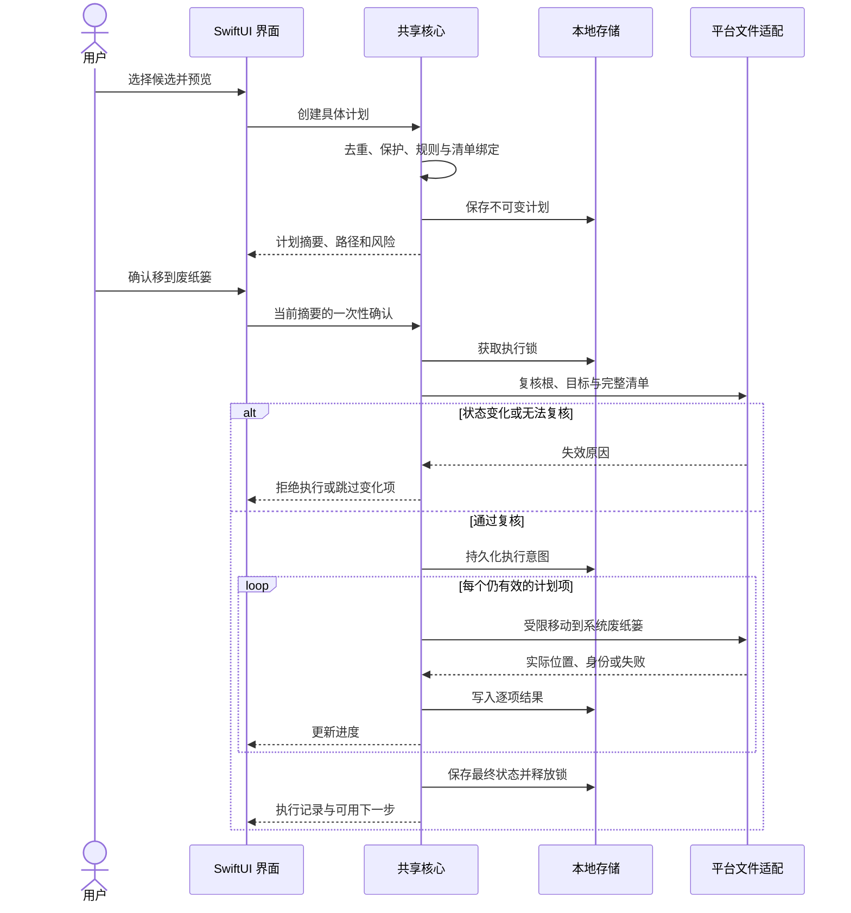
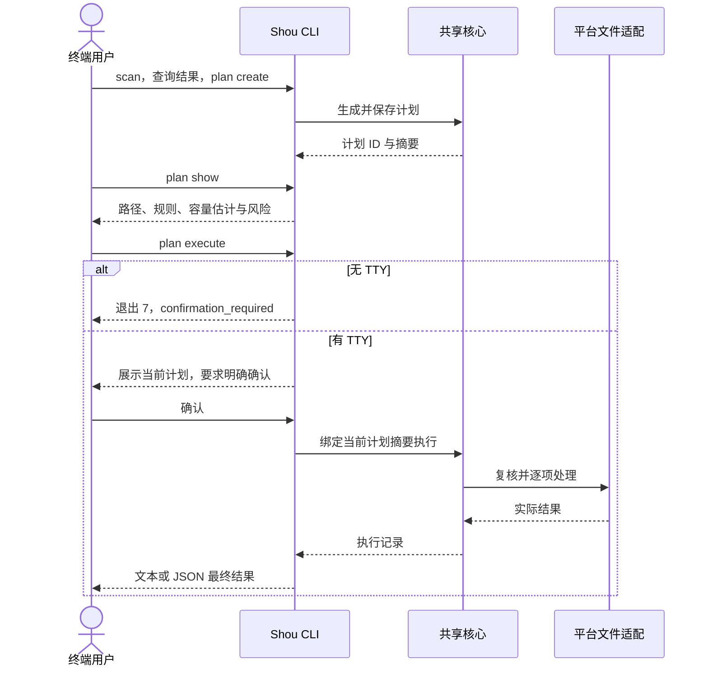
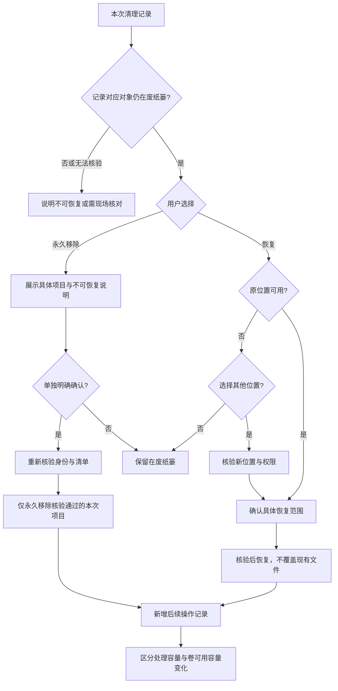
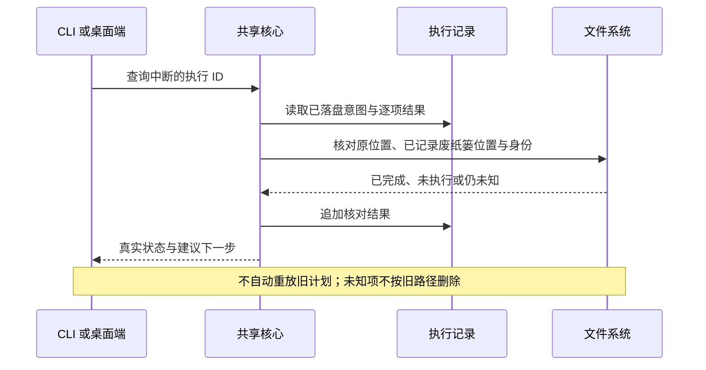

# 核心流程与时序

状态：设计草案。以下图描述目标行为，不代表已有实现。

## 1. 从占用发现到个人规则

没有规则的大目录不会被隐藏，也不会仅凭体积成为可执行目标。完整扫描是计划前提；权限缺口需修复或通过更窄范围重新扫描。

## 2. 计划与执行决策

任一入口均调用相同策略。计划尚未过期也不能跳过复核；记录与文件操作不是跨系统事务，异常现场需要核对。

## 3. 桌面端清理时序

锁在所有出口释放；图省略了统一资源释放块。执行期间每个目标仍需紧邻操作复核，不能把批量开始时的一次检查当作全程有效。

## 4. CLI 独立清理时序

此流程不启动桌面端。外部 Agent 的规则导入与预览时序见 [Agent 操作指南](../ai/coding-agent-integration.md)。

## 5. 立即释放空间与恢复

选择其他位置后仍需重新验证目标位置与权限；取消不触发恢复。永久移除不提供恢复承诺，也不清空其他废纸篓内容。

## 6. 中断与恢复核对

## 7. 状态一致性要求

- 用户改变排除、规则或动作后，当前预览与确认不能继续沿用。
- 取消尽快停止启动新项，已经完成的移动保留在历史中。
- 批次不是全有或全无事务，部分成功必须直说。
- 历史是操作事实；当前是否可恢复由现场核验决定。
- 成功路径与异常路径都必须在 CLI 和 GUI 中有对应表示，不能只在日志里记录。
