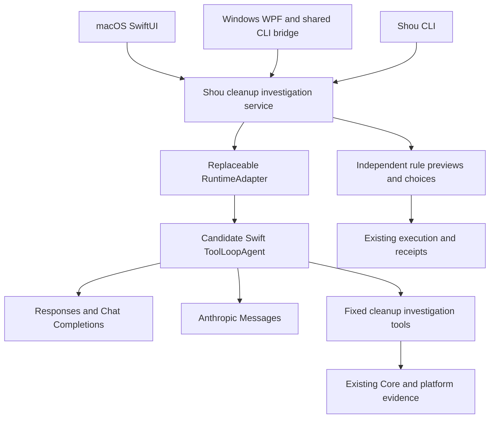

# Cleanup-specific Agent Core research

English | [简体中文](../zh-CN/engineering/agent-core-selection.md)

Date: 2026-10-22. This preserves the SDK-selection evidence. The working tree subsequently adopted Swift AI SDK 0.20.0 and verified synthetic multi-turn calls and pause/resume for all three protocols on macOS. See [implementation, pinned revision and remaining acceptance](embedded-ai-implementation.md). Candidate priorities below do not establish Windows or real-service acceptance.

Subsequent routing prioritizes deterministic code, then Jev fixed decisions, escalating to main models as needed. The SDK owns generative loops without requiring every task to use one. See [AI product contract](../product/embedded-ai.md) and [current/target architecture](../architecture/embedded-ai.md).

## Recommendation

Prioritize **teunlao/swift-ai-sdk's `ToolLoopAgent`** for a prototype, with **Tachikoma** as the comparison. Shou owns cleanup scope, evidence, retention choices, independent rules and receipts; reuse model loops, streaming protocols and tool-call plumbing where practical. This revises the previous default of implementing every protocol adapter directly.

This is a prototype priority, not a completed production selection. Neither candidate's reviewed CI covers Windows. Verify cross-platform builds and protocol contracts before pinning a dependency. Swift source, Linux support and a CLI do not independently establish Windows compatibility.

Built-in cleanup AI entered next-stage product scope on 2026-10-22, withdrawing the old no-model/no-Agent constraint; follow [AI01–AI06](implementation-plan.md). Fresh upstream review found the latest Swift AI SDK release is `v0.20.0` (2026-10-17), with Responses present in that tag. It changes public Agent/provider APIs and runs CI on `macos-26`, which does not establish macOS 14 or Windows runtime behavior. Prove bounded multi-turn tools, pause/resume and cancellation before choosing a production dependency.

## Method and baseline

Discover public repositories, then inspect READMEs, package manifests, tool loops, protocol adapters and CI. Check release tags separately so main-branch features are not attributed to published versions. Search snippets, stars and test-file counts are not quality evidence.

Shou declares Swift tools 6.0 and macOS 14; the local compiler is Swift 6.2.3. macOS uses native UI, while Windows already reuses behavior through a shared Swift CLI bridge. Required capabilities include Responses, Chat Completions, Anthropic Messages, custom endpoints, cleanup tools, streaming, cancellation and user questions.

## Evidence from related software

| Product | Reviewed source | Implication for Shou |
| --- | --- | --- |
| [Peekaboo](https://github.com/openclaw/Peekaboo) | Its [Core manifest](https://github.com/openclaw/Peekaboo/blob/main/Core/PeekabooCore/Package.swift) connects `PeekabooAgentRuntime` to `Tachikoma`; [submodules](https://github.com/openclaw/Peekaboo/blob/main/.gitmodules) explicitly include Tachikoma | Native desktop, CLI, domain tools and model SDK can be separated; real adoption does not establish Windows support |
| [Osaurus](https://github.com/osaurus-ai/osaurus) | Its own [AgentToolLoop](https://github.com/osaurus-ai/osaurus/blob/main/Packages/OsaurusCore/Services/Chat/AgentToolLoop.swift), [RemoteProviderService](https://github.com/osaurus-ai/osaurus/blob/main/Packages/OsaurusCore/Services/Provider/RemoteProviderService.swift) and [guide](https://github.com/osaurus-ai/osaurus/blob/main/docs/AGENT_LOOP.md) describe clarification, completion, budgets and a shared loop | Learn domain/protocol separation, question suspension and consistent budgets; adopting its full assistant scope would expand Shou unnecessarily |
| [Magpie](https://github.com/hsen-hash/magpie) | Its [manifest](https://github.com/hsen-hash/magpie/blob/main/Package.swift) has no third-party package dependencies; [Categorizer](https://github.com/hsen-hash/magpie/blob/main/Sources/Magpie/Categorizer.swift) abstracts classification and its [coordinator](https://github.com/hsen-hash/magpie/blob/main/Sources/Magpie/CategorizationCoordinator.swift) applies rules before batched inference | A dedicated file workflow can reduce inference through rule reuse; this early classifier does not replace multi-step investigation of unfamiliar large directories |

These sources demonstrate different approaches, not a ready-made cleanup core covering all Shou requirements. Do not infer proprietary products' Agent frameworks without public implementation evidence.

## Candidates

| Candidate | Reviewed capabilities and requirements | Assessment for Shou |
| --- | --- | --- |
| [Swift AI SDK: teunlao](https://github.com/teunlao/swift-ai-sdk) | `v0.20.0` declares Swift 6.0/macOS 13; the tag includes ToolLoopAgent, OpenAI Responses/Chat, compatible-service and Anthropic modules; stopWhen, prepareStep and streaming entry points | First prototype: relevant loop/provider abstractions; verify exact tagged protocol behavior and Windows. This community port is not Vercel's official Swift SDK |
| [Tachikoma](https://github.com/openclaw/Tachikoma) | Main declares Swift 6.2/macOS 14, three protocols, custom compatible endpoints; Mac/Linux CI and source-confirmed Peekaboo adoption | Main comparison/model-tool foundation; main and v1.0.0 differ substantially. Verify streaming loop semantics and the exact selected revision |
| [AnyLanguageModel](https://github.com/huggingface/AnyLanguageModel) | 1.0.0 requires Swift 6.3/macOS 14; three protocols, tool execution delegates, optional local backends; Mac/Linux CI | Clean backup abstraction, but requires a toolchain upgrade. Windows unverified; local inference is not currently required |
| [Swift AI SDK: zaidmukaddam](https://github.com/zaidmukaddam/swift-ai-sdk) | Swift 6.0/macOS 13, no third-party package dependencies; Agent supports maxSteps, step preparation and streaming, with a separate Responses implementation; reviewed CI is Mac | Smaller comparison implementation, distinct from the similarly named project; full protocol/platform behavior still needs verification |
| [AgentRunKit](https://github.com/Tom-Ryder/AgentRunKit) | Swift 6.1/macOS 15; typed tools, completion tools, budgets and clear terminal results; OpenAI/Responses/Anthropic clients | Useful loop design; deployment baseline exceeds Shou's and Windows is unverified. A dependency-free core does not make the whole package dependency-free |
| [SwiftedMind/SwiftAgent](https://github.com/SwiftedMind/SwiftAgent) | Current manifest requires Swift 6.2/macOS 26; OpenAI/Anthropic sessions use FoundationModels types | Does not meet Shou's macOS 14 baseline; similarly named repositories must be distinguished |
| [Vercel AI SDK](https://ai-sdk.dev/docs/agents/building-agents) / [OpenAI Agents SDK](https://developers.openai.com/api/docs/guides/agents/sdk) | TypeScript ToolLoopAgent for the former; official TypeScript/Python SDKs for the latter | Reference their loop/event/tool design; adopting the runtimes adds a foreign-language host, so they are not the first choice for the current Swift approach |

Requirements come from reviewed manifests or official documentation. Except where a tag is explicit, features describe main. Reviewed CI configuration describes upstream test scope, not a successful local build in this investigation.

## Material differences

In Tachikoma main's `Generation.swift`, non-streaming `generateText` has a maxSteps tool loop, but the provider-taking `streamText` overload declares `maxSteps _: Int = 1`. Do not assume both entry points implement the same automatic multi-step execution. This is a source observation requiring runtime verification on the selected revision.

Swift AI SDK's ToolLoopAgent forwards generation and streaming through shared tool configuration, stop conditions and step preparation, matching a bounded cleanup investigation. Shou must still explicitly set task budgets, network deadlines, cancellation and recovery instead of adopting SDK loop/timeout defaults as product policy.

Custom endpoint support also does not establish identical capabilities across compatible services. Verify arguments, continuation history, structured output, stream errors and real terminal states separately for each protocol.

## Proposed integration

Shou owns cleanup task state/results; the SDK owns model/tool iteration. A thin RuntimeAdapter translates tool contracts and events, keeping SDK types out of cleanup rules and execution. Reuse the SDK loop instead of maintaining a duplicate general model loop.

Tools query directories, necessary project configuration, applicable tool state, retention questions and rule previews. Unfamiliar large areas may require several evidence rounds; missing retention conditions require user input. Existing Core performs selected permanent cleanup, while fixed/enabled rules retain one-click reuse.

Clef/Jev remain separate optional decision providers; do not disguise them as generative tool-calling models or require multiple providers on each round.

## Prototype acceptance and tracking

| Work item | Status | Required evidence |
| --- | --- | --- |
| Official/source/version research | Complete | Candidate identity, requirements, protocol scope and sources are reviewable |
| Mac build and deployment baseline | Unverified | Pinned version builds with the available toolchain and runs on macOS 14; a manifest check alone is insufficient |
| Windows build and task execution | Unverified | Shared bridge supports the same core, network streams, cancellation and credential adaptation |
| Three protocol contracts | Unverified | Synthetic requests/mocks cover endpoint prefixes, tool IDs, continuation, truncation, throttling and in-stream errors |
| Bounded investigation and questions | Unverified | Multiple tool rounds, question pause/resume and step/token limits preserve correct state |
| Cleanup closure | Unverified | Isolated fixtures cover major-directory investigation, separate rule selection and receipts; SDK failures retain existing results |
| Production dependency pin | Not performed | Choose exact versions/modules and review dependencies/licenses after acceptance |

No directory evidence was sent to models, and no application dependency was changed or candidate framework installed. Local research and file digests are stored under `.build/agent-core-research-20261022/` and are not distributed.

## Sources and acknowledgements

- [Swift AI SDK v0.20.0 release notes](https://github.com/teunlao/swift-ai-sdk/releases/tag/v0.20.0), [tagged Responses implementation](https://github.com/teunlao/swift-ai-sdk/blob/v0.20.0/Sources/OpenAIProvider/OpenAIResponsesModel.swift) and [tagged CI](https://github.com/teunlao/swift-ai-sdk/blob/v0.20.0/.github/workflows/test.yml): the fresh release/API/platform review, without candidate builds or inference tests.
- [Swift AI SDK v0.20.0 manifest](https://github.com/teunlao/swift-ai-sdk/blob/v0.20.0/Package.swift), [ToolLoopAgent](https://github.com/teunlao/swift-ai-sdk/blob/v0.20.0/Sources/SwiftAISDK/Agent/ToolLoopAgent.swift), [settings](https://github.com/teunlao/swift-ai-sdk/blob/main/Sources/SwiftAISDK/Agent/ToolLoopAgentSettings.swift) and [CI](https://github.com/teunlao/swift-ai-sdk/blob/main/.github/workflows/test.yml).
- [Tachikoma main manifest](https://github.com/openclaw/Tachikoma/blob/main/Package.swift), [v1.0.0 manifest](https://github.com/openclaw/Tachikoma/blob/v1.0.0/Package.swift), [generation/streaming implementation](https://github.com/openclaw/Tachikoma/blob/main/Sources/Tachikoma/Core/Generation.swift) and [CI](https://github.com/openclaw/Tachikoma/blob/main/.github/workflows/ci.yml).
- [AnyLanguageModel 1.0.0 manifest](https://github.com/huggingface/AnyLanguageModel/blob/1.0.0/Package.swift), [tool execution delegates](https://github.com/huggingface/AnyLanguageModel/blob/main/Sources/AnyLanguageModel/ToolExecution.swift) and [CI](https://github.com/huggingface/AnyLanguageModel/blob/main/.github/workflows/ci.yml).
- [zaidmukaddam manifest](https://github.com/zaidmukaddam/swift-ai-sdk/blob/main/Package.swift) and [Agent](https://github.com/zaidmukaddam/swift-ai-sdk/blob/main/Sources/AI/Core/Agent.swift); [AgentRunKit manifest](https://github.com/Tom-Ryder/AgentRunKit/blob/main/Package.swift); [SwiftedMind manifest](https://github.com/SwiftedMind/SwiftAgent/blob/main/Package.swift).
- [Vercel building agents](https://ai-sdk.dev/docs/agents/building-agents), [loop control](https://ai-sdk.dev/docs/agents/loop-control) and [official OpenAI Agents SDK](https://developers.openai.com/api/docs/guides/agents/sdk).
