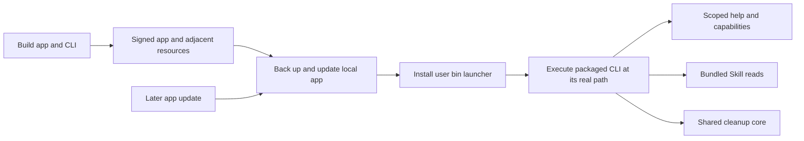

# Local development

English | [简体中文](../zh-CN/engineering/development.md)

This guide covers source builds. A development build is not a signed, notarized release or evidence that every acceptance gate has passed.

## Toolchain and layout

Use Swift 6 or later and the macOS SDK, with macOS 14 as the deployment baseline. The root Swift package builds the native application, independent CLI, portable core, platform adapter, and isolated test executable. No model SDK, JavaScript dependency manager, or running desktop process is required for the CLI.

```sh
swift build --jobs 4
.build/debug/shou --help
```

Launch the GUI from the locally signed application bundle, which includes its resources, independent CLI and read helper:

```sh
sh scripts/build-macos.sh debug
open dist/Shou.app
dist/Shou.app/Contents/Helpers/shou capabilities --json
```

The bundle script uses an ad-hoc signature for local development. Developer ID signing, notarization, clean-machine installation, updates, and distribution require separate release validation.

The desktop build product is `ShouDesktop`, while the CLI is `shou`. Distinct names prevent collisions on case-insensitive filesystems; the packaged application remains `Shou.app`.

### Install a terminal entry

After installing the application, run:

```sh
python3 "scripts/install-cli.py"
shou --version
shou skills --help
shou capabilities --command skills --json
```

The source-tree helper creates `~/.local/bin/shou`, a small launcher that executes `/Applications/Shou.app/Contents/Helpers/shou` with the original arguments, streams and exit code. Updating the app therefore updates this terminal entry's binary and bundled resources together; no desktop process is required. It avoids executable symlinks, which can make SwiftPM locate a development fallback instead of the installed resources. Existing different files or links are preserved. The helper does not edit `PATH` or shell settings; its JSON result states whether the selected bin directory is already on `PATH`. `--bin-directory` selects a different directory; `--executable` can select a CLI in a retained standalone distribution directory with adjacent bundles. This helper uses Python 3; the installed launcher and native CLI do not.

`python3 scripts/verify-cli-install.py` tests relocated packages, quoted paths, argument/exit forwarding, repeated installation and conflict preservation using temporary directories. `capabilities`, help and Skill reads remain usable without opening the cleanup record store.



The desktop's native filesystem adapter uses `Contents/Helpers/shou` for short-lived root-identity and scan reads. Use the packaged application when validating this path: a standalone desktop binary has no bundled helper. The internal worker entry opens no record store and is not part of public CLI discovery. Normal CLI use remains independent of the desktop. Parent-process mutation and confirmation/receipt checks remain in place. See the [read-operation boundary](../architecture/system-design.md#isolated-read-operations).

## Verification

```sh
sh scripts/test.sh
```

The test executable runs rule, domain, and real filesystem checks in temporary fixtures. It requires neither XCTest nor Swift Testing, allowing the same suite to run with Command Line Tools. Most domain cases use an isolated fixture Trash. `scripts/test.sh` defaults to `--native-trash`: all 74 bundled rules and their patterns exercise system Trash → restore, comparing the complete fixture file hashes and retained files. This default native suite does not permanently remove items from Trash. Application/build activity is fixed to idle for these generated fixtures; separate tests cover activity gates, Git ownership, and retained Cargo archives.

The CLI checks cover noninteractive refusal, cancellation, and native Trash → restore with real terminal confirmation restricted to generated fixture paths. `scripts/verify-native-cli.py` also defaults to restore only. These checks run through `scripts/test.sh`. Only an explicit `sh "scripts/test.sh" --native-trash-purge` additionally enables an isolated direct `action=permanent` plan, bounded permanent removal in the native catalog and CLI suites, and selected Trash follow-up purge. No native test enumerates or empties the user's Trash; permanent and follow-up operations use only exact fixture manifests or receipt items.

Run the large-target regression separately after building:

```sh
".build/debug/shou-tests" --native-large-trash-only
```

This explicit entry creates more than 100,000 distinct fixture files and exercises native Trash → restore. It checks the full descendant manifest, sentinel hashes and retained source, with no purge or full-Trash enumeration. It is not included in the default suite. These commands define verification procedures; record actual execution results separately from this contract.

These checks do not establish native Trash API race behavior, UI accessibility, third-party agent compatibility, or Windows support. Keep those gates separate in [acceptance and testing](acceptance-and-testing.md).

The desktop uses Sparkle 2.10.0 for online updates; the core and CLI have no third-party runtime dependency. `Package.resolved` pins the framework distribution. Packaging embeds Sparkle and its helpers. See [releasing](releasing.md) for universal builds, update signing, and the GitHub Actions release gate.

Local isolated-fixture verification has exercised the installed desktop's project scan, preview cancellation, explicit cleanup, history and restoration. All 1,035 fixture files matched their original SHA-256 after restoration. A personal rule was also created as a disabled draft, previewed without execution, exported through the native save panel, enabled for a fresh scan, then used for an explicitly confirmed cleanup and GUI restoration with the same hash result. The independent large-target native regression restored 100,103 files with a 100,204-entry manifest, matching full descendant metadata, sentinel hashes and retained source, without purge. These are scoped results; GUI and terminal privacy access, fault cases and distribution remain separate gates.

An isolated packaged application completed a project scan through its bundled read worker. Automated checks also covered direct/worker evidence equivalence, no record-store access, progress, snake-case protocol fields, invalid/foreign and oversized responses, cancellation, timeout, the two-live-child cap and capacity recovery. A separate packaged-worker rehearsal terminated the parent during a 20,000-file scan: the child watchdog exited without returning evidence, and all generated files remained. The installed desktop's standard scan reached a partial aggregate result and could stop at a stalled QQ root, then start again without an error alert. A stalled scan must return cancelled or limited rather than complete evidence.

An isolated application also downloaded a signed update from a localhost feed, installed it and automatically restarted from 0.0.9 into 0.1.0. The installed executable matched the update, and workspace/configuration hashes were retained. Settings, both interface languages, light/dark appearance, persistent preferences and the up-to-date response were exercised. This verifies the installation mechanism; the public GitHub feed and downloaded release artifacts still require verification after publication.

## Application identity and icon

The English name is Shou; the Chinese display name is 收拾一下, with “Tidy up. That's it. / 收好，就好。” as the slogan. The shared native artwork is maintained in [assets/brand](../../assets/brand/README.md). Rebuild all icon sizes and the vector export using `swift "scripts/generate-app-icon.swift"`. Packaging copies `Shou.icns`, declares it in `Info.plist`, and checks the packaged file against the source asset.

## Data and rules

The default user data location is `~/Library/Application Support/Shou`. CLI integration fixtures use `SHOU_DATA_DIR` with a dedicated absolute directory. The store requires user ownership and mode `0700`; record files use `0600`, atomic replacement, durable writes, and a cross-process mutation lock.

Register an explicit workspace, import a disabled draft, preview it, then enable and scan before selecting candidate IDs. See the [CLI contract](../ai/agent-and-cli-contract.md). There is no noninteractive confirmation bypass. `node_modules` remains a high-risk review scenario, and unknown data remains analysis-only.

The rule schema in `packages/shou-contracts/rule.schema.json` is the canonical structural contract and is bundled without fetching remote definitions. Rule implementations and display languages share this single contract.

## Localization

Edit `packages/shou-core/Localizable.xcstrings`, then generate SwiftPM-compatible native `.strings` resources:

```sh
python3 scripts/update-localizations.py
python3 scripts/update-localizations.py --check
```

The generated resources are checked in to support source builds with Command Line Tools. Do not edit them independently. Locale changes must not alter IDs, matching, digests, or execution decisions.

## Platform boundary

`ShouCore` imports portable Foundation and the language-independent contracts. POSIX descriptors, file identity, native Trash, no-overwrite restoration, bounded manifest removal, locking, and durable storage live in `ShouPlatform`. macOS UI code lives in its application target. A Windows adapter and native UI still require actual Windows implementation and validation.

Built-in templates live in `packages/shou-core/Sources/Resources/builtin-rules.json`. The catalog contains 74 templates and 35 fixed locations. Built-ins and personal rules share structural validation and execution gates; generated-source exceptions additionally require an exact trusted bundled definition and `NativeArtifactEvidence` facts. Rust/Swift definitions are version `1.1.0`; Cargo extracted-source validation also requires matching retained archive contents. Personal rules cannot request these exceptions.

Use `scan --scope full` (the CLI default) for storage accounting and directory queries; `scan --scope cleanup` limits discovery to rule prefixes and fully measures matched targets. `system scan` uses cleanup scope and defaults to `--include-projects false`; the desktop includes automatically discovered and remembered projects. Discovery probes a fixed list of conventional project collections without recursively enumerating the entire home directory. Snapshots separate discovery status, whole-tree completeness and independently complete targets. The UI must identify sparse cleanup evidence rather than reuse it as full space analysis. See [coverage fields](../architecture/data-model.md) and [CLI behavior](../ai/agent-and-cli-contract.md).

Storage accounting, cleanup categories, and treemap calculations live in the shared core. `scripts/verify-products.py` checks desktop/CLI artifact identity to prevent overwriting on case-insensitive filesystems. The native desktop execution-stop fixture left 22 of 24 targets unprocessed, restored the two moved items, and matched all 12,336 file hashes. Accessibility, fault cases and distribution retain their own acceptance boundaries; see the [local verification record](acceptance-and-testing.md#11-local-verification-record--2026-10-19).

Space catalogs link SQLite 3 through the `CSQLite` system-library target. The macOS SDK supplies SQLite; Linux builds require SQLite 3 development headers. The Swift core has no AppKit or Darwin dependency; the platform adapter owns local metadata traversal and the read-only worker.

## Install a verified local build

Run `python3 "scripts/install-macos.py" --check` after building to validate the bundle signature, matching desktop/CLI version, and adjacent Skill resources. Quit Shou normally, then run `python3 "scripts/install-macos.py"`. The installer stages and verifies the app, retains the previous installation under `.build/local-install/`, verifies installed bytes, preserves existing Shou records, and restores the previous app if installation verification fails. The default source and destination must be on the same filesystem for atomic rename. It never edits macOS privacy permissions.

For a stable local signing identity, explicitly set `SHOU_SIGNING_IDENTITY` to your Developer ID Application certificate hash when running `sh "scripts/build-macos.sh" release native`. No identity is selected automatically from the keychain. With no selection, the build is ad-hoc signed and updates may invalidate privacy approvals. Set `SHOU_SIGNING_TIMESTAMP=required` for a network timestamp; notarization remains a separate release requirement. See [installation and disk access](../product/installation-and-access.md).

Targeted regressions: `shou-tests --scan-access-only` and `shou-tests --storage-performance-only`. The latter compares bulk metadata against the exact stat-based evidence, including sparse files, hard links and Unicode names. macOS uses batch metadata reads when all fields are available, falls back to per-file stat when necessary, and passes known parent IDs directly into SQLite. This changes measurement throughput, not cleanup authorization.

## Targeted batch, privacy and rule verification

Run after the build completes; do not start concurrent Swift builds. Destructive tests use generated fixtures only.

```sh
swift build --product shou-tests
".build/debug/shou-tests" --applications-only
".build/debug/shou-tests" --privacy-only
".build/debug/shou-tests" --mole-rules-only
python3 "scripts/verify-mole-coverage.py" --self-test
python3 "scripts/verify-application-batch-cli.py" "dist/Shou.app/Contents/Helpers/shou"
```

Batch CLI verification uses unique generated applications and isolated records for summaries, confirmation cancellation, Trash/restoration and permanent removal, checking retained personal preferences. Privacy database tests inject a fixture home and never change real browsing records. Rule-source verification proves declaration/mapping consistency; application-version compatibility requires separate acceptance.
