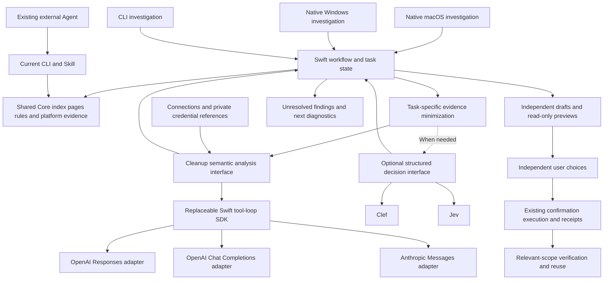

# Cleanup-specific AI investigation: Swift and model protocols

English | [简体中文](../zh-CN/engineering/embedded-ai-investigation.md)

Date: 2026-10-22. Swift AI SDK 0.20.0 is adopted with synthetic three-protocol/multi-turn/question/preview evidence and generated-fixture live checks against the selected Responses gateway/Jev. macOS 14, Windows and release acceptance remain open; see [implementation](embedded-ai-implementation.md). Live tests send generated relative metadata, not personal folders/content. The old no-model/no-Agent restriction is withdrawn.

This preserves integration research. The subsequent contract is [AI stories/interaction](../product/embedded-ai.md), [Jev-first routing/architecture](../architecture/embedded-ai.md) and [acceptance](embedded-ai-acceptance.md). Sufficient local/Jev tasks do not call a main model first; historical candidate diagrams do not define the new routing policy.

## Recommendation

Build a cleanup-specific Agent next so users can finish major-consumer attribution, focused questions, independent rule previews and cleanup inside Shou. Compare prototype steps, time and investigation quality against the existing external workflow to establish actual benefit. The external-Agent CLI/Skill route remains useful for terminal users.

The current choice centers business logic on a native Swift cleanup investigation service, with a replaceable Swift tool-loop SDK to evaluate and no Pi/Node runtime. Shou investigates storage and purpose, prepares independent rules and completes the existing cleanup flow. OpenAI Responses, OpenAI Chat Completions and Anthropic Messages are three required protocol adapters, with user-configurable official or compatible services. Clef/Jev remain optional structured decision providers, not prerequisites for native analysis; multiple services need not be called on every run.

[Agent Core research](agent-core-selection.md) prioritizes Swift AI SDK's ToolLoopAgent for a prototype, with Tachikoma as the main comparison. Prefer SDK protocol/tool-loop reuse while Shou owns cleanup-domain state. These are candidate designs; pin production dependencies after Mac/Windows and protocol acceptance.

Rules already have a defined schema. Models propose purpose, conditions and rule intent; Swift constructs and validates personal rules from observed paths and user retention choices. Unfamiliar large areas still require descent, necessary configuration evidence or questions; missing templates must not hide them. The selected compatible model can interpret unfamiliar build logic within cleanup-specific semantic analysis, with only cleanup investigation actions exposed.

## Product scope

An investigation starts with a user's cleanup request and ends with receipts for the selected cleanup or an explicit retention decision. Every investigation action serves a specific cleanup target:

| Capability | Expected result |
| --- | --- |
| Locate major consumers | Identify the largest branches using measured sizes, including index completeness and unresolved areas |
| Determine how to clean | Investigate purpose, rebuildability, tool use and retention requirements; ask focused questions when necessary |
| Prepare personal rules | Provide independently selectable rules, applicability conditions, exclusions and actual match previews |
| Complete cleanup | Execute selected targets through existing Core, verify results and reuse enabled rules in later one-click cleanup |

For a large development project, Shou should distinguish build outputs, dependency caches, release artifacts and source files, then offer separate recommendations based on the user's release retention needs. Unfamiliar large directories remain central to the investigation rather than limiting the feature to known caches. The task does not expand into changing application code, running development tasks or handling unrelated requests; necessary project configuration is evidence for cleanup conditions.

## Swift implementation choice

| Option | Verified capabilities | Current assessment |
| --- | --- | --- |
| Swift AI SDK (teunlao) ToolLoopAgent | Swift 6.0/macOS 13; native tool loop, stop conditions, step preparation and protocol modules | First prototype; pin dependencies after three-protocol and Windows verification |
| Tachikoma | Main Swift 6.2/macOS 14; protocols/custom endpoints and confirmed Peekaboo dependency | Main comparison; verify exact version/streaming iteration, with Windows unverified |
| Foundation, Swift Concurrency and current Core | URLSession, Codable, actor state, cancellation and native task events | Own orchestration/platform adaptation; prefer SDK protocol/loop reuse and existing evidence, preview and execution |
| SwiftedMind/SwiftAgent | Native Swift loop/model adapters; current manifest requires Swift 6.2/macOS 26 | Does not meet the macOS 14 baseline |
| AnyLanguageModel | Multi-provider sessions, tools and structured generation; current README requires Swift 6.3+, lists macOS 14+, Linux and other platforms | Reconsider if unified generative providers become necessary; Windows and ready-made System One adapters were not confirmed |

Add only two responsibilities initially: cleanup investigation orchestration and SDK/model adaptation. The orchestrator owns evidence, allowed actions, budgets, missing information and separate recommendations. Adapters translate SDK protocol requests, tool calls and streaming results into business contracts. Reuse `PersonalRuleDraft` instead of creating another rule engine. UI, CLI and Windows bridge consume the same business service; networking and system credentials stay behind platform adapters.

Generative models may stream explanations and cleanup investigation requests; Clef/Jev return typed decisions. Both use task events to show the investigated location, attributed space, missing answers and next step. Generated text length must not determine scan or cleanup percentages. Task cancellation must cancel in-flight network requests and future scheduling, alongside existing scan cancellation.

## Protocol compatibility contract

Configure protocol, service and model separately; names do not establish capability. Basic adapters below are implemented. Token streaming and all live-provider compatibility remain acceptance targets.

| Protocol ID | Example official API root | Request path relative to API root | Adapter responsibilities |
| --- | --- | --- | --- |
| `openai-responses` | `https://api.openai.com/v1` | `POST /responses` | Typed input/output items, `function_call`/`function_call_output`, `call_id` and Responses SSE events |
| `openai-chat-completions` | `https://api.openai.com/v1` | `POST /chat/completions` | Messages, `tool_calls`/tool messages, `tool_call_id` and delta streams |
| `anthropic-messages` | `https://api.anthropic.com/v1` | `POST /messages` | Top-level system, content blocks, `tool_use`/`tool_result`, `tool_use_id` and Messages SSE events |

OpenAI recommends Responses for new projects. Chat Completions remains a separate required entry point for compatible services. A Chat Completions-compatible service need not support Responses; tool calling, images and strict structured output are also model/endpoint-specific. Anthropic requires its own message encoding and completion handling rather than just different URLs and headers.

### Configuration and native experience

Each connection contains a name, protocol, `base_url`, `model`, credential reference and necessary protocol options. Define `base_url` as the API root, preserve gateway path prefixes and append the resource path exactly once, avoiding duplicated `/v1`. Allow manual model IDs; unavailable model-list endpoints must not block configuration.

OpenAI defaults to Bearer authentication; Anthropic defaults to `x-api-key` with `anthropic-version: 2023-06-01`. Compatible gateways may explicitly select their supported authentication mode and extra headers; unauthenticated local services may omit credentials. Store API keys in private per-user credential files by default on macOS, or the selected system credential store, with references in ordinary configuration. Local files use OS file permissions and are not Keychain-encrypted. CLI and both desktops share the contract; explicitly configured CLI automation may read credentials from its process environment without putting keys in arguments or logs.

Settings follow protocol, service URL, API key, model and connection test. Provide editable official-service presets. Tests send only minimal synthetic requests and separately report connection/authentication, model response and required investigation capabilities. They send no local directory evidence, and HTTP 200 alone is not a capability check. Switching connections affects future requests; an active investigation keeps its connection or is cancelled and restarted by the user, without silently forwarding context elsewhere.

### Shared semantics and protocol differences

Business logic handles cleanup evidence, allowed actions, user questions, independent rule proposals, usage and task state. Each adapter retains its own wire DTOs, tool-call IDs and required continuation items while normalizing investigation events. Do not flatten provider-specific reasoning/thinking or tool history into ordinary text for subsequent requests.

Tools are limited to directory queries, necessary configuration reads, applicable tool state, user questions and rule previews. Receive complete tool requests and validate arguments/scope before execution; repeated call IDs within one task reuse existing results. Actual deletion follows user selection through existing Core; protocol adapters have no deletion capability.

Streaming covers fragmented UTF-8, multiline SSE data, incremental tool arguments, normal completion, truncation, in-stream errors and cancellation. Partial rules or a disconnected stream are not completed investigations. Bound timeout/rate-limit retries by attempts and elapsed time, retain existing tool results and avoid repeating actions after reconnection. Adapters preserve usage and actual completion states; native task events continue driving progress.

Verify tool calling and strict JSON Schema support per connection and model. Initially require native investigation tool calls; report insufficient capabilities rather than build a text-action fallback loop. Locally validate schema and semantics in every case. Limit format-repair retries; remaining failures preserve an incomplete state and explain recovery rather than enabling rules. Evaluate bounded structured next-action fallback only after core acceptance, demonstrated demand and separate tests.

## Roles

| Component | Provides | Shou responsibility |
| --- | --- | --- |
| Pi | Agent state, tool loop, events and model integration; additional session/resource/RPC layers | Coordinate investigation; Pi is not a model or an accuracy improvement by itself |
| OpenAI/Anthropic-compatible generative models | Language understanding, structured proposals and model/endpoint-supported tool calls | Interpret unfamiliar cleanup conditions and propose investigation actions/rule intent without changing execution contracts |
| Clef/Jev | Typed Choice, Score and Noul answers about supplied state, including probabilities | Classify purpose, evaluate evidence or select a bounded next action; cannot discover missing evidence alone |
| Core/platform adapters | Index, paging, actual rule matches, protections, plans, execution and receipts | Own facts, exact scope and file operations; compute sizes, dates and identity in code |

A decision endpoint does not emit the conversational/tool-call responses expected by a general Agent loop. Driving a loop with it requires Shou to enumerate actions and implement transitions, which Swift can do directly. Novel explanations and arbitrary rules require template compilation or a separate generative model.

## Official capability comparison

The following are published capabilities and rates, not measured Shou performance.

| Item | Clef | Jev |
| --- | --- | --- |
| Endpoint | Cloudflare Workers AI `@cf/cloudflare/clef` | TypeSafe `POST /v1/systemone` |
| Model | 27B multimodal decision model | System One decision model |
| Base output | Choice/Score/Noul, probabilities; confidence for Choice/Score | Same three primitives and confidence behavior |
| Normal context | 65,536 tokens; excess text state is truncated to remaining budget | 64k/request, 32k/question; opt-in 262k long context is documented as slower and less accurate |
| Images | Workers endpoint supports up to four images with format/size limits | Experimental opt-in image support in 1.13/1.14; not marked production-ready |
| Input pricing | USD 0.24/million tokens | USD 0.042/million tokens |
| Output pricing | No output token charge | No output token charge |
| Deployment | Apache-2.0 weights; official examples use GPU servers; local macOS deployment unverified | Hosted API confirmed; redistributable local weights not established by this research |
| Domain considerations | Vision is not evidence of disposability; hosted request limits apply | English performs best according to documentation; CJK needs evaluation; 1.13 limitations include numbers, dates, indirection, distracting state and adversarial content |

Workers currently allows 1–64 Clef questions per request. Jev limits question count through its context budgets. Abstract only the common primitives actually used, and retain provider-specific validation, errors, deadlines and truncation handling. Compatible base semantics do not make the transport and limits interchangeable.

TypeSafe lists `jev-1.13.0` and `jev-1.14.0`; at research time `jev-latest` resolves to 1.13 and `jev-preview` to 1.14. Pin evaluated versions when possible and record the returned model, question version and date. A floating alias does not preserve calibrated behavior.

For 100,000 input tokens, base inference costs approximately USD 0.024 for Clef or USD 0.0042 for Jev. Questions, retries, investigation rounds, a possible general model and gateway/Worker charges affect actual cost. Clef-Flash is another candidate: published 9B, 24,576 context and USD 0.038/million input tokens; it is not selected as the current default.

## Investigation of major consumers

Bind every finding to scan ID, relative path, measurement time, completeness and evidence IDs. Reuse existing accounting for nested paths and hard links; models do not compute reclaimed bytes or add parent/child totals.

Prioritize the largest unexplained branches and fetch independent evidence concurrently within limits. Unresolved large areas remain prominent with facts, missing information and next actions after budget exhaustion or access failures. Completing many small caches cannot hide them.

Bounded actions can query children, read necessary project markers/build configuration, inspect applicable process/owner-tool evidence, reuse existing rules, ask about retention, propose a draft, or record preserve/investigate. Existing capabilities are reusable; new tools need implementation and verification before being advertised.

| Atomic question | Outcomes | Handling |
| --- | --- | --- |
| What purpose does current evidence support? | Build output, download cache, dependencies, user content, owner-managed data, mixed, unknown | Descend mixed/unknown roots instead of deleting the parent |
| Does evidence support the stated rebuild method? | Supported, contradicted, insufficient | Gather necessary configuration or ask the user |
| What is the next investigation? | Children, project configuration, tool state, question, preview, preserve, unresolved | Validate action and target against allowed scope |
| What rebuild cost applies? | Fast local rebuild, expensive rebuild, download, external state, unknown | Keep different decisions independently selectable |

Process observations, age thresholds, sizes and matches belong in deterministic tools. No detected process does not establish absolute inactivity. Retention periods, offline requirements and rollback needs come from users or existing settings.

Templates can compile verified exact paths, conditions and exclusions into standard rules. Use the selected OpenAI/Anthropic-compatible model for unfamiliar generation semantics, then validate rule intent and actual matches in Swift. Decision models do not produce arbitrary JSON or shell commands. Every draft retains independent preview and additional-benefit accounting.

Confidence summarizes a distribution; it is not the probability that deletion causes no loss. A confident model can lack private project context or follow misleading content. Choose thresholds through domain evaluation; confidence can guide further investigation, never bypass Core protections or actual cleanup confirmation.

## Proposed architecture

This is the historical integration candidate. Use the [specialist architecture](../architecture/embedded-ai.md) for current implementation versus local/Jev-first/on-demand-main routing, switches, contextual entries and sequences. This diagram does not require two providers on every task.



Prefer candidate SDK protocol modules behind a separate adapter exposing cancellable business events; inject Swift networking where necessary. Native macOS UI and execution stay in Swift. Shared contracts serve Windows and CLI without separate business logic per desktop. Clef/Jev use their own decision contract rather than pretending to implement chat protocols.

### Pi comparison: not selected

The following preserves integration-cost research and is not part of the current choice or rollout.

Evaluate the smaller `pi-agent-core`/`pi-ai` combination first; use `pi-coding-agent` if its sessions, resources and Skills are necessary. The inspected coding-agent main-branch package reports version 1.4.0, Node.js 22.19+ and MIT. Swift cannot directly import its TypeScript SDK: use a custom subprocess host/protocol, or coding-agent's existing JSONL RPC. A custom agent-core host does not automatically inherit coding-agent RPC.

SwiftUI/AppKit and WPF remain native; Pi does not require Electron. Packaging adds a runtime/side process, dependency pinning, macOS signing and architectures, Windows distribution, cancellation/reclamation and upgrade validation. Measure startup, memory and package size rather than guessing.

Expose scoped queries, targeted reads, questions and disabled-draft preview only. Host and Core enforce concrete capabilities. Arbitrary bash, unrestricted read/write/edit, automatic project extensions and external MCP loading are not defaults. Validate model-selected targets against observed identity and allowed scope; prompts/hooks alone are not an enforcement boundary.

The full coding-agent SDK discovers resources and uses default settings, persistent sessions and tools. Explicitly configure its tools, ResourceLoader and session location; investigated projects' AGENTS, Skills and extensions are not automatically application configuration. A custom agent-core host starts from an empty tool set.

RPC requires request correlation, continuous stream reading, backpressure, process failure, cancellation and final-state handling. A successful prompt response only acknowledges acceptance; use final lifecycle events before reporting investigation completion, and receipts before reporting cleanup.

## Native experience and execution

Offer optional intelligent analysis beside space analysis. Reuse tables/inspectors to show purpose, evidence, additional benefit, rebuild cost and independent choices. Ask only about missing information; avoid making a generic chat window or technical rule form the primary workflow.

Previously enabled rules continue daily one-click cleanup. Fixed rules and repeat cleanup need no inference or network access on every run. Users can confirm permanent removal of chosen targets after investigation; Trash is optional, and each read-only tool call needs no additional confirmation dialog. Existing scanning/cleanup remains usable when AI is disabled or unavailable.

The AI investigation service investigates and prepares drafts. The native host executes through existing Core services with current confirmation and exact target checks. Model integration does not weaken the public CLI's terminal confirmation contract; the desktop uses its existing native confirmation path. One cleanup authorization does not enable other rules or select other targets.

```mermaid
sequenceDiagram
    actor User
    participant UI as Native Shou
    participant Host as Investigation workflow
    participant Core as Local Core
    participant Adapter as Selected protocol adapter
    participant Model as User-configured model service
    User->>UI: Investigate major consumers
    UI->>Host: Current scan and scope
    loop Largest unexplained branches first
        Host->>Core: Pages and permitted local evidence
        Core-->>Host: Facts completeness time and evidence IDs
        Host->>Adapter: Minimized evidence and cleanup investigation contract
        Adapter->>Model: Configured protocol request and investigation tools
        Model-->>Adapter: Protocol events tool requests or structured proposals
        Adapter-->>Host: Normalized events usage and completion state
        Host->>Host: Validate combine facts choose next action
        opt Missing user retention requirements
            Host-->>UI: Focused retention question
            User->>UI: Answer retention question
            UI->>Host: Structured answer
        end
    end
    Host-->>UI: Independent previews preservation and unresolved findings
    User->>UI: Choose rules and actual targets then confirm
    UI->>Core: Existing plan and execution
    Core-->>UI: Per-item receipts
    UI->>Core: Relevant-scope verification
    Note over Host,Model: Cleanup actions only; reuse Core rules and file operations
```

## Hosted inference implications

Directory/project names and configuration snippets can be private. Explain provider and actual transmitted scope; prefer relative paths, necessary metadata and task-specific fields. Removing a username alone is not anonymization. Whole indexes, personal content and credentials are outside default requests.

Cloudflare currently states zero retention for ordinary stateless Workers AI inference, subject to documented security/legal exceptions; selected storage, Gateway logging/caching and application logs change retention. TypeSafe states customer requests/responses are not used for training, with enterprise ZDR separately conditioned. These are not a universal promise that no data is ever retained.

Initially use user-provided credentials in private local storage or the selected OS credential store for official, compatible-gateway or local services. Evaluate a product-hosted inference backend only after demonstrated demand; never distribute a publisher key in the app. Authentication, quotas, billing and operations are not prerequisites for this stage. Research created no account, configured no credentials and made no paid inference requests.

## Validation and rollout

1. Build a labeled set from sanitized real problems and generated cases: large build copies, custom output, modified dependencies, active projects, offline dependencies, release rollback, owner-managed disks, mixed roots, Chinese names and partial scans. Label precise allowable scope, preservation and missing questions.
2. First prove SDK multi-turn investigation, question pause/resume, cancellation and budgets with one protocol; verify macOS 14 and an actual Windows minimal build/network stream early. Build sanitized fixtures and local mock services for all three required protocols, covering authentication, gateway prefixes, tool IDs, stream fragmentation, errors, cancellation and budgets. Then verify explicitly configured real services: cover an official endpoint and at least one declared compatible endpoint per protocol. One gateway passing does not establish universal compatibility.
3. Evaluate major-consumer attribution, erroneous cleanup suggestions, unsupported claims, independent-preview success, question burden and closure. Use non-overlapping byte coverage; directory counts or routing everything to unknown do not establish useful quality.
4. Deliver the optional native entry, three protocol adapters and shared connection configuration; add disabled drafts and existing independent previews after read-only validation. Native desktops, CLI and Windows bridge share model/rule contracts; retain the external-Agent route.
5. Evaluate selected generative models and optional Clef/Jev on identical bounded evidence. Record actual protocol/model/question versions, requests/tokens, end-to-end p50/p95 and cancellation. Keep fixed cleanup tools and existing execution boundaries; vendor general benchmarks do not establish Shou quality.

### Implementation tracking

| Work item | Current status | Acceptance |
| --- | --- | --- |
| Cleanup scope, protocol contracts, architecture and sequence | Product direction confirmed; documentation synchronized | Chinese/English PRD, architecture and implementation plan adopt the new boundary and distinguish design from released capabilities |
| Swift tool-loop SDK comparison prototype | Swift AI SDK adopted; full comparison/platform acceptance open | Pinned version/license; Tachikoma, macOS 14, Windows and streaming not claimed passed |
| Connections, credentials and tests | macOS/CLI implemented; selected desktop live connection passed | Gating/independent decisions implemented; Windows integrated, native CI/UI acceptance pending |
| Responses adapter | Synthetic and selected gateway passed | Official/other gateways and token streaming separate |
| Chat Completions adapter | Synthetic passed | Live providers/token streaming pending |
| Messages adapter | Synthetic passed | Live providers/token streaming pending |
| Investigation/rule closure | Generated disabled import/preview passed | Complete live desktop workflow/quality pending |
| Jev decisions and priority routing | Replaceable provider interface and Jev-first routing implemented | No unnecessary main calls, deduplication, independent setup/service metrics; Clef separate |

AI does not fix the current directory-read stall or make filesystem traversal inherently faster. W08 isolation, cancellation and incomplete coverage remain separate work. Reuse saved indexes to avoid rescanning on every model round. Cleanup accuracy, total cost, Chinese reliability and Shou end-to-end latency have not yet been measured for either provider.

## Sources and acknowledgements

- [OpenAI Responses migration](https://developers.openai.com/api/docs/guides/migrate-to-responses) and [function calling](https://developers.openai.com/api/docs/guides/function-calling): protocol differences, official recommendations and tool continuation.
- [Anthropic Messages API](https://platform.claude.com/docs/en/api/messages): authentication/version headers, top-level system, content blocks and tool requests/results.
- [Pi](https://pi.dev/) and [Pi Agent Core](https://github.com/earendil-works/pi/tree/main/packages/agent): runtime responsibilities and tool loop.
- [Pi SDK](https://github.com/earendil-works/pi/blob/main/packages/coding-agent/docs/sdk.md), [RPC](https://github.com/earendil-works/pi/blob/main/packages/coding-agent/docs/rpc.md), [package.json](https://github.com/earendil-works/pi/blob/main/packages/coding-agent/package.json) and [MIT license](https://github.com/earendil-works/pi/blob/main/LICENSE): integration and distribution.
- [Cloudflare Clef](https://developers.cloudflare.com/workers-ai/models/clef/), [input schema](https://developers.cloudflare.com/workers-ai/models/clef/schema-input.json), [output schema](https://developers.cloudflare.com/workers-ai/models/clef/schema-output.json) and [model card](https://huggingface.co/Cloudflare/clef): capabilities, pricing and open deployment.
- [Clef-Flash](https://developers.cloudflare.com/workers-ai/models/clef-flash/) and [Workers AI data usage](https://developers.cloudflare.com/workers-ai/platform/data-usage/): alternative and data handling.
- [TypeSafe introduction](https://docs.typesafe.ai/introduction), [models](https://docs.typesafe.ai/models), [confidence](https://docs.typesafe.ai/confidence), [Jev 1.13 limitations](https://docs.typesafe.ai/model-jaggedness/jev-1.13), [experimental images](https://docs.typesafe.ai/images) and [API](https://docs.typesafe.ai/api/system-one): primitives, versions and limitations.
- [SwiftAgent](https://github.com/SwiftedMind/SwiftAgent) and [AnyLanguageModel](https://github.com/huggingface/AnyLanguageModel): native Swift SDK capabilities and current tradeoffs.

Local research artifacts are in `.build/agent-options-research/` and are not distributed with public documentation.
