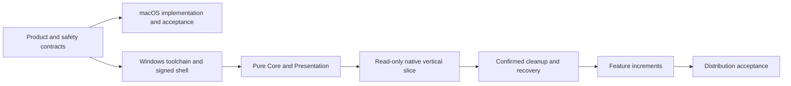

# Implementation plan

English | [简体中文](../zh-CN/engineering/implementation-plan.md)

Status: macOS source development is active. Windows read-only implementation is in progress; native acceptance is pending. Use [acceptance](acceptance-and-testing.md) for verification criteria and [SYNC.md](../../SYNC.md) for platform alignment.

## Product decisions

| Decision | Contract |
| --- | --- |
| DEC01 | Shou / 收拾一下; consistent product identity |
| DEC02 | Native macOS SwiftUI/AppKit with Swift domain services |
| DEC03 | Desktop and CLI independently call their platform's shared domain services |
| DEC04 | Optional cleanup AI proposes drafts; deterministic validation and confirmed execution own mutations |
| DEC05 | External agents use discoverable public CLI commands |
| DEC06 | Windows uses C# / .NET 10 LTS / WinUI 3 and an independent C# Core |
| DEC07 | Prioritize storage evidence, reusable rules and safe daily cleanup |
| DEC08 | English and Simplified Chinese engineering docs; Chinese/English runtime resources and 11 README languages |

## Delivery sequence

macOS priorities are scan correctness, current evidence, immutable plans, durable item receipts, recovery, bounded performance and native interaction. Implement product improvements in small independently verifiable slices. Windows stages and their exit criteria are defined in the [native plan](windows-native-plan.md). Portable logic and read-only source work have started; no stage has completed its required native acceptance.

## AI work packages

| Work item | Scope |
| --- | --- |
| AI01 | Annotated generated cases and investigation-quality baseline |
| AI02 | macOS model SDK and transport behavior, cancellation and budgets |
| AI03 | Bounded evidence tools, investigation state and disabled drafts |
| AI04 | Protocol, endpoint, model and independent credential configuration |
| AI05 | Native entry points, questions, current states and rule preview |
| AI06 | Quality, privacy, safety, offline cleanup and actual-service acceptance |
| AI07 | Default-off switch and request revocation |
| AI08 | Local handling, structured decision routing and necessary escalation |
| AI09 | Contextual launches from cleanup, space, large files and personal rules |
| AI10 | State, accessibility and user-journey acceptance |
| AI11 | Public CLI contract and independently implemented Windows parity |

The macOS investigation source exists; tests and native interaction establish only their executed scope. Windows AI remains planned and must use the .NET implementation boundary. See [AI implementation](embedded-ai-implementation.md) and [AI acceptance](embedded-ai-acceptance.md).

## Definition of done

- The owning product, safety, data and CLI contracts agree.
- Code implements the smallest current capability without speculative frameworks.
- Relevant domain, CLI, native and UI checks have recorded results.
- Shared resources are reproducible and both documentation editions agree.
- Capability availability, platform differences and pending work are accurate in the ledger.
- Signing, install and update claims have independent native evidence.
