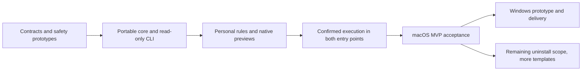

# Implementation plan and decisions

English | [简体中文](../zh-CN/engineering/implementation-plan.md)

Status: active development. Native macOS, independent CLI, shared core, platform adapter, and isolated verification sources exist. Complete platform-safety and release acceptance remain pending. See [local development](development.md).

The next delivery is tracked item by item in the [0.9.0 plan and progress](next-version-0.9.0.md).

Further space-analysis changes follow the [agent collaboration implementation checklist and W01–W06 tracking](space-analysis-agent-design.md): shared queries/paging, native Simple/Detailed switching, same-scan agent context, Windows synchronization and complete acceptance. Default to Simple initially, remember the preference and preserve browsing/selection without rescanning on switches. The shared queries, view switch and one-click copy are implemented; acceptance evidence and remaining platform checks are recorded in that design.

## 1. Product decisions

| ID | Decision | Purpose |
| --- | --- | --- |
| DEC01 | Shou · 收拾一下; “Tidy up. That’s it.” | Consistent identity |
| DEC02 | Native macOS Swift, SwiftUI, AppKit | Platform conventions and integration |
| DEC03 | Independent desktop and CLI with shared core | Equivalent workflows and semantics |
| DEC04 | No model integration or agent development | Local-tool scope and independence |
| DEC05 | Existing agents add rules through public CLI | Discoverable, verifiable operations |
| DEC06 | Native multi-platform monorepo; Windows uses C#/.NET 10/WPF | Shared contracts and isolated adapters |
| DEC07 | Prioritize project artifacts, Node.js data, inactive projects | Reduce repeated developer cleanup work |
| DEC08 | English default docs, multilingual entry points, runtime localization | Global users and contributors |

## 2. Provisional baselines

Portable Swift core; macOS 14+; Swift 6 checks; limited declarative JSON; local versioned storage; evidence-based SQLite adoption; direct signed/notarized distribution subject to access prototypes; macOS desktop permanent cleanup by default with exact-scope confirmation; optional Trash and verified restoration; no unattended destructive CLI. Windows uses C#/.NET 10 LTS/WPF Fluent/MVVM and a structured Swift process bridge; Windows Recycle Bin and restoration remain disabled by default, while manifest-bound permanent removal is enabled with explicit confirmation. See [Windows implementation](windows.md).

## 3. Milestones

Dates depend on estimates and prototype outcomes. Safety gates cannot be skipped for a deadline.

### M0: Contracts and critical prototypes

- [x] Product, architecture, workflows, data model, safety, and acceptance drafts.
- [x] Monorepo/platform boundary design.
- [x] Rule schema and fictional Rust/npm examples.
- [x] English/Simplified Chinese technical documentation and multilingual README structure.
- [ ] Lock Swift/Xcode and native project setup.
- [ ] Verify GUI/CLI access, TCC, bookmarks, signing, and distribution.
- [ ] Prototype Trash result identities and restoration conflicts.
- [ ] Inject target/ancestor replacement, descendant changes, and permanent-removal races.
- [ ] Verify cross-process locks, durable intent, disk-full behavior, and manifest costs.
- [ ] Establish an actual Windows minimal core/contract build path when an environment is available; record limitations early.

**Exit:** explicit supported boundaries; unresolved filesystem safety restricts subsequent functionality to read-only operations.

### M1: Core and read-only CLI

Create core/platform/CLI projects. Implement validation, workspaces, exclusions, bounded scans, project clues, unclassified data, plans, pagination, cancellation, and stable JSON/error contracts. Add fictional path/link/Unicode/size fixtures.

**Exit:** complete read-only terminal loop without GUI or target modifications.

### M2: Personal rules and native previews

Create the native macOS application, navigation, tables/inspector, access flow, rule wizard/import/export/enablement, previews, presets, and equivalent CLI operations. Implement classification and tested developer templates. Add treemaps only after shared accounting/performance/accessibility validation.

**Exit:** the primary personal-rule entry hands the bundled Skill to an existing agent; users answer focused questions while the agent writes, imports and previews disabled drafts through CLI. GUI and CLI agree without internal model integration; the manual wizard remains an advanced option.

### M3: Controlled execution

Implement immutable plans, digest-bound UI/TTY confirmation, expiry, near-operation revalidation, Trash moves, durable receipts, partial outcomes, cancellation, interruption reconciliation, restoration, and separately confirmed permanent removal.

**Exit:** safety cases pass; each entry completes cleanup independently; no confirmation bypass.

Current source status: the desktop quick path routes verified built-in candidates into an internal immutable plan; `CleanupPlan.action` supports `trash` and `permanent`; `TrashExecution` and `PermanentExecution` share leases, revalidation, manifests and durable item journals. The isolated native suite covers direct permanent plans, Trash follow-up purge and CLI `PURGE` confirmation. Platform race, forced-interruption and release acceptance remain M4 gates.

### M4: macOS MVP acceptance

Validate actual Codex/Claude Code clients and WorkBuddy where available, recording versions and limits. Test native interaction, accessibility, appearance, English/Simplified Chinese, locale aliases, storage pressure, performance, and consenting real-workspace trials with recovery conditions.

Verify signed/notarized distribution, CLI delivery, clean installation, upgrades, and uninstall. Update public claims to observed evidence.

**Exit:** all P0 requirements, language coverage, limitations, and reports satisfy an independent release review.

### M5: Windows delivery

The WPF solution, request-scoped JSON confirmation bridge, full Windows identities, private ACL records, locks, traversal, Recycle Bin and manifest-bound permanent-removal adapters now have source implementations. The first UI connects directory selection, paginated scans, rules, exclusions, directory space analysis, history, restoration and separately confirmed purge. Windows-native checks, build/package scripts and a separate CI workflow are provided. Applications, startup, privacy and other macOS-only features remain unavailable. Validate native filesystems, UI and complete runtime distribution independently; configured CI is not execution evidence.

**Exit:** native Windows evidence, not macOS simulations or cross-compilation alone.

## 4. Later candidates

Broader templates, orphan/shared-data ownership and external-registration handling, complete startup-registration coverage, safe sharing, project archival, and worktree workflows. Evaluate additional protocols only when a demonstrated need exceeds CLI capabilities.

Model integration and agent development are not roadmap candidates.

## 5. Open decisions

| Question | Required evidence |
| --- | --- |
| Trash API and race constraints | Platform prototype and fault injection |
| Minimum OS and architectures | Actual APIs, devices, toolchains, installation |
| Sandbox and distribution | GUI/CLI access, signing, bookmarks, TCC |
| Manifest/history storage | Large-fixture memory, disk, and query measurements |
| Expiry and budgets | Changing directories and repeat-cleanup benchmarks |
| Node.js dependency boundaries | npm/pnpm/Yarn, links, private/offline packages, local changes |
| Windows UI/distribution | Native table/accessibility, process bridge, clean install |
| Additional runtime languages | Reviewed translations and native interaction evidence |

## 6. Definition of done

Persistent features update shared services, CLI discovery/inputs/results/errors/next actions, GUI, tests, contract versions, documentation, and relevant translations together. Unsupported platforms remain explicit. Share behavior, isolate real external dependencies, and avoid unused infrastructure.

## Startup first stage

F15 now has a shared discovery and restricted control service, independent CLI `startup list`/`startup control`, native searchable table, explicit source coverage and public macOS Login Items settings navigation. Control is limited to current-user LaunchAgents, revalidated before execution and protected by interactive confirmation; complete registration inventory, system daemons and runtime process control remain outside scope. Its evidence is tracked separately in [acceptance](acceptance-and-testing.md) and its scope in [startup discovery](../product/startup-items.md).

## Application uninstall first stage

F14 now has source implementations for bounded application discovery, exact identifier component review, verified shared group-container discovery, separate personal-data consent, digest-bound plans, shared native Trash journaling, per-component history inspection and no-overwrite restoration, exposed through CLI and native SwiftUI. Core and CLI contracts plus generated-fixture Trash → restore pass; the tested build is locally installed. [Application uninstall](../product/application-uninstall.md) records implemented scope and pending orphan-only discovery, external-registration, other-account and custom-location work. Precise automated, desktop and installation limits remain recorded in [acceptance](acceptance-and-testing.md); the broader completion objective remains active.

## Personal-rule wizard first stage

F03 now has a native three-step authoring flow: bounded scope selection, conditions and preservation, then measured read-only preview. It reuses the closed rule parser and scan engine, exposes exact reasons for size, age, marker and protection decisions, keeps drafts disabled until explicit enablement and a fresh scan, and shares the same CLI rule format. The isolated desktop closure moved only the eligible generated target to Trash and restored it with unchanged hashes. Remaining release gates, third-party client coverage and Windows evidence remain open.

Dense-view correction is tracked as W07 in the [space analysis design](space-analysis-agent-design.md): bounded deep file data, shared type colors, compact linked tables and an adjustable 60:40 initial split. Core 234/234, CLI and generated-fixture checks pass; Windows cross-build and 11 process checks pass, with real Windows interaction pending. The initial application-batch failure and successful isolated rerun are both retained.

W08 tracks a native full-disk directory-read stall with real worker samples. A successful development-directory scan does not establish full-disk acceptance. Read diagnostics, stall isolation, incomplete timeout coverage and cancellation/reclamation need implementation and revalidation; delivering the color/layout correction does not resolve this scan issue.

W09 tracks largest-consumer investigation through independent rule preview, enable/scan, editable selection, existing confirmation, receipts and remaining-scope verification. Both desktops are synchronized; acceptance is recorded in the space analysis design.
