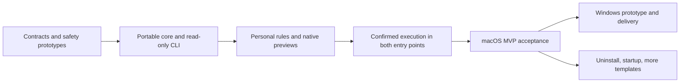

# Implementation plan and decisions

English | [简体中文](../zh-CN/engineering/implementation-plan.md)

Status: design draft. Documentation, draft rule schema, and fictional examples exist; applications, CLI, and runtime evidence are pending.

## 1. Product decisions

| ID | Decision | Purpose |
| --- | --- | --- |
| DEC01 | Shou · 收; “Tidy up. That’s it.” | Consistent identity |
| DEC02 | Native macOS Swift, SwiftUI, AppKit | Platform conventions and integration |
| DEC03 | Independent desktop and CLI with shared core | Equivalent workflows and semantics |
| DEC04 | No model integration or agent development | Local-tool scope and independence |
| DEC05 | Existing agents add rules through public CLI | Discoverable, verifiable operations |
| DEC06 | Native multi-platform monorepo, future Windows | Shared contracts and isolated adapters |
| DEC07 | Prioritize project artifacts, Node.js data, inactive projects | Reduce repeated developer cleanup work |
| DEC08 | English default docs, multilingual entry points, runtime localization | Global users and contributors |

## 2. Provisional baselines

Portable Swift core; macOS 14+; Swift 6 checks; limited declarative JSON; local versioned storage; evidence-based SQLite adoption; direct signed/notarized distribution subject to access prototypes; Trash by default; separately confirmed permanent batch removal; no unattended destructive CLI. Select one native Windows UI after prototyping.

## 3. Milestones

Dates depend on estimates and prototype outcomes. Safety gates cannot be skipped for a deadline.

### M0: Contracts and critical prototypes

- [x] Product, architecture, workflows, data model, safety, and acceptance drafts.
- [x] Monorepo/platform boundary design.
- [x] Rule schema and fictional Rust/npm examples.
- [x] English/Simplified Chinese technical documentation and multilingual README structure.
- [ ] Lock Swift/Xcode and native project setup.
- [ ] Verify GUI/CLI access, TCC, bookmarks, signing, and distribution.
- [ ] Prototype Trash result identities and restoration conflicts.
- [ ] Inject target/ancestor replacement, descendant changes, and permanent-removal races.
- [ ] Verify cross-process locks, durable intent, disk-full behavior, and manifest costs.
- [ ] Establish an actual Windows minimal core/contract build path when an environment is available; record limitations early.

**Exit:** explicit supported boundaries; unresolved filesystem safety restricts subsequent functionality to read-only operations.

### M1: Core and read-only CLI

Create core/platform/CLI projects. Implement validation, workspaces, exclusions, bounded scans, project clues, unclassified data, plans, pagination, cancellation, and stable JSON/error contracts. Add fictional path/link/Unicode/size fixtures.

**Exit:** complete read-only terminal loop without GUI or target modifications.

### M2: Personal rules and native previews

Create the native macOS application, navigation, tables/inspector, access flow, rule wizard/import/export/enablement, previews, presets, and equivalent CLI operations. Implement classification and tested developer templates. Add treemaps only after shared accounting/performance/accessibility validation.

**Exit:** GUI rule creation requires no JSON; existing agents import and preview drafts through CLI with no internal model integration; both entries agree.

### M3: Controlled execution

Implement immutable plans, digest-bound UI/TTY confirmation, expiry, near-operation revalidation, Trash moves, durable receipts, partial outcomes, cancellation, interruption reconciliation, restoration, and separately confirmed permanent removal.

**Exit:** safety cases pass; each entry completes cleanup independently; no confirmation bypass.

### M4: macOS MVP acceptance

Validate actual Codex/Claude Code clients and WorkBuddy where available, recording versions and limits. Test native interaction, accessibility, appearance, English/Simplified Chinese, locale aliases, storage pressure, performance, and consenting real-workspace trials with recovery conditions.

Verify signed/notarized distribution, CLI delivery, clean installation, upgrades, and uninstall. Update public claims to observed evidence.

**Exit:** all P0 requirements, language coverage, limitations, and reports satisfy an independent release review.

### M5: Windows delivery

Build shared Swift core and `shou.exe` on Windows; deliver runtime dependencies. Implement identities, ACLs, paths, locks, links, occupied files, and Recycle Bin. Select one native UI, define its structured confirmation bridge, and test actual filesystem operations, agents, UI, and clean installation.

**Exit:** native Windows evidence, not macOS simulations or cross-compilation alone.

## 4. Later candidates

Broader templates, uninstall ownership analysis, startup discovery/settings guidance, safe sharing, project archival, and worktree workflows. Evaluate additional protocols only when a demonstrated need exceeds CLI capabilities.

Model integration and agent development are not roadmap candidates.

## 5. Open decisions

| Question | Required evidence |
| --- | --- |
| Trash API and race constraints | Platform prototype and fault injection |
| Minimum OS and architectures | Actual APIs, devices, toolchains, installation |
| Sandbox and distribution | GUI/CLI access, signing, bookmarks, TCC |
| Manifest/history storage | Large-fixture memory, disk, and query measurements |
| Expiry and budgets | Changing directories and repeat-cleanup benchmarks |
| Node.js dependency boundaries | npm/pnpm/Yarn, links, private/offline packages, local changes |
| Windows UI/distribution | Native table/accessibility, process bridge, clean install |
| Additional runtime languages | Reviewed translations and native interaction evidence |

## 6. Definition of done

Persistent features update shared services, CLI discovery/inputs/results/errors/next actions, GUI, tests, contract versions, documentation, and relevant translations together. Unsupported platforms remain explicit. Share behavior, isolate real external dependencies, and avoid unused infrastructure.
