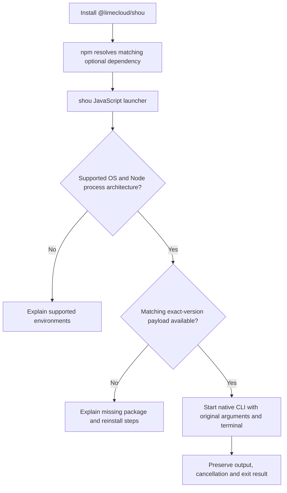

# npm CLI distribution

English | [简体中文](../zh-CN/engineering/npm-distribution.md)

Status: `@limecloud/shou@0.11.0` supports macOS only. The shared cross-platform entry described here is a distribution design; Windows payloads and platform-package automation are not implemented.

## Public entry

Keep one public package, [`@limecloud/shou`](https://www.npmjs.com/package/@limecloud/shou), and one command, `shou`. Users do not select a language implementation or a platform package manually.

```sh
npm install --global @limecloud/shou
shou --help
shou capabilities --json
```

The package address and command can stay the same when Windows support becomes available. Adding support requires a new published version. Existing npm versions are immutable; `0.11.0` remains a macOS-only release.

Node.js runs the npm launcher. The native CLI does not require Node.js when installed through an independent native archive. npm installation does not install the desktop application or grant system permissions.

## Package ownership

The target design is a small JavaScript launcher with platform-specific `optionalDependencies`. Native packages declare matching npm `os` and `cpu` values. Each dependency uses the exact public-package version; never resolve a different version or download `latest` at runtime.

| Package | `os` / `cpu` | Payload | Status |
| --- | --- | --- | --- |
| `@limecloud/shou` | Supported OS/CPU pairs | Launcher, documentation and exact dependency versions | Current package contains a macOS universal payload; platform routing is pending |
| `@limecloud/shou-darwin-arm64` | `darwin` / `arm64` | Swift CLI and required resources | Planned |
| `@limecloud/shou-darwin-x64` | `darwin` / `x64` | Swift CLI and required resources | Planned |
| `@limecloud/shou-win32-arm64` | `win32` / `arm64` | Self-contained .NET CLI and required resources | Planned |
| `@limecloud/shou-win32-x64` | `win32` / `x64` | Self-contained .NET CLI and required resources | Planned |

These platform-package names are planned and are not installation instructions. Only include a platform in the public manifest after its payload has passed acceptance and is available in the registry. Keep the current manifest macOS-only until that condition is met.



## Launcher contract

- Select from an explicit `process.platform` / `process.arch` allowlist. Architecture means the Node process architecture; native ARM64 execution requires ARM64 Node. Do not silently substitute another architecture.
- Resolve the installed platform package through its documented exported entry. Validate payload version and layout before launch; missing optional dependencies must produce an actionable error, including when installation used `--omit=optional`.
- Start the native executable directly with an argument array and inherited terminal streams. Do not concatenate shell commands or reinterpret quoting. Preserve working directory, spaces, Unicode paths, stdout/stderr separation, exit status and cancellation behavior.
- Keep JSON stdout machine-readable. Launcher errors go to stderr and return a nonzero exit code. The launcher does not scan, confirm cleanup or hold deletion policy.
- Install prebuilt payloads. Do not compile on the user's computer, add a `postinstall` binary download, or require an unrelated desktop installation.

Command semantics, errors, capability discovery and interactive safety follow the [CLI contract](../ai/agent-and-cli-contract.md). Each native CLI uses its own platform's domain and system services. Differences are recorded in [SYNC.md](../../SYNC.md).

## Payload and update boundaries

macOS packages include the executable, Swift resource bundles, rules, schemas, localization and required licenses. Windows packages include the `win-x64` or `win-arm64` self-contained .NET CLI, runtime dependencies, rules, schemas, localization and required licenses. Preserve resource paths when packing and installing.

The Windows CLI does not reference WinUI or Presentation. Keep its dependency graph free of Windows App SDK where possible, and verify that independently on a clean system. The GUI's Windows App SDK deployment is specified separately in the [Windows native plan](windows-native-plan.md).

npm owns CLI installation, upgrade and removal. Sparkle and Velopack own their respective desktop channels. Desktop updaters must not modify `node_modules`; the npm CLI must not invoke a desktop updater. The GUI and npm CLI may be installed independently, so the machine contract exposes the actual native version and capabilities.

## Release and acceptance

1. Build each supported native payload from the recorded release source. Include source revision, OS, CPU, toolchain versions and payload hashes in build metadata. Sign and verify executable artifacts before packing; compute hashes after signing.
2. Pack every platform package and the public launcher. Test the tarballs through isolated npm installations on the matching native OS/CPU. Test both persistent installation and `npx`, without a Swift compiler, .NET installation or desktop application.
3. Verify minimum OS checks, paths containing spaces and Unicode, relocated resources, JSON output, interactive confirmation, cancellation, exit codes and missing optional dependencies. Verify offline native startup and an offline read-only fixture scan after installation. Use generated temporary fixtures for any mutation checks.
4. Publish and verify all platform packages referenced by the release before publishing the public package. Publish the public package only when all supported pairs resolve the exact version. Record registry integrity and native source revision in release receipts.
5. Install the public package from the registry on each supported pair and verify the resulting command. Record results in the platform ledger. A successful macOS install does not establish Windows support.

These steps define the future release process and do not authorize publication. Current macOS staging remains documented in [packages/shou-npm](../../packages/shou-npm/README.md); desktop publication is described in [Releases](releasing.md).
