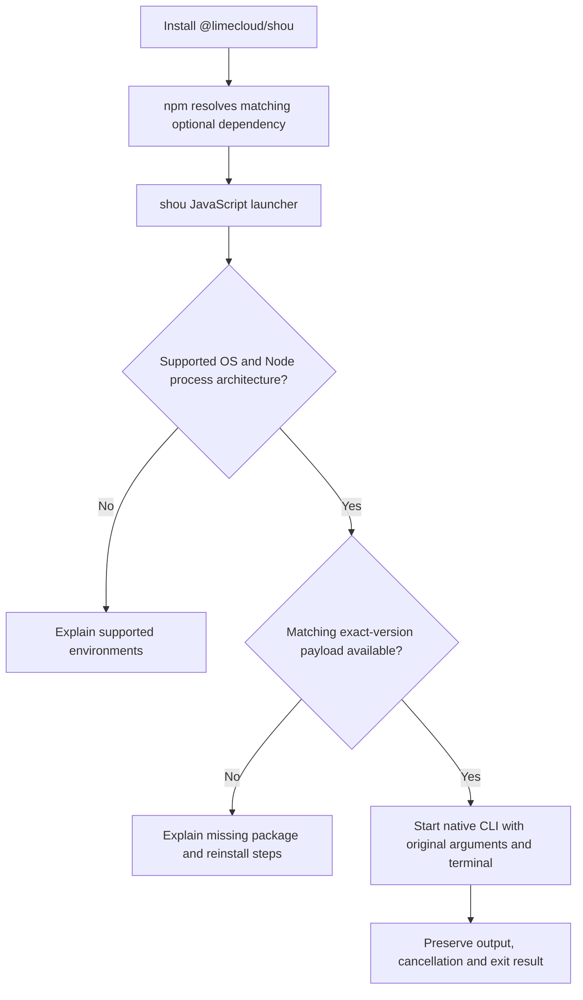

# npm CLI distribution

English | [简体中文](../zh-CN/engineering/npm-distribution.md)

Release scope: `@limecloud/shou@0.22.0` supports macOS through exact-version ARM64 and x64 platform packages. The source implements platform routing, native-package staging and an offline installation verifier; the source template is private `0.22.0`. Windows self-contained development payloads can be built. Native Windows npm acceptance, signing and registry publication remain pending.

## Public entry

Keep one public package, [`@limecloud/shou`](https://www.npmjs.com/package/@limecloud/shou), and one command, `shou`. Users do not select a language implementation or a platform package manually.

```sh
npm install --global @limecloud/shou
shou --help
shou capabilities --json
```

The package address and command can stay the same when Windows support becomes available. Adding support requires a new published version. Existing npm versions are immutable; `0.11.0` remains a macOS-only release.

Node.js runs the npm launcher. The native CLI does not require Node.js when installed through an independent native archive. npm installation does not install the desktop application or grant system permissions.

A shared installation entry does not require shared native code. macOS uses the Swift CLI and Windows uses an independent C# CLI; each calls its platform's desktop domain services. The launcher owns no business logic and does not install both native runtimes on every computer.

The public package and all platform packages it references use the same release version. Platform features can ship at their own pace: `capabilities --json` reports available commands, and a shared version does not imply full feature parity. Desktop applications release independently and do not need to update alongside the npm CLI.

## Package ownership

The design uses a small JavaScript launcher with platform-specific `optionalDependencies`. Native packages declare matching npm `os` and `cpu` values. Each dependency uses the exact public-package version; never resolve a different version or download `latest` at runtime.

| Package | `os` / `cpu` | Payload | Status |
| --- | --- | --- | --- |
| `@limecloud/shou` | OS/CPU pairs included in this staged artifact | Launcher, documentation and exact dependency versions | v0.22.0 macOS release scope |
| `@limecloud/shou-darwin-arm64` | `darwin` / `arm64` | Swift CLI and required resources | v0.22.0; native installation checked per architecture by release CI |
| `@limecloud/shou-darwin-x64` | `darwin` / `x64` | Swift CLI and required resources | v0.22.0; native installation checked per architecture by release CI |
| `@limecloud/shou-win32-arm64` | `win32` / `arm64` | Self-contained .NET CLI and required resources | Development staging implemented; native npm acceptance pending |
| `@limecloud/shou-win32-x64` | `win32` / `x64` | Self-contained .NET CLI and required resources | Development staging implemented; native npm acceptance pending |

Only the two macOS platform packages are included in v0.22.0. Windows packages remain development output. The source template sets `private=true` and is not published directly. Staging generates main-package dependencies only from supplied platform packages; development mode always stays private. Release artifacts must pass acceptance and their platform packages must be available in the registry before the corresponding main package is published. Source routing does not establish published platform support.



## Launcher contract

- Select from an explicit `process.platform` / `process.arch` allowlist. Architecture means the Node process architecture; native ARM64 execution requires ARM64 Node. Do not silently substitute another architecture.
- Resolve the installed platform package through its documented exported entry. Validate payload version and layout before launch; missing optional dependencies must produce an actionable error, including when installation used `--omit=optional`.
- Start the native executable directly with an argument array and inherited terminal streams. Do not concatenate shell commands or reinterpret quoting. Preserve working directory, spaces, Unicode paths, stdout/stderr separation, exit status and cancellation behavior.
- Keep JSON stdout machine-readable. Launcher errors go to stderr and return a nonzero exit code. The launcher does not scan, confirm cleanup or hold deletion policy.
- Install prebuilt payloads. Do not compile on the user's computer, add a `postinstall` binary download, or require an unrelated desktop installation.

Command semantics, errors, capability discovery and interactive safety follow the [CLI contract](../ai/agent-and-cli-contract.md). Each native CLI uses its own platform's domain and system services. Differences are recorded in [SYNC.md](../../SYNC.md).

Platform packages export `payload.json` and `package.json`. Descriptor version 1 contains the exact version, `platform`, `arch` and fixed `vendor/shou` or `vendor/shou.exe` entry. The launcher checks metadata, resource directories and critical dependencies, refusing links that resolve outside the package. Minimum releases are Darwin 23 and Windows `10.0.22000`. The Windows console delivers Ctrl+C to both processes; the launcher waits for the native exit rather than forcefully terminating it through `child.kill(SIGINT)`. Actual Windows console behavior still requires native verification.

## Local staging and verification

`scripts/package-npm.py` provides `platform` and `launcher` subcommands and never publishes. For an existing self-contained Windows development payload:

```sh
python3 "scripts/package-npm.py" platform --development --version 0.22.0 \
  --platform win32-x64 --payload ".build/windows/publish/win-x64/cli" \
  --licenses ".build/windows/publish/win-x64/cli/notices" --output ".build/npm/win32-x64"
python3 "scripts/package-npm.py" launcher --development --version 0.22.0 \
  --platform-package ".build/npm/win32-x64" --output ".build/npm/launcher"
node --test "tests/npm/launcher.test.cjs"
python3 "tests/npm/test-packaging.py"
```

Use the corresponding platform name and payload for ARM64. macOS input contains a thin Swift executable and its three adjacent resource bundles; the dependency-notice directory includes `SwiftAISDK-LICENSE.txt`. Windows build entry points generate .NET licenses, third-party notices and Windows SDK origin/license links from the actual restored packages into `notices`; staging copies them intact. Native versions must match the npm version. The macOS app, CLI and npm release use `0.22.0`. Windows native payloads also report `0.22.0` and ship as GitHub portable previews. Windows npm staging remains private development output until native signing and npm acceptance are complete.

Each artifact records source commit/tree, working-tree content digest, dirty status, native/signature checks and final file hashes. Main-package staging rejects different versions, different source states and modified native packages. Release mode requires a clean checkout, matching native OS/architecture, native version/resource queries and signature verification. Development mode permits cross-host static checks and does not record them as native acceptance. Staging never rewrites, resigns or compresses native executables.

After staging a matching main/native pair, run on its native platform:

```sh
python3 "scripts/verify-npm-distribution.py" --launcher "/path/to/launcher" \
  --platform-package "/path/to/native-package" --output "/path/to/new-evidence-directory"
```

The verifier packs and installs local tarballs offline with isolated cache, configuration and prefixes. It checks local installation, a temporary global command, `npx`-equivalent `npm exec`, versions/rule resources and the `--omit=optional` failure. It does not read the registry or install into the normal global directory, and writes `verification.json`. These checks do not replace clean-system, interactive-terminal or registry acceptance. Windows CI is configured to use the same private staging/install entry; actual CI results must be recorded separately.

Current Mac evidence includes 14 launcher tests, 10 packaging tests and actual ARM64 Swift CLI checks for offline installation, the global entry, `npm exec`, resources, a read-only generated fixture scan and missing optional dependencies. Windows platform packages have development staging and final-byte checks; native Windows npm, signing and console acceptance have not run. See [SYNC.md](../../SYNC.md) for the evidence scope.

## Payload and update boundaries

macOS packages include the executable, Swift resource bundles, rules, schemas, localization and required licenses. Windows packages include the `win-x64` or `win-arm64` self-contained .NET CLI, runtime dependencies, rules, schemas, localization and required licenses. Preserve resource paths when packing and installing.

The Windows CLI does not reference WinUI or Presentation. Keep its dependency graph free of Windows App SDK where possible, and verify that independently on a clean system. The GUI's Windows App SDK deployment is specified separately in the [Windows native plan](windows-native-plan.md).

npm owns CLI installation, upgrade and removal. Sparkle and Velopack own their respective desktop channels. Desktop updaters must not modify `node_modules`; the npm CLI must not invoke a desktop updater. The GUI and npm CLI may be installed independently, so the machine contract exposes the actual native version and capabilities.

## Release and acceptance

1. Build each supported native payload from the recorded release source. Include source revision, OS, CPU, toolchain versions and payload hashes in build metadata. Sign and verify executable artifacts before packing; compute hashes after signing.
2. Pack every platform package and the public launcher. Test the tarballs through isolated npm installations on the matching native OS/CPU. Test both persistent installation and `npx`, without a Swift compiler, .NET installation or desktop application.
3. Verify minimum OS checks, paths containing spaces and Unicode, relocated resources, JSON output, interactive confirmation, cancellation, exit codes and missing optional dependencies. Verify offline native startup and an offline read-only fixture scan after installation. Use generated temporary fixtures for any mutation checks.
4. Publish and verify all platform packages referenced by the release before publishing the public package. Publish the public package only when all supported pairs resolve the exact version. Record registry integrity and native source revision in release receipts.
5. Install the public package from the registry on each supported pair and verify the resulting command. Record results in the platform ledger. A successful macOS install does not establish Windows support.

Publication requires the user's release instruction. Current macOS staging remains documented in [packages/shou-npm](../../packages/shou-npm/README.md); desktop publication is described in [Releases](releasing.md).
