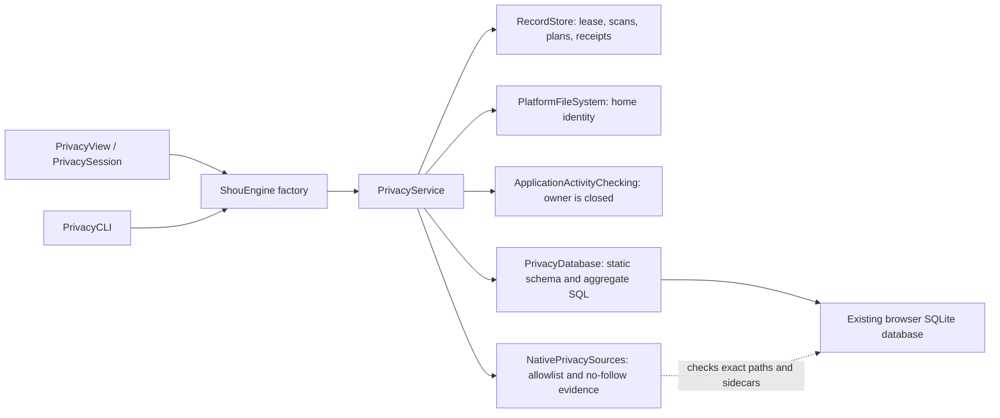
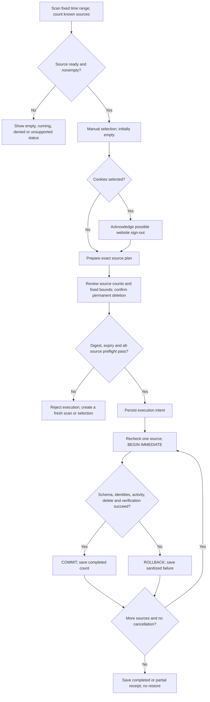

# Scoped browser privacy cleaning

English | [简体中文](../zh-CN/engineering/privacy-cleaning.md)

Privacy cleaning is a separate, manual domain. It queries aggregate counts and timestamp fields, prepares an expiring plan, and permanently deletes selected records only after explicit confirmation. It is never included in ordinary cache recommendations. The implementation does not claim compatibility with every browser version.

## Source support

| Source | Implemented scope | Boundary |
| --- | --- | --- |
| Chrome, Chromium, Edge, Brave history | Standard `Default` and `Profile N` profiles; visits and their known associations; remaining URL counts and timestamps are updated | Structural schema validation; browser-specific triggers are rejected. Download history is preserved |
| Chromium cookies | Exact legacy `Cookies` or current `Network/Cookies` database | Time filter uses last access, not creation or expiry. Separate sign-out consent is required |
| Firefox cookies | Standard directories under `Firefox/Profiles`; `moz_cookies` | Last-access timestamp; sign-out consent is required |
| Firefox history | Trigger-free schemas with the documented basic visit/place/bookmark columns; preserve bookmarks and download visits, update simple remaining aggregates | Schemas with Firefox-specific frecency/scoring columns or triggers are unsupported. Common modern Firefox history databases therefore remain unavailable for cleaning |
| Safari history | Trigger-free basic history-item/visit schema, including simple visit counts | Derived daily/weekly counts and autocomplete aggregates are unsupported. Some current Safari schemas therefore remain unavailable for cleaning |
| Safari cookies, site storage, saved passwords, autofill | Explicit unsupported rows | No whole-profile or container deletion fallback |

Custom profile locations, Firefox external profiles, beta/channel variants with different identifiers, site storage, permissions, browser extensions, session restore, password managers, application activity, clipboard, recent items and cloud copies are outside this implementation. A closed browser can later restore synced history; Shou does not alter the browser's cloud service. Running browsers remain unavailable; Shou never terminates them automatically.

### Windows source adapter

Windows discovers standard profiles under the following home-relative roots. The same schema restrictions above apply; Safari is macOS-only.

| Browser | Root below the current user's home |
| --- | --- |
| Chrome | `AppData/Local/Google/Chrome/User Data` |
| Chromium | `AppData/Local/Chromium/User Data` |
| Edge | `AppData/Local/Microsoft/Edge/User Data` |
| Brave | `AppData/Local/BraveSoftware/Brave-Browser/User Data` |
| Firefox | `AppData/Roaming/Mozilla/Firefox/Profiles` |

Chromium sources are exact `Default` or `Profile N` history and Cookie databases. Firefox sources are `places.sqlite` and `cookies.sqlite` in discovered profile directories. The optional source `platform` field keeps older macOS scan/plan metadata readable; Windows requires `windows` and its own closed path policy. Discovery accepts no caller-supplied root.

Native Windows access holds no-delete-sharing handles for the database, its ancestors and existing SQLite sidecars through each SQLite operation. It retains full File IDs and owner SIDs and rejects reparse points, placeholders, hard links, unexpected owners and untrusted write ACLs. Inherited read rights are allowed; write/delete/ACL rights must belong to the current user, SYSTEM or Administrators. Existing ACLs are inspected without modification. This explicit privacy access does not broaden ordinary cache rules' AppData grants. Windows SDK/runtime and WPF interaction acceptance remain outstanding.

Directory owners may be the current user, SYSTEM or Administrators, with the same ACL checks and pinned identities. Database and sidecar file owners must match the current user exactly. Elevated fixture checks exercise an administrator-owned generated directory and reject an administrator-owned database; no existing user directory ownership is changed.

## Scope and execution

Ranges are the last rolling hour, rolling 24 hours, rolling seven days, or all time. Finite ranges include both their fixed scan-time start and end. Chromium uses integer microseconds since 1601, Firefox integer microseconds since Unix epoch, and Safari seconds since 2001. Integer bounds round the lower bound upward and upper bound downward; the Chromium epoch offset is added as an integer to avoid losing microsecond precision. Cookies use last access; history uses visit time. Unknown or zero cookie timestamps are not guessed into recent ranges. All-time means all matching records, including undated cookies. Firefox visit type 7 is download history and is preserved.

Scans expire after 15 minutes. Plans expire after at most five minutes and never outlive their scan. Selection begins empty. Cookie selection requires a separate sign-out acknowledgement; execution additionally requires irreversible-deletion consent and, where applicable, sign-out consent. CLI execution requires an interactive terminal and the exact `DELETE-PRIVACY` phrase. There is no unattended bypass flag.

The service shares the engine's record store and cross-process lease. It applies existing global/workspace exclusions, protects the store, restricts sources to fixed browser locations under the injected home, and rejects symlinks, hard-linked database files, unsafe owners and writable-by-others source directories. It captures directory, database and WAL identity evidence. The entire plan is checked before intent is stored, then each source is checked again before its transaction. Activity, configuration, source identity, schema and selected counts must still match. SQLite opens existing files without following final symlinks, uses a one-second busy timeout and a 15-second query progress budget. Native filesystem metadata calls are not a hard real-time cancellation guarantee.

Empty WAL files without frames are checked for safe identities but excluded from the data fingerprint, because a read-only connection may create them. Nonempty WAL files remain part of the fingerprint. Triggers and foreign-key relationships crossing the known source tables are rejected; an unknown cascading table cannot silently join the deletion scope.

Some system SQLite versions cannot open a WAL database read-only when its required sidecar files are absent. That source remains unavailable; scanning does not open it for writing to initialize or repair those files.

Each database uses its own immediate transaction. Any failed statement or verification rolls that transaction back. Successful sources remain committed if a later source fails; the result is partial. Interrupted intents are retained and are never automatically retried. The UI offers recent sanitized receipts, and `privacy history` returns durable receipts. Receipts contain source IDs, time bounds, counts, status and sanitized error codes. They do not contain profile paths, URLs, domains, record values or SQL errors. Scan and plan metadata contains source descriptors and filesystem evidence, never individual browsing records. Profiles are not copied or backed up.

This is logical record deletion, not forensic erasure. SQLite free pages, WAL/journal history, backups and browser sync can retain traces. Shou does not run `VACUUM`, promise recovered disk space, move records to Trash or offer restoration for privacy executions. Filesystem identity checks reduce replacement risk; they do not provide an operating-system transaction against a hostile process repeatedly replacing ancestors. Close other tools that write the same browser database.

## Architecture



The engine supplies shared dependencies; it does not introduce another cleanup engine. Discovery and identity checks remain platform capabilities. `PrivacyDatabase` owns schema-specific SQL, while the service owns scope, consent, plan integrity and durable outcomes. [Privacy data contracts](../architecture/data-model.md#privacy-scan-plan-and-receipt-contracts) describe the exact persisted fields and state boundaries.

## Review and execution flow



Source failures do not expand selection or undo previously committed sources. Cancellation rolls back the current transaction when it can be interrupted, then marks remaining sources cancelled. Interruption may leave an executing intent whose outcome cannot be inferred; it is never replayed automatically.

## Execution sequence

```mermaid
sequenceDiagram
    actor User
    participant Client as GUI or CLI
    participant Service as PrivacyService
    participant Store as RecordStore
    participant Native as Identity and activity adapters
    participant DB as PrivacyDatabase
    User->>Client: Confirm exact plan and permanent deletion impact
    Client->>Service: execute(planId, digest, current consent)
    Service->>Store: Acquire lease; load plan and configuration
    Service->>Native: Recheck home, all source identities and closed owners
    Service->>DB: Read-only schema and selected-count checks
    Service->>Store: Save plan executing and sanitized receipt intent
    loop Each explicitly selected source
        Service->>Native: Recheck source and owner
        Service->>Store: Save item executing
        Service->>DB: BEGIN IMMEDIATE; validate schema and count
        DB->>Native: Through service callback, recheck identities and owner
        DB->>DB: Delete only fixed scope; verify zero matching records
        alt Transaction succeeds
            DB-->>Service: COMMIT and removed count
            Service->>Store: Save item completed
        else Error or cancellation
            DB-->>Service: ROLLBACK and sanitized error code
            Service->>Store: Save failed item and cancellation boundary
        end
    end
    Service->>Store: Save completed or partial outcome; release lease
    Service-->>Client: PrivacyReceipt without record contents
    Client-->>User: Display per-source results and recent receipts
```

## Entry points and verification

Core owners are `PrivacyModels.swift`, `PrivacyService.swift` and `PrivacyDatabase.swift`. Native discovery uses `NativePrivacySources.swift` on macOS and `WindowsPrivacySources.swift` with `shou_win_privacy_acquire` on Windows. The macOS GUI uses `PrivacySession.swift` and `PrivacyView.swift`; WPF uses `MainViewModel.Privacy.cs` and `PrivacyView.xaml`. `PrivacyCLI.swift` and the desktop bridge call the same service.

The bridge exposes read-only `privacy.scan` and `privacy.history`, plus `privacy.clean` with exact `scan_id`, `source_ids` and Boolean `sign_out` fields. Cleaning creates a fresh plan in the same process and binds confirmation to its digest and a one-use challenge. WPF starts with no selection, clears Cookie selection when sign-out acknowledgement is withdrawn, and requires independent permanent-deletion and applicable sign-out checkboxes in the final review. A completed, failed or cancelled attempt clears the scan; a fresh scan is required for another attempt. Recent receipts show sanitized per-source outcomes.

```text
shou privacy scan --range last-hour --json
shou privacy scan show --scan-id <scan-id> --json
shou privacy plan --scan-id <scan-id> --source <source-id> --json
shou privacy plan --scan-id <scan-id> --source <cookie-source-id> --acknowledge-sign-out true --json
shou privacy plan show --plan-id <plan-id> --json
shou privacy execute --plan-id <plan-id>
shou privacy history --json
```

`tests/core/PrivacyTests.swift` builds disposable databases under the generated fixture home. It covers timestamp epochs and finite ranges, selected associations versus unrelated orphan rows, cookie consent, bookmark/download preservation, running browsers, stale evidence, exclusions, transaction rollback, unsupported triggers and sanitized receipts. These generated tests establish the supported schema contract; they do not prove compatibility with every installed browser build or private-profile access. See [acceptance and testing](acceptance-and-testing.md) for executed results.

`WindowsPrivacyTests.swift` adds closed Windows source policies, legacy encoding compatibility, source-access lifetime and case-insensitive protection checks using generated evidence. `scripts/verify-privacy-bridge.py --native-fixtures` creates one exclusive disposable profile and selects only its two generated sources: it checks strict inputs, rejected/cancelled confirmations, Cookie consent, recent-record deletion with old/download records retained, stale replay and sanitized receipts. It also checks generated database hard links and, on Windows, an untrusted-write ACL. Windows-specific lease/rename checks are in `tests/windows/PrivacySourceTests.swift`; the specialized target is currently skipped for the recorded Swift SIL compiler crash, so those checks have not executed. On the macOS host, the focused privacy suite passes 8/8, the full core suite 294/294, process checks 24 and CLI contracts 159; WPF and native C++ cross-compilation are supplementary evidence, not Windows execution.

The source-specific model and policy were informed by [MangoDisk](https://github.com/harry0703/MangoDisk), especially its `src-tauri/crates/mangodisk-core/src/privacy/browser_database.rs`, `privacy/browser_database/schema.rs`, `privacy/service/policy.rs` and macOS privacy adapter. Shou implements a narrower capability set and retains explicit unsupported states.
