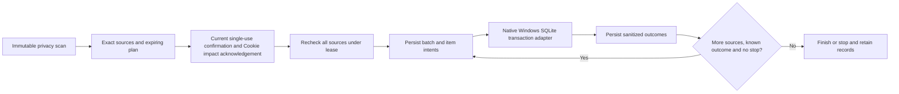
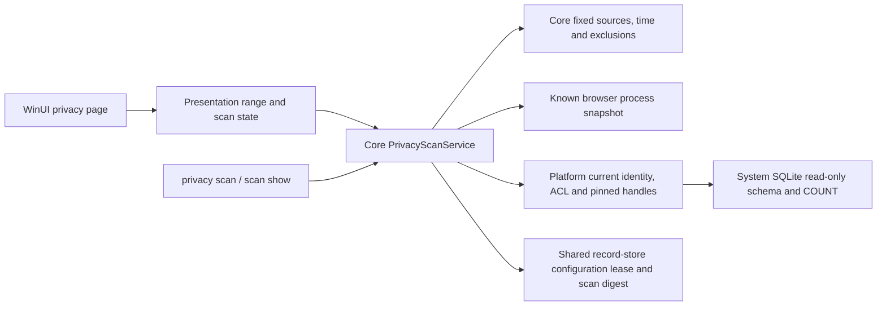
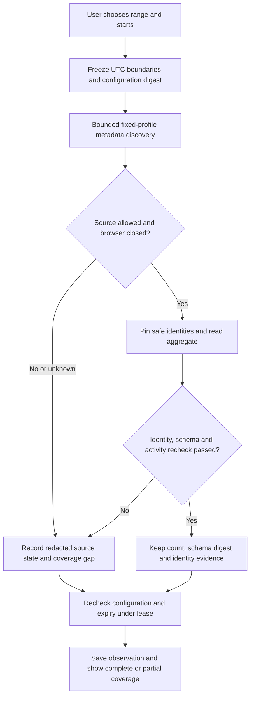
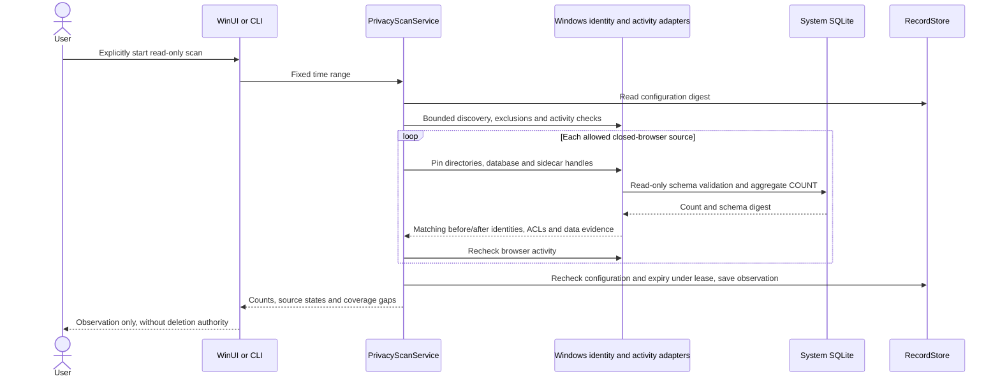
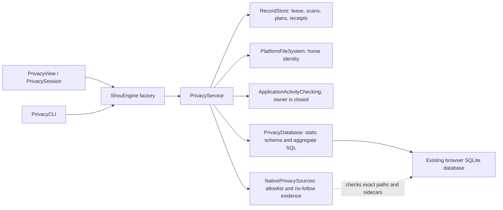
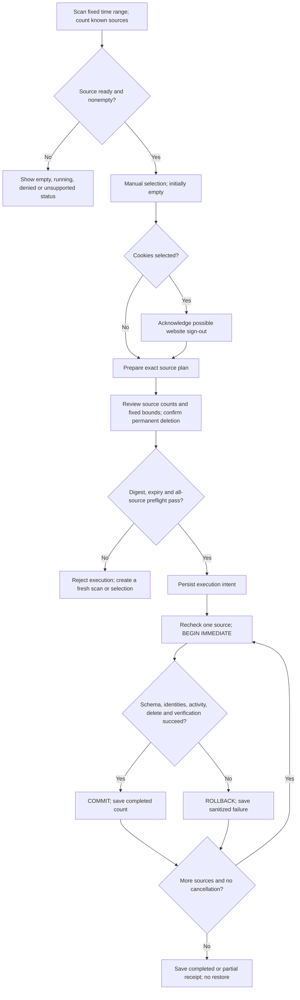
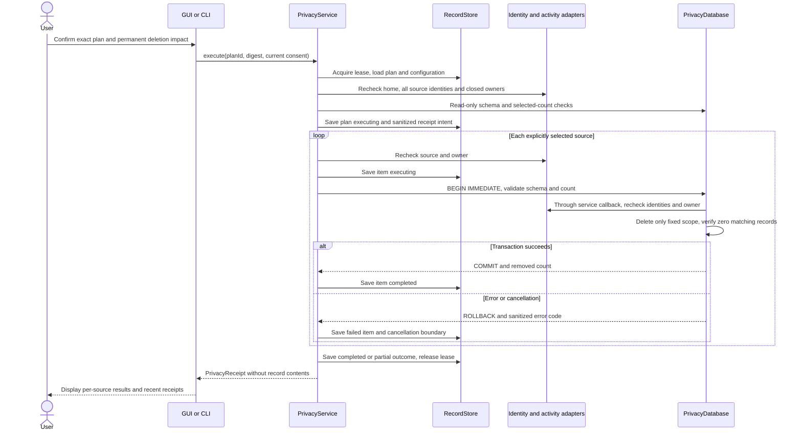

# Scoped browser privacy cleaning

English | [简体中文](../zh-CN/engineering/privacy-cleaning.md)

Privacy cleaning is a separate, manual domain. It queries aggregate counts and timestamp fields, prepares an expiring plan, and permanently deletes selected records only after explicit confirmation. It is never included in ordinary cache recommendations. The implementation does not claim compatibility with every browser version.

## Source support

| Source | macOS implemented scope | Boundary |
| --- | --- | --- |
| Chrome, Chromium, Edge, Brave history | Standard `Default` and `Profile N` profiles; visits and their known associations; remaining URL counts and timestamps are updated | Structural schema validation; browser-specific triggers are rejected. Download history is preserved |
| Chromium cookies | Exact legacy `Cookies` or current `Network/Cookies` database | Time filter uses last access, not creation or expiry. Separate sign-out consent is required |
| Firefox cookies | Standard directories under `Firefox/Profiles`; `moz_cookies` | Last-access timestamp; sign-out consent is required |
| Firefox history | Trigger-free schemas with the documented basic visit/place/bookmark columns; preserve bookmarks and download visits, update simple remaining aggregates | Schemas with Firefox-specific frecency/scoring columns or triggers are unsupported. Common modern Firefox history databases therefore remain unavailable for cleaning |
| Safari history | Trigger-free basic history-item/visit schema, including simple visit counts | Derived daily/weekly counts and autocomplete aggregates are unsupported. Some current Safari schemas therefore remain unavailable for cleaning |
| Safari cookies, site storage, saved passwords, autofill | Explicit unsupported rows | No whole-profile or container deletion fallback |

Custom profile locations, Firefox external profiles, beta/channel variants with different identifiers, site storage, permissions, browser extensions, session restore, password managers, application activity, clipboard, recent items and cloud copies are outside this implementation. A closed browser can later restore synced history; Shou does not alter the browser's cloud service. Running browsers remain unavailable; Shou never terminates them automatically.

### macOS access and partial coverage

Discovery isolates an unreadable fixed browser root. Permission denials (`EPERM`/`EACCES`), filesystem errors and unrepresentable filenames record `privacy_discovery_incomplete` plus a sanitized reason in the saved scan's `issues`; other browser roots continue. An absent root adds no issue. Denied roots are not reported as empty sources. Cancellation and profile/source limits still abort the scan. No-follow traversal and database identity checks remain required.

The privacy page shows incomplete coverage above the accessible sources. Permission failures, including per-database failures, also show an action to open System Settings → Privacy & Security → Full Disk Access. Users can review access and exclusions, then explicitly rescan. Opening Settings does not grant access or authorize deletion.

### Windows platform boundary

Windows has independent C# read-only scan, CLI and WinUI page source. Fixed Chrome, Chromium, Edge and Brave history/cookies and supported basic Firefox history/cookie structures are covered; Safari is outside this scope. Navigation does not scan automatically: the user chooses a range and starts scanning. Core implements separate privacy plans, current confirmation, execution orchestration and sanitized receipts. v0.15.0 includes `WindowsPrivacyMutation` and wires plans/current confirmation/receipts into WinUI, with the public removal gate closed. CLI scanning remains read-only. Counts grant no deletion authority. Native runtime, ACL, SQLite sidecar and UI acceptance remain pending. See the [native plan](windows-native-plan.md).

`PrivacyCleanupService` reuses the existing record lease and binds exact sources from one scan, the time window, configuration and identity/schema/count evidence. Plans last at most five minutes and never outlive the scan. Cookie sign-out acknowledgement is separate from the current process's single-use confirmation, which lasts at most one minute. All-source preflight precedes batch intent; item intent precedes native dispatch. Stopping waits for actual dispatched outcomes. Journal failure prevents further dispatch, and unknown outcomes stop later sources. Any durable batch intent blocks replay. Sanitized receipts support inspection without renewing execution authority.

The unreleased Windows page selects no sources automatically. Cookies require review acknowledgement before selection; revocation removes only Cookie selections. Refreshing, changing the time range or invalidating configuration clears stale selections; the horizontal footer shows source and record totals. Review creates the exact expiring plan before showing its sources and fixed time bounds. The final dialog defaults to Cancel; permanent-deletion and Cookie sign-out consent start unchecked, and review acknowledgement cannot substitute for current execution confirmation. A separate receipt card presents sanitized source IDs, actual counts and states without treating unknown counts as zero. Portable selection regressions have run; a separate collapsible history defaults to the latest 20 receipts, ordered by execution start time. Read-only queries validate receipts, plans, scans and digests under one lease and never renew authority. They allow at most 4,096 directory entries, 32 MiB of total reads including plans/scans, and ten seconds. Missing, corrupt, oversized or unreadable evidence produces an explicit error rather than empty history. New page interactions, Cookie-removal and post-relaunch history E2E still require native acceptance.



Memory tests verify orchestration. Seven generated Windows 11 x64 mutation fixtures passed: exact Cookie time windows, unrelated tables/old-row preservation, Chromium/Firefox references, cancellation rollback and stale/expired authorization refusal. Existing nonempty rollback journals are rejected before inspection or mutation, preventing implicit SQLite recovery from changing a source. A journal created by the current transaction is handled only within its verified transaction and cleanup. The WinUI deletion journey was not reached; this is neither release acceptance nor arbitrary browser compatibility. See [SYNC.md](../../SYNC.md).

`WindowsPrivacySourcePolicy` uses the actual Local/Roaming AppData returned by Windows, including supported redirected local directories. Chromium profiles are limited to `Default` or `Profile N`; Firefox uses valid single-component directories beneath fixed `Mozilla/Firefox/Profiles`, without external profile configuration. Discovery reads metadata only, with a ten-second deadline and limits of 2,048 entries of work, 256 profiles and 768 sources. Gaps remain partial coverage. The complete scan shares a two-minute budget and saves version 1 observations valid for fifteen minutes.

`PrivacyScanService` applies global and matching workspace ancestor exclusions, protects its own data and checks exact database/WAL/SHM/journal paths. Known browser executable names are observed before and after each query. Active or unknown observations do not publish usable counts; process snapshots do not prove exclusive database access. `WindowsPrivacyDatabaseInspection` pins ordinary directories from the AppData anchor to the database parent and rejects reparse points, foreign owners, hard-linked databases, cross-volume evidence and ACLs writable by untrusted identities. Only the exact injected Local/Roaming AppData anchor may be SYSTEM/Administrators owned, with pinned identity and validated ACLs; browser/profile directories and databases remain current-user owned. No system-directory permissions are repaired. Foreign inheritable write grants are rejected too, while inherit-only Creator Owner retains normal inheritance semantics. Database/sidecar pins permit shared writes required by SQLite and never share deletion. Directory, ACL, main-database and nonempty-WAL evidence must match before and after inspection.

The adapter uses Windows system `winsqlite3.dll` with read-only, no-CREATE, NOFOLLOW connections and static schema validation. Only aggregate counts and a schema digest are returned, without reading URLs, domains or cookie values. Triggers, views, virtual tables, unknown crossing foreign keys, noninteger timestamps and unsupported derived structures are rejected. Each connection has a one-second busy wait and fifteen-second/fifty-million-VM-instruction query budget. Cancellation waits for native work to release handles. Missing necessary WAL sidecars remain unavailable, without write-mode repairs. Read-only scanning neither changes browser records nor backs up profiles. Cleanup is a separate explicit operation requiring an exact plan, Cookie impact acknowledgement and current confirmation.







## Scope and execution

Ranges are the last rolling hour, rolling 24 hours, rolling seven days, or all time. Finite ranges include both their fixed scan-time start and end. Chromium uses integer microseconds since 1601, Firefox integer microseconds since Unix epoch, and Safari seconds since 2001. Integer bounds round the lower bound upward and upper bound downward; the Chromium epoch offset is added as an integer to avoid losing microsecond precision. Cookies use last access; history uses visit time. Unknown or zero cookie timestamps are not guessed into recent ranges. All-time means all matching records, including undated cookies. Firefox visit type 7 is download history and is preserved.

Scans expire after 15 minutes. Plans expire after at most five minutes and never outlive their scan. Selection begins empty. Cookie selection requires a separate sign-out acknowledgement; execution additionally requires irreversible-deletion consent and, where applicable, sign-out consent. CLI execution requires an interactive terminal and the exact `DELETE-PRIVACY` phrase. There is no unattended bypass flag.

The service shares the engine's record store and cross-process lease. It applies existing global/workspace exclusions, protects the store, restricts sources to fixed browser locations under the injected home, and rejects symlinks, hard-linked database files, unsafe owners and writable-by-others source directories. It captures directory, database and WAL identity evidence. The entire plan is checked before intent is stored, then each source is checked again before its transaction. Activity, configuration, source identity, schema and selected counts must still match. SQLite opens existing files without following final symlinks, uses a one-second busy timeout and a 15-second query progress budget. Native filesystem metadata calls are not a hard real-time cancellation guarantee.

Empty WAL files without frames are checked for safe identities but excluded from the data fingerprint, because a read-only connection may create them. Nonempty WAL files remain part of the fingerprint. Triggers and foreign-key relationships crossing the known source tables are rejected; an unknown cascading table cannot silently join the deletion scope.

Some system SQLite versions cannot open a WAL database read-only when its required sidecar files are absent. That source remains unavailable; scanning does not open it for writing to initialize or repair those files.

Each database uses its own immediate transaction. Any failed statement or verification rolls that transaction back. Successful sources remain committed if a later source fails; the result is partial. Interrupted intents are retained and are never automatically retried. The UI offers recent sanitized receipts, and `privacy history` returns durable receipts. Receipts contain source IDs, time bounds, counts, status and sanitized error codes. They do not contain profile paths, URLs, domains, record values or SQL errors. Scan and plan metadata contains source descriptors and filesystem evidence, never individual browsing records. Profiles are not copied or backed up.

This is logical record deletion, not forensic erasure. SQLite free pages, WAL/journal history, backups and browser sync can retain traces. Shou does not run `VACUUM`, promise recovered disk space, move records to Trash or offer restoration for privacy executions. Filesystem identity checks reduce replacement risk; they do not provide an operating-system transaction against a hostile process repeatedly replacing ancestors. Close other tools that write the same browser database.

## Architecture

This structure describes macOS. The Windows read-only chain is defined in the platform boundary above.



The engine supplies shared dependencies; it does not introduce another cleanup engine. Discovery and identity checks remain platform capabilities. `PrivacyDatabase` owns schema-specific SQL, while the service owns scope, consent, plan integrity and durable outcomes. [Privacy data contracts](../architecture/data-model.md#privacy-scan-plan-and-receipt-contracts) describe the exact persisted fields and state boundaries.

## Review and execution flow



Source failures do not expand selection or undo previously committed sources. Cancellation rolls back the current transaction when it can be interrupted, then marks remaining sources cancelled. Interruption may leave an executing intent whose outcome cannot be inferred; it is never replayed automatically.

## Execution sequence



## Entry points and verification


```text
shou privacy scan --range last-hour --json
shou privacy scan show --scan-id <scan-id> --json
shou privacy plan --scan-id <scan-id> --source <source-id> --json
shou privacy plan --scan-id <scan-id> --source <cookie-source-id> --acknowledge-sign-out true --json
shou privacy plan show --plan-id <plan-id> --json
shou privacy execute --plan-id <plan-id>
shou privacy history --json
```

`tests/core/PrivacyTests.swift` builds disposable databases under the generated fixture home. It covers denied browser roots before and after an accessible root, persisted coverage gaps, no-follow rejection, discovery limits and cancellation, timestamp epochs and finite ranges, selected associations versus unrelated orphan rows, cookie consent, bookmark/download preservation, running browsers, stale evidence, exclusions, transaction rollback, unsupported triggers and sanitized receipts. `shou-tests --privacy-discovery-only` isolates the generated discovery fixtures for access-denial checks. These generated tests establish the supported schema contract; they do not prove compatibility with every installed browser build or private-profile access. See [acceptance and testing](acceptance-and-testing.md) for executed results.


The source-specific model and policy were informed by [MangoDisk](https://github.com/harry0703/MangoDisk), especially its `src-tauri/crates/mangodisk-core/src/privacy/browser_database.rs`, `privacy/browser_database/schema.rs`, `privacy/service/policy.rs` and macOS privacy adapter. Shou implements a narrower capability set and retains explicit unsupported states.
