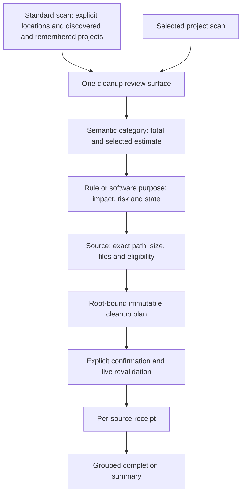

# Cleanup interaction and architecture decisions

English | [简体中文](../zh-CN/engineering/reference-design.md)

Status: design requirements and implementation mapping. A source implementation or visual reference does not establish interaction acceptance, filesystem safety, or release readiness. See [native macOS experience](../product/macos-experience.md) and [system architecture](../architecture/system-design.md) for the current product contract.

## Space discovery for external agents

The [space analysis collaboration design](space-analysis-agent-design.md) distinguishes installed-artifact REA Evidence, observed interactions and proposed Shou changes, including architecture, flow, sequence and Windows acceptance. Existing acknowledgements below apply; no third-party code or assets are adopted.

## Evidence and conclusions

Four evidence types inform this design:

| Evidence | What it supports | What it cannot establish |
| --- | --- | --- |
| Supplied interface references | Information hierarchy, visible controls, density, confirmation and result content | Transitions, timing, keyboard behavior, filesystem semantics |
| Available complete source | Category projection, selection calculations, scan orchestration, process guards and result models | Behavior of a different installed version or Shou's implementation |
| Retained REA native package inventories and property lists | Bundle identity, packaged resources and declared localizations | Executed behavior, decompiled source, rule matching or deletion correctness |
| Direct interaction with an installed reference application | Category → rule → path hierarchy, mixed selection, and a fixed bottom selection/action region | Cleanup, restoration, deletion semantics or Shou's implementation; no cleanup action was triggered in that application |

The original inventory supports package facts only. The later focused native investigation is documented in the space-analysis acknowledgment below. No proprietary catalog or recovered implementation is required. Animation must be specified and exercised in Shou; a still interface reference cannot prove animation behavior.

## Product differences to resolve

| Existing implementation boundary | Required experience | Architectural consequence |
| --- | --- | --- |
| Common-app results primarily list known filesystem locations | Start a standard scan immediately and review software or purpose | Keep location discovery in Core; project results into semantic cleanup choices |
| Each known location opens a separate workspace result | A single review surface summarizes the standard scan | Aggregate presentation across snapshots while preserving each source's snapshot and root identity |
| Workspace outline groups categories directly into paths | Category → rule/software purpose → exact source path | Add an explicit rule projection between navigation and candidates; do not infer software identity from display strings |
| Confirmation primarily lists paths | Explain selected choices, estimate, impact and blocked items before confirmation | Build confirmation from immutable plan facts; localized descriptions cannot expand authorization |
| Result rows expose individual filesystem outcomes | Show a concise summary and inspectable per-choice and per-source outcomes | Derive summaries from receipts, preserving partial, skipped, failed and unknown states |

These differences are interaction requirements. They do not authorize a new cross-root execution protocol or broader filesystem access.

## Information hierarchy

- **Window navigation** represents implemented tasks: Smart Cleanup, Large Files, Space Analysis, Rules, Startup Items and Applications, with History and Settings in the footer. Project scopes remain internal records. Saved rule selections belong in the Rules menu and require a fresh scan. Do not add empty destinations for unimplemented utilities.
- **Category navigation** represents the purpose of the data: application caches, browser caches, developer tools, project outputs, dependencies and personal rules when matching facts exist. Risk is a rule/source property, not a separate navigation taxonomy.
- **Rule rows** identify what will be cleaned in user language. Show its impact, selected/total estimate, expandable source count and eligibility state. A software name alone is insufficient when several rules clean different parts of that software.
- **Source rows** retain exact root-bound paths, file counts, estimates and reasons. Expansion and row focus never silently change selection. Finder reveal, path copying and exclusion remain inspectable actions.

Use a compact task heading and scan scope, one capacity summary, and a results region that fills the remaining height. In the results region, use category navigation and native rule/source details. At constrained widths, replace the category column with a native picker. Keep a single visible review action and a single stop action during an active scan. Technical root inventories belong in details, not the primary first-use view.

## Selection and capacity

Selection has one authoritative set of candidate identities. Category, rule and source checkbox states are deterministic projections: none, partial or all among their eligible children. Grouping, sorting, language changes and expansion do not change the selected identities.

| Mode | Behavior |
| --- | --- |
| None | Space analysis and large files start empty; Clear Selection empties any reviewed selection |
| Reviewable items | Explicit convenience action over current eligible sources; exclude high-risk dependencies. This is not a safety recommendation |
| Manual | Derived after individual changes; not a second preset that mutates selection |
| Rule convenience selection | Select eligible children within that visible scope; show high-risk status and retain explicit plan confirmation |
| All eligible items | Explicitly labelled as including high-risk items; never includes blocked sources or incompletely measured targets |

Space analysis and large files start with no selection. Smart Cleanup preselects eligible built-in and enabled personal-rule recommendations after scanning. No convenience action selects blocked or incomplete sources. The inclusive action explicitly names high risk; the interface does not infer safety recommendations from size or color. Saved rule selections continue to require fresh preview and confirmation.

Keep distinct figures for measured data, reviewable candidates, selected estimate, moved-to-Trash estimate and volume availability. A category or rule shows selected/total values when partly selected. Sum each physical candidate once, preserve parent/child conflicts, and use the established hard-link accounting policy. An inaccessible or unmeasured path is unknown, not zero.

Keep the selected estimate and primary review action in a fixed bottom region while results scroll. This region presents the same authoritative selection; it does not maintain a separate selection total or authorization state.

## Lifecycle and motion

The desktop owns display state; Core owns operation facts and authorization. Preserve distinct idle, discovering, scanning, analyzing, review, preflight, executing, cancellation and result states. Stable operation IDs prevent late progress from replacing a completed result. Cancelled or incomplete scans remain visibly incomplete.

| State | Visible content | Action |
| --- | --- | --- |
| First use | Short explanation of known software coverage and a primary scan button | Start standard scan; choose a project as a secondary option |
| Scanning | Current stage, item count and bounded current path | Stop |
| Review | Categories, rules, sources, selected amount and limitations | Review current selection |
| Confirmation | Selected choices, exact scope, impact, estimates and running-app blockers | Return to selection or explicitly confirm |
| Executing | Processed items, current source and actual operation state | Stop safely; retain completed outcomes |
| Result | Moved, skipped, failed and unverified counts plus item reasons | Close, inspect history or separately restore |

The dot matrix is a secondary space overview, not the cleanup model. Animate actual measured/selected values and transitions between operation states. During unknown-total work, a restrained sweep may indicate activity without implying a completion percentage. Honor Reduce Motion, stop repeating animation when work ends, and retain text alternatives. Use the timing and native control requirements in the [macOS experience specification](../product/macos-experience.md).

## Ownership and implementation mapping

| Owner | Responsibility | Must not own |
| --- | --- | --- |
| `KnownLocations` and `BuiltinCatalog` | Explicit platform profiles, stable rule identity and matching metadata | UI layout, arbitrary executable rules or implicit home-wide traversal |
| `ShouEngine` | Bounded scans, snapshots, root ownership, protection, plan validation and execution orchestration | Localized display grouping or application termination |
| Cleanup review projection | Pure category/rule/source rows, selection states and receipt summaries | Filesystem reads, configuration mutations or independent safety policy |
| `AppModel` | Invoke use cases, preserve operation identity, store focus/selection and present sheets | Reimplement matching, protection or plan authorization |
| Native views | Layout, keyboard interaction, disclosure, focus and accessible progress | Authorizing candidate paths from row labels |
| `PlatformFileSystem` and `ApplicationActivityChecking` | Physical identity, access, filesystem operations and application activity facts | Product selection policy or process control |
| CLI | Structured adapter over the same scans, plans and receipts | A separate cleanup engine or noninteractive confirmation bypass |

The review projection should carry stable category ID, rule ID/version, source candidate ID, snapshot ID and workspace/root identity. Display names, paths and locale are presentation fields; they are never identity keys. It can initially remain an internal Swift type rather than a new package or generic plugin system.

An aggregate standard-scan view may contain many snapshots. The desktop builds a transient immutable review scope containing each child plan ID, digest, workspace and exact selected paths. One explicit confirmation covers that visible list; AppModel passes each original child digest to the existing root-bound Core API. The engine independently checks expiry, configuration, identity, manifest and application activity for every child. Failures are retained separately from successful receipts; the result never implies an atomic transaction or rollback. This is desktop orchestration over the existing plan contract, not a new CLI batch protocol. A future persisted batch API must separately define versioning, resumption and cancellation semantics.

## Complete cleanup pipeline

Discovery coverage and candidate measurement are different facts. The implemented `cleanup` scope follows enabled rule prefixes, prunes `.git` during discovery and fully measures matched targets, including protected-content checks. Project markers remain matching evidence. An unreadable sibling must not invalidate a fully verified target; incomplete discovery remains visible and cannot authorize paths never discovered. `scope`, `treeComplete` and `completedPaths` distinguish sparse discovery completion from whole-tree measurement. A candidate needs positive evidence that its entire subtree was measured; missing legacy coverage does not provide that evidence. Selected targets retain full manifests and receive live revalidation before mutation. Space analysis requires `full` scope and must explain sparse cleanup results.

| Stage | Core-owned fact | Required acceptance |
| --- | --- | --- |
| Resolve rules | Validated rule ID/version, applicability and declared boundary | Missing software and unavailable inventory remain distinct |
| Discover | Explicit locations, registered project roots, rule prefixes, project markers and coverage | No implicit home-wide discovery; rule-pruned scans preserve coverage limitations |
| Measure | Per-target completeness, physical identity, counts and manifest | One limited target does not poison independently complete siblings |
| Assign ownership | One physical target and explicit parent/child conflicts | Overlapping rules never double-count or expand selection |
| Plan and preflight | Selected candidate IDs, configuration, digest, expiry and activity facts | Replaced paths, tracked authored files and changed manifests fail closed |
| Execute and reconcile | Per-item mutation and verified resulting identity | Cancellation stops new work while reconciliation records mutations already performed |
| Record and follow up | Durable receipts, partial/unknown states and explicit follow-up scope | Secondary refresh failures cannot replace a completed result; restore never overwrites |

Generated source inside a verified build output is different from authored project source. Preserve credential and repository protection, and use explicit project provenance and authored-content ownership checks when recognizing disposable outputs. Do not make a file extension the sole authority either to permit deletion or to classify an entire generated tree as authored content. Personal rules do not inherit trusted built-in artifact privileges.

The Rust/Swift bundled definitions are version `1.1.0`. Only exact trusted definitions can use the native evidence port for recognized Rust `OUT_DIR`, Swift generated products and Cargo extracted-source validation. Missing activity/ownership/integrity evidence, tracked content or modified sources fail closed. The catalog contains 74 templates and 35 fixed locations; desktop standard scanning includes discovered and remembered projects, while CLI `system scan --include-projects` defaults to `false`.

Rust/Swift activity checks use fixed native `ps` and `lsof` invocations for the current UID. A matching build process blocks a project when its verified working directory contains or is contained by that project root; unavailable or ambiguous evidence blocks the candidate. Cargo registry resources are shared, so their process gate remains global. Process results are cached only within one read-only analysis; execution obtains fresh facts before each move. Analysis checks a 12-second evidence-query window before starting further queries.

Native Cargo verification has a 10-second budget per crate, at most 256 files, 16 MiB per file, and 64 MiB for the retained archive and for the total uncompressed file bodies. Two fixed `tar` invocations provide strict member metadata and one concatenated body stream. Verification splits that stream using actual archive member sizes, never checksum declarations. Unsupported escaped/Unicode member names and exhausted budgets leave candidates blocked with a reason.

Rule-directed filesystem cleanup uses directory manifests; explicit space-analysis and large-file removal support individual files through fresh identity and content checks. Native tool operations require separate typed capabilities before being exposed. A controlled tool capability must define executable identity, fixed argument construction, bounded output/time, scope, dry-run behavior, cancellation and before/after verification. A rule document cannot supply arbitrary shell commands. Large model stores, virtual disks, toolchains and simulator runtimes are not ordinary caches merely because they occupy substantial space. Add these capabilities only for an implemented use case; do not introduce a generic plugin framework.

Keep scan/verify/Trash/restore/permanent-removal budgets consistent for large targets. Budget exhaustion produces a typed limitation, never a false success. Tests must include a tree beyond the default entry budget, protected generated-content boundaries, independently complete siblings and cancellation after the first mutation. Report both estimated logical/allocated data and actual volume availability without treating them as interchangeable.

## Safety and completion semantics

Fixed application rules target verified disposable leaves, not entire application-support roots. Project rules require project evidence and must preserve source, credentials, databases and authored data. Personal or agent-authored rules remain untrusted drafts until validated and explicitly enabled. Next-stage built-in cleanup AI reuses the same rules and confirmed-execution contracts; model proposals still require local deterministic validation.

Permission limits, incomplete measurement, changed identities and unavailable activity checks remain typed limitations. Recheck identified running applications immediately before mutation; skip affected candidates with reasons while preserving independent outcomes. The present application does not quit software. A future close-application feature would need a separately authorized native capability and explicit user interaction.

“Moved to Trash” is the completion metric for recoverable cleanup. It is not a claim of freed volume capacity. Permanent removal is a first-class `action=permanent` path with its own confirmation, `PermanentExecution` journal and `operation=permanent_cleanup` receipt. A partial batch must never appear as complete success because some children succeeded. Unknown post-operation states remain unknown until verified.

Execution progress reports actual stage, path and processed/total items. Stop requests prevent new item operations at safe boundaries; an in-progress system Trash or permanent-removal call may finish and must be reconciled. The completion view keeps location-level failures separate from failed item receipts. The desktop fast path creates a concrete plan internally for verified built-ins, while personal rules remain in detail review. Project-fixture progress and successful results have been exercised; permanent-removal cancellation, stop, partial-failure and unverified-state interactions still require acceptance.

## Acceptance still required

Shou's Chinese → English → Chinese switching, installed-desktop project cleanup → native Trash → history → restoration, and a disabled personal-rule draft → read-only preview → export → enable → fresh scan → cleanup → GUI restoration have been exercised with isolated fixtures. All 1,035 fixture files matched their original SHA-256 after each restoration. Standard scanning and stopping through the new read worker, execution stopping and the other cases below remain pending; a project-fixture success does not establish every cleanup journey.

Validate the implemented hierarchy, partial selection, parent/child conflicts, long paths, large result lists, keyboard focus, VoiceOver, supported languages, Reduce Motion and narrow windows. Exercise a complete generated-fixture journey: standard discovery → review → confirmation → execution → receipt → restoration, including running-app, permission, stale-plan, cancellation and partial-result cases. Simulated fixtures do not establish native Trash races, real application cache safety, or Windows behavior.

## Acknowledgements

- [Lark CLI](https://github.com/larksuite/cli) and [Vercel Skills](https://github.com/vercel-labs/skills): standard Skill distribution and version-matched CLI reads. Shou implements its own native installer and bundled resource reader; see [research and client installation](../ai/skill-distribution.md).

- [MangoDisk](https://github.com/harry0703/MangoDisk): available source informed semantic category navigation, rule/source selection, explicit confirmation and itemized outcomes. Direct interaction with the installed deep-cleanup page confirmed category/rule/path hierarchy, mixed selection and the fixed bottom selection/action region; its cleanup action was not triggered. Inspected owners include `cleanup-result-categories.ts`, `md-cleanup-rule-groups.vue`, `cleanup-rule-selection.ts`, `md-cleanup-plan-dialog.vue`, `md-cleanup-result-dialog.vue`, and Core cleanup scan/execution modules.
- [MangoDisk](https://github.com/harry0703/MangoDisk) startup source informed the separation of definition evidence, configured state, runtime state and control capability. Inspected owners include Core `startup/models.rs` and platform `macos/startup/mod.rs` and `launchd.rs`. Shou independently implements native read-only discovery and public macOS settings navigation; it does not adopt the reference implementation's helper or state-changing operations.
- [Pulse](https://pulse.egoist.dev/): compact native capacity summaries and space distribution presentation.
- [BuhoCleaner](https://www.drbuho.com/buhocleaner): disk exploration and grouped cleanup presentation.

These are design acknowledgements, not dependencies or claims of affiliation. Shou implements its own native views, rules and safety boundaries. Retained REA observations support package facts only; no proprietary rules or decompiled implementation were copied.

## Acknowledgments: native space analysis

Thanks to [BuhoCleaner](https://www.drbuho.com/buhocleaner) for the disk-analysis interaction reference, MangoDisk for locally available cleanup implementation study, and [Mole](https://github.com/tw93/mole) for the terminal utility reference. Shou's implementation is original Swift code; no third-party binary or recovered code is shipped.

On 2026-10-20, REA 6.4.0 used Ghidra 12.1.4 with a matching locally built macOS ARM64 decompiler and Temurin JDK 21. The Codex registration preserves unrelated settings and pins provider paths in the REA process environment. Hopper's official download returned HTTP 403; Ghidra is the working provider. This session uses the REA CLI because an existing client session does not acquire newly registered MCP tools until reconnecting.

| Evidence | Observation | Boundary |
| --- | --- | --- |
| `ev_62f71e9b278f74f0183b00a652495580997f5cd70d6e644c98061ffd1f452fac` | The main ARM64 executable has no matching space-analysis procedures in the bounded search | The launcher is not the UI implementation |
| `ev_8d677385bd1f5842b2dba97bbd1c442e060437c19a20e63822c8d7ec2ffd8e61` | `DesktopApplication.framework` exposes selected-list, left-list and space-key handling procedures | Static procedure identities do not prove runtime selection or deletion behavior |
| `ev_5cdd9882850f22dd1bc117ba063c72d9dba9faec99e22c9a1c4a06492ec4fded` | Focused `DU` search located left-list double click (`0x173dec`), checkbox (`0x18bdd0`), selected-list double click (`0x217744`) and space-key handling (`0x1763fc`) | A partial class-oriented inventory, not a reconstruction of the scanner or deletion engine |
| `ev_a9513150ded58787848017e2f8ae4fb594a1a624a417775a656d98e8b5444239` | Full-module decompilation of `checkBtnClicked` (`0x18bdd0`) reads `_checkBtnAction` and invokes its non-null callback between helper calls | Establishes the cell's callback dispatch only. The indirect callback target and downstream selection/deletion logic remain unresolved; Ghidra reports an unexplained terminal `_objc_release` flow |
| Direct native interaction | Opening `/opt` drills into its children; selecting protected container roots shows a blocking explanation | No reference-app deletion was performed; this is UI observation, separate from static REA evidence |

The UI framework ARM64 research copy has SHA-256 `f87e00451d456754758f62c183c9d90cab374f505b28a0770e2240fbae5d9348`. Research copies and raw evidence remain outside the source repository. Default analysis first exceeded its startup deadline; the successful inventory used a longer bounded startup. Full-module function analysis succeeded with a 30-minute startup limit after a 15-minute attempt timed out. Inspection of the installed 6.4.0 configuration parser showed that the attempted analyzer-disable environment setting is unsupported and has no effect; the recorded analysis profile remains authoritative. Decompilation warnings and missing runtime traces must remain explicit limitations.

These observations informed an independent directory browser, linked list/treemap selection, native Quick Look, navigation, and exact-scope deletion. Shou's permanent-first desktop action is a product decision to reclaim disk space, not a claim that the reference uses the same deletion policy. See [space analysis](../product/space-analysis.md).

## MangoDisk acknowledgment: scanning and access guidance

MangoDisk's complete source informed batch filesystem metadata retrieval, constrained work queues, explicit incomplete-scan explanations, and permission guidance that remains available after dismissal. Shou implements its own Swift measurement/catalog path and keeps deletion verification independent. Source inspection establishes these design choices; it does not establish the behavior or performance of a different installed version.

A focused REA inventory of the installed MangoDisk bundle is retained as `.build/mangodisk-rea-artifact.json`, Evidence `ev_dda64636549bef4a0cac435f101123abb7549f224943246e65c29359c154df2e`. This establishes package identity and contents only. The native overview attempt returned `provider_unavailable`; no decompilation result or runtime scan timing is claimed from that attempt. Shou's metadata equivalence tests and the separately retained before/after CLI catalog benchmarks establish the implementation results, with scope and cache/load limitations recorded in acceptance evidence.
