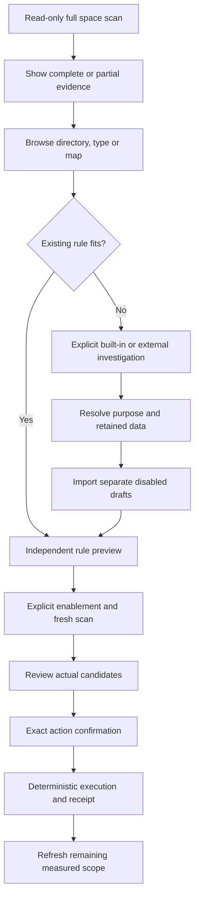

# Space analysis and rule investigation

English | [简体中文](../zh-CN/engineering/space-analysis-agent-design.md)

## User workflow

Space Analysis offers a compact view and a detailed view over the same saved scan. Switching preserves the directory, selection and focus without rescanning. The detailed view combines a directory table, file-type summary and bounded multilevel space map. Show current directory breadcrumbs, coverage and fresh-measurement actions without repeated headers.

Start with a 60:40 vertical split, allowing adjustment. Type highlighting and map/list selection use stable identities and consistent colors. Full paths remain available to accessibility and hover. Do not create one UI control per disk file; use bounded geometry and virtualized tables.

## Domain and interface ownership

Core owns saved queries, accounting, parent/child selection normalization, blocked reasons and bounded map geometry. UI owns the viewport, visual density, focus, highlighted type and display-only path shortening. External-agent context is separately bounded and does not expand cleanup authority.

macOS implementation uses Swift Core and native drawing/table views. Windows is planned with C# Core, Presentation and WinUI views; it implements the same behavior with platform-local services. See the [Windows plan](windows-native-plan.md).

## Implementation checklist

| Item | Required behavior |
| --- | --- |
| W01 | One saved-scan query contract for directories, types and map |
| W02 | Compact/detailed view switching without rescanning or selection loss |
| W03 | Bounded context export with exact CLI and rule schema references |
| W04 | Independent rule drafts and read-only benefit preview |
| W05 | Platform-specific native rendering and keyboard/accessibility |
| W06 | Accounting, pagination, cancellation and current-evidence checks |
| W07 | Deep-file representation, consistent type colors and adjustable split |
| W08 | Bounded directory readers, partial coverage and cancellation recovery |
| W09 | Independent rule enablement, fresh scan, explicit execution and remaining-scope verification |

## Acceptance

Use generated deep, wide, Unicode, hard-link, excluded and stale directories. Compare list/map accounting, exact selected scope, paging and cancelled work. A partial full-disk index cannot establish complete coverage. Rendering checks do not establish scan performance. External-agent quality, native UI, destructive execution and distribution require separate evidence.
