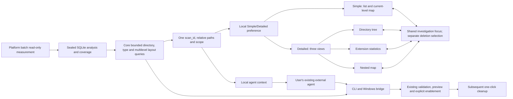
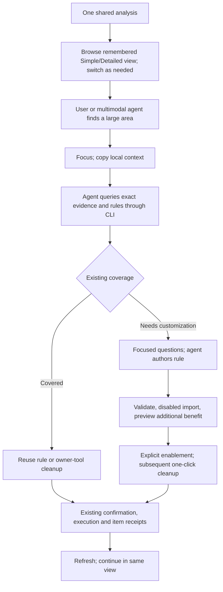
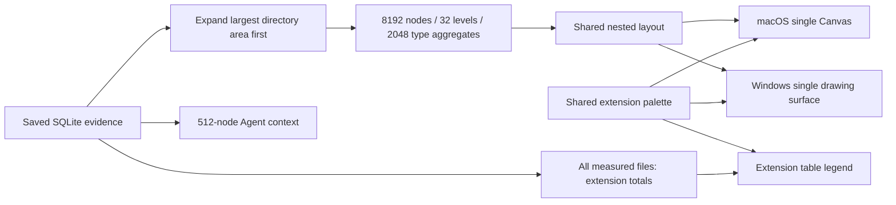

# Space analysis and external agent collaboration

English | [简体中文](../zh-CN/engineering/space-analysis-agent-design.md)

Date: 2026-10-21. Shared queries, native Simple/Detailed views and one-click agent context copying are implemented. Acceptance is tracked below; original research limitations still apply.

## Findings and user value

Space Analysis offers switchable Simple and Detailed views. First use defaults to Simple; later visits remember the user's preference. Simple supports everyday browsing and cleanup. Detailed adds the directory tree, extension statistics and nested map to show where space is used and what contributes. Users and external multimodal agents investigate as needed, then turn discoveries into personal rules reused by one-click cleanup. Users do not write rules manually.

In local interaction, clicking a large tile expanded the tree to a Colima `datadisk` file displaying approximately **107.4 GB** logical and **52.8 GB** allocated. Zoom Treemap focused its parent. The map quickly identifies a large area; the agent then investigates its owner tool and cleanable contents before authoring a rule. These are displayed measurements, not independently verified accounting.

Visual discovery complements structured evidence from the same scan. Shou integrates no model, builds no agent and uploads no files automatically. Existing Smart Cleanup retains scan, Clean Recommended and appropriate confirmation; discovery does not require users to process daily cleanup directory by directory.

## Evidence and boundaries

The research target is an installed native disk analysis application, bundle `1.0.0 (1)`, minimum macOS 12.0. Executable SHA-256: `51a1a448a97566e10c3c1f9657c4313de7cd68793bcef5be53ce353eb4665ddb`. Exact artifact identity remains in local raw evidence; identity does not verify developer signing or distribution provenance.

| ID | Source | Established | Limits |
| --- | --- | --- | --- |
| E1 | REA `inspect_macho`, `ev_f52cdc473c1948335289eaa14c76131c1c3c892f3a18e98ebdac35c241395226` | Universal arm64/x86_64, AppKit/SwiftUI linkage, `getattrlistbulk` import, scan/aggregation/layout exports | Symbols do not establish active call paths, default worker counts or speed |
| E2 | REA `inspect_native_dispatch_metadata`, `ev_843e3a90d33deca94a8d7d9ccb746e257b4cfbc4e943a3972c9dc3d8d8b5392d` | `NSOutlineView` tree, `NSTableView` extension table and `NSView` map subclasses; drawing, input, sorting and menu methods | Partial Objective-C ivar/Swift conformance coverage, unsupported generic/resilient metadata; source not recovered |
| U1 | Computer Use observation of existing results | Header capacity/duration, upper tree and extension table, lower nested map and hierarchy labels | No new controlled full-volume scan |
| U2 | Expand Users, select `.js`, click a large tile | Ancestor context; tile hit expands/selects exact file; bottom selection totals | Row selection verified, highlighting every matching tile not clearly observed; full type linkage unknown |
| U3 | Treemap menu and Zoom Treemap | Copy Path, Quick Look, CSV, zoom and display options; focused scope verified | Export, deletion and display-option changes not executed; menu presence is not end-to-end acceptance |
| S1 | Shou source inspection | Current implementation and gaps below | Does not replace runtime acceptance |

Complete local Evidence is retained under `.build/space-analysis-reference-20261021/`: `macho.json`, `dispatch.json`, `overview.json`, `providers.json` and derived demangled exports. `runtime-observations.json` separately records Computer Use observations, not REA runtime captures.

Readable Swift names were derived from E1 exports using ordinary `xcrun swift-demangle --compact`, retained in `exports-demangled.json`. This derivation is not decompilation.

Native overview returned `provider_unavailable`: no available Hopper, configured Ghidra or IDA. Independent Mach-O/metadata inspection succeeded. No pseudocode, active scan chain, layout implementation or scheduling was established. CLI invocations ended with no native analysis session left open.

Demangled E1 entry points include `ScanEngine.parallelBulkScan(root:workerCount:)`, `pipelinedBulkScan(root:syscallWorkers:parseWorkers:maxInFlightDirectories:)`, `parallelScanToTree(roots:…workerCount:…progressCallback:…isCancelled:…)`, `FileNode.aggregateSizes()`, `groupedChildren(minGroupSize:)`, `subtractContributionFromAncestors()`, `squarify(_:metric:in:maxItems:)` and `computeExtensionStats(roots:colorBySize:extensionLists:)`. Extension fields include logical/allocated totals and file count.

Together with the batch-metadata import these establish named entry points, not their use in the displayed scan, worker parameters, hard-link policy or index reuse. The page displayed **337.36 seconds** and approximately 6.4 million entries for an existing scan. No matched root/access/file/cache/load comparison establishes a speed advantage. Shou already has batch metadata and bounded scheduling; measure reading, aggregation, sealing and first rendering separately.

Volume usage, tree allocated totals and logical totals differed; the cause was not established. Shou must distinguish live capacity, measured scope usage, rule-match estimates and observed available-space changes, with timestamps and coverage.

## Shou foundation and gaps

| Area | Existing | Additions |
| --- | --- | --- |
| Directories | On-demand sealed-directory reads, sorting/filtering/breadcrumbs, list/map selection | Expandable multicolumn tree retaining ancestors; real database pagination. `children(of:)` currently loads a whole directory before CLI array pagination |
| Map | Balanced partitions of direct children; remainder after 160 tiles | Nested levels, zoom, stable legends, readable labels and bounded multilevel queries |
| Types | `analysis large-files` filters saved evidence by predefined extension categories | All-file arbitrary/no-extension and scoped aggregates; large-file filtering is not complete type statistics |
| Identity | `StorageScan.id`, root/relative paths, SQLite parents, logical/allocated bytes and coverage | Same snapshot and metric across views/handoff; no additional global UUID system |
| Agent | Directory menu opens `AgentRuleSetupView` with absolute path and local Skill/CLI | Current request omits `scan_id`, scoped metrics and coverage, risking duplicate investigation |
| Rules | Skill, opportunities, validation, disabled import, preview, explicit enablement and reuse | Connect storage evidence; route owner-tool targets to existing tool cleanup |
| Windows | WPF directory table, `storage.scan`/`storage.directory` bridge | Equivalent views/context; equivalent map was absent at this baseline |

Owners: `apps/macos/Sources/StorageViews.swift`, `StorageSession.swift`, `AgentRuleSetupView.swift`; `packages/shou-core/Sources/StorageCatalog.swift`, `StorageOperations.swift`, `Treemap.swift`; `apps/cli/Sources/ShouCLI.swift`, `DesktopBridge.swift`; `apps/windows/Shou.Windows/MainWindow.xaml`, `MainViewModel.cs`.

## Implementation changes

Connect W02 → W03 → W04 in order, updating shared contracts and Windows bridge at each step; W05 completes native Windows views and W06 verifies the full journey. UI and agent interfaces share aggregation services.

| Order | Owners | Changes | Completion |
| --- | --- | --- | --- |
| 1 | `StorageCatalog.swift`, `StorageOperations.swift` | Database sorting/paging, exact nodes, global/scoped extension aggregates and bounded multilevel queries; retain snapshot accounting and old analyses | Core/CLI agree on paths, bytes and coverage; large directories do not first load complete arrays |
| 2 | `Treemap.swift` and contracts | Visible nested nodes with parent relationships and aggregation/omission data; deterministic bounded layout and cancellation | Consistent areas/metrics, no parent-child double counting, stable layouts and robust zero-size/long-name handling |
| 3 | `StorageSession.swift`, `StorageViews.swift` and focused native controls | Native Simple/Detailed segmented control and remembered preference; shared scope, focus, filters and deletion selection; on-demand detailed AppKit tables and bounded linked drawing | No rescan or path/focus/selection reset on switching; Simple first-use default and remembered preference; no stale scope results; complete cleanup journey |
| 4 | `AgentRuleSetupView.swift`, CLI and Skill | Include current analysis ID, scope and exact selection; export structured context; shared rule-coverage queries and existing authoring workflow | Selected build directory resolves through CLI into the same evidence; explicitly enabled rule reused in a new process and daily cleanup without another disk scan |
| 5 | `DesktopBridge.swift`, WPF `MainViewModel.cs`/`MainWindow.xaml` | Same read queries/context, native virtualized tree/table/map and matching focus/selection | Shared contract checks plus actual Windows native interaction and permanent-cleanup journey |

Extend existing `analysis children` first. Add operations only for four concrete needs: exact nodes, extension totals, multilevel map data and context. W02 fixes command names/inputs and synchronizes `capabilities`, schemas, paging, errors and bridge. This table does not advertise existing commands. Visual labels and paths resolve to the existing `(scan_id, relative_path)` identity.

Suggested Detailed layout: adjustable upper area about 60% height, with tree/type widths about 2:1; lower 40% is the full-width map. These are initial values to validate, not fixed acceptance ratios. Allow collapsing types on small windows. Scan completion uses the remembered view; cleanup returns to the previous scope and view, and refresh updates measurement. Reuse the current agent handoff panel and split queries, controls and state only by actual responsibility.

## Interface and story

Extend the existing Space Analysis page, reusing compact navigation and bottom deletion actions, without new top-level task pages.

- Native toolbar Simple/Detailed segmented control. Simple retains a clear directory list, sizes and a current-level map; Detailed adds the three sections below. Both support direct cleanup and agent handoff; Detailed is not an AI-only mode.
- Detailed upper left: native expandable tree; name, share of parent, allocated bytes and file count by default; logical bytes, directory count and modified date on demand. Define percentage denominators.
- Detailed upper right: current-scope extension statistics with legend, share, allocated bytes and count; separate no-extension group.
- Detailed lower area: full-width nested map with directory boundaries/labels; readable large tiles, aggregated small entries and drill-down. A hit reveals the tree node, folder double-click focuses, breadcrumbs return.
- Compact header: volume/folder, scan/refresh, measurement time, scoped metrics and coverage. Label live volume capacity separately.
- Color describes type or directory categories; text/icons describe cleanup status. Middle truncation preserves leaf names/extensions; details expose exact paths.
- Clicking changes investigation focus; checking changes deletion selection. Type selection highlights/filters before explicit Select All. Preserve permanent-delete actions.
- Copy for AI Analysis supplies current local scope through the existing Skill workflow.

Switching changes presentation without scanning or mutating files. Path, focus, search/type filters and checked items share state. An active type filter remains visible as a removable chip in Simple, avoiding hidden conditions. Ancestors of selected deeper files show mixed selection; the bottom bar retains the complete selected count and bytes.

Persist the local display preference only; restoring a view still requires a valid current analysis and never restores previously selected deletion targets persistently. Load Detailed aggregates/map data asynchronously on first use, cache by scan/scope and cancel unnecessary requests when returning to Simple. View preference changes neither shared Core accounting/cleanup semantics nor CLI inputs.

Developer story: build output stands out across several projects. The user focuses one area and hands it to an existing agent. It queries paths, current rules and build configuration, asks only unresolved rebuild/retention questions, and authors a reusable pattern. Once explicitly enabled, Smart Cleanup covers equivalent projects together.

Extensions provide leads only: `.js` may be source, dependencies or application resources; `.sqlite` may contain personal data. Maps identify investigation scopes; previews identify exact matches/additional benefit. Owner-managed virtual disks require investigation of internal resources before choosing a cleanup action.

## Proposed architecture

This is a design, with no new CLI commands or bridge operations implemented. Reuse `ShouEngine` and one disk catalog, without another scanner.



Core owns queries, aggregation and layout data. Prefer AppKit for dense macOS tables; evaluate one drawing view with cached layouts/images for the map rather than one SwiftUI view per disk file. WPF consumes the same contract. Use interaction profiling to choose the renderer, without inferring the full reference rendering strategy from class names.

Global type totals reuse measured rows. Scoped queries are asynchronous, cancellable and cached, with no rescan on hover. Bound nested depth, node count and drawing area; explain omissions and aggregates. Parent area includes descendants and must not be added again as benefit. Keep the snapshot's hard-link policy, logical/allocated metrics and partial lower bounds.

## Flow and agent contract



Suggested context: version, `scan_id`, root, analysis time, relative scope, exact selection, logical/allocated bytes, file count, coverage, metric and usable read-only commands. Short visual labels map to `(scan_id, relative_path)`; stale labels never resolve to another file after view changes. A `view_revision` can distinguish post-deletion displays awaiting refresh.

Existing commands:

```sh
shou analysis summary --scan-id "storage_…" --json
shou analysis children --scan-id "storage_…" --path "projects/demo" --limit 50 --json
shou analysis large-files --scan-id "storage_…" --minimum-bytes 52428800 --limit 100 --json
shou rules validate --file "/absolute/path/rule.json" --json
shou rules preview --file "/absolute/path/rule.json" --workspace "workspace_…" --json
```

Paths/IDs are illustrative; use returned values. Space analysis needs no workspace; rule preview uses a registered workspace. `rules opportunities` currently reads full workspace scans, not `storage_…`. Add storage-node rule coverage through shared Core without forcing another disk scan or user-facing workspace management. `analysis children` omits full file identity, while `analysis large-files` includes it in `entry`. The new analysis map returns scoped nodes and extension aggregates; analysis context returns shared evidence and a localized request. These bounded results do not replace an exact deletion manifest.

```mermaid
sequenceDiagram
    actor User
    participant UI as Native Space Analysis
    participant Core as Core and disk catalog
    participant Agent as External agent
    participant CLI as Shou CLI
    opt Switch Simple/Detailed
        User->>UI: Change presentation
        UI->>Core: Query supplemental data from same scan as needed
        Core-->>UI: Bounded results; no rescan
        UI-->>User: Preserve path, focus, filters and checked items
    end
    User->>UI: Focus; copy analysis context
    UI->>Core: Bounded context from existing scan_id
    Core-->>UI: Exact paths, metrics, coverage and commands
    User->>Agent: Provide interface and local context
    Agent->>CLI: Query same snapshot; investigate purpose and rules
    CLI->>Core: Read saved evidence
    Core-->>CLI: Exact results and explicit unknowns
    CLI-->>Agent: Structured evidence
    Agent->>User: Ask only unresolved purpose, rebuild or retention questions
    Agent->>CLI: Validate, import disabled draft, preview
    CLI-->>User: Matches, additional benefit and rebuild cost
    User->>UI: Explicit enablement; subsequent Smart Cleanup
    UI->>Core: Existing confirmation, execution and receipts
```

## Delivery and acceptance

| Stage | Scope | Status | Acceptance |
| --- | --- | --- | --- |
| W01 | Artifact, metadata, interactions and source comparison | Complete within stated scope | E1/E2, U1–U3 and unknowns recorded; no pseudocode recovered |
| W02 | Tree, extension and multilevel query contracts | Implemented; shared contract checks passed | Same scan, arbitrary/no extension, hard links, partial coverage, true paging, cancellation and old analyses |
| W03 | macOS Simple/Detailed switching and focus | Implemented; core native interactions verified | Default/memory, no rescan, preserved state/filters/mixed selection; sorting, keyboard, zoom/return, middle truncation, accessibility; readable at 1024×768 and wider |
| W04 | Same-scan context and Skill loop | Implemented; CLI and Skill checks passed | Exact visual references, unambiguous duplicate names, reused coverage; enabled rule reused in new process/daily cleanup |
| W05 | Native Windows synchronization | Implemented; cross-build passed; real Windows UI pending | Matching contracts/metrics; Simple/Detailed switching, retained state, selection and handoff on actual Windows |
| W07 | Dense type colors and layout | Implemented; key macOS presentation and dragging verified | Deep root-scope files, shared legend/leaf palette, compact tables and native UI inspection |
| W06 | Performance, failures and complete cleanup | Generated cleanup and million-row queries passed; full performance targets pending | Large directories/millions of entries, rapid changes/cancellation, bounded memory; generated-data deletion, retry, return and fresh measurements |
| W09 | Major-consumer investigation and independent-rule cleanup | Implemented; deterministic regression and listed macOS interactions passed; external-agent judgment pending | Investigate large consumers; independent preview, enablement, fresh scan, confirmation, receipt and remaining-space verification |
| W08 | Full-disk directory read stalls | Open; worker samples retained | Identify stalled directories; isolate timed-out reads; reclaim workers on cancellation; never report unread scope as complete |

Targets: existing-snapshot focus/highlight p95 ≤100 ms; cancellable background scope queries with loading feedback within 100 ms; bounded drawing per frame. Record environment, tree size and cold/warm cache; measure first rendering, queries and scans separately. These are targets, not current measured results. Destructive tests use generated data.

External multimodal acceptance uses fictional generated trees: find largest allocated areas, follow hierarchy to build output, distinguish source/dependencies, recognize owner-managed virtual disks, resolve exact paths through context. Record visual identification separately from CLI verification. No success rate is promised before selecting/evaluating an actual external model.

## Acknowledgements

Native disk analysis tools provided directory-tree, extension-statistics and nested-map interaction references. Shou will independently implement views and queries, distributing no third-party binaries, assets or recovered code. Existing [design acknowledgements](reference-design.md) apply.

## Delivered query and copy contract

Simple/Detailed share one StorageSession and scan, preserving scope, focus, name query, sort and removal selection. Only the display preference persists. macOS uses an AppKit outline, native extension table and a single Canvas. Extension selection highlights matching files; a clearable active-filter label remains in Simple mode. Click inspects; double-click opens a directory.

The map query expands the largest remaining directory area first, returning at most 8,192 nodes, up to 32 levels and 256 children per directory. Branches below 0.001% of scope are left for drill-down. Clipboard context has an independent 512-node budget to stay usable in an Agent context window. Undrawn bytes remain an Other Entries area. Directory expansion pages 200 rows. Extension totals cover every measured file in the scope using saved hard-link accounting; the top 100 extensions and omitted totals are returned. Directory metadata is outside file-extension totals.

Copy for AI writes locally to the clipboard from either view. It includes format version, measurement metric/time/status, root/scope, exact paths, nodes, allocated/logical bytes, file counts, extension totals, coverage, focus, selected/removed paths, CLI/Skill entries and a localized analysis request. No model calls, upload or cleanup occur. Removed paths qualify old snapshot totals; the extension table requests a refresh after cleanup.

CLI analysis map and analysis context expose saved evidence; context returns structured context and ready-to-paste text. Existing analysis children keeps its cursor contract with SQL ordering/LIMIT/OFFSET. Newly sealed catalogs add a directory-size index; old snapshots remain readable without migration. Windows exposes storage.map/page/context and storage.remove through existing manifest review, request-bound confirmation, execution and receipts. Cross-building and protocol checks on macOS cannot replace Windows UI acceptance.

The bundled Skill reuses a supplied storage scan, reads existing rules and distinguishes storage queries from workspace-only rules opportunities. Rule drafts still require validation and preview; copying a report does not establish rule coverage or authorize deletion.

## Acceptance record, 2026-10-22

Environment: Apple M1, 8 physical cores, arm64, macOS 15.7.3. Performance values are from a Debug build with a generated, just-sealed local index; they do not measure cold full-disk scanning or UI p95.

- Core: 234/234 checks passed, including scoped extension/context accounting, legacy/catalog parity, hard links, bounded maps, cancellation and area checks. Focused presentation/selection checks: 3/3; space removal: 4/4. Selection/filter deselection over 70,000 entries took about 0.24 seconds.
- Generated catalog: 1,000,005 file rows; bounded map plus full extension summary returned 64 nodes in about 0.895 seconds. Final directory page took about 0.083 seconds.
- CLI: 158 contract, 23 storage and 34 large-file checks passed. Desktop protocol verifies map/context/pages, cancellation, confirmed permanent deletion, retained siblings, journals and replay refusal using generated files only.
- Installed macOS UI: default Simple, remembered Detailed after restart with empty deletion selection, retained checked items through switches, directory expansion, extension highlighting and visible clearing, map-to-file tree focus, exact deletion review and cancellation/return verified. Real clipboard text was pasted into the native text editor and checked for scan ID, complete scope, selections, extension state, metrics and CLI/Skill entries.
- Windows: WPF cross-build has zero warnings/errors; 11 process bridge checks pass. Actual Windows layout, keyboard/selection semantics and native cleanup interaction still require a Windows machine.
- Documentation: 84 Markdown files, 643 local links, 11 README languages and 1388 native localization keys. Skill validation passes.

Evidence is retained in .build/presentation-*.log, .build/presentation-million.log, .build/presentation-final-install.json and .build/analysis-copy-verification.rtf. The installer verifies bundle signatures/content and compares local records before/after replacement; it retains no previous app.

Remaining acceptance: real Windows Computer Use; all window-size/accessibility combinations; UI p95 and cold/warm disk-scan comparisons; external multimodal-agent accuracy; separate Claude Code/WorkBuddy clients. No model integration was introduced to simulate these results.


## Dense analysis view correction, 2026-10-22

The previous three-level/512-node map stopped before files in a disk-root view, so neutral directory surfaces occupied the entire map. The new query follows allocated area through deep chains, with explicit node, depth and per-directory bounds and no filesystem rescan. Omitted descendant files are grouped by actual extension under their closest displayed ancestor, adding at most 2,048 aggregate tiles. Labels show type and count; clicks inspect the parent, and synthetic IDs are never deletion paths. Remaining omissions and directory metadata retain neutral area and are available via paging or folder drill-down. Extension summaries still use every measured file, independent of the visual sampling budget.

The upper 60% contains linked compact AppKit tables (19 pt rows), with name/icons, parent share, allocated/logical sizes, file count and modification time; the extension table adds a shared type legend, scope share and sizes. Both scroll horizontally when necessary. The lower 40% is a dark nested map with 13 pt directory headers, fine borders, white labels and size annotations on large tiles. Real file extensions use a shared palette and two-axis gradients; directories and omitted regions stay neutral. Active types have red outlines, investigation focus white, and explicit removal selection cyan. These states never select files implicitly. Footer and table chrome are compact; splitters remain adjustable.

Windows consumes Core geometry, depth and the same `colors` mapping from `storage.map`, including legend colors and neutral directories. The WPF view uses corresponding compact columns and gradients. macOS renders a single Canvas; Windows uses one drawing surface. Clipboard context retains a smaller independent budget. No third-party assets are bundled.



W07 tracks this correction. Native inspection verified the initial 60:40 split, divider dragging, type highlighting and switching without rescanning; the app was replaced locally. Regression evidence follows. Actual Windows interaction remains pending.

Extension legends and aggregate tiles reuse one read-only index aggregation. A recursive directory attribution assigns files to their closest displayed ancestor and produces both map groups and complete extension totals. This avoids a second index traversal and changes neither persistent SQLite data nor filesystem scan evidence. Clipboard reports retain their independent smaller budget.

### W07 regression evidence

- Core 234/234, CLI contracts 158, storage 23, large-file 34 and desktop protocol checks passed. A million-row generated index returned 256 real nodes and an exact extension aggregate; map/full-extension queries took about 1.335 seconds, with the final page about 0.101 seconds. These are Debug index queries, not cold filesystem scan measurements.
- The first `scripts/test.sh` run stopped in the application-batch check because a generated selection had no components. The isolated rerun passed 19/19. The remaining privacy 16, cache 13 and native TTY cleanup/restore checks passed separately. The original failure is retained; this was not a single all-green suite run.
- Windows cross-build completed with zero warnings/errors; 11 process bridge checks passed. Real Windows interaction remains pending.
- A real development-directory analysis measured 122.44 GB of allocated space. Extension highlighting was verified without adding removal selections. The subsequent splitter correction starts at 60:40 and retains native dragging.

Evidence: `.build/space-colors-final-tests.log`, `.build/space-colors-app-batch-retry.log`, `.build/space-colors-privacy-final.log`, `.build/space-colors-cache-final.log`, `.build/space-colors-native-cli-final.log`, `.build/space-colors-million.log`, `.build/space-colors-windows.log` and `.build/space-colors-windows-checks.log`.

### W08 known stall and acceptance work

During native full-disk acceptance, the entry counter stopped at 3,066,212. Repeated samples of the actual read worker showed multiple parallel directory threads inside `openDirectory → _fcntl_overlay_open → __open`. The last progress path does not identify the stalled directory, and permissions, filesystem behavior or application ownership have not been established as the cause. The worker currently has an overall deadline without per-directory stall isolation.

That scan was stopped; `.build/space-colors-scan-worker.sample` and `.build/space-colors-sample.log` retain evidence. Stop responded; a separate development-directory analysis returned a queryable partial index with about 146.62 GB measured as a lower bound. Neither establishes complete development-directory or full-disk acceptance. W08 requires precise read diagnostics, bounded stall isolation, explicit incomplete coverage after timeouts, cancellation/worker reclamation, then equivalent cold/warm scans and injected-stall checks. This color/layout correction changes neither the scanner nor system permissions.


## W09: Major consumers and independent-rule cleanup

The clipboard request and bundled Skill prioritize major consumers, following large branches to specific ownership, purpose, active use, reproducibility, rebuild cost and retention. Unresolved large areas remain explicit with the next diagnostic. Easy small caches do not substitute for this investigation; names, extensions and size do not establish removability. Shou supplies same-scan evidence and paging, while actual external-agent judgment remains a separate acceptance requirement.

Each rule ID represents an independent cleanup decision. Split different purposes, rebuild costs, active-use restrictions, retention and user preferences, even within the same tool. Equivalent policies may share a pattern. Preview each draft independently, report matches/protected/outside-condition paths and deduplicated additional benefit, and never sum overlapping previews. Draft import remains disabled.

macOS exposes Review AI Rules… after copying. Reactivation checks external configuration revisions, invalidates old cleanup evidence and offers a return prompt. Rules → Personal Rules → Review & Clean… opens one rule with measured preview, conditions, retention and benefits. Keep Current Choice closes without changing enablement. Enable & Scan This Rule checks the preview revision, saves only that ID/version, scans it freshly and prepares an editable selection for existing permanent/Trash confirmation. Other drafts retain their state.

Windows mirrors independent preview, enable/scan, external refresh and return navigation. The `rules.preview` bridge returns rows, conditions, benefits and configuration revision; `scan` accepts explicit `rule_ids` for Core cleanup scanning. Both platforms reuse existing rules and execution, without a model, agent or alternate deletion engine.

```mermaid
flowchart LR
    Snapshot[Same scan and directory pages] --> Agent[External Agent investigates largest consumers]
    Agent --> Findings[Recommended / optional / preserve / investigate]
    Findings --> Split[Independent rule IDs]
    Split --> Drafts[Validate, disabled import, separate previews]
    Drafts --> Return[Return to Shou Personal Rules]
    Return --> Choice{Choose each rule}
    Choice -->|Keep| Stay[Keep current state]
    Choice -->|Enable| Scan[Fresh scan of this rule only]
    Scan --> Select[Adjust actual file selection]
    Select --> Confirm[Existing exact deletion confirmation]
    Confirm --> Receipt[Per-item execution and failure retry]
    Receipt --> Verify[Verify targets and remaining relevant scope]
    Verify --> Daily[Enabled rule joins future one-click cleanup]
```



```mermaid
sequenceDiagram
    actor User
    participant UI as Shou native UI
    participant Agent as Existing external Agent
    participant Core as Shared CLI / Core
    User->>UI: Copy for AI
    UI-->>Agent: Local evidence, investigation and return instructions
    Agent->>Core: Investigate major areas; separately import disabled rules and preview
    Agent-->>User: Per-rule benefits, costs, preservation and unknowns
    User->>UI: Return and review one rule
    UI->>Core: Single-rule preview and deduplicated benefits
    User->>UI: Enable & Scan This Rule
    UI->>Core: Check revision; save this choice; fresh scan
    Core-->>UI: Current candidates; other drafts unchanged
    User->>UI: Adjust files and confirm deletion action
    UI->>Core: Existing plan and execution
    Core-->>UI: Per-item results and execution receipt
    User->>Agent: Continue verification when needed
    Agent->>Core: Read receipt; remeasure relevant locations only
    Agent-->>User: Actual outcome and subsequent reuse
```

Acceptance uses two independently previewed rules with different retention needs: enable one, reopen the engine, clean generated data, verify its receipt and absence, preserve the other target, and verify a fresh scan. Native acceptance covers review, close, enable/scan, editable selection and cancellation. Deterministic execution tests require no model call; external-agent judgment accuracy is evaluated separately.

### W09 acceptance evidence

- Final Core checks passed 235/235. The new case independently previews two rules, enables only rebuildable output, verifies its reuse by a new engine's daily scan, permanently removes generated data, then checks the `purged` receipt, target absence, preserved offline dependencies and a fresh scan.
- All 158 CLI contracts, desktop protocol integration and 11 Windows process checks passed; WPF cross-build reported zero warnings/errors. Bridge checks cover disabled preview and explicit `rule_ids` scan scope.
- macOS Computer Use verified measured matches/benefits, expanded scope, closing without enablement, enabling only one rule, a fresh scan, deselection/reselection, permanent-removal confirmation and cancellation. Other drafts stayed disabled; the fixture rule was restored to its original state, and generated files plus retained sibling were verified and archived as build evidence.
- The final installed app successfully copied analysis and exposed Review AI Rules…, which returned directly to Personal Rules. Directory selection used the native panel. Native deletion confirmation was cancelled; actual removal is covered by isolated tests, with no personal files deleted.
- This Codex session reused a real development index through the installed CLI, followed a hidden working directory with about 89.25 GB measured, and distinguished candidate working copies, Rust `target` inside a release copy, and separate `debug` output. The overall tree remains `partial`; estimates cannot be added as reclaimable space. Active use, rebuildability and retention still need verification, so no real cleanup rules were imported.
- The local release application bundle and signatures passed verification. Version 0.10.0 replaced `/Applications/Shou.app`, with 138 verified files, 132 existing records preserved and `backup: null`. Existing local ad-hoc signing limitations remain.

Evidence: `.build/agent-cleanup-loop-final-core-tests.log`, `.build/agent-cleanup-loop-cli.log`, `.build/agent-cleanup-loop-bridge.log`, `.build/agent-cleanup-loop-windows-final.log`, `.build/agent-cleanup-loop-windows-checks.log`, `.build/agent-cleanup-loop-final-release.log`, `.build/agent-cleanup-loop-final-install.json` and read-only descent records in `.build/agent-cleanup-loop-*.json`. Documentation, 1,404 bilingual resources and Skill validation passed. Real Windows interaction, external-agent investigation quality and complete full-disk performance remain pending.
