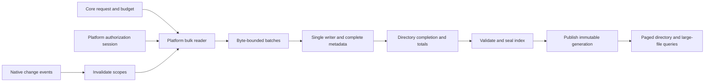
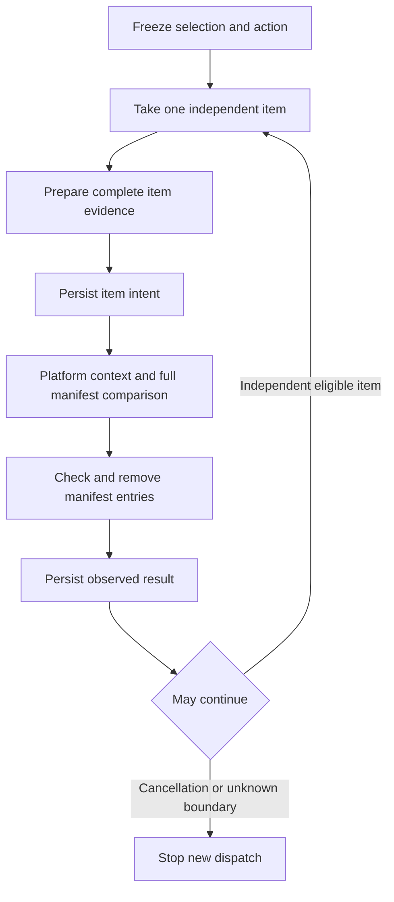

# Scan and deletion performance architecture proposal

English | [简体中文](../zh-CN/engineering/storage-performance-architecture.md)

Date: 2026-10-29. Status: architecture proposal with initial implementation. The first changes reduce duplicate evidence work; pipelines, concurrency, incremental indexes and NTFS discovery remain experiments. No Windows performance acceptance is established. Facts and pinned sources are in the [research report](storage-performance-research.md) and shared [evidence inventory](storage-performance-evidence.json).

## Decision and scope

Keep Swift Core/macOS Platform and C# Core/Windows Platform. Share product and safety contracts while implementing native capabilities independently. Retain complete evidence once, query projections on demand, bound the handoff between reads and persistence, and reduce repeated-scan work with invalidatable incremental indexes.

Do not start with a language rewrite, a database replacement or batch live preflight. Make independently measurable small changes first; add orchestration/concurrency only when observations justify complexity. Performance numbers are experiment gates until verified.

Scope includes Space Analysis, large files, rule cleanup, application components/remnants, projects and developer-tool file discovery/manifests. Browser database transactions, package managers, MSI/MSIX and startup controls retain their own contracts; shared authorization, diagnostics and journaling do not turn them into recursive filesystem removal.

## Initial implementation boundary

- Catalog-backed macOS storage scans no longer duplicate inline details. Full catalogs and exact counts remain; browsing, review, comparison, CLI and AI consumers were audited, and legacy inline records remain readable.
- New catalogs no longer maintain the temporary directory index unused by current traversal, reducing intermediate writes and final free pages. Published query indexes/formats are unchanged. Measurements support smaller directory-heavy catalogs, not faster scan completion.
- Initial storage-removal history publication copies this operation's verified plan pages, checking their digests again before copying. History keeps independent storage and retention, avoiding repeated JSON encoding without shared physical pages, reference GC or a new format.
- Shared manifest paging uses fixed field names and array slices to avoid per-entry snake-case conversion and page-array copies. Bytes must match the legacy encoder exactly; see the [data model](../architecture/data-model.md).
- Shared native macOS permanent removal consolidates adjacent duplicate `fstatat` calls for ordinary single-link files. The complete comparison immediately before `unlinkat`, hard-link/directory/symlink contracts and ancestry checks remain.
- Windows cleanup computes total entries once and accumulates removed entries, avoiding a full-plan traversal on every progress callback. This is not a measured Windows native-removal speedup.
- Windows full scanning bounds progress delivery in Core: first entry immediately, then a 250 ms interval checked every 128 entries, and an exact final count before return. Per-entry cancellation remains; ordinary observer exceptions do not discard evidence. Targeted rule-scan accumulation is unchanged.
- Finalization events no longer carry the analysis root. Both presentations restrict deletion paths to frozen targets and descendants, avoiding a volume root being displayed as a deletion target.

These changes reuse existing Core/Platform ports and paging. See the [data model](../architecture/data-model.md) for contracts and [performance records](storage-scan-performance.md) for measurements and validation. Proposed pipelines and incremental capabilities have no placeholder implementation.

## Preserved contracts

- Default permanent cleanup and exact selection review remain. Selection, recommendation, cache hits and administrator sessions are not standing deletion permission.
- After confirmation, prepare/check/execute independent items and report results. Removing batch live checks does not remove complete per-item live manifest verification. Strict CLI planning retains its existing boundary.
- Complete lists/history comparison retain full details. Partial views, derived indexes and events cannot authorize mutation.
- Check current root, ancestry attachment, ownership, exclusions, policy, identity and manifest. Never follow replacements or remove new entries outside the manifest.
- Persist intent before each mutation. Unknown outcomes, journal failure, invalid root scope or authorization cancellation stop new dispatch; no automatic replay. Preserve each platform's existing independent-failure behavior.
- Reuse Platform authorization sessions without requesting a password for each directory/file/worker. A lost session reports the actual boundary and does not replay dispatched mutations. Full Disk Access, administrator access and business confirmation remain separate.
- Windows public mutation remains gated pending matching native acceptance. Mac-host .NET tests do not establish Windows native performance.

## Scan data flow

A Release experiment putting catalog schema, final indexes and cleanup in one transaction showed no gain and was reverted. Five alternating pairs per generated workload preserve every field and aggregate: file-heavy scan medians were 0.382/0.396 s and directory-heavy 0.299/0.302 s. One fewer commit does not establish faster completion. Full evidence and limits are in the [performance record](storage-scan-performance.md).

Status/writer lock separation was also reverted after confirmation showed roughly 7% file-heavy regression and 16% directory-heavy improvement with overlapping ranges. Checkpoints were already batched every 128 entries; no second mechanism was added. A separate writer channel still requires representative workload evidence; theoretical concurrency does not pass admission.

This is the proposed flow, not a claim that a separate batch channel already exists. Start by measuring the existing scheduler, lock waits and allocations.

### Complete evidence and projections

Keep stable identity, sizes, required timestamps, ownership/permissions, kind and coverage for every observed entry. Represent paths using parent IDs and basenames, constructing full paths for queries/boundary operations. Reuse the macOS catalog's existing partial implementation. Directory totals are projections; the UI need not build another full object tree.

The initial change publishes root, catalog reference, exact count and coverage summary for new catalog-backed scans without the second inline list at 10,000 entries or below. Audited `StorageScan.tree.entries` consumers use existing catalog queries for browsing, selection, history comparison, CLI and AI; affected tests now query catalog details. Existing readers remain for old inline records and non-catalog scans.

Do not add an overview-only mode in this phase. Any later directory/top-file mode needs an explicit capability and cannot replace complete browsing/history or silently degrade evidence.

### Batch ownership, backpressure and dependencies

Candidate: readers hand bulk pages/compact batches to one writer that owns the catalog, instead of doing per-entry SQL under the scheduling/error-state lock. Batches carry parent identity, required facts and directory discovery events without copying a full path tree.

Bound both entry count and actual batch bytes; separately bound pending directories. Eight active workers alone do not bound closures, paths and arrays. Stream wide directories rather than collecting all children. A full queue pauses producers; writer failure, disk-full and cancellation must wake producers, join work and refuse publication of incomplete data as complete.

Pending child counters finalize a directory only after its enumeration, required children and identity closeout complete. One lifecycle owner closes queues and seals the index. Avoid designs in which all readers wait for work only readers can schedule. Benchmark capacities and worker counts; do not copy another project's channel size or CPU multiplier.

Batch acknowledgements return new directory IDs to the scheduling owner; readers do not hold slots waiting for descendants. Reaching a pending-directory limit produces explicit partial coverage or stops under existing budget semantics, rather than blocking every worker on enqueue. Queue limits do not make the whole scan constant-memory: name deduplication, identity associations and complete evidence need separate accounting/budgets.

Keep one SQLite writer, prepared statements, transactions and publication after sealing. Measure allocation-free bindings, directory update batches and batch sizes before adopting them. Do not assume more writers or WAL improve this workload. Rebuildable index failures do not weaken execution-journal durability.

### Windows counterpart

C# Core retains Windows path/coverage decisions; Platform handles metadata, bulk enumeration, persistence and authorization. Introduce only the small streaming scan-store/query port needed to avoid simultaneous full observation and path collections. App and CLI use the same service.

Reuse existing capacity-128 directory channels and authorized delivery in `WindowsFileSystem`; do not add a redundant queue at the same boundary. Coordinate cross-directory budgets and storage consumption, testing waits among the thread pool, native scheduler and writer together.

Prototype Windows-owned SQLite storage and measure inserts, indexes, private ACLs and deployment costs. Share field semantics and fixtures, not a Swift database/File ID ABI. The existing `NativeDirectoryReader` emits names; adding batched metadata requires information-class and buffer validation. Required owner/link/reparse/placeholder checks cannot disappear merely because enumeration is batched.

## Immutable-manifest lifecycle

The initial change keeps separate plan/history collections and copies verified raw page bytes at first history publication, avoiding repeated encoding without depending on an expiring plan file. Pages are checked during load and copy, history pages precede journal publication, and changed manifests use the encoder. Shared physical pages and GC below remain later candidates, not implemented features.

First evaluate a shared store with the existing page encoding. Do not invent a compressed binary protocol before measuring need. If a minimal reference design provides insufficient value, retain the current implementation.

| Boundary | Requirement |
| --- | --- |
| Preparation | Stream encoding/hashing with exact counts/order/identity; persist pages before publishing references |
| Load | Validate parent binding, page order/count/digest and path ordering; reuse verified immutable pages within an operation, never cache authorization across operations |
| Mutation intent | Under the mutation lease, durably bind dependencies to the receipt and write the appropriate intent before mutation |
| Result | Update small state records, retain actual outcomes, stop dispatch on journal failure |
| Retention/GC | Mark reachable pages from active plans, retained receipts, recovery and unfinished intents; protect reference publication using leases |
| Crash | Reclaim unpublished orphan pages; missing dependencies fail as corruption; plan expiry cannot erase evidence or permit replay |

Equal content digests do not mean equal authority. Parents still bind scan, plan, item, action, policy and expiry; sharing must not allow a legitimate manifest to be attached to another unconfirmed target. Windows implements matching semantics with its own versions.

Version new records explicitly; continue reading old inline/pages. No bulk background migration or rewriting old confirmation digests. Older readers must refuse unknown formats rather than treating them as empty. Rollback affects newly generated data while preserving evidence for started operations.

## Permanent removal

This is a domain lifecycle; each entry point retains its actual confirmation-binding order. Unprepared scope is not authorized and plan creation is not deletion completion.

### Consolidate duplicate work first

The initial change targets ordinary single-link files: it consolidates adjacent checks in the `purge` loop and `unlinkFile` into the mutation helper, preserving the final complete comparison nearest `unlinkat` and ancestry checks. Directory, symlink and hard-link contracts remain separate, including hard-link pinning, post-unlink link/ctime reconciliation and cross-target accounting. It does not pass an old `stat` to remove the final check.

Profile entry construction, path allocation, digest decoding and native calls separately. Retain the FD stack. Reducing ancestry checks changes behavior when ancestors move or are replaced and requires separate research, not incidental cleanup during a performance refactor.

POSIX check-to-`unlinkat` races remain; neither batching nor FD caching proves their elimination. New native mechanisms need documented semantics and fault tests, otherwise retain current checks.

### Conditions for parallel removal

Start with independent selected targets at concurrency 1/2/4, separating devices/volumes. Dispatch only targets with no unsafe shared mutable context. Many files in one directory may not benefit. Subtree parallelism within one large target is a separate experiment and never permits unrestricted `RemoveAll`.

Dependencies include child completion before parent removal, shared-inode accounting, root/context checks, FD bounds and serialized journal transitions. Windows currently rejects multi-link cleanup files; preserve that boundary.

Every task needs durable intent before dispatch. After cancellation, journal failure or unknown outcomes, stop new tasks, wait for dispatched work and record actual boundaries. Concurrency changes how many items may already be in flight; document and verify this stop behavior before production use. Until then retain serial execution.

Throttle progress without dropping actual results; do not refresh UI or send complete manifests per entry. Measure Windows reporting, authorization IPC and logging separately, including end-to-end privileged runs.

Renaming into a background directory is not a completion shortcut: movement does not complete permanent deletion and adds hidden-data/recovery lifecycle. Distinguish removed names, estimated bytes and volume free space; APFS snapshots/clones/open files can delay reclamation.

## Incremental indexes

Incremental work speeds repeated analysis, historical comparison and discovery. Preparation/live mutation checks still inspect selected targets; events do not prove unchanged contents.

### Baseline and generations

1. Validate root/volume identity, path semantics, policy and permission coverage. Establish event observation and starting cursor before baseline scanning to avoid a listener gap.
2. Run a complete scan, mark events during scanning dirty, rescan/reconcile affected scopes and publish a generation with explicit coverage/watermark. A changing tree is not an atomic point-in-time filesystem snapshot.
3. Coalesce dirty descendants beneath affected ancestors. Renames invalidate old/new parents and dependent paths. Stable directory IDs avoid unnecessary path rewrites; directory mtime alone is insufficient.
4. Write changes into a temporary generation or transaction, update affected ancestors, validate and publish atomically. Readers retain their previous generation; index generation and event cursor commit together.
5. Continuous changes, exhausted budgets or uncertain events retain partial/stale state or trigger full scans; never force a complete label.

Hard-link size/link changes may affect multiple paths and allocation attribution. Maintain reverse identity associations or enlarge rescans/invalidate the baseline. Permission expansion requires scanning previously partial subtrees; restriction cannot leave old facts labeled currently complete.

### macOS

Platform uses FSEvents; Core receives affected scopes, cursors and continuity state. Handle `MustScanSubDirs`, `KernelDropped`, `UserDropped`, `RootChanged`, and `EventIdsWrapped` according to Apple documentation. Lost continuity/root changes require a new affected baseline. On restart validate cursor, volume and root identity.

No event silence as deletion proof, no stale result labeled an atomic current snapshot, and no scope expansion merely to accelerate indexing.

### Windows

Evaluate NTFS USN journal maintenance first. Retain volume identity, `UsnJournalID` and committed cursor; verify continuity. Recreated journals, out-of-range cursors, volume changes and unsupported record versions require full scans. Handle case-sensitive directories, rename pairing, hard links, multiple names and missing associations for deleted records; uncertain associations trigger parent rescans.

Prototype `FSCTL_ENUM_USN_DATA` for first discovery, but FRN/parent/name data alone is only a discovery index. Supplement allocated/logical sizes, owner SID, link count, reparse/placeholder and real path context using restricted handles. Distinguish discovered records from completely measured entries.

Use the current UAC session; no per-entry authentication. Fall back to handle traversal for insufficient privilege, non-NTFS, unsuitable directory requests, placeholders or unsupported volumes. Do not change ACLs, take ownership, enable or recreate system journals. Compare discovery + supplementation + index + publication; if supplements erase the gain, retain journals for incremental maintenance without shipping initial fast discovery.

Defer raw MFT parsing. WinDirStat demonstrates its possibility and its aligned-read, run, extension-record and consistency complexity; do not copy GPL code or treat raw records as Shou mutation evidence.

## Modules and feature coverage

| Work package | macOS ownership | Windows counterpart | Exit condition |
| --- | --- | --- | --- |
| Measurement | `NativeStorageMeasurement`, `StorageCatalog`, `StorageOperations`, `NativeFileSystem`, `ReceiptJournal` | `StorageScanner`, `WindowsFileSystem`, `NativeDirectoryReader`, `WindowsCleanupMutation`, stores | Reproducible phase timing/CPU/allocation/I/O and correctness summaries |
| Duplicate work | `StorageScanRecords` consumers, small catalog publication, manifest/plan/history storage | Paged manifests and all plan/history readers/writers | No duplicate full details; reference/legacy tests pass |
| Scan pipeline | Shared state, directory scheduler and catalog batching | Small Core scan ports, Platform streaming storage/scheduler | Bounded queues/FDs; cancellation/storage failure terminates |
| Local removal changes | `purge`/`unlinkFile`; ancestry research separate | `Scope.VerifyTree`/`VerifyContext`, dispositions/reporting | Exact scope and race/unknown guarantees preserved |
| Other entries | Rules, app components, project/tool file observations | Matching Core services and Platform capabilities | Shared lower layer, no second authorization/traversal policy |
| Incremental/discovery | Platform FSEvents, Core generations/invalidation | Platform USN, Core generations; optional NTFS prototype | Continuity failures fall back; complete results match full scan |

Add only ports needed for the work package being implemented. Do not prebuild a universal framework or cross-platform FFI. UI owns phases, coverage, selection and real results; use existing shared design resources without extra explanatory panels. Apply the native-design skill when actually changing UI.

Measure MSI/MSIX, privacy transactions and package managers separately from filesystem work. All features share Platform authorization lifecycle. Validate access failure, recheck and invalidation behavior without weakening protection for speed.

## Benchmark and fault acceptance

### Protocol

Use Release on both platforms and record source/worktree hashes, binary SHA-256, OS/architecture/filesystem/device, CPU/memory, authorization state and toolchain. Retain fixture generator/parameters, content digests, in/out-of-scope sentinels and every raw sample. Deletion uses generated data only.

Screen each candidate with at least five alternating baseline/candidate pairs, publishing all samples, median and range. Five samples do not establish p95; collect more for tail claims. Separate warm tests from genuinely controlled cold-start/cold-metadata tests, and label uncontrolled caches. Profiling runs are separate from timing runs.

Measure first useful result, complete publication, cancellation return, preparation, manifest load/compare, durable intent, native mutation and final receipt. Pipeline phases overlap; do not sum CPU/wall times blindly. Also measure phase/whole-process-tree RSS, allocations, read/write bytes, SQL/syscall counts, lock waits, queue/directory backlogs and FD peaks. Volume free-space observations remain separate from estimated removed bytes.

Use macOS Instruments Time Profiler/Allocations/File Activity or available `sample`/scoped tracing; Windows WPR/WPA, ETW and .NET tracing. Record unavailable tools rather than invent attribution. Privileged worker/IPC and GUI journeys are additional end-to-end groups, separate from ordinary-user Core timings.

### Matrix

| Scenario | Required checks |
| --- | --- |
| Wide directory, many siblings, deep/directory-heavy trees, million-row synthetic catalog | Exact details/totals; synthetic index construction reported separately from traversal |
| Small/large/sparse/compressed/cloned files and hard links | Preserved logical/allocated semantics, deduplication and estimation limits |
| Unicode, long paths and case-sensitive directories | No lost or merged entries; stable ordering |
| Permission failures, authorization reuse/loss, FDA changes | Explicit coverage/errors, independent siblings follow contract, no replay |
| Symlinks, junctions/reparse points, mounts and placeholders | No following, hydration or scope escape; unsupported evidence grants no mutation |
| Root/ancestor/descendant replacement, new files during removal | Preserve outside sentinel contents/identity and new entries; existing race assertions remain |
| Cancellation, journal failure, disk-full and process crash | No deadlocked queues; unpublished scans unavailable; durable intent/unknown preserved |
| Incremental no-change/small-change/renames/hard links/event loss/journal recreation | Compare with full scan; gaps force fallback |
| Rules, app components, projects and analysis entry points | Shared contracts and outcomes; installer/database paths measured separately |

Existing macOS `PermanentRemovalTests` covering link replacement, external sentinels, new files, shared hard links and deep trees remain admission tests. New reference storage also tests expired plans with retained history, GC, missing/tampered pages and crashes at publication windows.

Verify Windows x64/ARM64 .NET, native system, UI and packages separately. Prepare candidates/scripts before consolidated cloud acceptance. This research does not purchase/start a cloud machine; the previously released machine is not an available resource. Apply the repository Windows-cloud skill when native testing actually begins.

### Gates and order

These are **proposed engineering targets, not measured gains or promises**: a focused candidate should reduce median target-workload time by at least 20%; over 5% regression in a major group needs more samples/investigation. Unattributed noise is not a pass. Correctness is mandatory and queue/FD/memory bounds remain. Report incremental gains separately from initial scans.

1. Establish phase attribution for enumeration, writing/locks, sealing, small-scan publication, encoding, live verification and mutation. Reorder work when the target phase is insignificant.
2. Audit small-catalog consumers, then independently evaluate shared manifest references and adjacent ordinary-file checks, with separate measurements/rollback.
3. Add one-writer batches/Windows streaming storage only when locks, allocation or updates justify them. Select measured limits.
4. Evaluate removal concurrency 1/2/4 after proving races, journaling and in-flight stop behavior. Retain serial execution without stable benefit.
5. Implement incremental gap detection/fallback before normal updates; compare against full scans at different change ratios.
6. Independently evaluate Windows NTFS discovery with complete supplements. Defer raw MFT; do not block shared foundational work on it.

Stop candidates that gain speed by dropping safety/details, improve only visibility without real completion, depend on unavailable authority, report unknown as success or lose resource bounds. Each package requires source changes, raw evidence and explicit unverified scope before updating bilingual contracts and `SYNC.md`. This proposal itself establishes no implementation or release support.
