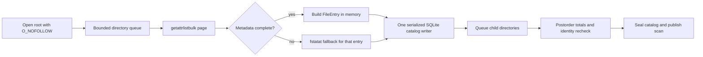

# Storage scan performance

English | [简体中文](../zh-CN/engineering/storage-scan-performance.md)

Shou's full storage analysis is a read-only inventory. Its hot path is filesystem metadata I/O, not CPU arithmetic. A scan therefore becomes faster when independent directory reads overlap and each directory is fetched with fewer syscalls. Increasing thread count without a bound makes APFS, cloud placeholders, network volumes and the desktop compete for the same resources, so Shou uses a bounded reader pool.

## Current pipeline



On macOS, `getattrlistbulk` returns a page of names, object types, device/inode identities, timestamps, allocation sizes and logical sizes. Regular files stay on this batched path. Directory metadata is refreshed once with `fstatat` so directory link counts and exact stat evidence remain compatible with the existing cleanup and hard-link contracts. Symlinks, special files, incomplete records and unsupported attributes use the no-follow stat fallback.

The default reader count is `min(activeProcessorCount, 8)`, with a lower bound of one. The pool is a directory pool rather than a file-per-thread pool: a worker reads one directory page, appends its immediate rows, then schedules child directories. A finalizer runs after all descendants complete, updates parent totals, checks that the directory identity is unchanged and marks the subtree complete only when its own coverage and every child coverage are complete.

SQLite remains a single writer. The catalog is opened with `SQLITE_OPEN_NOMUTEX`; `StorageParallelState` protects all appends and total updates with one lock. This avoids unsafe concurrent SQLite calls while allowing metadata reads to overlap. Waiting directories remain in a FIFO; only active readers are dispatched, so queued directories do not consume blocked threads. The scan is published only after the final transaction is sealed.

```mermaid
sequenceDiagram
    participant UI as Desktop or CLI
    participant Parent as Scan parent
    participant Pool as Directory workers (1..8)
    participant DB as Serialized catalog writer
    UI->>Parent: Analyze an explicit root
    Parent->>Pool: Queue root; retain cancellation context
    loop Independent directories
        Pool->>Pool: Check cancellation; read bulk metadata
        Pool->>DB: Append immediate entries
        Pool-->>UI: Throttled entry count and path
        Pool->>Pool: Queue children without waiting in a reader
    end
    Pool->>DB: Postorder totals and subtree coverage
    Pool-->>Parent: Join every reader and finalizer
    alt Cancelled or storage failure
        Parent-->>UI: Error; do not publish scan
    else Complete or explicit partial coverage
        Parent->>DB: Seal transaction and indexes
        Parent-->>UI: Publish scan ID and measured count
    end
```

## Why this follows MangoDisk's fast path

MangoDisk's macOS implementation uses the same high-value ideas: `getattrlistbulk`, a bounded directory worker pool (up to eight workers), in-memory aggregation and a final index projection. The speedup comes primarily from fewer metadata round trips and overlapping independent directory latency. It is not evidence that the application is doing CPU-heavy parallel computation. Shou keeps its durable SQLite catalog so the CLI and desktop can page through results after publication; the reader side still follows the same batch-and-overlap model. The previous Shou path already batched regular-file metadata; this change overlaps directory reads and keeps exact directory stat evidence.

BuhoCleaner was inspected for package and runtime boundaries with REA. Its native scan internals could not be fully disassembled in this environment because Hopper, Ghidra and IDA providers were unavailable. It is therefore used as a product reference, not as proof of a particular thread count or syscall strategy.

References and acknowledgements: MangoDisk's `mangodisk-platform/src/macos/analysis.rs`, `bulk_directory.rs` and `mangodisk-core/src/storage/traversal/parallel_analysis.rs`. Retained REA artifact evidence: BuhoCleaner `ev_37ae786bf04f8b9651880aac0dea30eeb49f9adb951623d142a2d4dbfcebd8e8`; MangoDisk `ev_dda64636549bef4a0cac435f101123abb7549f224943246e65c29359c154df2e`. Artifact evidence identifies the inspected package; the algorithm findings above come from source inspection.

## Progress and cancellation

Progress is aggregated by entry count and throttled to at most one update per 250 ms after every 128 entries. UI updates never run once per filesystem record. Cancellation is checked before and during each bulk page, before opening children and while sealing SQLite. A cancelled or corrupt scan is discarded and never published. A time limit records `resource_limit`, seals a truthful partial catalog and sets `limitReached`; it does not masquerade as a complete scan.

The following boundaries remain explicit:

- symlinks are never followed;
- cross-filesystem entries and cloud placeholders are recorded as opaque, incomplete rows;
- hard-linked files are charged once by the catalog's identity table;
- directory replacement or metadata changes become coverage issues;
- permission failures mark the affected subtree incomplete while sibling coverage continues.

## Reproducible benchmark

The generated `--storage-performance-only` fixture creates eight directories with 1,000 files each, plus nested directories, Unicode names, a sparse file, a hard link and a symlink. It verifies exact parity with the stat-based reference and reports elapsed time. The worker count can be overridden for diagnostics without exposing unbounded concurrency:

```text
SHOU_STORAGE_SCAN_WORKERS=1 .build/debug/shou-tests --storage-performance-only
SHOU_STORAGE_SCAN_WORKERS=8 .build/debug/shou-tests --storage-performance-only
```

The override is for local comparison only; the shipped default remains bounded and device-independent. Benchmark reports must include the machine, macOS version, filesystem type, warm/cold cache state, entry count, elapsed time and coverage issues. A local fixture result is not a promise for every disk or cloud volume.

## Platform scope

This optimization is implemented in the macOS native adapter. Windows keeps its separate platform traversal and must use the same observable contracts—bounded concurrency, no-link traversal, partial coverage, cancellation and durable publication—when its native worker is evolved. A Windows build or benchmark is not claimed by macOS-only validation.
