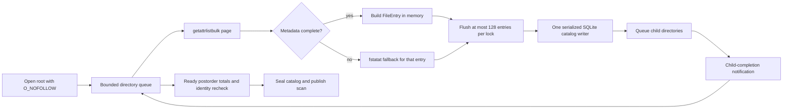
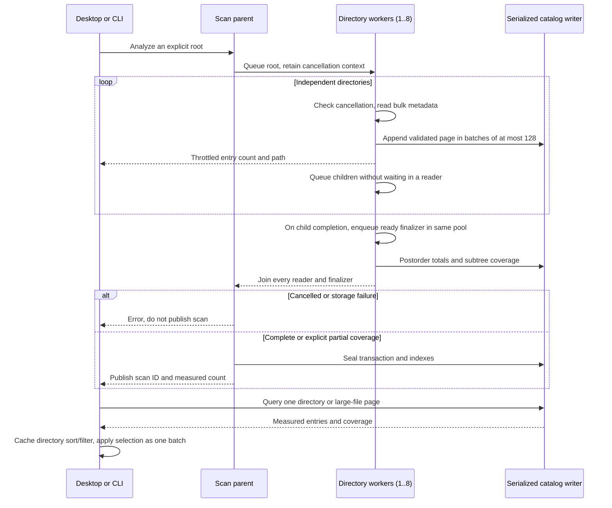

# Storage scan performance

English | [简体中文](../zh-CN/engineering/storage-scan-performance.md)

Shou's full storage analysis is a read-only inventory. Its hot path is filesystem metadata I/O, not CPU arithmetic. A scan therefore becomes faster when independent directory reads overlap and each directory is fetched with fewer syscalls. Increasing thread count without a bound makes APFS, cloud placeholders, network volumes and the desktop compete for the same resources, so Shou uses a bounded reader pool.

## Current pipeline



On macOS, `getattrlistbulk` returns a page of names, object types, device/inode identities, timestamps, allocation sizes and logical sizes. Regular files stay on this batched path. Directory metadata is refreshed once with `fstatat` so directory link counts and exact stat evidence remain compatible with the existing cleanup and hard-link contracts. Symlinks, special files, incomplete records and unsupported attributes use the no-follow stat fallback.

The default reader count is `min(activeProcessorCount, 8)`, with a lower bound of one. The pool is a directory pool rather than a file-per-thread pool: a worker reads one directory page, appends its immediate rows, then schedules child directories. A finalizer runs after all descendants complete, updates parent totals, checks that the directory identity is unchanged and marks the subtree complete only when its own coverage and every child coverage are complete.

Readers and ready finalizers share the same bounded scheduler. A serial notification queue only submits work after child completion; parents never wait for children while holding a worker slot. This prevents a separate unbounded finalization queue from creating many threads blocked on the single catalog writer. The bound covers executing scan work, not every runtime or process thread.

SQLite remains a single writer. The catalog is opened with `SQLITE_OPEN_NOMUTEX`; `StorageParallelState` protects all appends and total updates with one lock. This avoids unsafe concurrent SQLite calls while allowing metadata reads to overlap. Waiting directories remain in a FIFO; only active readers are dispatched, so queued directories do not consume blocked threads. The scan is published only after the final transaction is sealed.

The bulk reader validates and consumes one 64 KiB kernel page at a time. There is no 65,536-entry cutoff and no whole-directory metadata sort. A wide directory therefore keeps bulk I/O throughout. Each worker commits at most 128 measured entries per lock acquisition; metadata reads and progress callbacks run outside that lock. If a later bulk page fails, the no-follow name/stat reader retries the directory and a per-directory name set prevents duplicate rows. This retains names and queued child directories, so it is not a constant-memory traversal. Existing object, coverage and cancellation checks still apply.



## Saved results and desktop interaction

New catalogs maintain a partial `large_files` index on allocated size, name and parent for regular files allocated at least 1 MiB. Queries at or above that threshold include the literal partial-index predicate, allowing SQLite to skip tiny cache/build files for totals and pagination. Smaller thresholds and existing catalogs keep their compatible query path; existing user catalogs are not rewritten. A new scan produces the indexed format. The result still uses physical allocation, once-only hard-link charging, filename-extension classification and binary path ordering for tied sizes.

macOS caches the current directory's size ordering, filter/sort result and local eligibility projection. Index replacement, navigation, query or sort changes invalidate the appropriate presentation. Hover and selection changes reuse those arrays. This cache is presentation only: deletion still prepares and validates fresh manifests through Core.

`StorageSelection` tests ancestor membership using the selected-path set. Folder-wide selection normalizes the batch once; filtered deselection expands only the affected selected ancestry and retains other siblings. The native checkbox and Command-A share this batch operation. The portable implementation also serves CLI plan normalization; it does not change confirmation or removal authority.

The bundled rule schema and fully validated built-in templates are immutable process-wide values. Binding a template to a workspace copies its typed rule and validates the changed root reference against the bundled schema. Dynamic workspace/location selection is still evaluated per request. Public template construction and external rule import continue through complete rule validation; neither arbitrary templates nor rules are cached by caller-supplied identifiers. This removes repeated JSON/schema decoding from common cleanup and repeated plan checks on both platforms.

## Why this follows MangoDisk's fast path

MangoDisk's macOS implementation uses the same high-value ideas: `getattrlistbulk`, a bounded directory worker pool (up to eight workers), in-memory aggregation and a final index projection. The speedup comes primarily from fewer metadata round trips and overlapping independent directory latency. It is not evidence that the application is doing CPU-heavy parallel computation. Shou keeps its durable SQLite catalog so the CLI and desktop can page through results after publication; the reader side still follows the same batch-and-overlap model. The comparison baseline below already had bulk metadata reads and a directory worker pool. This iteration removes the wide-directory bulk cutoff and sorting, streams pages, batches catalog locks and preserves exact directory stat evidence.

BuhoCleaner was inspected for package and runtime boundaries with REA. Its native scan internals could not be fully disassembled in this environment because Hopper, Ghidra and IDA providers were unavailable. It is therefore used as a product reference, not as proof of a particular thread count or syscall strategy.

References and acknowledgements: MangoDisk's `mangodisk-platform/src/macos/analysis.rs`, `bulk_directory.rs` and `mangodisk-core/src/storage/traversal/parallel_analysis.rs`. Retained REA artifact evidence: BuhoCleaner `ev_37ae786bf04f8b9651880aac0dea30eeb49f9adb951623d142a2d4dbfcebd8e8`; MangoDisk `ev_dda64636549bef4a0cac435f101123abb7549f224943246e65c29359c154df2e`. Artifact evidence identifies the inspected package; the algorithm findings above come from source inspection.

## Progress and cancellation

Progress is aggregated by entry count and throttled to at most one update per 250 ms after every 128 entries. UI updates never run once per filesystem record. Cancellation is checked before and during each bulk page, before opening children and while sealing SQLite. A cancelled or corrupt scan is discarded and never published. A time limit records `resource_limit`, seals a truthful partial catalog and sets `limitReached`; it does not masquerade as a complete scan.

The following boundaries remain explicit:

- symlinks are never followed;
- cross-filesystem entries and cloud placeholders are recorded as opaque, incomplete rows;
- hard-linked files are charged once by the catalog's identity table;
- directory replacement or metadata changes become coverage issues;
- permission failures mark the affected subtree incomplete while sibling coverage continues.

## Reproducible benchmark

The generated `--storage-performance-only` fixture creates eight directories with 1,000 files each, plus nested directories, Unicode names, a sparse file, a hard link and a symlink. It verifies exact parity with the stat-based reference and reports elapsed time. The worker count can be overridden for diagnostics without exposing unbounded concurrency:

```text
SHOU_STORAGE_SCAN_WORKERS=1 .build/debug/shou-tests --storage-performance-only
SHOU_STORAGE_SCAN_WORKERS=8 .build/debug/shou-tests --storage-performance-only
```

The override is for local comparison only; the shipped default remains bounded and device-independent. Benchmark reports must include the machine, macOS version, filesystem type, warm/cold cache state, entry count, elapsed time and coverage issues. A local fixture result is not a promise for every disk or cloud volume.

## Release measurements (2026-10-21)

Local Apple M1 MacBookPro17,1, 8 CPU cores, 16 GB memory, macOS 15.7.3 and APFS. Before/after Release executables alternated for three pairs per workload and worker count, with warm repeated reads and no cache purge. Each run verified complete coverage, exact entry count and identical logical/allocated totals. This is elapsed CLI scan time, including its read worker and durable publication. RSS is the maximum for a single process reported by `/usr/bin/time -l`, not the sum of the process tree.

| Workload | Entries | Readers | Before median | After median | Before / after max process RSS |
| --- | ---: | ---: | ---: | ---: | ---: |
| 64 generated directories | 65,601 | 1 | 0.4718 s | 0.4419 s | 22.2 / 19.3 MiB |
| 64 generated directories | 65,601 | 8 | 0.3813 s | 0.2496 s | 26.2 / 22.5 MiB |
| One wide directory | 70,001 | 1 | 0.5668 s | 0.3673 s | 48.8 / 23.2 MiB |
| One wide directory | 70,001 | 8 | 0.5273 s | 0.3842 s | 47.2 / 23.2 MiB |
| Combined generated tree | 135,604 | 1 | 1.0681 s | 0.8637 s | 54.1 / 26.7 MiB |
| Combined generated tree | 135,604 | 8 | 0.8868 s | 0.7993 s | 56.8 / 30.1 MiB |
| Read-only Rust documentation | 50,625 | 8 | 0.3601 s | 0.3260 s | 33.4 / 23.5 MiB |
| Read-only Cargo registry | 85,371 | 8 | 0.9255 s | 0.8895 s | 35.7 / 35.4 MiB |

Eight readers primarily help independent directories; they did not beat one reader on the optimized single wide directory. The host had substantial unrelated CPU/memory pressure, so these local medians do not establish a universal speedup. An earlier Debug series showed Rust documentation with eight readers regressing from 1.715 s to 1.969 s; retain that result alongside the Release comparison instead of treating all workloads as faster. The generated before/after catalogs additionally matched every metadata row and total for 65,601 and 70,001 entries. A separate generated 1,000,005-row catalog test passed in 70.48 s under load, using 89.4 MiB maximum process RSS; it measures catalog construction, not filesystem traversal.

Evidence: `.build/performance-20261021/paired-release-final/results.json`, `paired-debug/results.json`, `catalog-parity.json`, `million-catalog.log` and `after-release-binary.json`. Benchmark scripts and retained binaries are adjacent. These local evidence files are not distribution assets.

After validation, generated scan roots and isolated catalog copies were removed; reports, integrity summaries, logs and comparison binaries remain. `generated-data-cleanup.json` records the exact scope. Rerunning the benchmarks requires recreating their input data.

Saved large-file queries were compared on isolated copies of a 7,083,140-row catalog, alternating five pairs with first/next pages. All 60 responses matched completely, including candidates, totals, cursors, removal reasons and partial coverage; the original user catalog was read-only. Median elapsed CLI time across both pages:

| Filter | Original index | Partial index |
| --- | ---: | ---: |
| At least 50 MiB, all types | 7.7807 s | 0.1326 s |
| At least 1 MiB, all types | 3.9136 s | 0.2201 s |
| At least 1 MiB, video | 5.5245 s | 0.2588 s |

This compares compatible saved formats; existing catalogs obtain the new index on rescan. The source scan remains partial and the benchmark does not prove full-disk coverage. The first harness incorrectly required exit 0 for a partial result; it was corrected to accept the documented exit 6 while still comparing all returned data. Evidence: `paired-large-files.json`, `paired-large-files-final.log`; the failed harness log is retained separately.

## Platform scope

macOS adapters own paged reads, bounded scheduling and index writes. Windows traversal, accounting, cancellation and performance will be implemented and verified independently under the native plan.

### Progress presentation

macOS adapters own paged reads, bounded scheduling and index writes. Windows traversal, accounting, cancellation and performance will be implemented and verified independently under the native plan.

Permanent removal additionally reports manifest-entry progress inside the current selected item. These transient updates do not replace the durable receipt or treat failed items as successfully removed.

## 0.9.0 finalizer contention check

Live installed full-volume sampling found a separate concurrent finalizer queue reaching GCD's 64-thread soft limit while readers remained bounded. Ready finalizers now share the reader scheduler. The generated 18,449-entry/8,192-file comparison retained exact counts/allocation and every file hash; sampled per-process peaks were 10/46 before and 11/11 after. Warm alternating scan medians were 1.021s/0.992s with ps overhead, which is insufficient for a product-wide speed claim. The initial diagnostic benchmark overlapped other regression work and is excluded. Final isolated evidence: `.build/next-version-finalizer-benchmark-isolated/result.json`; live samples: `.build/next-version-current-scan-worker-sample.txt` and `.build/next-version-current-scan-gui-sample.txt`.

Reproduce with two explicitly retained Release binaries and a new evidence directory; the script only scans its generated tree and retains its files:

```sh
python3 "scripts/benchmark-storage-finalizers.py" \
  --baseline "/path/to/baseline/shou" \
  --candidate ".build/release/shou" \
  --evidence ".build/storage-finalizer-comparison/new-run"
```

Many-file deletion and immutable journal comparisons are recorded separately in the [0.9.0 plan](cleanup-delivery.md); they do not establish scan acceleration.
