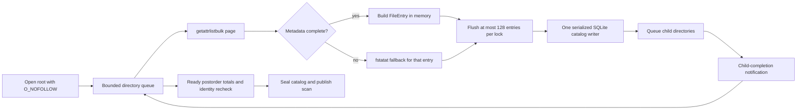
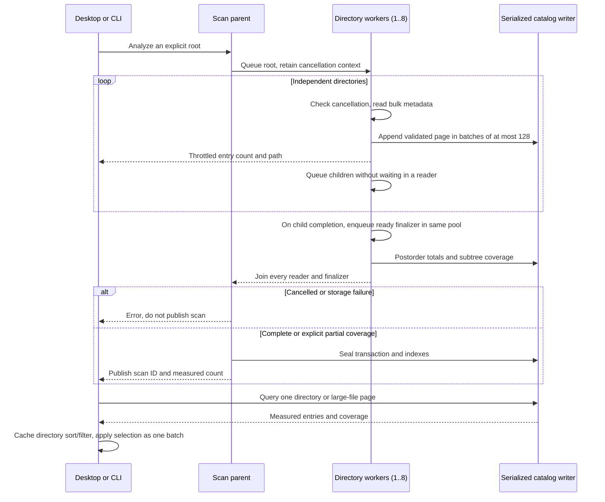

# Storage scan performance

English | [简体中文](../zh-CN/engineering/storage-scan-performance.md)

Shou's full storage analysis is a read-only inventory. Its main costs include filesystem metadata I/O, directory revalidation and per-entry index writes. Independent directory reads overlap while repeated work is reduced. Increasing thread count without a bound makes APFS, cloud placeholders, network volumes and the desktop compete for the same resources, so Shou uses a bounded reader pool.

The 2026-10-29 [research report](storage-performance-research.md) checks comparable source and official documents. The [architecture proposal](storage-performance-architecture.md) separates the initial duplicate-work implementation from proposed pipelines, concurrency and incremental indexes. Measurements below establish only the explicitly tested scope.

## Reuse across operations

The directory reader is shared by full measurement and bounded target/cleanup/history inspection. macOS reuses `getattrlistbulk` pages, with no-follow fallback for missing metadata. Windows uses the same bounded 64 KiB handle-based name reader for observation and native manifest verification; child metadata comes from relative handles pinned against replacement. A platform may mark entries verified only when its enumeration contract provides that evidence; other adapters retain a second metadata inspection.

Windows `FileTreeIndex` builds parent/child, identity and completion indexes once per observation and shares them across rule classification, planning and context validation. Execution no longer performs batch live preflight: policy and observations are checked per current item, with exact target verification by the native adapter at each mutation boundary. Current activity checks, immutable scope and per-unlink verification remain. macOS uses the same capability boundary for rule cleanup, direct removal, uninstall components and orphan cleanup; browse/selection reuse request-local policy and catalog contexts. History list summaries avoid loading full manifests; explicit inspection still reads current files.

Plans and history share immutable digest-verified paging machinery. macOS copies verified plan-page bytes to independent initial history pages without encoding them again; subsequent state/result writes update compact metadata. Unpaged or changed manifests retain their existing encoding path. Progress is advisory and throttled; only selected targets/descendants appear during removal, finalization has no path, and unknown preparation totals stay indeterminate. Release builds are required for performance comparisons. The MangoDisk analysis-removal fast path uses a different cancellation/manifest contract; it is not copied as a recursive fallback.

## Current pipeline



On macOS, `getattrlistbulk` returns a page of names, object types, device/inode identities, timestamps, allocation sizes and logical sizes. Regular files stay on this batched path. Directory metadata is refreshed once with `fstatat` so directory link counts and exact stat evidence remain compatible with the existing cleanup and hard-link contracts. Symlinks, special files, incomplete records and unsupported attributes use the no-follow stat fallback.

The default reader count is `min(activeProcessorCount, 8)`, with a lower bound of one. The pool is a directory pool rather than a file-per-thread pool: a worker reads one directory page, appends its immediate rows, then schedules child directories. A finalizer runs after all descendants complete, updates parent totals, checks that the directory identity is unchanged and marks the subtree complete only when its own coverage and every child coverage are complete.

Readers and ready finalizers share the same bounded scheduler. A serial notification queue only submits work after child completion; parents never wait for children while holding a worker slot. This prevents a separate unbounded finalization queue from creating many threads blocked on the single catalog writer. The bound covers executing scan work, not every runtime or process thread.

SQLite remains a single writer. The catalog is opened with `SQLITE_OPEN_NOMUTEX`; `StorageParallelState` protects all appends and total updates with one lock. This avoids unsafe concurrent SQLite calls while allowing metadata reads to overlap. Waiting directories remain in a FIFO; only active readers are dispatched, so queued directories do not consume blocked threads. The scan is published only after the final transaction is sealed.

The bulk reader validates and consumes one 64 KiB kernel page at a time. There is no 65,536-entry cutoff and no whole-directory metadata sort. A wide directory therefore keeps bulk I/O throughout. Each worker commits at most 128 measured entries per lock acquisition; metadata reads and progress callbacks run outside that lock. If a later bulk page fails, the no-follow name/stat reader retries the directory and a per-directory name set prevents duplicate rows. This retains names and queued child directories, so it is not a constant-memory traversal. Existing object, coverage and cancellation checks still apply.



## Saved results and desktop interaction

New catalogs maintain a partial `large_files` index on allocated size, name and parent for regular files allocated at least 1 MiB. Queries at or above that threshold include the literal partial-index predicate, allowing SQLite to skip tiny cache/build files for totals and pagination. Smaller thresholds and existing catalogs keep their compatible query path; existing user catalogs are not rewritten. A new scan produces the indexed format. The result still uses physical allocation, once-only hard-link charging, filename-extension classification and binary path ordering for tied sizes.

macOS caches the current directory's size ordering, filter/sort result and local eligibility projection. Index replacement, navigation, query or sort changes invalidate the appropriate presentation. Hover and selection changes reuse those arrays. This cache is presentation only: deletion still prepares and validates fresh manifests through Core.

`StorageSelection` tests ancestor membership using the selected-path set. Folder-wide selection normalizes the batch once; filtered deselection expands only the affected selected ancestry and retains other siblings. The native checkbox and Command-A share this batch operation. The portable implementation also serves CLI plan normalization; it does not change confirmation or removal authority.

The bundled rule schema and fully validated built-in templates are immutable process-wide values. Binding a template to a workspace copies its typed rule and validates the changed root reference against the bundled schema. Dynamic workspace/location selection is still evaluated per request. Public template construction and external rule import continue through complete rule validation; neither arbitrary templates nor rules are cached by caller-supplied identifiers. This removes repeated JSON/schema decoding from common cleanup and repeated plan checks on both platforms.

## Why this follows MangoDisk's fast path

MangoDisk's macOS implementation uses the same high-value ideas: `getattrlistbulk`, a bounded directory worker pool (up to eight workers), in-memory aggregation and a final index projection. The speedup comes primarily from fewer metadata round trips and overlapping independent directory latency. It is not evidence that the application is doing CPU-heavy parallel computation. Shou keeps its durable SQLite catalog so the CLI and desktop can page through results after publication; the reader side still follows the same batch-and-overlap model. The comparison baseline below already had bulk metadata reads and a directory worker pool. This iteration removes the wide-directory bulk cutoff and sorting, streams pages, batches catalog locks and preserves exact directory stat evidence.

BuhoCleaner was inspected for package and runtime boundaries with REA. Its native scan internals could not be fully disassembled in this environment because Hopper, Ghidra and IDA providers were unavailable. It is therefore used as a product reference, not as proof of a particular thread count or syscall strategy.

References and acknowledgements: MangoDisk's `mangodisk-platform/src/macos/analysis.rs`, `bulk_directory.rs` and `mangodisk-core/src/storage/traversal/parallel_analysis.rs`. Retained REA artifact evidence: BuhoCleaner `ev_37ae786bf04f8b9651880aac0dea30eeb49f9adb951623d142a2d4dbfcebd8e8`; MangoDisk `ev_dda64636549bef4a0cac435f101123abb7549f224943246e65c29359c154df2e`. Artifact evidence identifies the inspected package; the algorithm findings above come from source inspection.

### 2026-10-29 reference review and build-mode comparison

Rechecking MangoDisk's `mangodisk-platform/src/macos/analysis.rs`, `bulk_directory.rs` and `mangodisk-core/src/storage/analysis/index_projection.rs` confirms that Shou already implements bulk metadata and an eight-reader directory pool. Result retention is different: MangoDisk aggregates directories in memory, retains bounded large-file details and enumerates again when navigation needs missing rows; Shou writes every file to an immutable SQLite catalog for complete lists, pagination and cross-scan comparisons. Lightweight aggregation warrants a separate design review. Dropping rows must not silently preserve claims of a complete snapshot or become a deletion manifest.

The locally installed `0.21.0` candidate was still a Debug build. Three alternating read-only rounds against a local Release CLI used eight readers and generated fixtures. Every identity, timestamp, permission, size and completeness field matched row by row, directory totals matched and generated contents remained unchanged:

| Workload | Entries | Debug median | Release median | Ratio |
| --- | ---: | ---: | ---: | ---: |
| Tiny files in 32 directories | 131,105 | 1.128 s | 0.469 s | 2.41× |
| 10,241 directories and 8,192 files | 18,433 | 0.582 s | 0.410 s | 1.42× |

This compares the installed candidate and Release build modes, not a new scanning algorithm, full-volume performance or Windows performance. The host was Apple Silicon/macOS 15.8.1/APFS; caches were not cleared and other foreground work plus an existing Shou scan remained active. Release additionally includes uncommitted deprecated-API fixes; scanner source was unchanged. Raw rounds, both binary hashes, source status and row digests remain local in `.build/v021-scan-performance/result.json`, with `compare.py` beside it.

Normal local installations use Release. Install Debug only for an explicit debugging need and record that mode. At the user's request, `v0.21.0` continues from its frozen candidate; subsequent warning fixes and scanning algorithm changes are outside that release source.

### 2026-10-29 native Shou and MangoDisk workflow measurements

Optimized Release probes call each product's actual Core API on the same Apple M1/macOS 15.8.1/APFS host. Three rounds alternate Shou/MangoDisk, MangoDisk/Shou, Shou/MangoDisk. MangoDisk source is `4285d46644f2b9e53dee4ddfa3b3b5374dd64e3b`; Shou uses frozen baseline `6f24e7796af1263823e77518ffb584f2c4867cb5` plus the uncommitted warning fixes above, with scanning and removal algorithms unchanged. MangoDisk's clean worktree remains unchanged. Each run has fresh isolated state, ordinary-user privileges, a refreshed scan and a separate generated fixture with matching layout/content. Timings exclude fixture creation and process startup.

| Workload | Shou median scan | MangoDisk median scan | Shou median preparation + permanent removal | MangoDisk median preparation + permanent removal |
| --- | ---: | ---: | ---: | ---: |
| 16 directories, 32,768 tiny files | 0.152 s | 0.109 s | 4.907 s | 2.740 s |
| 4,608 internal directories, 4,096 files | 0.470 s | 0.110 s | 2.426 s | 0.995 s |

Shou/MangoDisk scan-time ratios are 1.39/4.29, and preparation/removal ratios are 1.79/2.44. Shou median preparation takes 0.583/0.567 s and execution 4.323/1.813 s; individual phase medians need not sum to the total median. Median peak RSS for the entire probe is 55.0/52.3 MiB for Shou and 18.6/14.3 MiB for MangoDisk, not scan-only memory. All twelve runs verify exact file counts, matching paired allocated totals, actual target removal and retained content/inode identity for sibling and out-of-scope sentinels.

The probes retain different persistence and deletion contracts; this is not an equal-contract algorithm comparison, GUI/full-volume timing or Windows evidence. MangoDisk's memory aggregates and bounded file index avoid Shou's complete durable detail. Its deletion pins the current target during preparation and uses scan counts for result accounting. Shou additionally preserves an immutable complete manifest, verifies its current contents at execution and persists intent and per-item results. Source explains additional work, but these end-to-end timings do not separately attribute SQLite, serialization or syscall costs.

Follow-up priorities are reviewing duplicate small-scan detail persistence alongside an existing catalog, reducing serialized database round trips during directory aggregation, and avoiding repeated manifest construction/checks while retaining exact scope, identity, cancellation and receipts. A lightweight browsing snapshot needs its own design; missing rows must not become complete deletion evidence. Both products already use bulk metadata and bounded concurrency, so further thread increases require separate measurements.

Caches were not purged and other desktop activity was uncontrolled. Shou's directory-heavy raw scan range was 0.263–1.000 s, showing substantial variation; these medians describe only this host sample. Raw runs, paired content digests, executable SHA-256, toolchains and source state remain local in `.build/v021-mangodisk-comparison/result.json`; `compare.py` and both probe sources are retained beside it.

### 2026-10-29 initial optimization measurements

The initial implementation removes duplicate inline details from small catalog-backed scans, copies revalidated plan-page bytes into independent initial storage-removal history pages, and consolidates adjacent metadata reads for ordinary single-link files in shared native permanent removal. The final complete comparison before `unlinkat`, ancestry and hard-link contracts remain. Windows separately precomputes progress totals and accumulates removed counts; portable .NET regression is not native performance evidence. See the [data model](../architecture/data-model.md).

A separate pre-optimization `sample` run observed `ReceiptJournal.save → FileManifestRecords.pages → JSONEncoder` during the two seconds after execution started. This identifies duplicate encoding within that window, not a whole-operation time percentage. Profiling is separate from the timings below.

The final first-phase candidate Release and retained baseline Release use identical probe source and eight readers on the Apple M1/macOS 15.8.1/APFS host above. Each workload has five alternating pairs, independent matching generated fixtures and fresh state. Access is ordinary-user, metadata is warm without cache purging, and desktop activity is uncontrolled. Timings exclude fixture generation/startup; no profiler is attached. Ratios divide baseline by candidate median time.

| Generated workload | Scan before / after | Scan ratio | Preparation + deletion before / after | Preparation + deletion ratio |
| --- | ---: | ---: | ---: | ---: |
| 32,768 files, 16 internal directories | 0.259 / 0.263 s | 0.98 | 5.954 / 4.935 s | 1.21 |
| 4,096 files, 4,608 internal directories | 0.556 / 0.488 s | 1.14 | 3.821 / 2.751 s | 1.39 |

All twenty executions verify exact file counts, paired allocated totals, actual target removal and retained sibling/out-of-scope sentinel contents and inode identity. Twenty earlier-candidate executions also remain: directory-heavy scan 0.290 → 0.194 s and preparation/deletion 1.657 → 1.315 s. The final candidate additionally preserves native permission-read error classification. The builds remain separate; results are not pooled or selected for favorable samples.

Desktop variation is material: directory scan time decreased about 33% in the first set and 12% in the final set. Final directory preparation median changed 0.818 → 1.034 s, opposite the earlier improvement, with no attribution to the implementation. File-heavy scanning has no small-scan inline-branch algorithm change, so its timing differences are not scanning-speedup evidence. Final preparation/deletion reductions of about 17%/28% describe these samples, not a stable multiplier. No individual ablation assigns gains to JSON, SQLite or syscalls. No several-fold, tenfold, full-volume, GUI, privileged-worker or Windows gain is established; proposed acceptance targets still need more controlled measurement.

The shared [evidence inventory](storage-performance-evidence.json) retains all raw samples, phase medians/ranges, whole-probe RSS, both candidates/baseline hashes and final source hashes. Local `result.json`, `initial-result.json`, `compare.py`, build arguments and signing/installation receipts are under `.build/performance-20261029-optimization/`, with measured binaries retained. Earlier MangoDisk measurements are not combined with this later run as a new simultaneous comparison.

The ordinary Mac script passed 352 Core/generated-fixture checks, including manifest-copy tampering, retention, legacy formats and progress scope. After the final permission-error adjustment, 11/11 native permanent-removal checks passed separately. The full script ends with the real `build_process_running` refusal for its Node fixture; no personal process was stopped and the complete script is not marked passed. Mac-host Windows checks passed 805 Core, 288 Presentation, 220 Platform with 98 native skips, 34 CLI and 192 CLI contracts. The final path-display assertions separately passed all 288 Presentation checks. This establishes no current Windows native/WinUI deletion or performance acceptance and changes no public gate.

The finalization event no longer carries the analysis root, and both presentations restrict deletion paths to frozen targets/descendants. A local Release installation passed signature and 156 package-file checks, preserving all 3,772 existing record hashes. The public `v0.21.0` tag/assets were unchanged. Installed startup was observed; Full Disk Access is currently off in System Settings and restoration needs separate confirmation, so protected-directory access is not marked passed.

### 2026-10-29 follow-up scan experiment and manifest encoding

Read-only probes scan 65,570 file-heavy entries and 8,706 directory-heavy entries. Separate `sample` runs observe reader waits on the shared lock and SQLite commit/index sorting during sealing; sampled stacks do not establish whole-operation percentages. A follow-up experiment combines schema, rows, final indexes and temporary-table cleanup in one transaction. Five alternating Release pairs per workload use the same retained fixture, fresh state and eight readers, comparing every row field and aggregate:

| Generated workload | Original transactions median | Single transaction median |
| --- | ---: | ---: |
| File-heavy | 0.382 s | 0.396 s |
| Directory-heavy | 0.299 s | 0.302 s |

Desktop load is uncontrolled, metadata is warm and sample ranges overlap. There is no demonstrated gain, so the transaction change was reverted; fewer SQL commits are not treated as faster completion. Source, binaries, all samples and full-field digests remain in `.build/performance-20261029-scan/` and the shared evidence inventory.

Shared manifest paging separately uses fixed field names and array slices, avoiding per-entry snake-case conversion and page-array copies while retaining Foundation JSON encoding, sorting, optional omission and legacy decoding. A standalone Release probe compiles actual production paging source with only its module import added. It first checks exact bytes and legacy decoding for Unicode/escaping, numeric extremes, optional digests and 0/1/2/4095/4096/4097/8192/8193-entry boundaries. Twelve alternating pairs of ten 4,096-entry pages, both including SHA-256, have medians **0.458 → 0.242 s**. This measures repeated encoding/digests; it does not establish approximately doubled removal or scan speed. Raw runs, probe source and build arguments remain in `.build/performance-20261029-manifest/`.

The complete workflow then uses the same probe and a baseline containing the first-phase fixes, changing only `FileManifestRecords.swift`; source hashes exclude SQL or syscall changes. Five alternating pairs per workload give 20 Release runs with freshly generated matching fixtures and state. Every run checks file counts, allocation, actual removal and in/out-of-scope sentinel contents/inodes. Host load is uncontrolled; no profiler is attached, and fixture generation/process startup are excluded:

| Generated workload | Preparation before / after | Execution before / after | Preparation + execution before / after |
| --- | ---: | ---: | ---: |
| 32,768 files, 16 internal directories | 0.581 / 0.388 s | 3.588 / 3.276 s | 4.169 / 3.664 s |
| 4,096 files, 4,608 internal directories | 0.370 / 0.313 s | 1.191 / 1.198 s | 1.543 / 1.512 s |

File-heavy preparation decreases about 33% and preparation plus execution about 12%. Directory-heavy preparation decreases about 15%; execution has no observed improvement, and the roughly 2% overall difference is insufficient for a stable-speedup claim. Scanner source is unchanged: scan medians of 0.169/0.175 s and 0.253/0.240 s establish no scan gain. All ranges, RSS, samples and source/binary hashes are in the shared evidence. These runs are not pooled with first-phase or earlier MangoDisk results and do not establish full-volume, GUI, privileged-session or Windows gains.

This round's ordinary script passes **353/353 Core** checks, including legacy-byte comparisons for directory pages and single-file content digests. Its last native CLI Node fixture still refuses with `build_process_running`; the full script exits 1 and no personal process is stopped. The full Mac-host Windows suite passes **808 Core, 288 Presentation, 220 Platform (98 native skips), 34 CLI and 192 CLI contracts**. There is no current Windows native or WinUI acceptance.

The final follow-up Release/ARM64 was built and installed, verifying 156 package files and all 3,772 existing record hashes; updated startup was observed. Protected access remains restricted and the earlier permission-restoration confirmation is unanswered. No permission was changed and no installed-UI deletion was performed; generated Core/Presentation fixtures cover the progress logic. Public `v0.21.0` assets were not replaced.

### 2026-10-29 lock-separation experiment and confirmation

An experiment separates status and catalog locks while retaining one writer. Five initial alternating pairs per workload give directory-heavy medians of 0.176/0.122 s and file-heavy 0.229/0.234 s. The same binaries then run ten confirmation pairs per workload:

| Workload | Shared-lock median | Separate-lock median | Shared-lock range | Separate-lock range |
| --- | ---: | ---: | ---: | ---: |
| File-heavy | 0.296 s | 0.317 s | 0.232–0.490 s | 0.240–0.593 s |
| Directory-heavy | 0.147 s | 0.123 s | 0.137–0.253 s | 0.120–0.189 s |

Every field and aggregate matches across all 60 read-only scans. Confirmation reduces the directory-heavy median about 16% but increases file-heavy about 7%; overlapping ranges and uncontrolled desktop load prevent acceptance based on the stronger first set. The lock change was reverted. Four native metadata/parent-cancellation checks pass. Checkpoints were already batched every 128 entries, so no duplicate batching change was added. Source, binaries, harnesses, raw samples and hashes remain in `.build/performance-20261029-scan-lock/` and shared evidence.

### 2026-10-29 unused measurement-index removal

At the start of the experiment, repository search found `forEachChildDirectory` only at its definition. Native traversal retains pending directories in memory and never uses the temporary `measurement_directories` index. New catalogs skip its creation, per-directory maintenance and removal during sealing. The method still queries correctly; published tables/indexes and format versions are unchanged.

Additional directory-API validation exposed an existing column-index error: the appended ID is column 16, but the method read column 19 and returned 0. This is fixed, with a regression covering 600 directories, three keyset pages and descendant inserts during callbacks. The method has no production caller and does not affect the measured scanner; all five metadata/cursor/cancellation checks pass.

Ten alternating Release pairs per workload give 40 read-only scans with identical fields and aggregates. File-heavy medians are 0.265/0.261 s and directory-heavy 0.160/0.160 s; overlapping ranges provide **no demonstrated scan speedup**. The directory-heavy catalog median shrinks from **1,415,168 to 1,320,960 bytes**, about 6.7%; file-heavy saves one 4 KiB page. The change removes unused indexing/storage work and is not counted as a time improvement. Samples, source and binaries remain in `.build/performance-20261029-scan-index/` and shared evidence.

### Final validation and local installation for this iteration

After the directory-cursor fix, the full Core suite passes **354/354** and the targeted suite **5/5**. Earlier in this iteration, the ordinary script passed its then-current 353 Core tests and subsequent CLI groups, but the final native CLI Node fixture refused with `artifact_evidence_unavailable`; an isolated rerun also exited 1. This differs from the previous iteration's `build_process_running` refusal and does not establish a green full script. No personal process was stopped or deletion protection weakened.

The **Release/arm64** containing index cleanup and the cursor fix replaced `/Applications/Shou.app` after normal exit. Signatures, all 156 package files and 3,772 existing record hashes verified, and startup was observed. This installation includes the deletion-progress fix: finalization carries no path, and macOS/Windows presentations accept only frozen targets and descendants. Generated fixtures cover permanent removal, Trash and preservation outside the selection. No post-install GUI deletion or Windows native acceptance was performed in this iteration.

The installed and candidate packages are both ad-hoc. An isolated same-team Developer ID signing probe timed out after 30 seconds; this alone does not establish that a Keychain password dialog appeared. Stable signing was not verified, and no Keychain permission changed. The app still reports protected access restricted; the earlier Full Disk Access confirmation is unanswered and that permission was not changed. Installation success does not establish restored privacy access. The repository design skill now requires preserving an existing Developer ID Team, explicit signing identity and separate signature/privacy verification. Public `v0.21.0` assets remain unchanged, and the cloud machine was not started. Final evidence is in `scan_index_final_validation` in the shared inventory.

## Progress and cancellation

Windows full `StorageScanner` also throttles in Core, avoiding per-entry progress allocations before UI throttling. It reports the first observed entry immediately, checks 250 ms every 128 entries, and reports the exact final observed count without duplicate counts. No subscriber means no progress-object allocation; cancellation remains per entry. Ordinary observer failures do not discard filesystem evidence. Cross-target accumulation in the separate targeted `CleanupScanner` is unchanged.

Progress is aggregated by entry count and throttled to at most one update per 250 ms after every 128 entries. UI updates never run once per filesystem record. Cancellation is checked before and during each bulk page, before opening children and while sealing SQLite. A cancelled or corrupt scan is discarded and never published. A time limit records `resource_limit`, seals a truthful partial catalog and sets `limitReached`; it does not masquerade as a complete scan.

The final SQLite index sorts can exhaust storage even after traversal has finished. `StorageCatalog` retains SQLite result codes and maps `SQLITE_FULL` to `storage_full`; native traversal must propagate this fatal storage error instead of treating it as an unreadable directory or a time-budget partial result. Generated 64 KiB catalog fixtures exercise exhaustion during row writes and sealing, verify that no new scan is published, and compare the previous index bytes and queries. The production limit remains 4 GiB; the lower constructor budget supports bounded, reproducible checks.

The following boundaries remain explicit:

- symlinks are never followed;
- cross-filesystem entries and cloud placeholders are recorded as opaque, incomplete rows;
- hard-linked files are charged once by the catalog's identity table;
- directory replacement or metadata changes become coverage issues;
- permission failures mark the affected subtree incomplete while sibling coverage continues.

## Reproducible benchmark

The generated `--storage-performance-only` fixture creates eight directories with 1,000 files each, plus nested directories, Unicode names, a sparse file, a hard link and a symlink. It verifies exact parity with the stat-based reference and reports elapsed time. The worker count can be overridden for diagnostics without exposing unbounded concurrency:

```text
SHOU_STORAGE_SCAN_WORKERS=1 .build/debug/shou-tests --storage-performance-only
SHOU_STORAGE_SCAN_WORKERS=8 .build/debug/shou-tests --storage-performance-only
```

The override is for local comparison only; the shipped default remains bounded and device-independent. Benchmark reports must include the machine, macOS version, filesystem type, warm/cold cache state, entry count, elapsed time and coverage issues. A local fixture result is not a promise for every disk or cloud volume.

## Release measurements (2026-10-21)

Local Apple M1 MacBookPro17,1, 8 CPU cores, 16 GB memory, macOS 15.7.3 and APFS. Before/after Release executables alternated for three pairs per workload and worker count, with warm repeated reads and no cache purge. Each run verified complete coverage, exact entry count and identical logical/allocated totals. This is elapsed CLI scan time, including its read worker and durable publication. RSS is the maximum for a single process reported by `/usr/bin/time -l`, not the sum of the process tree.

| Workload | Entries | Readers | Before median | After median | Before / after max process RSS |
| --- | ---: | ---: | ---: | ---: | ---: |
| 64 generated directories | 65,601 | 1 | 0.4718 s | 0.4419 s | 22.2 / 19.3 MiB |
| 64 generated directories | 65,601 | 8 | 0.3813 s | 0.2496 s | 26.2 / 22.5 MiB |
| One wide directory | 70,001 | 1 | 0.5668 s | 0.3673 s | 48.8 / 23.2 MiB |
| One wide directory | 70,001 | 8 | 0.5273 s | 0.3842 s | 47.2 / 23.2 MiB |
| Combined generated tree | 135,604 | 1 | 1.0681 s | 0.8637 s | 54.1 / 26.7 MiB |
| Combined generated tree | 135,604 | 8 | 0.8868 s | 0.7993 s | 56.8 / 30.1 MiB |
| Read-only Rust documentation | 50,625 | 8 | 0.3601 s | 0.3260 s | 33.4 / 23.5 MiB |
| Read-only Cargo registry | 85,371 | 8 | 0.9255 s | 0.8895 s | 35.7 / 35.4 MiB |

Eight readers primarily help independent directories; they did not beat one reader on the optimized single wide directory. The host had substantial unrelated CPU/memory pressure, so these local medians do not establish a universal speedup. An earlier Debug series showed Rust documentation with eight readers regressing from 1.715 s to 1.969 s; retain that result alongside the Release comparison instead of treating all workloads as faster. The generated before/after catalogs additionally matched every metadata row and total for 65,601 and 70,001 entries. A separate generated 1,000,005-row catalog test passed in 70.48 s under load, using 89.4 MiB maximum process RSS; it measures catalog construction, not filesystem traversal.

Evidence: `.build/performance-20261021/paired-release-final/results.json`, `paired-debug/results.json`, `catalog-parity.json`, `million-catalog.log` and `after-release-binary.json`. Benchmark scripts and retained binaries are adjacent. These local evidence files are not distribution assets.

After validation, generated scan roots and isolated catalog copies were removed; reports, integrity summaries, logs and comparison binaries remain. `generated-data-cleanup.json` records the exact scope. Rerunning the benchmarks requires recreating their input data.

Saved large-file queries were compared on isolated copies of a 7,083,140-row catalog, alternating five pairs with first/next pages. All 60 responses matched completely, including candidates, totals, cursors, removal reasons and partial coverage; the original user catalog was read-only. Median elapsed CLI time across both pages:

| Filter | Original index | Partial index |
| --- | ---: | ---: |
| At least 50 MiB, all types | 7.7807 s | 0.1326 s |
| At least 1 MiB, all types | 3.9136 s | 0.2201 s |
| At least 1 MiB, video | 5.5245 s | 0.2588 s |

This compares compatible saved formats; existing catalogs obtain the new index on rescan. The source scan remains partial and the benchmark does not prove full-disk coverage. The first harness incorrectly required exit 0 for a partial result; it was corrected to accept the documented exit 6 while still comparing all returned data. Evidence: `paired-large-files.json`, `paired-large-files-final.log`; the failed harness log is retained separately.

## Cleanup pipeline Release measurements (2026-10-24)

The host is a MacBookPro17,1 with 8 cores, 16 GB RAM, macOS 15.8.1 ARM64, APFS and Swift 6.2.3. Both binaries use Release. Three pairs alternate old/new, new/old and old/new; each run regenerates two targets with 12 nested directories and 10,000 files each, totaling 20,026 manifest entries. Timings include scanning, preparing a permanent-removal plan and execution after exact confirmation; every run checks that unrelated source files survive. Fixture creation is excluded and system caches are not flushed.

| Metric | Before median | After median | Reduction |
| --- | ---: | ---: | ---: |
| Scan | 0.429 s | 0.402 s | 6.4% |
| Prepare | 4.918 s | 1.833 s | 62.7% |
| Execute | 12.832 s | 7.295 s | 43.2% |
| Total | 17.064 s | 9.173 s | 46.2% |
| Plan metadata | 6,405,554 bytes | 2,080 bytes | 99.97% |
| Largest record | 6,405,558 bytes | 1,310,267 bytes | 79.5% |

The compact plan separately references immutable manifest pages; 2,080 bytes is not its total disk footprint. There was substantial host CPU contention, and the first baseline overlapped a small installed-cache CLI retry. Old total times range from 17.056–29.126 s and new times from 8.367–15.520 s. All three raw pairs and medians are retained; they do not establish performance on every disk or native Windows. This fixture principally exercises preparation/removal and record writes; the small scan difference does not establish a full-disk scanning improvement.

Evidence is under `.build/cleanup-performance/paired-release.json`, `paired-release-*.log`, `baseline-source.json`, `source-before-release-package.json` and build logs. The local `paired-release.py` reproduces the same generated fixture and records both Release binary hashes. Earlier installed Debug timings are excluded. See [SYNC.md](../../SYNC.md) for final validation and installation facts.

## Platform scope

macOS adapters own paged reads, bounded scheduling and index writes. Windows `CleanupScanner` independently scans rule targets: it probes literal path components and project markers first, bounds wildcard-prefix enumeration per directory, discovers targets before measurement, then divides remaining entry/time budgets between exact target trees. Wide source directories and the first large target must not consume every later target's allocation; undiscovered or incompletely measured scopes retain explicit gaps.

Planning and execution preflight reread only selected targets, their ancestors and project markers. Rules, configuration, identities, manifests, activity and single-use consent remain checked. Non-specialized scanner adapters retain full-tree revalidation. Ordinary space analysis continues using `StorageScanner`, independently of sparse cleanup observations.

Rule observations record `scope=rule_targets`: `state=complete` means this rule discovery and target measurement had no gaps, while `tree_complete=false`. Only targets in `completed_directories` have positive subtree evidence. These observations cannot enter space-comparison catalogs or prove whole-workspace coverage. Older records without scope default to `full_tree`. Actual platform, fixture and native evidence belongs in [SYNC.md](../../SYNC.md); source and Mac results do not establish native Windows acceptance.

### Progress presentation

The interface distinguishes scanning, preparation, verification and execution progress. Counts represent observed work and never include unobserved directories as completed.

Permanent removal additionally reports manifest-entry progress inside the current selected item. These transient updates do not replace the durable receipt or treat failed items as successfully removed.

## 0.9.0 finalizer contention check

Live installed full-volume sampling found a separate concurrent finalizer queue reaching GCD's 64-thread soft limit while readers remained bounded. Ready finalizers now share the reader scheduler. The generated 18,449-entry/8,192-file comparison retained exact counts/allocation and every file hash; sampled per-process peaks were 10/46 before and 11/11 after. Warm alternating scan medians were 1.021s/0.992s with ps overhead, which is insufficient for a product-wide speed claim. The initial diagnostic benchmark overlapped other regression work and is excluded. Final isolated evidence: `.build/next-version-finalizer-benchmark-isolated/result.json`; live samples: `.build/next-version-current-scan-worker-sample.txt` and `.build/next-version-current-scan-gui-sample.txt`.

Reproduce with two explicitly retained Release binaries and a new evidence directory; the script only scans its generated tree and retains its files:

```sh
python3 "scripts/benchmark-storage-finalizers.py" \
  --baseline "/path/to/baseline/shou" \
  --candidate ".build/release/shou" \
  --evidence ".build/storage-finalizer-comparison/new-run"
```

Many-file deletion and immutable journal comparisons are recorded separately in the [0.9.0 plan](cleanup-delivery.md); they do not establish scan acceleration.
