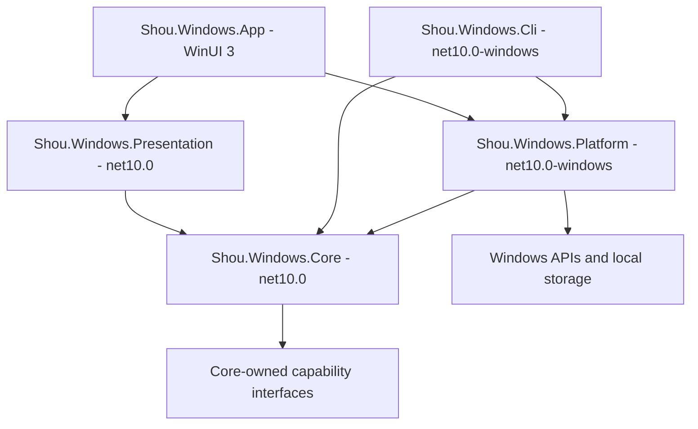
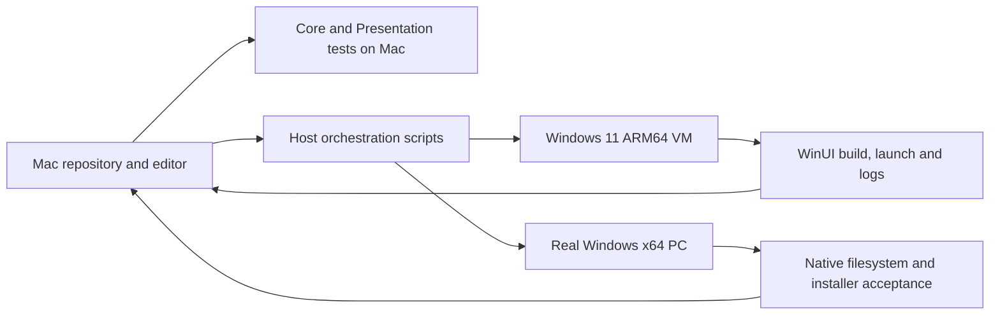

# Windows native implementation plan

English | [简体中文](../zh-CN/engineering/windows-native-plan.md)

Status: implementation in progress. Source includes Core/Platform/Presentation scanning, application registration discovery/browsing, workspace/rule services, persisted regular scans and draft previews, planning and item-journal orchestration, .NET CLI, WinUI configuration/storage/applications/cleanup-review/history pages and resource generation. CLI and UI assemble plan review; terminal confirmation has portable logic tests. v0.15.0 is a restricted portable preview with public GUI/CLI execution gates closed; native adapters remain independently testable with generated fixtures. Generated MSI and startup-task suites each passed six cases on Windows Server 2025 x64. Ordinary-user Windows 11, full desktop journeys and visual acceptance remain pending, blocking public mutation support. Windows 11 ARM64 native main suites and window startup/normal close have passed; complete UI, ARM64 generated-system fixtures, public target mutation and signed distribution remain unaccepted. This document defines the implementation contract; [SYNC.md](../../SYNC.md) records current evidence.

## Product goal

Deliver native Windows storage analysis, reviewable cleanup and reusable rules with consistent Shou interaction, language and safety behavior. Target Windows 11, x64 and ARM64. Select the exact minimum Windows build against the pinned Windows App SDK during the first prototype.

## Technical decisions

| Concern | Decision | Reason |
| --- | --- | --- |
| Language and runtime | C# / .NET 10 LTS | Native Windows ecosystem and long-term runtime support |
| UI | WinUI 3 / Windows App SDK, MVVM | Fluent controls, DPI and native accessibility |
| Domain | Independent deterministic C# Core | Windows path, identity and lifecycle semantics |
| CLI | .NET console entry sharing C# Core | Independent terminal workflow with the same validation |
| Distribution | Architecture-specific self-contained packages | No separate user installation of .NET |
| Installation and updates | Velopack, subject to first-stage validation | Installer lifecycle and incremental updates |
| Signing | Authenticode with timestamping | Verifiable publisher and distribution integrity |
| AI | Separate .NET investigation service behind narrow interfaces | Domain execution stays deterministic; provider choice remains replaceable |

Pin .NET SDK, Windows App SDK, build tools and package versions in the project and lock files when implementation starts. Verify their support matrix together. .NET self-contained publishing does not include Windows App SDK automatically: configure and verify Windows App SDK self-contained deployment independently. Do not enable trimming, single-file publishing or Native AOT until WinUI, COM and updater compatibility are proven.

## Four layers and composition



| Layer | Owns | Must not own | macOS checks |
| --- | --- | --- | --- |
| Core | Rule semantics, Windows logical path policy, exclusions, candidates, immutable plans, confirmation binding, receipts, cancellation | P/Invoke, registry, UI, direct filesystem access | Build and unit tests |
| Platform | Filesystem handles/identity, registry, Win32/COM, processes, Recycle Bin, local records and credentials | UI decisions or copied matching logic | Reference compilation only when targeting packs support it |
| Presentation | Page state, commands, selection, progress, async cancellation and errors | WinUI controls, dispatchers or OS calls | Build and state tests |
| App | XAML, dialogs, accessibility, navigation, composition and UI-thread scheduling | Rules or deletion policy | Source generation checks only |

The CLI is a composition entry, outside the UI layer chain. App and CLI register Platform implementations for Core interfaces. Presentation consumes service interfaces; inject a small scheduler only where required. Windows API reference compilation on macOS uses `EnableWindowsTargeting` where supported; it does not permit running Windows code or building the WinUI XAML pipeline there.

Target layout, to be created stage by stage:

```text
apps/windows/
  global.json
  Directory.Build.props
  Shou.Windows.slnx
  src/
    Shou.Windows.Core/
    Shou.Windows.Platform/
    Shou.Windows.Presentation/
    Shou.Windows.App/
    Shou.Windows.Cli/
  tests/
    Shou.Windows.Core.Tests/
    Shou.Windows.Presentation.Tests/
    Shou.Windows.Platform.Tests/
    Shou.Windows.Cli.Tests/
    Shou.Windows.App.Tests/
```

## CLI contract reuse

The Windows CLI is a thin .NET entry over C# Core: parse arguments, expose capability discovery, serialize versioned JSON, map errors/exit codes and perform interactive terminal review. Rules, plans, policy and mutations remain in the same services used by WinUI.

Share stable command names, field semantics, error categories, confirmation requirements and semantic acceptance fixtures across platforms. Platform-specific commands declare their actual scope and unavailable reasons. Keep machine contracts aligned without exposing local persistence or native identity layouts as a universal ABI. Track intentional differences in the platform ledger.

The npm entry remains `@limecloud/shou` and the command remains `shou`. A platform-aware launcher selects the matching native CLI; the [npm distribution plan](npm-distribution.md) owns package layout, version coordination and acceptance. Windows npm support remains unavailable until its native payload and packed installation pass those checks.

## Data and safety contract

Rule patterns use `/`-separated relative paths. Core uses an explicit Windows path model and simulated filesystem; tests must not derive Windows semantics from macOS `System.IO.Path`. Platform validates actual volume behavior and identities. Preserve full volume/File ID and owner SID without converting them into POSIX fields. Compare paths according to actual directory case behavior; path spelling alone never establishes identity.

Reject path traversal, drive-relative paths, device namespaces, alternate data streams, network roots, junction escapes and unknown reparse points. Cloud placeholders and unsupported filesystems remain read-only or unavailable until separately verified. Check protected roots, current ownership, access, exclusions, active owners, full target manifests and replacement before mutation. Verify hard-link accounting and mutation races with real Windows handles.

The desktop product defaults to permanent removal with an exact-scope irreversible confirmation. An optional Recycle Bin action requires separately verified move and restoration behavior and cannot fall back to permanent deletion. A CLI mutation requires an interactive confirmation bound to the current plan. Persist intent before each mutation; retain completed, skipped, failed, cancelled and unknown outcomes. Cancellation stops new work and reconciles an in-flight OS operation rather than inventing success.

Use a current-user private Windows data root, ACLs, atomic writes, durable journals and cross-process mutation leases. Schema and record versions are owned by the Windows implementation. Product error semantics and fixture expectations align with macOS; stored binary layouts and platform identity DTOs are independent.

See [Windows development](windows.md) for configuration, location discovery, built-ins, scans, plan creation, terminal confirmation, UI review, read-only history and private-store commands, budgets and flow, and the [data contract](../architecture/data-model.md#windows-native-records) for record formats. Drafts cannot become plan sources. The CLI's default Trash action is unavailable; permanent plans require explicit selection. Core planning, current confirmation, item journals and history queries/inspection have simulated-port tests. Presentation covers personal-rule configuration, exact-version bindings, built-in preferences, configuration reconciliation after discovery, exclusion preview, write reconciliation, evidence invalidation, selection, cancellation and history observations. Discovery uses shared declarations and batch registration preserves scopes and preferences. CLI and GUI batch scans share budgets sequentially. GUI source aggregates categories, rules and paths across locations and retains filtered-out selections. One multi-location plan binds every source, one current confirmation, all-source preflight and item journals; public execution remains closed. Platform has relative-handle permanent-removal, Restart Manager file-use and project-scoped tool-process observation source. The internal process ABI, races, interruption and actual terminal behavior await native acceptance. CLI/UI share the disabled Platform execution gate. WinUI confirmation, stop-and-wait, recorded outcomes and normal-close protection have source implementations; native acceptance and recovery remain pending.

Application discovery spans Core `ApplicationCatalog` / `IApplicationInventory`, Platform `WindowsApplicationInventory`, Presentation `ApplicationsViewModel`, WinUI `ApplicationsPage` and CLI `applications summary`. Registration discovery is read-only and independent of cleanup storage. MSI, MSIX, other installers and residual-component mutations need distinct contracts. See [application uninstall](../product/application-uninstall.md#windows-application-discovery-and-uninstall-boundaries) for sources, budgets, estimates and current paging limits.

Source also includes `ApplicationUninstallReviewer`/`ApplicationUninstallPlanner`, `WindowsApplicationUninstallInspector` and `ApplicationUninstallViewModel`. CLI and the page share exact installation review and expiring plans. Planning requires separate acknowledgement of installer-managed data effects and a matching reinspection digest; inspection stays read-only and planning reuses the record lease. `ApplicationActivityService` combines installation-directory scanning, Restart Manager file use and query-only process image observations; active or unknown observations block planning. `ApplicationUninstallService` and `WindowsApplicationUninstallMutation` now provide consent, lease, durable intent, MSI/MSIX invocation and independent outcome-observation source; CLI has an execution entry and read-only result query. WinUI source connects separate confirmation, stop-and-wait, recorded outcomes and normal-close protection; GUI and CLI share a disabled execution gate. Additional residual selection and restore remain pending. Native identity, installer data effects, interruption and UI require independent acceptance; logic tests do not establish uninstall support.

Startup discovery now has separate `StartupInventoryService` / `IStartupInventory`, fixed-source `WindowsStartupInventory`, `StartupViewModel`, WinUI page and `startup list` source. The chain is read-only, does not open cleanup records and leaves enablement/activity unknown. Task Scheduler boot/logon and current-user packaged startup-declaration discovery have source implementations; native acceptance and public control support remain pending; the [startup contract](../product/startup-items.md#windows-startup-contract) defines the current source and evidence boundary.

Scheduled boot/logon tasks now have separate public `RegisteredTask.Enabled` / `State` observations in Core, CLI and WinUI details. Missing/changed status preserves a definition-rechecked registration with partial coverage; task status is not effective startup activation or application process state. Portable logic and reference compilation require separate native COM/permission/UI acceptance.

## Resource synchronization

Maintain the shared rule schema, catalog JSON, brand assets, text keys and semantic fixtures in one source location. Generate Windows resources with source digest and generation version. Extract approved colors, typography, spacing, radii and motion values into a canonical token source; generate XAML without copying Swift UI code. Preserve native keyboard, window, DPI and accessibility conventions.

For every feature or safety change, record the exact macOS source commit, paths, contract digest, Windows implementation commit, differences and evidence in [SYNC.md](../../SYNC.md). Run `python3 scripts/generate-windows-resources.py --check` to reject missing keys, mismatched placeholders and generated differences. Rule-schema checks remain independent. See the [development commands](windows.md) for generation and portable/native verification.

## Development topology



Use Parallels shared source or an explicit revision-synchronized checkout. Place Windows `obj`, `bin`, NuGet cache and package output on Windows-local storage; keep Swift artifacts on macOS. Per-project output paths must remain distinct. First test shared-folder build behavior; use synchronized Windows-local source if metadata or toolchain behavior is unreliable.

Host scripts will invoke PowerShell through `prlctl exec` for the VM and SSH for the physical PC. Scripts must take explicit arguments, propagate exit codes, impose deadlines, print bounded diagnostics, redact secrets and collect startup exceptions. Record source commit, working-tree digest, OS, architecture and toolchain in each run. UI automation supplements scriptable checks; system consent dialogs remain explicit user actions.

A Windows ARM64 VM can build x64 output with the installed toolchain but cannot establish native x64 behavior. Validate ARM64 on its own runtime and x64 on a real x64 machine. Remote desktop does not establish local battery or physical display behavior.

Native CI follows the same boundary: an ARM64 archive produced on an x64 runner establishes build/package integrity only. The `windows-11-arm` runner separately verifies same-source hashes and actual process architecture before native suites and window startup/normal-close checks. Complete UI, ordinary-user, signing and installation evidence remains separate; see [logging and testing](windows-testing.md).

## Implementation stages

| Stage | Deliverable | Required exit evidence |
| --- | --- | --- |
| WN01 | Pin SDKs; minimal WinUI App and .NET CLI; release prototype | x64 and ARM64 start; .NET and Windows App SDK bundled; signed install/update/uninstall on clean Windows; signing feasibility recorded |
| WN02 | Pure Core, Presentation and shared resource generator | Mac tests verify Windows path semantics, protected data, stale plans, states and all locale placeholders; reproducible generated resources |
| WN03 | Read-only Platform and storage UI | Real identities, ACLs, reparse points, long/Unicode paths, hard links, cancellation and partial coverage tested on Windows; no deletion enabled |
| WN04 | Confirmed cleanup and durable history | Native generated-fixture permanent removal, interruption recovery, races, locks, disk-full and hash-preserved exclusions; optional Recycle Bin/restore independently pass |
| WN05 | Feature increments | Personal rules, application cleanup, startup, privacy and AI added separately with contract cases and native UI evidence; ledger updated per feature |
| WN06 | Distribution acceptance | Clean install, upgrade, delta/full recovery, signature validation, x64/ARM64, real DPI/accessibility, SmartScreen observations and uninstall behavior |

Do not implement all pages before the first read-only vertical slice works. Unverified operations stay hidden or show an accurate unavailable reason. Each stage records executed results; document completion does not satisfy runtime gates.

## Testing and release

Run pure domain/state tests on macOS, Platform integration and WinUI checks on Windows. Use generated disposable directories and fake owner tools for automated mutations. Shared fixtures must include stale identities, replaced ancestors, partial targets, protected descendants, forged input, replayed confirmation, journal failure and cross-process contention. Real personal data is not a regression fixture.

System uninstall has a separate [generated MSI entry](windows.md#native-uninstall-acceptance-with-generated-msi-packages): it authors fresh per-user packages, opts into six cases and retains source digests, TRX, installer logs, hashes and private records. It skips by default, accepts no existing product identities and does not open public execution. Clean source `8860f44` passed all six generated MSI cases on Windows Server 2025 x64, including installation, product uninstall, rejection cases and fixture teardown; ordinary-user Windows 11 still requires revalidation. MSIX, interactive cancellation, WinUI and release require separate verification.

Produce separate `win-x64` and `win-arm64` assets. Sign shipped executables and installer/update artifacts as required by the selected packaging tool, timestamp and verify the final bytes, and then compute checksums. Never modify an artifact after its final signature. Test interrupted and invalid updates without broadening cleanup permissions. SmartScreen reputation is independent of a valid signature and is recorded as an observation.

Select a certificate service available to the actual developer identity and release environment. Verify hardware/cloud signing access, session expiry, renewal and unattended support during WN01. If interactive authentication is required, the release pipeline stops at a prepared unsigned-artifact handoff; signing and verification resume explicitly. Never store private keys or one-time passwords in the repository.

## AI implementation contract

Before implementing a feature, read this plan, its product specification, [safety rules](../security/cleanup-safety.md) and the matching ledger row. Touch only owned modules and deterministic generated outputs. Implement the smallest working vertical slice; do not introduce cross-platform runtime glue, generic plugin hosts or future data migrations. Include the relevant unit, native and UI evidence. Report unsupported behavior with concrete reasons and update both language editions together.

Scheduled-task switch Core/Platform/Presentation/CLI/WinUI source is connected with a disabled public gate. Native COM, security descriptors, races, interruption and UI require separate acceptance. This records implementation progress without claiming available Windows controls. The [startup contract](../product/startup-items.md#scheduled-task-switch-review-and-control) owns eligibility, flow, records and remaining checks.

Scheduled-task control now has a [generated-task native entry](windows.md#native-startup-control-acceptance-with-generated-tasks), six cases and a separate evidence script. Cases skip by default; explicit opt-in requires stable source, all executed passes and teardown receipts. Mac compilation/refusal checks do not establish Windows execution or enable the product gate.
