# Windows development

English | [简体中文](../zh-CN/engineering/windows.md)

Status: implementation in progress. Scanning, platform adapters, presentation and CLI have source implementations; WinUI includes storage browsing, application registration browsing, cleanup review and history pages. v0.15.0 keeps public GUI/CLI cleanup, startup-task control, installer uninstall and privacy/storage removal gates closed; native adapters remain independently testable with generated fixtures. The release workflow builds unsigned, self-contained x64/ARM64 portable previews. Native fixture, installation and full UI/accessibility evidence is tracked in SYNC.md.

Shou for Windows uses C#, .NET 10 LTS and WinUI 3 from Windows App SDK. The GUI and CLI call the same C# domain services directly. Source editing and portable tests run on macOS; Windows builds and runtime checks run on Windows.

Use the repository [shou-windows-cloud-test skill](../../.agents/skills/shou-windows-cloud-test/SKILL.md) for Alibaba Cloud Wuying acceptance. Keep the desktop shut down with `StopCharging` during local development and UI alignment, then reuse it for concentrated native validation after local checks and synchronization packages are ready. Record the one-day retention deadline and continuing disk charges separately. Accounts, Keychain passwords and instance state remain in private local storage outside the repository.

| Need | Read |
| --- | --- |
| Architecture, project layout and implementation stages | [Windows native implementation plan](windows-native-plan.md) |
| Platform ownership and shared resources | [Monorepo boundaries](../architecture/monorepo-and-platforms.md) |
| Product and safety behavior | [PRD](../product/prd.md), [cleanup safety](../security/cleanup-safety.md) |
| Runtime, development and release sequences | [Workflows and sequences](../architecture/workflows-and-sequences.md) |
| Feature parity and verification | [SYNC.md](../../SYNC.md) |
| Structured diagnostics, regression layers and desktop E2E | [Windows diagnostics and testing](windows-testing.md) |

The first deliverable is a signed, self-contained WinUI shell on both x64 and ARM64, followed by a read-only scan and deterministic Core tests. Destructive capabilities require their own native acceptance before being enabled. See the plan for stage exit criteria.

## Development commands

Use the .NET SDK pinned by [global.json](../../apps/windows/global.json). From the repository root:

```sh
python3 "scripts/generate-windows-resources.py" --check
sh "scripts/test-windows-core.sh"
sh "scripts/build-windows-cli.sh" win-arm64
sh "scripts/build-windows-cli.sh" win-x64
```

The CLI build script stages unsigned self-contained development payloads in `.build/windows/publish/<runtime>/cli`. Cross-building does not establish Windows runtime or npm acceptance. The shared RID list in `Directory.Build.props` keeps lock files stable between host tests and architecture-specific restores.

On Windows, prepare the pinned .NET SDK and Python 3, and use a local output directory. The scripts default to `%LOCALAPPDATA%/ShouBuild`, outside the shared source:

```powershell
./scripts/windows/test.ps1
./scripts/windows/build.ps1 -Runtime win-arm64 -Launch
./scripts/windows/build.ps1 -Runtime win-x64
```

`test.ps1` checks resources, runs Core/Presentation/native Platform/CLI tests, builds the CLI and runs generated-fixture contracts under an isolated data root. Windows CI runs x64 suites and both architecture builds, plus a separate Windows 11 ARM64 native suite/archive job. Both native architectures check CLI/WinUI startup and normal close. Every job must pass. Actual run results are recorded in [SYNC.md](../../SYNC.md); these suites do not replace complete ordinary-user desktop or physical-device acceptance.

Retained filesystem handles request data-read/directory-list access as well as metadata access so their share masks participate in native replacement and write protection. Privacy inspection explicitly permits shared writes on the final database/sidecar, while denying deletion. Metadata-only handles cannot provide this protection. Generated native fixtures explicitly assign the current-user owner and private inherited ACLs, including SQLite sidecars; elevated build-agent tokens can otherwise assign Administrators as the default owner. Production ownership and ACL checks remain strict.

Private-record publication uses `NtSetInformationFile` with `FileRenameInformation` and the retained parent handle. The Win32 rename wrapper rejects a non-null `RootDirectory`; no absolute-path fallback is used. The publication directory allows shared writes for NT destination opens while denying deletion/rename; the private `mutation.lock` serializes record operations. Existing native record-store cases verify replacement, reopened reads, private ACLs and competing leases.

Regenerate shared resources with `python3 scripts/generate-windows-resources.py` after changing their canonical sources. The generator records input/output digests and validates current translation placeholders. Design tokens in `assets/design/tokens.json` generate both WinUI `Design.xaml` and macOS `ShouDesign.generated.swift`; `--check` verifies both. WinUI consumes shared accent, spacing, radii, sidebar/titlebar dimensions and start-page typography, using two navigation groups, one toolbar and separate page states. Applications, startup items and history show details on demand. Rules support source/search filters and location-bound toggles; storage browsing provides a directory tree, extension totals and an area map. Settings save language, theme and reduced motion in current-user private atomic records; language changes rebuild the window. Windows still uses a native activity ring; exact Mac artwork, nested area maps and full visual/accessibility acceptance remain pending. See the [design-resource contract](interface-design.md#shared-design-resources).

Mac checks prove portable semantics and reference compilation. Windows tests, WinUI launch, signed installation and update checks require the matching native environments and separate evidence. The CLI's `capabilities` output owns actual availability. Rule-file reads require Windows and verify a regular local file without links, within 256 KiB and a ten-second deadline.

## Native uninstall acceptance with generated MSI packages

`scripts/windows/test-uninstall-fixtures.ps1` is a separate native test entry; default tests install no software. Use native-architecture PowerShell 7.4 or later, the pinned .NET SDK and Python in a regular Windows 11 user session, with outputs on a local Windows disk:

```powershell
& "./scripts/windows/test-uninstall-fixtures.ps1" -RunGeneratedMsiFixtures
```

This command explicitly opts the current process into fixture tests. It accepts no existing package, ProductCode or installation-location input. `GeneratedMsiFixture` creates an MSI from scratch using system Windows Installer APIs, with fresh ProductCode, PackageCode, UpgradeCode and component IDs. It installs one generated text file without custom actions, services, shortcuts or arbitrary uninstall commands. Per-user installation and the no-elevation summary flag constrain deployment. The destination deliberately contains Chinese characters and spaces; directory properties are supplied at runtime, keeping the database encoding neutral. The authored fallback destination is also a unique current-user directory rather than a volume root. Windows Installer still manages this generated product’s registration and cache.

Tests assemble test services directly, and their confirmation callback accepts only the current generated identity. They neither open the GUI/CLI execution gate nor change product confirmation. Coverage includes:

| Case | Native assertions |
| --- | --- |
| Successful uninstall | Discover the generated application from real registration, verify MSI context and PackageCode, execute with current confirmation/private journaling, then require installer success, original identity absence and removal of the registered file |
| Extra data and replay | Preserve hashes of unregistered generated data, the source and a protected sibling; rereading leaves records unchanged and the same plan cannot execute again |
| Declined confirmation | Keep the installation and bytes unchanged without execution intent |
| Installation removed after confirmation | Fixture-owned uninstall makes preflight reject without dispatching the adapter or writing intent |
| Changed actor and file use | Reject a different actor at the native boundary; holding the generated file blocks planning while preserving bytes |
| Mismatched registration clues | Different name, version, publisher or install directory yields no installation identity; exact clues still bind PackageCode and current-user context |

Cases run serially and require process-local `SHOU_TEST_GENERATED_MSI=1`; ordinary test runs skip them. The test process architecture must match Windows. x64 emulation is not ARM64 native acceptance. The script requires every TRX result to execute and pass; zero results or any skipped case cannot produce a successful receipt.

Default evidence is `%LOCALAPPDATA%/ShouBuild/generated-uninstall-tests/run-<id>`; `-ArtifactsRoot` selects another local build directory. Runs retain source commit/worktree digests, toolchain details, TRX, generated MSI, installation/teardown logs, stage JSON, file hashes and private records. Successful runs write `verification.json`. Teardown rechecks ProductCode, PackageCode, name, publisher, location and current-user context before uninstalling only its own matching product. It accepts no arbitrary product code, recursively deletes no unknown residuals and retains generated evidence for review.

Tests await the installer’s actual exit without killing or abandoning it on a test timeout. Forced interruption, process crashes or failed teardown verification can leave the generated product installed. Preserve logs and inspect independently; missing success receipts do not establish that nothing changed. This simple MSI retaining unregistered files does not establish data preservation for other installers. MSIX, interactive installer cancellation, restart, WinUI, other architectures and signing need separate evidence.

The `Generated Windows system fixtures` GitHub workflow provides a separate manual entry for MSI and inert scheduled-task suites using the same scripts, retaining failure evidence; ordinary push/PR tests install no packages. The MSI script requires six passes, stable source digests, every generated product absent at its final checkpoint and closed public-gate evidence. Its `windows-2025` x64 results establish the native API chain only on that server environment, not regular-user Windows 11, ARM64 or WinUI acceptance.

The five cloud cases on 2026-10-26 failed during discovery before product-uninstall assertions. The tested delta changed installation arguments to `ALLUSERS=""`; delta five restored the current `ALLUSERS=2 MSIINSTALLPERUSER=1` without rerunning the special suite. A clean `58dccc1` Windows Server 2025 x64 run then reproduced all five failures: the unique current-user installation was discovered through the machine registry, with `Assignment=0` in the installer log. The correction uses the system API as the context authority and adds assignment-type/directory matching under the [application contract](../product/application-uninstall.md#installation-identity-review-and-plans); registry location grants no permission. See [SYNC.md](../../SYNC.md) for actual rerun results. MSI authoring follows Microsoft’s [File table](https://learn.microsoft.com/en-us/windows/win32/msi/file-table), [Word Count property](https://learn.microsoft.com/en-us/windows/win32/msi/word-count-summary) and [standard action sequence](https://learn.microsoft.com/en-us/windows/win32/msi/suggested-installexecutesequence).

## Startup registration discovery

`startup list [--source <source>] [--search <text>] [--offset <n>] [--limit <n>] [--max-entries <n>] [--max-seconds <n>] --json` queries fixed Run/RunOnce keys, two local Startup folders and visible local boot/logon scheduled tasks and current-user packaged startup declarations without opening cleanup storage. The default shared budget is 2,000 entries/five seconds; maximums are 10,000/60. The page searches and pages an immutable snapshot, preserves previous results during refresh and exposes partial coverage. `startup_control_available` is currently false on every host: GUI and CLI share a closed public execution gate. A matching native Windows process alone does not enable it. Actual packaged-task activation, effective startup/application activity checks and public control acceptance remain separately evidenced. Source names, read limits, states and flow/sequence diagrams are maintained in the [startup contract](../product/startup-items.md#windows-startup-contract), with transient fields in the [data model](../architecture/data-model.md#11-startup-discovery). Logic/reference checks do not establish native registry, folder, Task Scheduler COM, native package-manifest reads or UI acceptance.

Recognized scheduled-task items may carry `scheduled_task.enabled` and task-engine `state`, independently of effective startup enablement and application activity. Status failures/changes retain the registration with explicit partial coverage. WinUI details show the same observation; no controls or execution rights are added. The startup contract defines property rechecks, state values and remaining native evidence.

## Application registration discovery

```powershell
shou applications summary --json
shou applications summary --search "Example" --sort registered-size --limit 100 --offset 0 --json
```

`applications summary` calls Core `ApplicationCatalog` and `WindowsApplicationInventory` without constructing the record store. Sources include the current-user shared uninstall key, machine 64/32-bit keys and current-user MSIX. Registered estimates neither measure disk usage nor establish ownership. The [application contract](../product/application-uninstall.md#windows-application-discovery-and-uninstall-boundaries) owns source scope, budgets, text validation, MSIX filtering and uninstall boundaries.

Optional inputs are `--search` up to 256 characters, `--sort name|registered-size` defaulting to name, `--limit` default 100 within 1–500, and `--offset` default 0 within 0–20,000. `--max-entries` defaults to 4,000 with a 20,000 maximum; `--max-seconds` defaults to ten with a 60-second maximum. Results include observation ID/time, matching total, entries, pagination and source coverage. Any source gap returns partial/exit 6. Each CLI invocation observes again, so pages across calls are not consistent snapshots. An unsupported host returns `unsupported_platform` before creating storage.

The WinUI applications page searches, sorts and paginates one observation, showing publisher, version, source, estimated size, registration identity and unverified location. Cancellation, refresh and disposal isolate stale results; configuration writes disable navigation. Mac can verify Core, Presentation, CLI and Platform references. Generated native registry fixtures and real MSIX reads require Windows acceptance; this is not uninstall support.

### Uninstall review and planning

```sh
shou applications inspect --application-id <application_id> --json
shou applications plan --application-id <application_id> --review-digest <digest> --allow-installer-data-changes true --json
shou applications plan show --uninstall-plan-id <uninstall_plan_id> --json
```

Use the exact application ID from the summary to inspect the installation, then read `blocking_reasons`, `warnings` and its fact `digest`. `inspect` does not open storage. `plan` reinspects and saves a fifteen-minute plan only for an unchanged digest without blockers and with explicit installer-data acknowledgement. `plan show` validates the local record without querying current installation state or granting execution consent. Missing acknowledgement returns `installer_data_consent_required`/exit `7`; changed facts return `application_changed`/`4`, unsupported/protected installations return `unsupported_capability`/`8`, and invalid saved records return `corrupt_record`/`5`.

WinUI offers the same review and initially unchecked acknowledgement, disabling selection changes while preparing. Selection changes and refresh clear old review. MSI binds system ProductCode/PackageCode and context; MSIX binds the current user's exact package identity. System installers can change personal data, and MSIX can remove unused dependencies. Both review and planning freshly inspect installation-directory activity; active or unknown observations block preparation. Core/Platform/CLI and WinUI have current confirmation, system uninstall and outcome-recording source. GUI and CLI share a closed public execution gate; native adapters are independently tested with generated fixtures. Additional residual files and restore remain pending. Reviews and plans report the host's `execution_available` value. The [application contract](../product/application-uninstall.md#installation-identity-review-and-planning) owns boundaries and diagrams.

WinUI connects separate confirmation, stop-and-wait and record queries. Execution disables other-page navigation; normal closing requests stop and retains the window. Record errors retain the exact-plan query. The [window lifecycle contract](../product/application-uninstall.md#winui-confirmation-and-window-lifecycle) owns dispatcher handling, recorded versus current state and forced-termination limits. Source and page-state tests do not establish native UI acceptance.

### System uninstall outcomes and execution gate

```sh
shou applications execution show --uninstall-plan-id <uninstall_plan_id> --json
shou applications uninstall --uninstall-plan-id <uninstall_plan_id> --json
```

`execution show` only reads existing records and validates plan/actor/state binding. Missing records return `not_found`/5 without creating storage, observing again or retrying. Public `uninstall` currently reports `unsupported_capability`/8 on every host without prompting or invoking an installer. The independently tested native service source includes plan rechecks, current confirmation, exact MSI/MSIX invocation, identity observation and terminal recording; generated fixtures do not open the public entry. `application_uninstall_available` is discovered independently from ordinary file mutation.

Execution source uses single-use consent issued by the same service instance for at most one minute, with exact phrase `UNINSTALL <uninstall_plan_id>`. Expiry returns `plan_stale`/4 or `confirmation_required`/7; any existing intent returns `plan_consumed`/4, including unknown or corrupt outcomes. Unconfirmed intent/result publication returns `journal_write_failed`/5 and requires reading existing records plus independent verification, without automatic replay. Native acceptance must precede enabling this entry, and terminal confirmation/data/process warnings remain required. Installer terminal status and exact identity observations are separate. Completion returns success/0, cancellation cancelled/130, and failure or unknown partial/6. `restart_required` reports a system fact without initiating restart. The [system uninstall contract](../product/application-uninstall.md#system-uninstall-execution-and-outcomes) owns invocation/cancellation, storage failure and independent acceptance boundaries.

## Location discovery and built-in rules

The source can use bundled rules without importing a personal rule. These commands still require native Windows acceptance:

```powershell
shou rules catalog --json
shou system locations --include-projects true --json
shou system scan --include-projects true --max-entries 100000 --max-seconds 120 --json
```

Without a workspace, `rules catalog` reads bundled templates only and can be checked on Mac; `--workspace` returns full definitions applicable to that location. The catalog contains 23 fixed Windows locations and 39 applicable templates, including 16 project templates. Both platforms read conventional project directories from `project-locations.json`. Local/Roaming AppData paths use actual system directories, including redirected locations, rather than assuming they are under home.

`system locations` only inspects a bounded set of location metadata, without registration or traversal. It defaults to fixed locations; `--include-projects true` adds registered roots and conventional project directories without recursively searching home. Registered scopes take precedence; suggestions cannot expand or overlap them, and physical identities are deduplicated. Missing automatic locations are skipped; permissions, links, ownership and changed registered-root identities produce issues. Discovery has a ten-second deadline.

`system scan` reinspects discovered directory identities, then checks the discovery revision and registers the batch in one configuration transaction. Conflicts publish no partial registration. Reused locations retain logical references, exclusions and bindings. Scans then run sequentially with shared entry and traversal/classification time budgets; exhausted locations report gaps, and fair scheduling is not implemented. Results contain independent `scans`, `issues`, `state` and the host's cleanup `execution_available`; gaps return partial/exit 6. Registration commits before scanning: cancellation does not undo registered locations or earlier published scans.

WinUI Scan All Locations calls `ScanRegisteredAsync` through the same batch observation orchestration, passing only the exact location IDs listed on the page without discovery or registration. Results aggregate across locations with optional location filters, and stopping preserves earlier saved snapshots. Configuration invalidation or failed plan revalidation clears the reusable batch. [Windows scanning and review](../product/unified-cleanup.md#windows-scanning-and-review) owns states, selection boundaries and flow/sequence diagrams. Categories, filtering, explicit recommendation selection and multi-location plans have source implementations. One current confirmation and all-source preflight share the execution service; execution gates stay disabled.

Applicable built-ins participate in scans by default. Configuration stores enable/disable preferences by stable rule ID, so disabled preferences survive resource upgrades; definitions always come from the current bundle. Fixed cache locations require exact path mapping; overlapping or ambiguously spelled scopes cannot fall back to generic project templates. Built-in scans still apply source protection, exclusions and coverage checks; tool exceptions remain pending.

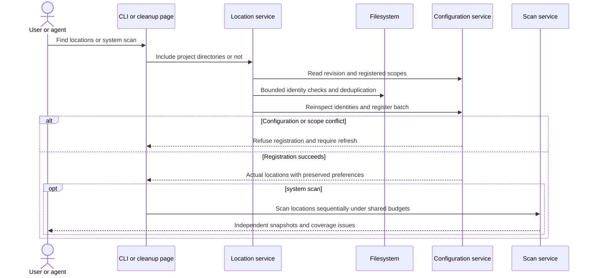

## Workspaces and personal rules

The CLI source provides workspace registration, exclusions, versioned rule import and enablement, enabled-rule scans, draft previews and paged results. Commands follow the shared [CLI contract](../ai/agent-and-cli-contract.md); native runtime acceptance remains pending:

```powershell
shou workspaces add --path "C:\Users\Alice\Projects" --root-ref developer-workspaces --json
shou rules validate --file ".\cache.rule.json" --json
shou rules import --file ".\cache.rule.json" --json
shou rules preview --file ".\cache.rule.json" --workspace "<returned-workspace-id>" --json
shou scan results --scan-id "<returned-scan-id>" --limit 50 --json
shou rules enable --rule-id "<imported-rule-id>" --workspace "<returned-workspace-id>" --json
shou scan --workspace "<returned-workspace-id>" --json
```

Import does not enable a rule. `rules enable` changes a local binding without authorizing cleanup. `rules show` and `rules export` return a shareable definition in the result envelope; Windows `rules export` currently has no `--output`. `rules list` returns personal versions and bindings and reports `builtin_templates_available=true` for the separately queryable catalog.

`analysis scan` returns bounded in-memory measurements without saving records. `rules preview` evaluates one draft independently and saves `preview_only=true` evidence; after enablement, use `scan --workspace` to scan again. A regular scan freezes current effective built-in definitions and explicitly enabled personal versions, returning `preview_only=false`; without applicable rules it only measures. Both summaries return rule IDs and digests in a `rules` array. Directed cleanup observations return `scope=rule_targets` and `tree_complete=false`; `state=complete` covers this rule discovery and target measurement, independently of whole-tree space analysis. Planning and preflight recheck selected targets and project context under the [scan budget and completeness contract](storage-scan-performance.md#platform-scope). `scan results` preserves the source marker, and cursors bind the scan ID, saved bytes and offset, with page sizes from 1–500.

Candidates are `review` or `blocked`. The CLI reports cleanup `execution_available` for the current host. `plan create` assembles a plan without changing targets; public `plan execute` currently returns `unsupported_capability`/8. Separate native generated fixtures verify explicitly confirmed permanent actions without opening the public gate. Source, credentials, databases, unknown links and unclassified data remain conservatively protected. Personal rules cannot request built-in tool exceptions.

Each directory gets positive completeness evidence only after traversal and reinspection. Unrelated gaps preserve independently complete candidates; incomplete targets remain blocked. Global, workspace and rule exclusions combine, and protected descendants block their whole parent target. Retention uses the newest descendant modification time, never access time as proof of inactivity.

Scanning defaults to 100,000 entries, 120 seconds and 32 levels, with maxima of 1,000,000 entries, 3,600 seconds and 64 levels. All rules share a 2,000,000-operation classification cap and the remaining scan time. Snapshot serialization and publication occur outside that traversal time budget, with a 128 MiB limit. Cancellation publishes no snapshot; partial coverage and classification limits remain visible. A configuration change during scanning returns `plan_stale` and prevents publication as current evidence.

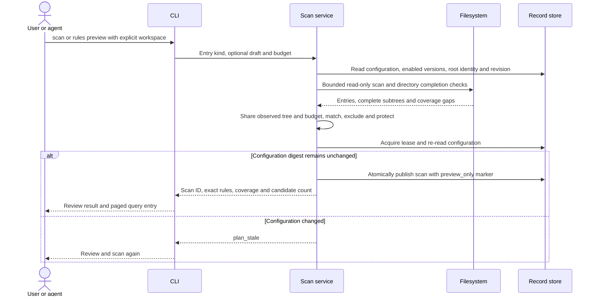

## UI configuration

WinUI's **Cleanup Rules** page uses the same configuration service as the CLI. Users can prepare personal-rule scans without a terminal:

1. Import a JSON rule through the system file picker, using the CLI's native file-reading adapter with a 256 KiB limit and ten-second deadline. It refuses links and checks identity and metadata before and after reading. Core validates the closed schema and immutable version. Import does not change the enabled version; rules for other platforms are visible but cannot be enabled on Windows.
2. Select an exact rule version. Its existing matching scan location is selected automatically. Otherwise, **Choose Folder for This Rule** registers a selected directory using the rule's logical reference; Core/Platform verifies the real path and current-user identity. Each logical reference binds one directory and is never silently rebound.
3. Enable that version at the selected location. Importing a newer version preserves the previous binding; the page shows the actual bound version. Disable acts only on the explicitly selected version when it is currently enabled.
4. Return to cleanup and run a fresh scan before reviewing candidates. Built-ins follow the selected location and can enable/disable the currently bundled version; personal rules retain exact immutable version bindings. Recommended selection remains pending.

A scan location can be removed after a dialog shows its exact path and explains that target files and imported rules remain. Its bindings and local exclusions are removed from configuration. Exclusion settings support all locations, the selected location and a project. Preview the resolved relative pattern before saving; a blank project pattern protects the entire project (`**`), and the project directory must be an exact relative path. Inherited global protections are shown separately and can only be removed in the all-locations scope. Rule-owned exclusions remain in the rule definition.

`ConfigurationViewModel` serializes page reads and writes. Conflicting actions and page changes stay disabled until both the write and persisted-state reload finish. Starting a refresh or save immediately invalidates cleanup scope, scans, selections and plans; late results cannot restore old evidence. Dispatched configuration writes offer no cancellation or rollback guarantee: closing the window suppresses page notifications and does not mean the write was undone. While the process remains alive, success, failure and cancelled responses all trigger a reload of actual configuration. A failed reload clears editable state and requires refresh. Cancelling a file/folder picker or exclusion preview does not dispatch a write.

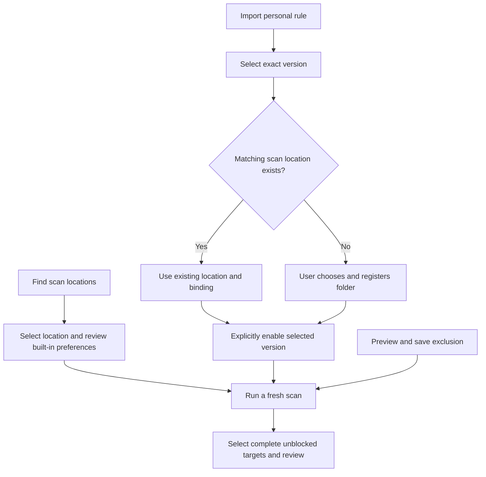

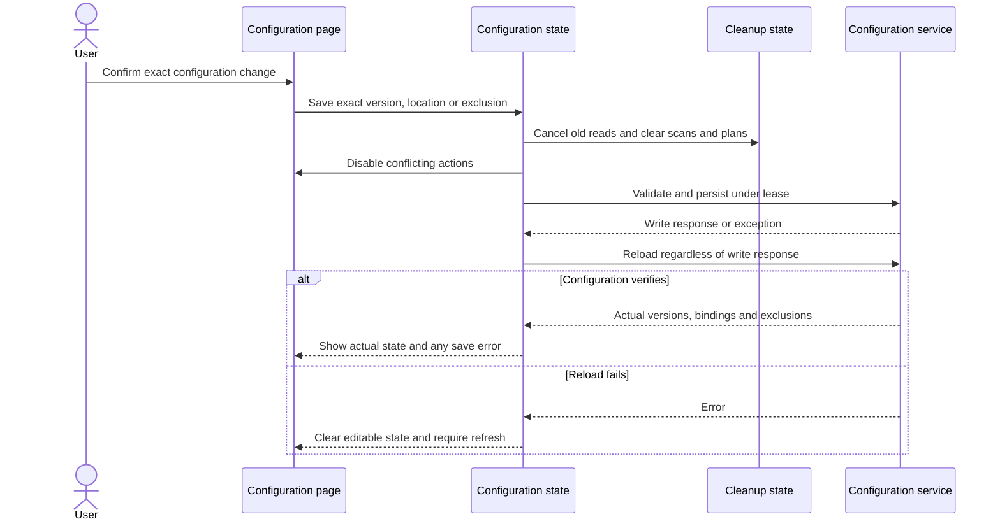

## UI review and history

WinUI source provides storage analysis, cleanup review, cleanup rules and history navigation. **Find Scan Locations** prepares fixed and conventional project directories; users then select one location to scan built-ins and enabled personal rules. Preparation clears old evidence immediately and reloads actual configuration after success or failure. Dispatched registration offers no stop or rollback guarantee; closing the page only suppresses late results. The configuration page refreshes to show built-in preferences. The GUI can scan all configured locations listed on the page and review aggregated categories, rules and paths, retain selections across location filters, explicitly select recommendations and review one multi-location plan. Public execution and native acceptance remain pending.

`CleanupReviewViewModel` owns asynchronous state, explicit selection and plan review. App's `NativeReviewOperations` composes Core/Platform and moves service work off the UI thread. The page displays 200 candidates at a time and retains at most 256 manual selections across pages. High-risk items start unselected. Blocked, incomplete, draft, duplicate-scope and overlapping parent/child targets cannot enter the review selection. The page explains blocking reasons while domain services retain final eligibility and fresh validation.

Changing locations clears selection and plans while allowing batch observations to be revisited per location. Refresh or configuration changes invalidate old evidence. New requests isolate late responses, and failed planning requires a fresh scan. Cancelled single-location scans and planning requests do not publish unacknowledged results; batch reads retain previously published snapshots, and mutation attempts retain actual recorded outcomes. Configuration writes follow the persisted-state reconciliation above.

**Review Selected Items** explicitly creates a permanent-action plan and only displays full paths, count, estimated size and risk; it never issues consent. **Clean Permanently** has separate confirmation and execution source; it stays disabled by the shared native-acceptance gate. Review source and presentation tests do not establish native mutation acceptance.

History queries 50 recorded summaries per page, with details re-reading and validating the plan. **Check Recorded Locations** only observes exact locations. Recorded results and current observations are displayed separately; unknown or unfinished intent never becomes success because an original path disappeared. Paging and refresh do not merge different query snapshots, and changing records clears old observations. There are no recovery, retry or journal-write controls.

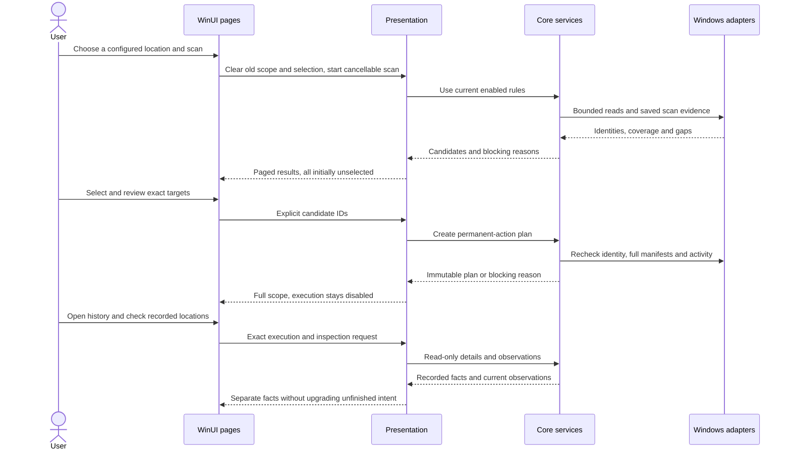

### File cleanup confirmation and window lifecycle

`CleanupExecutionViewModel` is separate from review state and binds only the current permanent-action plan. App checks `WindowsCleanupMutation.PublicExecutionAvailable`, then uses the same Core service for current confirmation and single-use consent consumption. GUI and CLI read that one disabled gate, with no environment override. `WinUICleanupConfirmation` displays exact plan paths, count, risk and irreversible consequences on the UI thread, defaults to Cancel and rejects a cancelled or no-longer-visible review.

Dispatch clears executable plans, scans and selection; changing scope or leaving the cleanup page is blocked until the task returns. Stop and normal window closing request cooperative cancellation and keep the window waiting. Returned recorded outcomes remain visible even after stop. Forced process termination is outside that guarantee. Existing intent, unknown outcomes and journal failures are never automatically retried. The page retains exact-plan record lookup; absence of a readable record does not prove no mutation. Lookup validates that plan's journal without rewriting state or granting recovery.

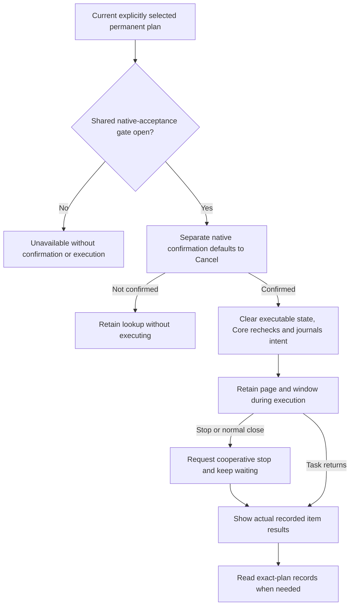

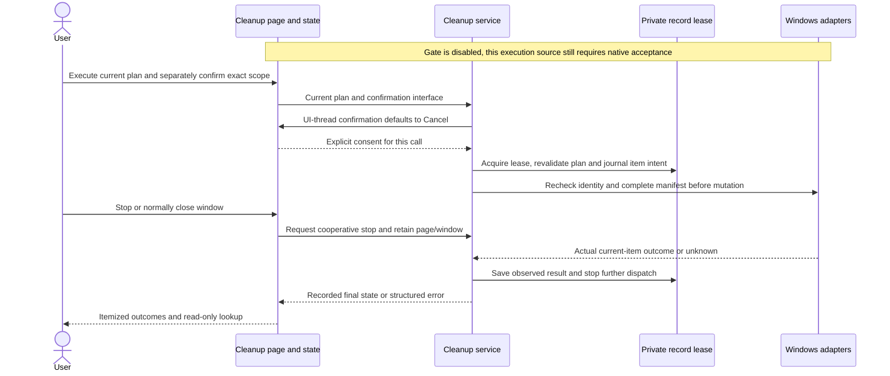

## Controlled cleanup domain service

Core implements planning, current confirmation and item journal orchestration, verified with in-memory fixtures. The CLI assembles native filesystem, activity and mutation adapters. `plan create` and `plan show` create and read plans; public `plan execute` currently returns `unsupported_capability` (exit `8`) on every host before touching targets. Generated fixtures independently exercise confirmed native actions and item records without opening that gate. Discovery exposes the runtime gate; there is no environment-variable override. Native fixture and interactive UI evidence remain separate acceptance gates. WinUI includes separate confirmation, stop-and-wait, recorded-result lookup and normal-close protection source.

```powershell
shou plan create --scan-id "<regular-scan-id>" --candidate "<candidate-id>" --mode permanent --json
shou plan show --plan-id "<returned-plan-id>" --json
```

Following the shared contract, CLI `--mode` defaults to `trash`. Trash is currently unavailable, so the default action returns unavailable; creating a permanent plan requires explicit `--mode permanent`, without fallback. Creating a plan never deletes files. Repeat `--candidate` for multiple selections; implicit select-all and duplicate IDs are refused.

Only regular enabled-rule scans can produce plans, with 1–256 explicitly selected, complete, non-overlapping targets. Plans freeze configuration, rules, manifests, ancestor identities and marker metadata, action and a ten-minute lifetime, then freshly observe the filesystem. Activity must be known idle; unknown activity blocks planning and execution.

Current confirmation binds the service instance, plan digest and action, lasts at most one minute, is consumed once and cannot be restored from JSON. Terminal confirmation source displays full scope, digest, risk and the irreversible-action warning on stderr, requiring exact `PURGE <plan-id>` or `TRASH <plan-id>` input. Input is limited to 256 characters within one minute; stdin and stderr must be interactive terminals, while stdout may carry JSON. Control characters in paths and rule fields are escaped. Injected-prompt logic tests have run; actual Windows Console behavior remains unaccepted, and the disabled execution entry never prompts.

Prompts do not hold the mutation lock. Execution holds an asynchronous storage lease, preflights the batch and revalidates each item, persists `purging` or `moving` before calling the native port, then saves the observed result. Unknown outcomes stop dispatch; journal failures return `journal_write_failed`. Any existing execution intent prevents plan replay, and missing final state never proves success. Recovery remains pending; read-only history entries are described below.

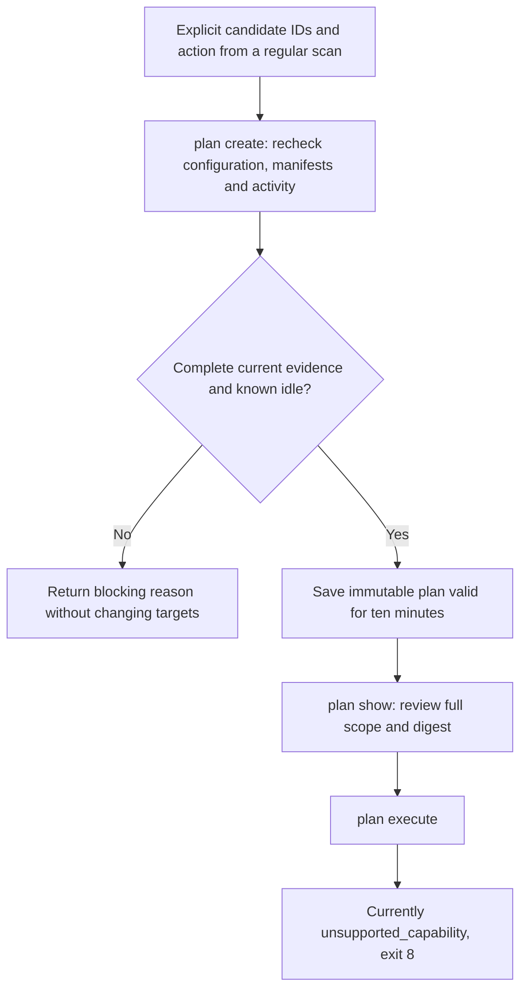

`WindowsCleanupMutation` implements permanent removal only. It pins workspace ancestors and context, opens objects relative to verified parent handles through `NtCreateFile` without following reparse points, enumerates directories through handles and preflights the full manifest. It then processes selected entries in postorder, unlinking each opened name through POSIX disposition. It never recursively deletes by path or overrides readonly attributes, and requires an image-section check. New objects never enter the manifest; directories must be empty to remove. Only confirmed unlinks count as removed, and unconfirmed outcomes remain unknown. Each item has a cooperative two-minute budget; kernel calls can still block. Cancellation waits for the current native boundary before journaling. Trash currently returns unavailable.

`WindowsCleanupActivity` combines two read-only observations: Restart Manager file use for target files and parent markers, and a fixed tool-process inventory whose verified working directories are checked for overlap with the target's parent project directory. Core owns the tool-name list; rules cannot supply process names. Shou's current process and processes confirmed exited through opened handles are ignored. No command lines or environments are read, and no elevation or process termination is attempted.

Both checks share a ten-second deadline and bounded native workers. The inventory permits at most 16,384 snapshot rows and 64 matching-tool directory reads. Access failures, unknown directory identities, incomplete snapshots, excess work and timeouts cannot become idle. Positive activity takes precedence; otherwise any unknown blocks, and both observations must be idle to continue. Tools in other projects do not block globally merely by sharing a name.

A directory positively verified outside the project/ancestor scope does not need the target owner's SID; it grants no cleanup authority. Missing directory evidence still blocks, and overlapping foreign-owner scopes remain unknown. Target, context and workspace ownership checks are unchanged.

The directory adapter uses `NtQueryInformationProcess` and `ReadProcessMemory` to read PEB directory fields, rechecking pointers, directory bytes and filesystem identity before and after, with native 64-bit and WOW64 layouts. This internal ABI has no Windows runtime evidence yet. Working directories are activity clues: tools accessing a project through absolute arguments from unrelated directories may escape observation. This does not detect every use. Public mutation stays disabled pending native process, race, interruption and terminal acceptance.

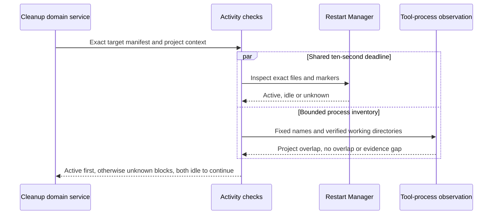

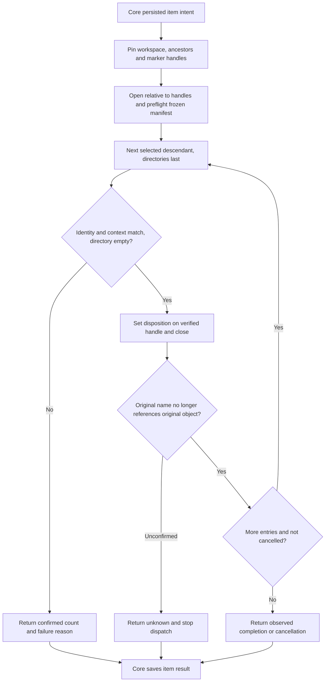

## History queries and inspection

The CLI includes the following read-only commands, with native runtime acceptance pending. Public cleanup is unavailable, so these queries do not create new user cleanup records.

```powershell
shou plan show --plan-id "<saved-plan-id>" --json
shou history list --limit 50 --json
shou history show --execution-id "<saved-execution-id>" --json
shou history inspect --execution-id "<saved-execution-id>" --max-entries 100000 --max-seconds 120 --json
```

`history list` reads journal summaries under one storage lease without loading target manifests and reports `plan_verified=false`. Pages default to 50 rows, at most 500, sorted by descending start time then ascending execution ID. Each query is bounded by 4,096 total private-directory entries, 32 MiB of execution bytes and ten seconds; exceeding a budget returns `resource_limit` or `time_limit`. Cursors bind the journal set, raw-byte digests, page size and offset; changed records return `source_changed`. Corrupt rows appear in `issues` while readable rows remain accessible. No continuation is returned when raw bytes cannot be read. Gaps return `status=partial` and exit `6`.

`history show` re-reads the corresponding plan and validates digest, action, timestamps, item IDs, state combinations and receipt identities. `plan show` only reads and validates the plan. Expired history remains readable and never restores confirmation authority. Historical queries do not require the current configuration to retain the workspace or rule.

`history inspect` holds the same cross-process lease from record opening through observation. It only checks exact original paths and recorded Trash locations, never searches the recycle bin, rewrites journals or retries operations. `--max-entries` and `--max-seconds` use the scan limits and apply jointly across every target and location. Entry accounting includes root-location observations and entries returned by scanning; directory depth is capped at 64.

The report preserves `recorded_state`, `unfinished` and `checked_at`. Locations are `matches`, `missing`, `changed`, `unavailable` or `not_recorded`. A match requires the complete manifest, identities and metadata; Windows does not relax Trash-root change timestamps. Each item's `assessment` is `verified_permanent`, `verified_trash`, `unchanged`, `conflict` or `needs_verification`. Only recorded permanent completion plus a missing original can report `verified_permanent`; `purging` or `unknown` remains uncertain even when the original disappears. Unfinished executions remain unfinished. Budget gaps, uncertainty or conflicts return `status=partial` and exit `6`; caller cancellation returns `130`. Every result reports `records_changed=false` and `recovery_available=false`.

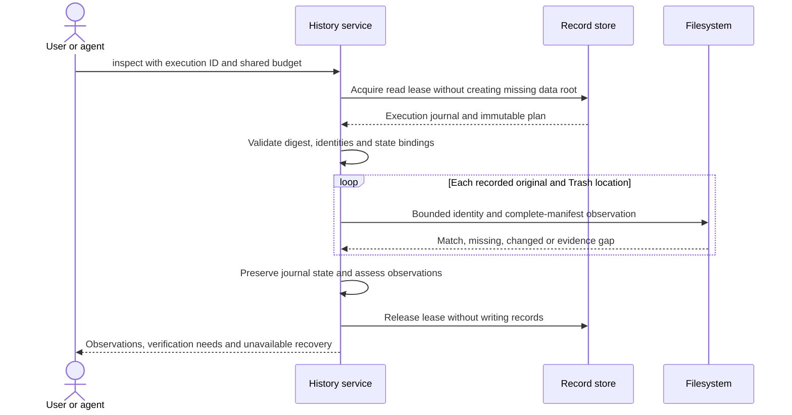

## Private records

The default data root is `%LOCALAPPDATA%/Shou/Data`. `SHOU_DATA_DIR` can select an absolute local directory whose parent already exists and belongs to the current user. Read-only queries against missing storage do not create the data root. Directories and files use restricted ACLs for the current user and SYSTEM. Existing broad permissions, junctions, cloud placeholders and multi-link records are refused without changing permissions.

Reads and updates share a cross-process lease; contention returns `store_busy`. Updates write and flush a unique temporary file, then publish through pinned directory and file handles. Atomic replacement of one record is not a multi-record transaction. A flush failure after publication returns `commit_unconfirmed`: callers must inspect the outcome before retrying. See the [Windows data contract](../architecture/data-model.md#windows-native-records) for formats and limits.

## Scheduled-task switches

These source commands are separate from startup discovery. Review opens no storage; execution and record lookup use current-user private operation records.

```sh
shou startup inspect --task-path '\Folder\Task' --action enable --json
shou startup control --task-path '\Folder\Task' --action enable --review-digest sha256:<digest> --json
shou startup execution show --startup-operation-id startup_control_<id> --json
```

Actions are only `enable|disable`. `inspect` returns a five-minute in-memory review, blocking reasons and the host's `execution_available`. Public `control` currently returns `unsupported_capability` / 8 on every host without prompting or setting the task. The independently tested native service rechecks the original digest, requests current confirmation (`STARTUP ENABLE <current-operation-id>` or `STARTUP DISABLE <current-operation-id>` for the TTY adapter) and changes only the scheduled-task Enabled flag; generated fixtures do not enable the public entry. No `--yes`, `--approved` or retry flags are accepted.

`execution show` is read-only; absent records return `not_found` / 5 without creating storage. Changed tasks return `startup_changed` / 4. Journal failure returns partial / 6 with the operation ID and a lookup next_action; missing output does not prove no change. Unsupported hosts return 8 without creating a data directory. The [startup contract](../product/startup-items.md#scheduled-task-switch-review-and-control) owns eligibility, safety and UI waiting behavior; the [data model](../architecture/data-model.md#windows-scheduled-task-switch-records) owns storage. Native control and UI acceptance remain pending.

## Native startup-control acceptance with generated tasks

Status: a separate entry and six native cases have source implementations. Mac checks establish compilation, explicit skipping and script refusal only; Windows execution remains unverified. The entry directly exercises the native adapter and Core service with the public product gate still disabled. It does not accept WinUI or real terminal confirmation.

On matching native Windows 11 x64 / ARM64, use PowerShell 7.4 or newer, the pinned .NET SDK and Python from the repository root:

```powershell
& "./scripts/windows/test-startup-fixtures.ps1" -RunGeneratedStartupFixtures
```

Optional `-ArtifactsRoot` selects output on a fixed local drive, defaulting to `%LOCALAPPDATA%/ShouBuild/generated-startup-tests`. Shared/mapped-network drives and UNC paths are unsupported. No existing task, executable or account parameters are accepted, and no elevation is requested. Missing opt-in, unsupported host/architecture and unknown task parameters are rejected. Default test runs skip these six task-mutation cases.

Each case creates one current-user task beneath a random `\ShouGeneratedStartup-<id>` folder. The task starts disabled, its sole current-user logon trigger and demand starts are explicitly disabled, and its action points to a nonexistent fixture-local `.exe`. No API to run tasks is called. Registration is create-only; the definition-change case is update-only so an update cannot create a missing task.

| Case | Native behavior under test |
| --- | --- |
| Switch round trip and lookup | Enable/disable setters, rereads, durable outcomes, reopened lookup, replay rejection and no arguments in journals |
| Declined current confirmation | Unchanged switch, no mutation invocation or durable intent |
| Definition changes during confirmation | Change only the generated task's Hidden setting, reject changed digest without intent |
| Stop during confirmation | Correct approval cannot override cancellation; no intent |
| Actor mismatch at the native boundary | Reject another actor without changing the switch |
| Stop after intent but before dispatch | Persist cancelled/not_started, preserve the switch and prevent intent replay |

Teardown rechecks the current actor, exact folder/task, owner, unique generated marker, disabled trigger/demand starts and definition digest. It removes only that task and the verified-empty generated scheduler folder. It never recursively deletes a filesystem tree. Unverified ownership or definition refuses teardown and retains diagnostics. Generated marker files, stage JSON and private operation records remain in the output directory.

The script requires all six cases to execute and pass; skips are failures for acceptance. It compares before/after source digests and checks all six initial-disabled and final-folder-removal receipts. Output includes TRX, toolchain, system/process architectures, source state, stage facts, operation records and a `verification.json` with file SHA-256 hashes. Ordinary discovery never opens these records. This entry does not cover forced interruption during a call, concurrent replacement/ABA, permission matrices, real terminals, WinUI, other startup sources or signed distribution; it cannot by itself enable the product gate.

## Read-only browser privacy scans

`privacy scan [--range last-hour|last-day|last-seven-days|all-time]` saves fixed-window aggregate observations. `privacy scan show --scan-id <privacy_scan_id>` strictly reads metadata without querying browser records again. The WinUI Privacy page explicitly starts the same Core service through `PrivacyScanViewModel`; range/configuration changes clear results, Stop discards late results, and navigating away cancels scanning. No source is automatically scanned on navigation and no privacy deletion action is exposed. Partial observations return CLI status `partial`, exit `6`.

Source, ACL/handle, SQLite, budget and unsupported-schema contracts belong to [privacy cleaning](privacy-cleaning.md#windows-platform-boundary); platform-specific records belong to the [data model](../architecture/data-model.md#windows-privacy-observations). Plans, confirmation, transactional deletion and receipts remain to be implemented.
