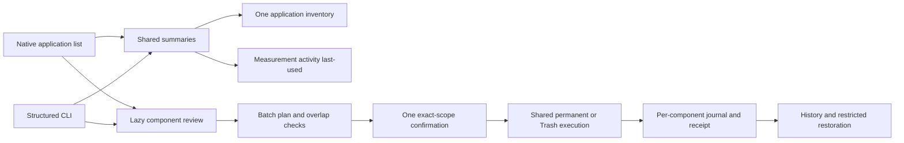
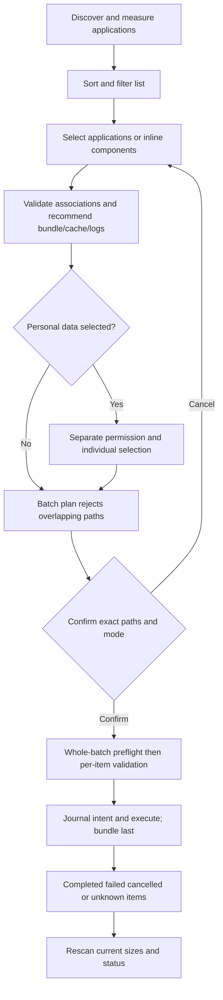
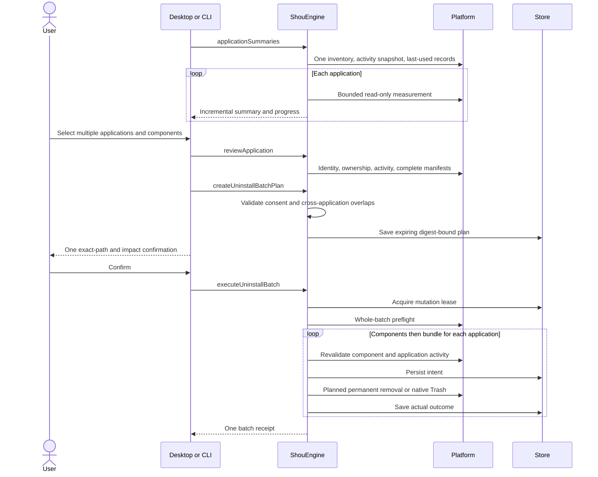

# Application uninstall and associated files

English | [简体中文](../zh-CN/product/application-uninstall.md)

Application uninstall is separate from rebuildable-cache rules. Desktop and CLI share summaries, component review, batch plans, native execution and history. Shou neither integrates models nor hosts an Agent. Implementation and actual verification are recorded separately in [acceptance and testing](../engineering/acceptance-and-testing.md).

## Purpose and interaction

Users need to compare applications, select several, review associated data inline and confirm once. The native list shows icons, versions, exact identifiers, activity/access status, estimated bundle allocation and optional system last-used records. Associated components are measured only when expanding or selecting an application.

| Journey | Behavior |
| --- | --- |
| Find large applications | Size descending by default; sort by name, status, size or last used; search names, identifiers, versions and paths |
| Batch selection | Initially empty; selecting an application reviews it and selects eligible bundle/cache/log components without coverage warnings |
| Component review | Expand in the same list to inspect exact paths, sizes, risks and unavailable reasons |
| Preserve personal data | Preferences, databases, sessions and containers remain unselected until separately allowed and individually selected |
| Select the current view | The header affects only currently filtered eligible applications and preserves selections outside the filter and customized components; deselecting the required bundle deselects the application |
| Running application | Request normal quit, then rescan; no forced termination or automatic selection |
| Administrator/protected application | Explicit status; this build has no elevation capability and cannot label these applications executable |
| Uninstall | Default permanent removal, with one exact application/component confirmation; native Trash is an explicit alternative |
| Results and recovery | Shared per-item history; only verified Trash items can be restored; permanent removal cannot be restored |

List totals describe bundle allocation; the bottom bar describes the actual selected bundles and associated components. Neither promises exclusively reclaimable bytes. Missing last-used metadata stays unknown rather than using modification time. Coverage gaps, unavailable sizes and activity checks remain explicit. Refreshing or changing selection invalidates prior confirmation; mutations require a new scan for current totals and status.

## Components and associations

| Component | Evidence | Personal-data consent |
| --- | --- | --- |
| Bundle | Exact installation path, metadata and device/inode | Required application selection |
| Caches/logs | Exact identifier under the corresponding Library directory | Defaults only for eligible components without coverage warnings |
| Preferences | Exact identifier plist | Required |
| Application Support/saved state | Exact identifier path in the relevant Library family | Required |
| Container | Exact identifier and native container metadata | Required |
| Shared group container | Native metadata identifying the application | Required |
| WebKit/HTTP storage | Exact identifier path | Required |

An identifier provides association, not exclusive ownership. Duplicate installations may share components. Unverified/shared components remain protected. Batch plans reject identical or overlapping component paths across applications. Similar names, vendor prefixes and orphan-only leftovers do not authorize removal. Package receipts, external registrations, custom data locations and other accounts remain outside this scope.

Discovery checks `~/Applications`, `/Applications` and two levels of container folders, with a 4,000-entry/10-second budget. Explicitly included system applications stay protected. Embedded bundles are not separately discovered. Each application has its own bounded size measurement; selected components need complete current manifests. Windows is unverified.

## Architecture



`ApplicationsSession` owns presentation state, persistent selections across filters and component caches. `ShouEngine` owns associations, consent, exclusions, plan digests and revalidation. Platform ports supply filesystem, process and metadata facts. Batch execution reuses `TrashExecution` or `PermanentExecution`; one receipt stores every component origin without another deletion loop.

## Flow



## Sequence



## Execution and recovery

Plans expire in 15 minutes and bind application identity, complete manifests, configuration, personal-data consent and mode. Whole-batch preflight failure prevents mutation. Failures or cancellation after starting can leave partial results: this is not a cross-application atomic transaction. Stop takes effect at safe item boundaries; completed items are not automatically rolled back and unknown outcomes are never blindly retried.

Protected cases include system/current applications, running owners and helpers, unknown activity, other owners, special files, multiple hard links, credentials, Shou records and exclusions. Bundle links are handled as links. Preference files have bounded content digests; directories retain complete metadata manifests. Restoration verifies every exact original parent without creating parents or overwriting files. Permanent outcomes cannot be restored. No administrator elevation or privileged helper is introduced.

## CLI

```sh
shou applications summary --json
shou applications inspect --path "/Applications/Example.app" --json
shou applications plan --review-id <review-id> --component <app-id> --mode trash --json
shou applications batch plan --file selections.json --mode permanent --json
shou applications batch plan show --plan-id <plan-id> --json
shou applications batch uninstall --plan-id <plan-id> --json
shou history inspect --execution-id <execution-id> --json
```

The batch input is an explicit selection array with `review_id`, `component_ids` and optional `include_user_data` per application. Legacy single plans default to Trash; batches default to permanent. Machine clients must inspect the actual plan mode. Execution requires one current-scope controlling-terminal confirmation; external Agents may prepare and inspect plans. Trash restoration needs separate confirmation.

## Acknowledgments

MangoDisk informed application-list layout, inline components, filters, sorting and batch interactions. Shou retains an independent native implementation and its own execution, personal-data and history contracts. A visible reference page does not establish Shou feature parity or full acceptance.
