# Application uninstall and associated files

English | [简体中文](../zh-CN/product/application-uninstall.md)

Application uninstall is separate from rebuildable-cache rules. Desktop and CLI share summaries, component review, batch plans, native execution and history. Uninstall execution does not depend on a model; next-stage built-in cleanup AI cannot bypass component selection, personal-data consent or actual uninstall confirmation. Implementation and actual verification are recorded separately in [acceptance and testing](../engineering/acceptance-and-testing.md).

Platform status: macOS has bundle, component review and uninstall source. Windows has registration discovery, installation-identity review, separate installer-data acknowledgement and expiring plans in CLI/UI source; native acceptance is pending and uninstall execution is unavailable. Bundle, Library, Finder and Trash details below apply to macOS. Windows follows the separate contract in the next section.

## Windows application discovery and uninstall boundaries

The Windows `ApplicationCatalog` supplies one bounded observation to its desktop and CLI. Distinct registrations retain their sources and exact registration identifiers even when display names match.

| Source | Scope and limits |
| --- | --- |
| Current-user registry | `HKCU/Software/Microsoft/Windows/CurrentVersion/Uninstall`, read once because this path has a shared view on supported systems |
| Machine 64-bit registry | The corresponding `HKLM` uninstall path through its 64-bit view; this does not establish each application's architecture |
| Machine 32-bit registry | The corresponding `HKLM` path through its 32-bit view, retained separately |
| Current-user MSIX | `PackageManager.FindPackagesForUser("")`, excluding frameworks, resource packages and bundle containers; no other-user or provisioned-package enumeration |

Registry system components, entries associated with a parent and explicit updates are excluded as independent applications. A system-signed MSIX package is labeled as a platform fact, without inferring general uninstall eligibility. Portable applications, custom install directories and software without registration are not discovered. Complete source enumeration never means that every application on the computer has been found.

All four sources share a default budget of 4,000 entries and ten seconds, with maxima of 20,000 entries and 60 seconds. Hidden and excluded entries also consume the entry budget. Registry names and values have fixed read limits; each value is at most 8 KiB. Uninstall commands and command lines are not read. Each source reports `complete`, `partial`, `unavailable` or `not_read` and reasons. Permission failures, invalid values that omit an entry, limits and timeouts cannot become complete coverage. An invalid installation path alone retains the application and marks that field unavailable. Observations are not system-wide atomic snapshots. A blocked native read retains its bounded worker slot; cancelling the wait does not forcibly interrupt the kernel operation.

Search covers names, versions, publishers, exact registration identifiers and registered locations. Name is the default sort; registered-size descending is optional. `RegisteredEstimatedBytes` is the installer's registered KiB estimate, without measuring its directory. It is neither measured allocation nor expected reclaimed space; missing estimates remain unknown. Registered locations are not environment-expanded, followed or treated as exclusive ownership. MSIX identity does not become a directory-deletion target.

If a native call blocks beyond the caller's waiting deadline, sources report `unavailable` with `time_limit` and `inspected_entries: null`. Progress is unknown, not zero or proof that reading was never attempted. Normally returned partial observations retain known counts.

The page searches, sorts and paginates one immutable snapshot. Each CLI invocation observes again and returns `snapshot_id`, `observed_at`, `total`, `offset`, `items`, `has_next`, source coverage and limitations. Offset pages from different invocations need not share a snapshot. CLI pages contain at most 500 items and snapshots are not retained across calls; consistent queries exceeding one page remain unsupported, and different snapshots must not be combined as one complete observation. Read-only discovery does not create cleanup storage, plans or elevation requests. Cancellation, refresh and window disposal isolate late responses.

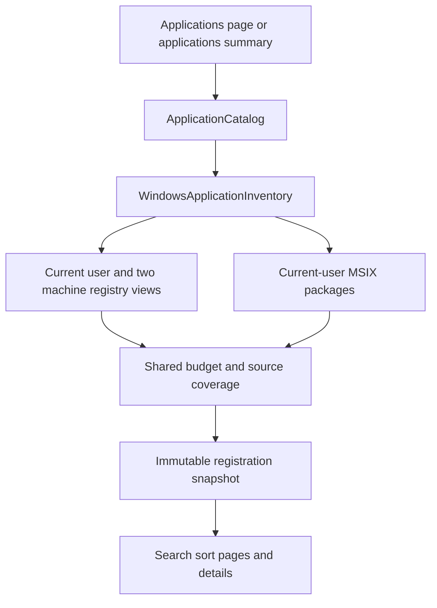

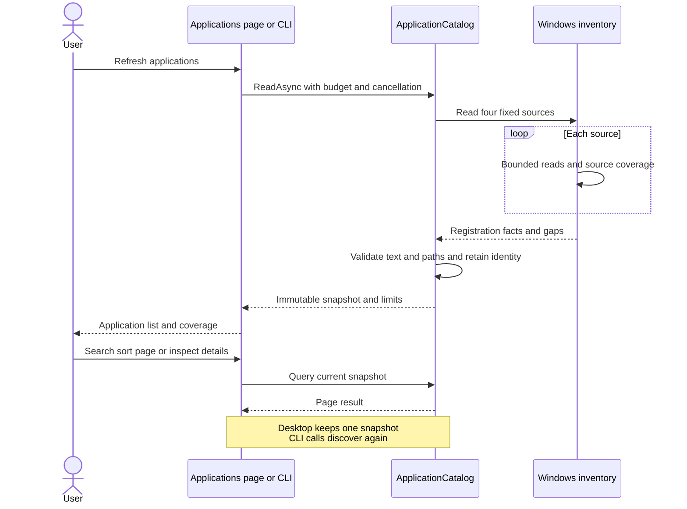

### Installation identity review and planning

`applications inspect --application-id <id>` rediscovers the exact registration. `ApplicationUninstallReviewer` and `WindowsApplicationUninstallInspector` read its system installation identity without opening storage. Installation inspection has a separate ten-second deadline after bounded discovery. Timeout, permission failures and conflicting identities produce explicit blocking reasons. An accessible installation directory may carry a verified directory identity; a missing directory produces a warning and never grants file permissions from the registration path.

| Installer | Verification and binding |
| --- | --- |
| MSI | `WindowsInstaller=1` is only a clue. `MsiGetProductInfoExW` checks current-user managed, unmanaged and machine contexts; exactly one must be installed and match the registration source. Bind ProductCode, PackageCode, context, user SID and system name/version/publisher |
| MSIX | Query the current user's exact package full name again; bind family name and current-user SID. System-signed, framework, resource and bundle containers remain protected |
| Other installer | Unsupported; never read or execute `UninstallString` or interpolate a shell command |

MSI custom actions and ordinary MSIX removal can change installer-managed data. Excluding additional residual cleanup cannot promise that personal data is preserved. MSIX may also remove dependencies that the user no longer needs. The UI acknowledgement starts unchecked; CLI planning requires `--allow-installer-data-changes true`. This acknowledgement covers installer-managed data effects only and grants neither residual cleanup nor execution.

Planning reinspects the installation and requires the current fact digest to equal the reviewed `review_digest`; observation time is excluded from the digest. Changes return `application_changed`, and protected or unverifiable installations cannot be saved as plans. Plans use the current user's private store and cross-process lease, with a fifteen-minute lifetime. Selection changes, refresh, a new inspection and planning errors invalidate old review/consent. Cancellation and disposal suppress late results.

Review and planning both call `ApplicationActivityService`. Within one ten-second deadline it scans the verified installation directory, at most 20,000 entries and 32 levels. All directories must be complete and identities unchanged. Unknown reparse points, cross-volume entries, unreadable entries and multiple hard links make the observation unavailable. Restart Manager inspects all regular-file paths. At most 128 distinct `.exe`/`.com` names from observed files select matching processes in a snapshot capped at 16,384 processes, with at most 256 matching image queries. Names only narrow the query and never establish association. A same-name image outside the installation does not block it; the current Shou process inside the installation is not exempt.

Image reads request query and synchronization rights only, without working directories, private memory, arguments, environments, elevation, quit requests or termination. Observed entries are reread afterwards; directory additions, file replacements and writes make the observation unavailable. Only complete coverage without observed file/image users reports `idle`; activity reports `active`, and uncertainty reports `unknown`. Both block planning, as does a missing installation directory. Activity state/reason enters the review digest, so starting the application after review invalidates the reviewed facts. Coverage is limited to the installation directory, excludes external components and never authorizes future execution. Real Windows file-use/image-query and UI acceptance remains pending.

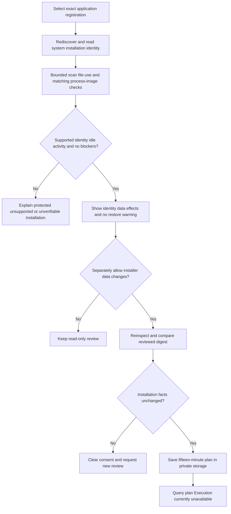

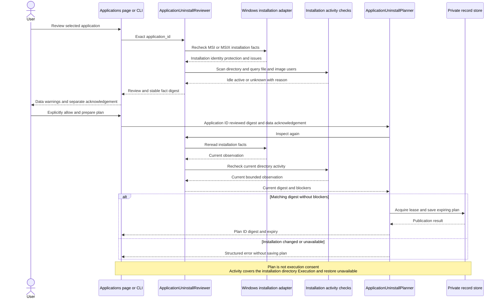

### System uninstall execution and outcomes

Source connects `ApplicationUninstallService`, `WindowsApplicationUninstallMutation`, CLI terminal confirmation/outcome queries and WinUI execution interaction. GUI and CLI share `WindowsApplicationUninstallMutation.PublicExecutionAvailable`, currently `false`; the UI disables execution and public `applications uninstall` returns `unsupported_capability`/exit 8 without prompting or invoking an installer. Native uninstall, installer data effects and interruption behavior are unaccepted.

Confirmation freshly checks identity and installation-directory activity and presents the full plan, system identity, data effects, possible shutdown of installer-managed apps/services and the lack of Shou restore. CLI requires `UNINSTALL <uninstall_plan_id>`. WinUI uses a separate dialog defaulting to Cancel; users actively select Uninstall after reviewing the application, exact identity and system effects. The data-effects checkbox is not execution confirmation. There is no unattended approval option. Consent belongs to its issuing service instance, binds plan ID/digest, expires within one minute and the plan lifetime, and can be consumed once.

Execution holds the existing cross-process mutation lease, rereads and validates the plan/consent/current review, and writes no intent for stale preflight. It then durably publishes `uninstalling` before Platform rechecks the actor, identity, activity and authorization deadline and invokes the system installer. System APIs provide no atomic transaction covering identity checks and uninstall. External installation changes and installer custom actions still require native verification; the system installation is not frozen.

| Installer | Invocation and cancellation |
| --- | --- |
| MSI | Direct Windows-system-directory `msiexec.exe` with fixed argument array `/x <ProductCode> /qb /norestart REBOOT=ReallySuppress MSIRESTARTMANAGERCONTROL=Disable`; no shell or registry uninstall command. Basic installer UI retains its Cancel button without requesting reboot or Restart Manager application shutdown. Shou cancellation after launch does not kill it and waits for its actual exit; cancellation is available through its UI |
| MSIX | Current-user `RemovePackageAsync` for the exact full name, without other-user/all-user flags. Shou cancellation requests deployment cancellation and still awaits native terminal status. The system may shut down package executables and remove managed data and unused dependencies |

Neither path recursively removes residuals, elevates itself or terminates processes. Installers may manage services, processes and custom data outside the installation-directory activity observation. The mutation lease remains held while waiting for a normal result; an unreliable outcome is unknown and does not prove that nothing changed.

Results separately preserve installer `outcome`, native code, `restart_required` and the subsequent exact installation `presence`. The identity observation has its own ten-second deadline. Only reported installer success plus absence of the original identity becomes `completed`. Success with a present, changed or unverifiable identity becomes `unknown`. Failure and cancellation preserve their native facts without promising retained data or automatic rollback. MSI code 3010 records a required restart; Shou does not initiate it.

`applications execution show --uninstall-plan-id <id>` only reads saved intent/outcome; it does not observe again, repair logs or retry. Any existing intent, including corrupt logs and `uninstalling` left by failed result publication, blocks replay of the same plan. Journals are not installer transactions, and reading one does not establish current installation state. Unknown outcomes need independent follow-up verification. Shou cannot restore system uninstall. Residual cleanup still requires independent component review, current ownership, personal-data consent and an exact-scope plan; shared and unknown ownership remain protected.

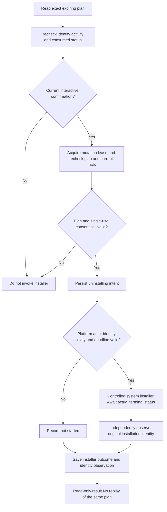

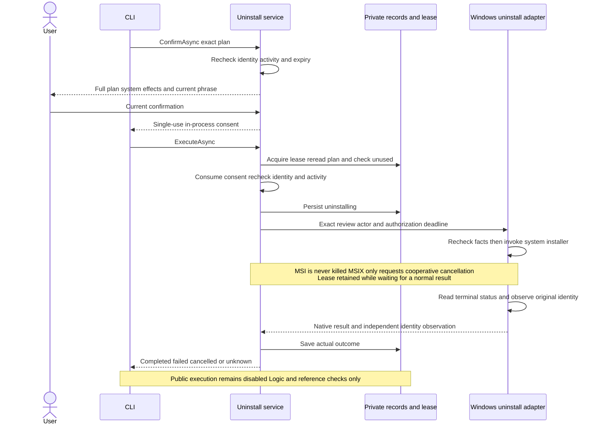

### WinUI confirmation and window lifecycle

The applications page separates installer-data acknowledgement, plan preparation and current execution confirmation. Starting execution clears the executable page plan and acknowledgement while retaining its exact ID for read-only queries. Expired plans and clock rollback prevent dispatch. The confirmation adapter uses DispatcherQueue to return to the UI thread; cancellation, an unavailable page or failed dispatch cannot grant consent. Native UI verification remains pending.

From confirmation until the execution task returns, selection, refresh and navigation to other pages are disabled. Stop or normal window closing requests cancellation and keeps the window open while awaiting the actual outcome; MSI cancellation remains in the installer UI. A real outcome arriving after Stop must still be shown. Users may close the window after completion. Forced process termination can leave only `uninstalling`, which establishes neither continued installer execution nor completion.

Results display the saved timestamp, installer outcome and identity observation from that time. They never trigger automatic reboot, retry, restore or residual cleanup. Failed result publication retains Read Uninstall Record. This query only reads the bound plan’s saved record; it neither refreshes installation state nor repairs intent. A new selection or refresh clears the page’s query context; CLI can still query the original plan ID.

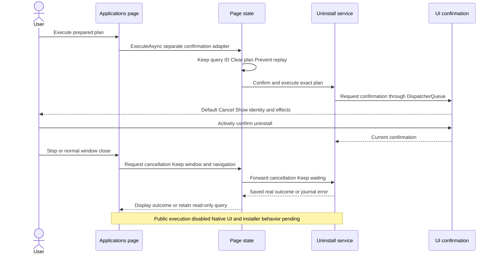

## Purpose and interaction

Users need to compare applications, select several, review associated data inline and confirm once. The native list shows icons, versions, exact identifiers, activity/access status, estimated bundle allocation and optional system last-used records. Associated components are measured only when expanding or selecting an application.

| Journey | Behavior |
| --- | --- |
| Find large applications | Size descending by default; sort by name, status, size or last used; search names, identifiers, versions and paths |
| Batch selection | Initially empty; selecting an application reviews it and selects eligible bundle/cache/log components without coverage warnings |
| Component review | Expand in the same list to inspect exact paths, sizes, risks and unavailable reasons |
| Preserve personal data | Preferences, databases, sessions and containers remain unselected until separately allowed and individually selected |
| Select the current view | The header affects only currently filtered eligible applications and preserves selections outside the filter and customized components; deselecting the required bundle deselects the application |
| Running application | Request normal quit, then rescan; no forced termination or automatic selection |
| Administrator application | Selectable lock indicator; eligible current-user/root-owned bundles use Finder’s native Trash operation, with macOS authentication when required; associated data is kept |
| Protected application | System/current applications, other-user content and unverifiable targets remain unavailable |
| Uninstall | Desktop defaults to native Trash after exact application/component confirmation; permanent removal remains an explicit alternative for eligible user-owned applications |
| Results and recovery | Shared per-item history; only verified Trash items can be restored; permanent removal cannot be restored |

List totals describe bundle allocation; the bottom bar describes the actual selected bundles and associated components. Neither promises exclusively reclaimable bytes. Missing last-used metadata stays unknown rather than using modification time. Coverage gaps, unavailable sizes and activity checks remain explicit. Refreshing or changing selection invalidates prior confirmation; mutations require a new scan for current totals and status.

## Components and associations

| Component | Evidence | Personal-data consent |
| --- | --- | --- |
| Bundle | Exact installation path, metadata and device/inode | Required application selection |
| Caches/logs | Exact identifier under the corresponding Library directory | Defaults only for eligible components without coverage warnings |
| Preferences | Exact identifier plist | Required |
| Application Support/saved state | Exact identifier path in the relevant Library family | Required |
| Container | Exact identifier and native container metadata | Required |
| Shared group container | Native metadata identifying the application | Required |
| WebKit/HTTP storage | Exact identifier path | Required |

An identifier provides association, not exclusive ownership. Duplicate installations may share components. Unverified/shared components remain protected. Batch plans reject identical or overlapping component paths across applications. Similar names, vendor prefixes and orphan-only leftovers do not authorize removal. Package receipts, external registrations, custom data locations and other accounts remain outside this scope.

Discovery checks `~/Applications`, `/Applications` and two levels of container folders, with a 4,000-entry/10-second budget. Explicitly included system applications stay protected. Embedded bundles are not separately discovered. Each application has its own bounded size measurement; selected components need complete current manifests. Windows is unverified.

## Architecture

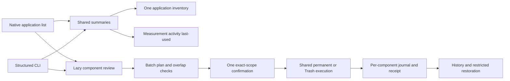

`ApplicationsSession` owns presentation state, persistent selections across filters and component caches. `ShouEngine` owns associations, consent, exclusions, plan digests and revalidation. Platform ports supply filesystem, process and metadata facts. Batch execution reuses `TrashExecution` or `PermanentExecution`; one receipt stores every component origin without another deletion loop.

## Flow

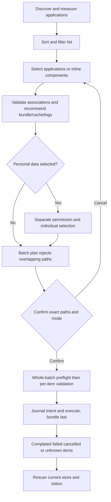

## Sequence

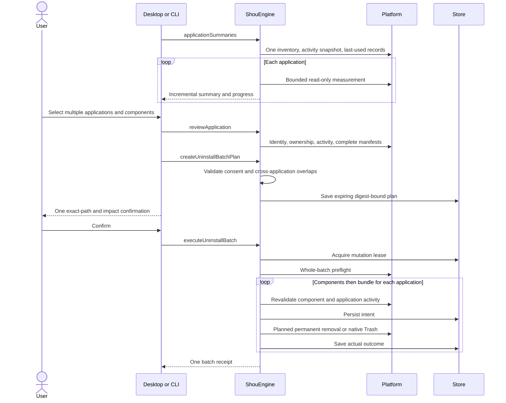

## Execution and recovery

Plans expire in 15 minutes and bind application identity, complete manifests, configuration, personal-data consent and mode. Whole-batch preflight failure prevents mutation. Failures or cancellation after starting can leave partial results: this is not a cross-application atomic transaction. Stop takes effect at safe item boundaries; completed items are not automatically rolled back and unknown outcomes are never blindly retried.

Protected cases include system/current applications, running owners and helpers, unknown activity, other-user owners, special files, multiple hard links, credentials, Shou records and exclusions. Bundle links are handled as links. Preference files have bounded content digests; directories retain complete metadata manifests. Restoration verifies every exact original parent without creating parents or overwriting files. Permanent outcomes cannot be restored.

On macOS, eligible application bundles containing root-owned content may be moved to Trash alone through `NSWorkspace.recycle`, which uses Finder’s system interaction. The app never collects a password or runs a privileged deletion command. This path retains the complete preflight, per-item journal and destination identity/content verification. Cancelling authentication leaves the application and its associated data in place. Other-user content and protected applications remain blocked. Associated data is not included in an administrator application’s plan; permanent removal is refused. Restoring a protected installation may still require Finder.

Activity checks combine running bundle identifiers with current-user executable paths. `kill(pid, 0)` also succeeds for zombies: an unreadable path is skipped only when the kernel confirms the process has exited or is `SZOMB`. Live or unknown processes remain blocked. An exit race receives at most one retry within the existing cancellation and three-second deadline.

When an executable was unlinked during a package update (`ENOENT`), a live process still participates in activity checks. The adapter reads only the executable prefix from the kernel's cached process record, verifies current-user ownership and unchanged process start identity, and discards the temporary argument/environment buffer. It neither logs nor returns arguments or environment values. A verified path outside the selected application no longer blocks unrelated uninstall; a path inside its bundle still blocks removal. Failed verification remains unavailable.

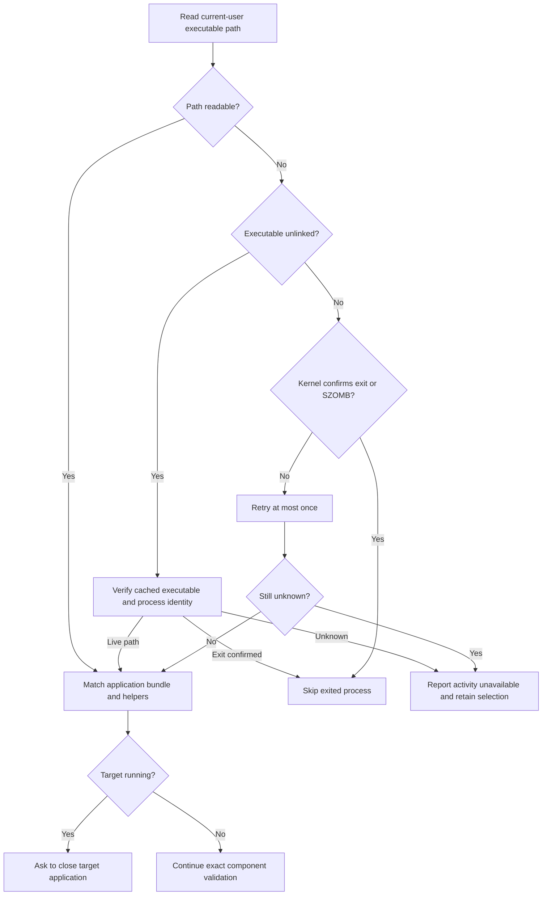

Failed activity inspection reports `application_activity_unavailable`; an active target reports `application_running`. Neither is mislabeled as changed files. A failed preflight creates no execution receipt and mutates no component. The desktop retains selection after unavailable activity and allows another review, followed by a fresh confirmation. Actual identity, configuration or content changes continue to invalidate old plans.

## CLI

```sh
shou applications summary --json
shou applications inspect --path "/Applications/Example.app" --json
shou applications plan --review-id <review-id> --component <app-id> --mode trash --json
shou applications batch plan --file selections.json --mode permanent --json
shou applications batch plan show --plan-id <plan-id> --json
shou applications batch uninstall --plan-id <plan-id> --json
shou history inspect --execution-id <execution-id> --json
```

The batch input is an explicit selection array with `review_id`, `component_ids` and optional `include_user_data` per application. Legacy single plans default to Trash; batches default to permanent. Machine clients must inspect the actual plan mode. Execution requires one current-scope controlling-terminal confirmation; external Agents may prepare and inspect plans. Trash restoration needs separate confirmation.

## Acknowledgments

MangoDisk informed application-list layout, inline components, filters, sorting and batch interactions. Shou retains an independent native implementation and its own execution, personal-data and history contracts. A visible reference page does not establish Shou feature parity or full acceptance.
