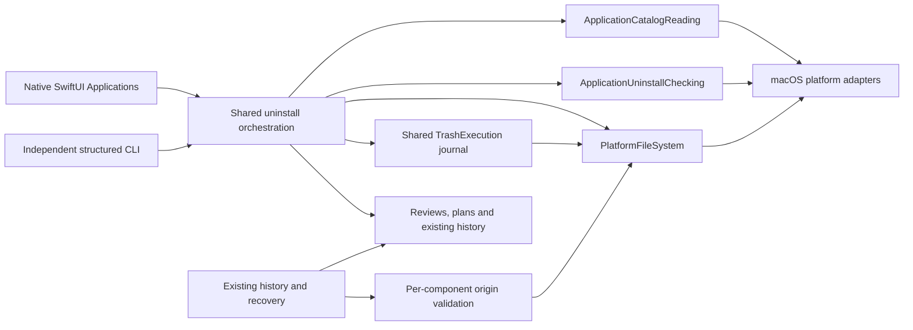
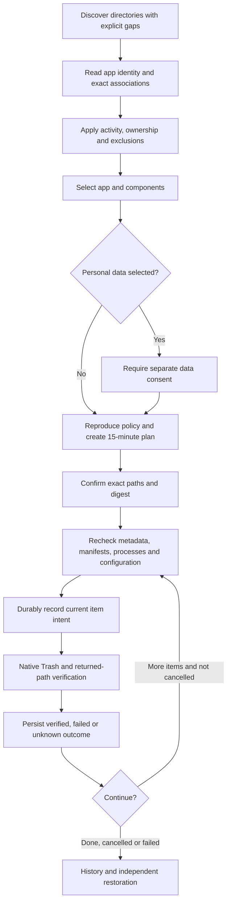

# Application uninstall and associated files

[简体中文](../zh-CN/product/application-uninstall.md)

Status: implemented and locally verified on macOS with generated fixtures; the tested build is installed locally. Precise runtime evidence and limits are recorded in [acceptance](../engineering/acceptance-and-testing.md). This capability is separate from rebuildable-cache rules and from the published release's feature set.

## Purpose and experience

Removing an application can leave caches, preferences and databases behind. Users need to inspect those components together without treating personal data as disposable cache. The desktop's Applications page and the independent CLI share one review, plan and execution implementation. Existing coding agents can prepare structured reviews and plans; Shou integrates no model and hosts no agent.

1. Discover application bundles and search by name, bundle identifier or exact path.
2. Review the application and exact identifier associations. The app is selected by its physical path and filesystem identity; two installations with the same identifier remain separate objects.
3. Select components. Personal data requires a separate enabling choice and individual selection. Coverage warnings also prevent automatic selection of associated components.
4. Preview exact paths and confirm the current plan. Components move to native Trash; the application bundle is processed last.
5. Inspect results and restore explicitly selected components from History without overwriting newer files.

This is a series of journaled item operations, not an atomic multi-directory transaction. Failure or cancellation can leave a partial result; only verified moved items are eligible for restoration. Moving to Trash does not immediately free disk space. Application-uninstall receipts currently support restoration only, without an in-app permanent-removal operation.

## Scope and evidence

| Component | Association | Personal-data consent |
| --- | --- | --- |
| Application bundle | Exact installation path, bundle metadata and device/inode | Application selection |
| Caches, logs | `~/Library/Caches/<id>`, `~/Library/Logs/<id>` | No additional data consent; review still required |
| Preferences | `~/Library/Preferences/<id>.plist` | Required |
| Application support | `~/Library/Application Support/<id>` | Required |
| Saved state | `~/Library/Saved Application State/<id>.savedState` | Required |
| App container | `~/Library/Containers/<id>` and matching `MCMMetadataIdentifier` | Required |
| Shared group container | `~/Library/Group Containers/<name>` with matching native container metadata (`<id>` or `group.<id>`) | Required |
| WebKit, HTTP storage | Exact identifier directory under the corresponding Library family | Required |

An identifier association does not prove exclusive ownership. A discovered duplicate identifier blocks associated components. Shared group containers enter the review only after their native metadata identifies the selected bundle identifier; an unverified or shared container remains protected. Incomplete discovery is a visible warning and requires individual choices. Package receipts, external helper registrations, custom data paths, other accounts and orphan-only discovery are outside this stage. Similar names, substrings and inferred vendor prefixes never authorize deletion. Apps with invalid metadata remain visible in discovery but cannot produce an uninstall review.

Discovery checks `~/Applications` and `/Applications`, plus up to two container-folder levels. `/System/Applications` is opt-in and protected. Embedded helper apps are not traversed. Budgets default to 4,000 entries and ten seconds, with explicit partial coverage. Metadata reads accept XML or binary `Contents/Info.plist` up to 256 KiB and return only approved display fields. Arguments, credentials and arbitrary metadata are not exported.

## Architecture



Core owns associations, consent, exclusion policy, plan validation and receipt states. Platform adapters own bounded no-follow reads, current-account process inspection, container metadata and native filesystem mutations. UI and CLI provide explicit choices and confirmation. `TrashExecution` is shared with ordinary cleanup; no second deletion loop or shell-command rules are introduced.

Normal workspace registration retains its protected-root restrictions. Application restoration uses a separate restricted parent-identity capability for the supported installation directories. Associated data retains its own user-owned parent identity. Receipt paths must reproduce the exact component-kind association before inspection or recovery.

## Plan and execution flow



Plans bind exact component manifests, application metadata, configuration digest, personal-data consent and expiry. Stored records are reproduced against current policy before execution. Activity, app identity, relevant duplicate identifiers, parent identity and target manifests are checked again at each item boundary. Current-account process evidence includes GUI bundle identifiers and executable paths inside the bundle; it does not prove that another account or every external helper has stopped. No process is terminated.

```mermaid
sequenceDiagram
    actor User
    participant Entry as Desktop or CLI
    participant Core as ShouEngine
    participant Store as Record store
    participant Mac as Native platform
    User->>Entry: Choose application and components
    Entry->>Core: Review and create plan with explicit data consent
    Core->>Mac: Re-read metadata, activity and complete targets
    Core->>Store: Save digest-bound expiring plan
    Core-->>Entry: Exact paths, risks and coverage
    User->>Entry: Confirm current scope
    Entry->>Core: Execute plan and confirmed digest
    Core->>Store: Acquire mutation lease and save execution identity
    loop Each selected component; bundle last
        Core->>Mac: Revalidate current item and application activity
        Core->>Store: Persist moving intent
        Core->>Mac: Native Trash
        Mac-->>Core: Exact returned path and verified manifest
        Core->>Store: Persist item outcome
    end
    Core-->>Entry: Completed or partial receipt
    User->>Entry: Select receipt items and confirm restore
    Entry->>Core: Restore with independent confirmation
    Core->>Mac: Verify exact Trash object and original parent identity
    Core->>Store: Persist follow-up intent
    Core->>Mac: Atomic no-overwrite restoration
    Core->>Store: Persist follow-up outcome
```

## Safety and limits

- System/Apple applications, the executing application, active applications/helpers, unknown activity, other-owned entries, special files, multiple-linked regular files, protected Shou storage and matching exclusions remain blocked.
- Parent traversal and target roots reject symbolic links. Internal bundle links are recorded without dereferencing them. Local filesystem boundaries and complete manifests remain required.
- A standalone preference file requires a bounded content digest, at most 16 MiB. Only its root ctime may differ after a verified Trash/restore operation; content, identity, mtime, permissions and link count must still match. Legacy directory manifests retain their original encoding.
- Directory evidence remains a complete metadata manifest; this is not a promise to hash every byte of an installed application.
- Cancellation stops before the next item. An operation with a durable moving intent completes its native verification and records its outcome; unavailable outcomes remain unknown and are never replayed automatically.
- Restore validates each component's exact original parent, uses no-overwrite rename and does not recreate missing parents. History inspection reads exact recorded locations without enumerating Trash or repairing receipts.
- No administrator prompt, privileged helper, launchctl mutation, permission change, model integration or Windows support is introduced.

## CLI workflow

```sh
shou applications list --json
shou applications inspect --path "/Applications/Example.app" --json
shou applications plan --review-id <review-id> --component <app-id> --component <cache-id> --json
shou applications plan show --plan-id <plan-id> --json
shou applications uninstall --plan-id <plan-id> --json
shou history inspect --execution-id <execution-id> --json
shou history restore --execution-id <execution-id> --item <item-id> --json
```

`--include-user-data true` permits explicitly selected personal-data components during plan creation; it never selects them automatically. Execution requires a controlling terminal and the exact `UNINSTALL <plan-id>` phrase. A pipe or `--yes` cannot bypass confirmation. Restoration independently requires `RESTORE <execution-id>`. Read and plan operations remain usable by existing coding agents.

Verification covers isolated generated bundles and data only. See [acceptance](../engineering/acceptance-and-testing.md) for precise automated, CLI, desktop and installation evidence. Third-party product references are listed in [acknowledgements](../../README.md#acknowledgements).
