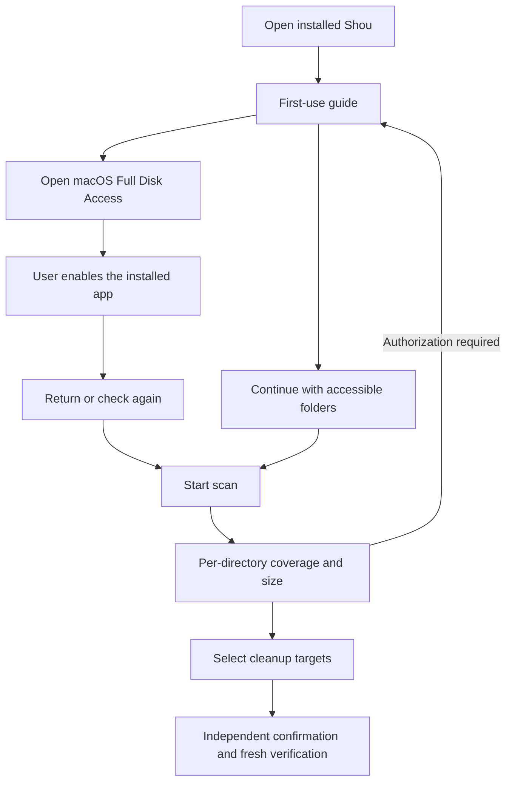
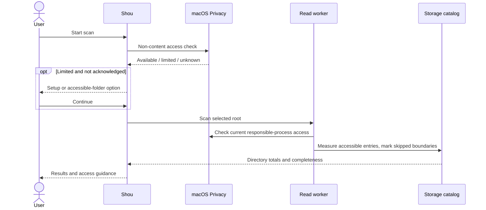

# Installation and disk access

English | [简体中文](../zh-CN/product/installation-and-access.md)

Install Shou in **Applications** before granting disk access. Open the installed copy and follow **Settings → Installation and CLI → Setup Guide**. The guide appears on first launch and remains available from Settings and scan coverage notices.

## First use

1. Drag `Shou.app` from the disk image into Applications and open that copy.
2. Choose **Open System Settings** in the guide. In **Privacy & Security → Full Disk Access**, enable Shou. If absent, use **+** to select `/Applications/Shou.app`. macOS may ask you to quit and reopen it.
3. Return to Shou or choose **Check Again**. A successful protected-directory check means scanning can attempt protected areas; individual failures still appear in the result. Authorization never starts cleanup.
4. Optionally install the CLI command. This creates `~/.local/bin/shou`, preserves conflicting commands and symbolic links, and leaves shell configuration unchanged. If the directory is not on PATH, use the full path displayed in the guide.

The guide has a **Use Accessible Folders** action. This choice is remembered, so subsequent scans start without repeating the same guide. A coverage notice keeps setup available. Known protected app containers remain visible as unmeasured boundaries; accessible project and cache folders are still scanned. After enabling access, start a new scan to include those areas.

The desktop app and the terminal hosting the CLI have separate macOS privacy identities. Granting access to Shou does not prove a terminal or an external AI agent has equivalent access. CLI errors and partial coverage remain machine readable; an agent must not edit TCC or silently change system privacy permissions.

## Permission evidence and boundaries

macOS exposes no supported API returning a universal Full Disk Access authorization state. Shou opens the system-protected `/Library/Application Support/com.apple.TCC/TCC.db` sentinel read-only and immediately closes it, without reading its contents. This is operational evidence, not a query of that database. Missing or unexpected failures stay unknown. It does not probe another app's container merely to populate Settings.

When this check is limited or unknown, the native scanner avoids descending into known app container, mail, message, browser and similar protected boundaries. It reports `authorization_required`, preserves accessible siblings, and never publishes the skipped subtree as complete zero bytes. The policy runs in the read worker as well as the direct scanner. It is not an exhaustive model of every present or future macOS privacy boundary: other unreadable paths remain explicit coverage issues, and macOS may still request folder-specific consent.

## Updates and signatures

Privacy permissions depend on code identity. Rebuilding an ad-hoc signed app changes its code requirement and can invalidate previous approvals. A stable bundle ID and path alone do not fix this. Developer ID builds use an explicitly selected signing identity and stable CLI identifier; later updates must keep the same trusted signing identity. Signing is separate from Apple notarization and does not grant access.

If the macOS switch is enabled but the installed development build cannot access protected areas, remove its old Full Disk Access entry, add the current installed app, and reopen it. Shou never changes TCC, resets privacy approvals, or weakens signature requirements automatically.

See [local installation and signing](../engineering/development.md) and [release requirements](../engineering/releasing.md).
