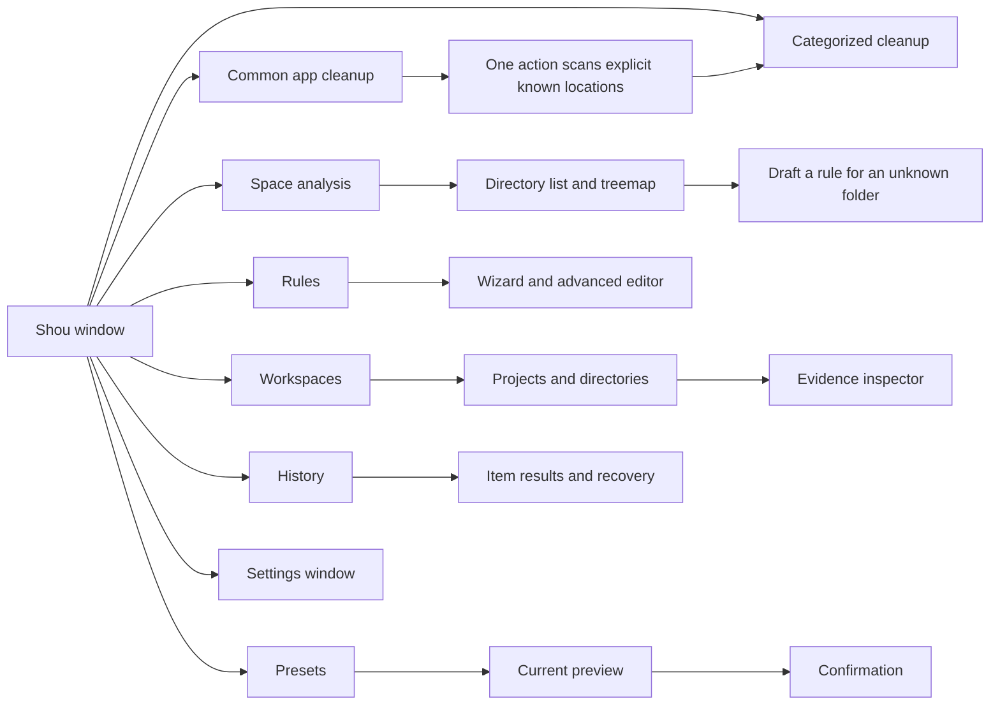
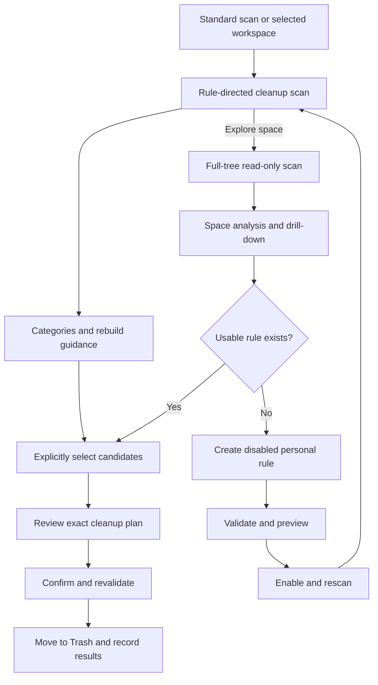

# Native macOS experience

English | [简体中文](../zh-CN/product/macos-experience.md)

Status: the development build implements categorized cleanup and space exploration. This document also retains requirements for subsequent interaction acceptance. Native Swift, primarily SwiftUI with AppKit where required.

## 1. Design goals

Use system windows, semantic colors, materials, typography, SF Symbols, and standard controls. Prioritize inspectable paths, appropriate information density, keyboard access, and concrete action labels. Avoid custom window buttons and layouts that obscure desktop conventions. Color alone must not communicate risk.

## 2. Information architecture

Add uninstall/startup navigation only when implemented; do not present unavailable primary actions as functional.

## 3. Window layout

Use a standard title bar and toolbar, `NavigationSplitView`, a sortable `Table` or verified AppKit table, and an optional inspector. Suggested initial size is approximately 1100 × 760 pt; determine the minimum through usability tests.

| Region | Content |
| --- | --- |
| Toolbar | Add workspace, scan/stop, filter, inspector |
| Sidebar | Overview, workspaces, rules, presets, history |
| Table | Name, estimate, type, project, status, newest modification |
| Inspector | Full path, evidence, rule/version, risk, rebuild prerequisites, exclusions |
| Capacity panel | Selected count, estimated size, action, explicit next step |

## 4. Screens and behavior

### Overview and workspace analysis

Show volume availability, last scan, scope, and largest projects/directories. Distinguish eligible, unclassified, excluded, protected, and inaccessible items. An unreadable directory is not `0 B`.

Provide expansion, breadcrumbs, sorting, Finder reveal, path copying, exclusion, and rule creation. Optional treemaps share data and location with the table; clicks do not silently toggle cleanup selection. Keep an accessible list alternative.

### Rule wizard

Scope → purpose and rebuild prerequisites → retention/exclusions → preview → save. Bind existing workspaces rather than request unrestricted paths. Advanced JSON uses the same validation; preserve unsupported editor constructs rather than silently rewriting them.

### Cleanup preview

No default select-all. Display exact paths and sources; merge repeated matches and resolve parent/child conflicts. Use “Move to Trash · N items” and an original native sheet for final review. Changes to selection, rules, exclusions, or action invalidate the previous digest and confirmation.

### History

Separate success, skip, failure, cancellation, and unknown states. Use “Moved to Trash,” not “Space freed.” Permanent removal of this batch is a separate destructive action and confirmation. Enable restoration only after verifying the recorded object.

## 5. Native interactions

Use system file panels and native Settings (`⌘,`). Respect window closing and `⌘W`; quitting or closing during operations must explain progress and stop safely rather than hide ongoing deletion. Provide visible cancellable scans, meaningful focus order, native context menus, and inspectable paths.

Avoid single-key destructive shortcuts. Recovery is a specific operation, not a promise of transactional Undo. Do not read sensitive file contents by default for previews.

## 6. States and wording

| State | Example | Next action |
| --- | --- | --- |
| First use | Scan common app caches or choose a project folder | Scan common apps |
| Scanning | Scanning; 12,400 entries checked | Stop |
| Partial | Some directories could not be read | Inspect errors or reauthorize |
| No match | No items match these conditions | Adjust conditions or inspect large directories |
| Unclassified | Directory purpose is not established | Inspect, exclude, or draft rule |
| Stale plan | Files or rules changed; preview again | Rescan |
| Trashed | Moved to Trash; not permanently removed | Restore or separately remove batch |
| Purged | Permanently removed; cannot be restored | Inspect receipt |

## 7. Accessibility and localization

Provide localized labels for icon buttons, VoiceOver descriptions for selection/progress/errors, keyboard completion of core tasks, and text/icon alternatives to color and charts.

Use String Catalogs, full sentences, placeholders, plural rules, locale-aware formatting, and layout expansion. Preserve exact paths and IDs; support Unicode and long filenames. Bytes are internal integers; UI uses explicitly defined decimal units. See [internationalization](internationalization.md).

## 8. Validation

Use an interactive SwiftUI prototype for split navigation, large-table virtualization, focus, permission failure, partial scans, confirmation, and restoration conflicts. Collect actual interaction and accessibility evidence. Static appearance alone does not establish behavior.

## 9. Implemented first-use workflow

The default desktop scan combines explicit application/developer-cache locations and already registered project workspaces. It uses cleanup scope without a directory picker or implicit home-wide project search. Users can also choose a project workspace or a specific known location; a custom rule is not a prerequisite. Location-specific rules require the actual expected user directory, not a matching workspace name.

**Cleanup** groups non-overlapping matched directories into build outputs, installed dependencies, project caches, package-manager caches, and personal rules. It shows size, file count, purpose, and risk. Nothing is selected initially. Category and item checkboxes change the selection explicitly; cleanup still requires plan review and confirmation. Built-in rules can be disabled individually; changing a binding invalidates prior evidence and plans.

**Space Analysis** requires full-scope scan facts for its sorted directory list, treemap, breadcrumbs and drill-down. A cleanup snapshot contains sparse rule-directed evidence; show this limitation and a full-scan action instead of presenting it as total usage. Chart clicks navigate or focus without selecting cleanup targets. Above 60 direct children, remaining chart area is grouped while every entry remains in the list. An unknown folder can prefill the personal-rule wizard with its exact relative path; saving creates a disabled draft.

The tree reports allocated-space estimates, charging hard links to one lexical path and avoiding parent/child summation. Snapshots, clones, compression, and Trash affect actual available space. Partial scans remain inspectable; only independently complete, policy-valid targets can enter a cleanup plan. Missing legacy coverage does not make incomplete targets eligible. Cleanup completion is not full-tree measurement.

## Cleanup layout specification

Use a compact page heading followed by one capacity panel. Place the estimated reviewable size and selected count on the left, and the current-selection review action on the right. A dot matrix communicates measured space distribution; its legend remains readable text. The panel describes the selected workspace, while volume availability is labeled separately.

Below it, use AppKit `NSOutlineView` with aligned Name, Size, Files and Modified columns, native disclosure triangles, checkbox mixed states, sortable headers, and alternating row backgrounds. Categories are compact rows with inline rebuild guidance. Expanding a category reveals concrete relative paths. Selecting a row focuses details; checking a box changes the cleanup scope. Keep the inspector closed initially and avoid a second selection footer competing with the primary action.

Pin the heading and capacity panel to the top of the detail area; the results region fills the remaining height and the status strip stays at the window bottom. During scanning, use a restrained diagonal sweep through the dot matrix at up to 24 fps. Keep redraws inside the decorative Canvas. Show discovery, rule matching, and saving as real stages, with the current count and path. Show an unknown size as a dash until measured; do not animate fabricated capacity or completion percentages. Use one toolbar Stop action rather than repeated spinners and buttons.

Crossfade activity into results in 250 ms. Use 200–350 ms numeric transitions for measured capacity and selection changes. Honor macOS Reduce Motion by keeping the dot matrix static and disabling numeric and layout transitions; text continues to report actual progress. No repeating animation remains when scanning ends.

The desktop uses a bounded 500,000-entry / 180-second scan; the CLI defaults to 100,000 entries / 60 seconds and can explicitly raise bounded limits. Carry the selected scope and budget into plan revalidation. Incomplete coverage remains visible; independent complete targets retain eligibility while incomplete targets are blocked.

During execution, a compact native status region shows the actual stage, current path and processed/total items. A stop request changes the visible state and disables repeated requests. Stop at a safe item boundary: a single system Trash call may finish before stopping and its result must be recorded. The completion view separates location-level issues from failed item receipts, and distinguishes moved, skipped and unverified items. This specifies the interaction contract; the updated GUI journey still requires actual acceptance.

### Native navigation and catalog coverage

Main navigation contains common-app cleanup, project cleanup, space analysis, rules and history. Only user-added projects appear as workspaces; fixed software locations belong to the catalog. Saved rule selections live in a secondary Rules menu. The catalog currently defines 74 templates and 35 fixed locations, with declarative matching and application-activity requirements. Common-app results use category → rule → exact path, native lists, disclosure groups, mixed checkboxes and menus. Narrow windows use a category picker. A transient confirmation scope lists every child plan and digest; Core independently revalidates each root and the result preserves failures alongside receipts. The application loads its bundled icns directly.
