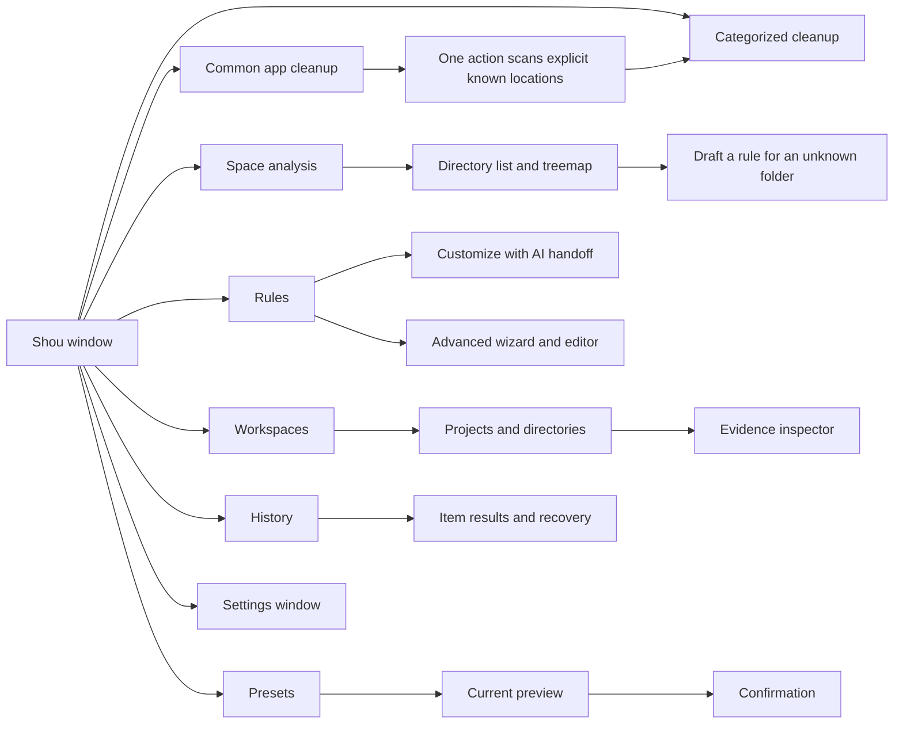
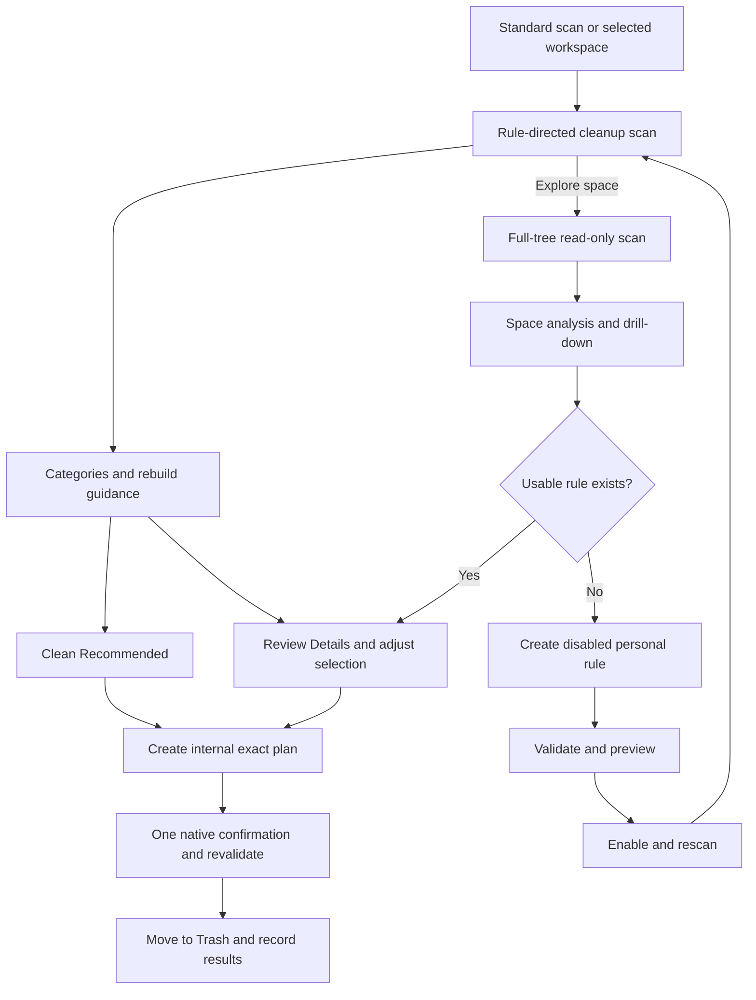

# Native macOS experience

English | [简体中文](../zh-CN/product/macos-experience.md)

Current desktop navigation and automatic discovery follow [Unified daily cleanup](../product/unified-cleanup.md).

Status: the development build implements categorized cleanup and space exploration. This document also retains requirements for subsequent interaction acceptance. Native Swift, primarily SwiftUI with AppKit where required.

Desktop cleanup defaults to **Clean & Free Space**, a permanent action with one exact-path confirmation and an irreversible warning. Space Analysis labels its primary action **Delete Permanently**. Move to Trash is an explicit menu alternative. Results distinguish the removed-byte estimate from observed volume availability; snapshots and open files may delay reclaim. CLI defaults remain compatible; use `--mode permanent` for direct removal.

## 1. Design goals

Use system windows, semantic colors, materials, typography, SF Symbols, and standard controls. Prioritize inspectable paths, appropriate information density, keyboard access, and concrete action labels. Avoid custom window buttons and layouts that obscure desktop conventions. Color alone must not communicate risk.

## 2. Information architecture

Startup Items now opens the [definition-discovery workflow](startup-items.md), with search, exact-path details, coverage and native Login Items settings guidance. Uninstall navigation remains unavailable until implemented.

## 3. Window layout

Use a standard title bar and toolbar, `NavigationSplitView`, a sortable `Table` or verified AppKit table, and an optional inspector. Suggested initial size is approximately 1100 × 760 pt; determine the minimum through usability tests.

| Region | Content |
| --- | --- |
| Toolbar | Add workspace, scan/stop, filter, inspector |
| Sidebar | Overview, workspaces, rules, presets, history |
| Table | Name, estimate, type, project, status, newest modification |
| Inspector | Full path, evidence, rule/version, risk, rebuild prerequisites, exclusions |
| Capacity panel | Selected count, estimated size, action, explicit next step |

## 4. Screens and behavior

### Overview and workspace analysis

Show volume availability, last scan, scope, and largest projects/directories. Distinguish eligible, unclassified, excluded, protected, and inaccessible items. An unreadable directory is not `0 B`.

Provide expansion, breadcrumbs, sorting, Finder reveal, path copying, exclusion, and rule creation. Optional treemaps share data and location with the table; clicks do not silently toggle cleanup selection. Keep an accessible list alternative.

### Agent-authored rules and advanced wizard

The primary Rules action is **Customize with AI**. A native sheet explains the external-agent workflow, provides a copyable request with the shipped Skill and exact CLI/workspace paths, and reveals the Skill in Finder. It does not launch a client or connect to a model. Users answer purpose, rebuild and preservation questions in their existing agent; imported drafts appear in Shou for preview and enablement. Manual creation and import remain in the Advanced menu.

Scope → purpose and rebuild prerequisites → retention/exclusions → preview → save. Bind existing workspaces rather than request unrestricted paths. Advanced JSON uses the same validation; preserve unsupported editor constructs rather than silently rewriting them.

Personal rules now offer Edit Rule for the complete JSON definition, retaining multiple patterns, exclusions, platforms and conditions. The editor suggests an unused patch version, requires the original rule ID, reports validation issues and requires validation again after text changes. Saving adds a disabled version; existing workspace bindings retain their version. Preview the new draft, explicitly enable it and rescan. Importing, saving or toggling rules clears desktop scan evidence and selections. Core checks version uniqueness again under its mutation lock to reject concurrent CLI imports. A source picker switches between all, built-in and personal rules.

### Exclusions and protection

Open Exclusions from Rules or Settings → Scanning and Privacy → Manage. The native sheet provides All Workspaces, Workspace and Project scopes, validates relative patterns, previews the stored pattern and supports individual removal. Global patterns are inherited by current and future workspaces; their inherited list directs editing to All Workspaces. Rule-specific exclusions remain in each rule definition.

Project scope takes an exact relative directory; leaving its pattern empty protects the whole project, for example `demo/**`. Absolute paths, parent traversal and wildcard project directories are rejected. Excluding a descendant protects the entire containing cleanup target. A successful change clears old scan results, selections and confirmation state and requests a new scan. Removing protection updates configuration without changing files. The global scope explains that saving global protection upgrades local configuration and earlier builds cannot read it.

### Cleanup preview

The Smart Cleanup screen is a two-step experience: scan once, then use **Clean Recommended**. Verified built-in matches are preselected and grouped by app, browser, developer tool, and project output; enabled personal rules participate automatically. Users can expand **Review Details**, change the selection, and use **Clean Selected** when they need finer control. The immutable plan is created and revalidated inside the action; it is an implementation boundary, not a screen the user must navigate.

Display exact paths and sources; merge repeated matches and resolve parent/child conflicts. Use “Move to Trash · N items” in the native confirmation sheet. Changes to selection, rules, exclusions, or action invalidate the previous digest and confirmation. CLI and agent callers keep the explicit scan → plan → execute contract because structured automation needs stable checkpoints.

The reviewed action menu also offers **Permanently Remove · N items** for a concrete, fully evidenced batch. Its confirmation states that the action cannot be undone and names the exact paths. The desktop creates `action=permanent` internally and routes it to `PermanentExecution`; custom or ambiguous items remain behind **Review Details**.

### History

Separate success, skip, failure, cancellation, and unknown states. Use “Moved to Trash,” not “Space freed.” Permanent removal is a separate destructive action and confirmation, whether selected directly from the reviewed plan or later from verified Trash history. Enable restoration only after verifying the recorded object.

Each history batch offers Verify Locations. Its cancellable native sheet compares the exact recorded original and Trash manifests, displays occupied restore destinations, changed/missing objects and unfinished follow-ups, and allows another read-only check. It retains original receipts and does not retry actions. Unknown or pending follow-ups remain unavailable for restore/removal. Failed follow-up messages appear beside the affected history item; resolving a known restore conflict still requires a separate reviewed retry.

An executing record displays Unfinished cleanup. Its pending/moving items need verification; only pending items in a cancelled batch display as skipped. Diagnostic lines are localized individually. Selections and follow-up states stay isolated by batch even when item IDs are shared.

Each batch has a native three-state checkbox for its currently available items, a selected count and Clear Selection above its item list. Completed or pending follow-ups cannot be selected. Selecting a batch only changes selection; Restore and Permanently Remove still open an exact-path preview and require separate confirmation. Selection is disabled while preparing that preview or executing an operation, and completed items leave the selection when history refreshes.

## 5. Native interactions

Use system file panels and native Settings (`⌘,`). Respect window closing and `⌘W`; quitting or closing during operations must explain progress and stop safely rather than hide ongoing deletion. Provide visible cancellable scans, meaningful focus order, native context menus, and inspectable paths.

During confirmed cleanup, restoration or permanent removal, `⌘W` and `⌘Q` show a localized native alert with **Keep Open** as the default. **Stop and Close** or **Stop and Quit** requests cancellation and waits for the execution task and its receipts. Errors or uncertain outcomes keep the application open for review. Successful closing dismisses the completion sheet and closes the window; closing a window leaves the app running, while quitting terminates it. Completed work is not automatically restored. An idle window closes normally.

Avoid single-key destructive shortcuts. Recovery is a specific operation, not a promise of transactional Undo. Do not read sensitive file contents by default for previews.

Render the window before opening local data in the background. During initialization, show Opening local data and disable business actions while keeping sidebar navigation and normal quit available. A blocked filesystem call must not block the main thread or expose unloaded data as executable results.

## 6. States and wording

| State | Example | Next action |
| --- | --- | --- |
| First use | Scan common app caches or choose a project folder | Scan common apps |
| Scanning | Scanning; 12,400 entries checked | Stop |
| Partial | Some directories could not be read | Inspect errors or reauthorize |
| No match | No items match these conditions | Adjust conditions or inspect large directories |
| Unclassified | Directory purpose is not established | Inspect, exclude, or draft rule |
| Stale plan | Files or rules changed; preview again | Rescan |
| Trashed | Moved to Trash; not permanently removed | Restore or separately remove batch |
| Purged | Permanently removed; cannot be restored | Inspect receipt |

## 7. Accessibility and localization

Provide localized labels for icon buttons, VoiceOver descriptions for selection/progress/errors, keyboard completion of core tasks, and text/icon alternatives to color and charts.

Settings includes a persistent Reduce Motion switch. Off follows macOS; on also requests reduced motion within Shou. The effective setting is the logical OR of the app and system preferences, including sheets. Static hourglass labels replace indeterminate activity indicators, while actual counts and paths continue updating. The scan stage has a localized accessibility name and value. Announcements cover scan start/end, execution start/stop requests and completion; per-file updates do not generate announcements. VoiceOver speech still requires separate runtime acceptance.

The native cleanup outline uses arrows for browsing and expanding groups, Space to toggle the focused item or group, and Shift-F10 for the focused path's context menu. Keyboard and pointer selection share eligibility checks; protected items remain unchecked. Group changes publish one selection update and preserve selections in other categories. Sorting and language changes retain expansion, the focused candidate identity and checked items. The outline and checkboxes expose localized names, full paths and protection/rebuild explanations; high-risk items include an explicit risk description.

Use String Catalogs, full sentences, placeholders, plural rules, locale-aware formatting, and layout expansion. Preserve exact paths and IDs; support Unicode and long filenames. Bytes are internal integers; UI uses explicitly defined decimal units. See [internationalization](internationalization.md).

## 8. Validation

Use an interactive SwiftUI prototype for split navigation, large-table virtualization, focus, permission failure, partial scans, confirmation, and restoration conflicts. Collect actual interaction and accessibility evidence. Static appearance alone does not establish behavior.

## 9. Implemented first-use workflow

The default desktop scan combines explicit application/developer-cache locations and automatically discovered and remembered project folders. It uses cleanup scope without a directory picker or implicit home-wide project search. Extra folders can be included once and remembered; neither workspace setup nor a custom rule is a prerequisite. Location-specific rules require the actual expected user directory, not a matching workspace name.

**Cleanup** groups non-overlapping matched directories into build outputs, installed dependencies, project caches, package-manager caches, and personal rules. It shows size, file count, purpose, and risk. Verified built-in matches are selected automatically for the quick-clean action; personal rules and blocked/high-risk items remain visible for deliberate review. The primary action is **Clean Recommended**; category and item checkboxes remain available through **Review Details**. Built-in rules can be disabled individually; changing a binding invalidates prior evidence and plans.

**Space Analysis** has its own volume/folder entry and `StorageScan` evidence, independent of rule workspace registration. Its list and treemap share navigation and explicit file/directory checkboxes. Single click focuses; double click opens; neither implicitly selects targets. Above 160 direct children, remaining chart area is grouped while every entry remains in the list. Delete reviews selected paths once and supports Trash or permanent removal. Rule-based cleanup keeps its separate eligibility contract.

The tree reports allocated-space estimates, charging hard links to one lexical path and avoiding parent/child summation. Snapshots, clones, compression, and Trash affect actual available space. Partial scans remain inspectable; only independently complete, policy-valid targets can enter a cleanup plan. Missing legacy coverage does not make incomplete targets eligible. Cleanup completion is not full-tree measurement.

## Cleanup layout specification

Use a compact page heading followed by one capacity panel. Place the estimated reviewable size and selected count on the left, and the current-selection review action on the right. A dot matrix communicates measured space distribution; its legend remains readable text. The panel describes the selected workspace, while volume availability is labeled separately.

Below it, use AppKit `NSOutlineView` with aligned Name, Size, Files and Modified columns, native disclosure triangles, checkbox mixed states, sortable headers, and alternating row backgrounds. Categories are compact rows with inline rebuild guidance. Expanding a category reveals concrete relative paths. Selecting a row focuses details; checking a box changes the cleanup scope. Keep the inspector closed initially and avoid a second selection footer competing with the primary action.

Pin the heading and capacity panel to the top of the detail area; the results region fills the remaining height and the status strip stays at the window bottom. During scanning, use a shared central progress screen with decorative motion capped at 24 fps and independent measured counts. Show discovery, rule matching and saving as real stages, with cumulative counts and the current path. Known-total workflows, such as application scanning, also show a percentage. Show an unknown size as a dash until measured; do not animate fabricated capacity or completion percentages. Use one toolbar Stop action rather than repeated spinners and buttons.

Crossfade activity into results in 250 ms. Use 200–350 ms numeric transitions for measured capacity and selection changes. Honor macOS Reduce Motion by keeping the dot matrix static and disabling numeric and layout transitions; text continues to report actual progress. No repeating animation remains when scanning ends.

The desktop uses a bounded 500,000-entry / 180-second scan; the CLI defaults to 100,000 entries / 60 seconds and can explicitly raise bounded limits. Carry the selected scope and budget into plan revalidation. Incomplete coverage remains visible; independent complete targets retain eligibility while incomplete targets are blocked.

During execution, a central native progress screen shows the actual stage, a prominent percentage, current path and processed/total items. Multi-location cleanup preserves an operation-wide total and cumulative count. A stop request changes the visible state and disables repeated requests. A journaled Trash or restore item finishes verification and records its result before stopping. Permanent removal may stop between recorded descendants and leave a partial item requiring review. The completion view separates location-level issues from failed item receipts, and distinguishes moved, skipped and unverified items. Actual coverage is recorded in [acceptance](../engineering/acceptance-and-testing.md).

Restoration and permanent removal use the same progress region. The total is the explicitly selected follow-up set; the processed count advances only after an outcome is persisted, including a failed outcome. It is not a success count. Read-only checking and the actual restoring/removing stage retain their own labels. Stopping leaves unstarted items available for a newly reviewed operation.

### Native navigation and catalog coverage

Main navigation contains Smart Cleanup, Large Files, Space Analysis, Rules, Startup Items, Applications, Privacy and History. Project discovery and remembered locations participate in Smart Cleanup. Saved rule selections live in a secondary Rules menu. The catalog currently defines 210 templates, 660 path patterns and 65 fixed locations, with declarative matching and application-activity requirements. Common-app results use category → rule → exact path, native lists, disclosure groups, mixed checkboxes and menus. Narrow windows use a category picker. A transient confirmation scope lists every child plan and digest; Core independently revalidates each root and the result preserves failures alongside receipts. The application loads its bundled icns directly.

## Explicit space-analysis removal

Space analysis now supports local volume/folder discovery and direct explicit file/directory removal, independently of cleanup-rule workspaces. Desktop list and treemap share navigation and normalized selection. Current manifests and exclusions are checked before confirmation and execution. It reuses existing mutation journals and history. See [space analysis architecture, flow and sequence](../product/space-analysis.md).

Shared central progress screens, count semantics, motion and stopping states: [operation progress and feedback](operation-progress.md).
