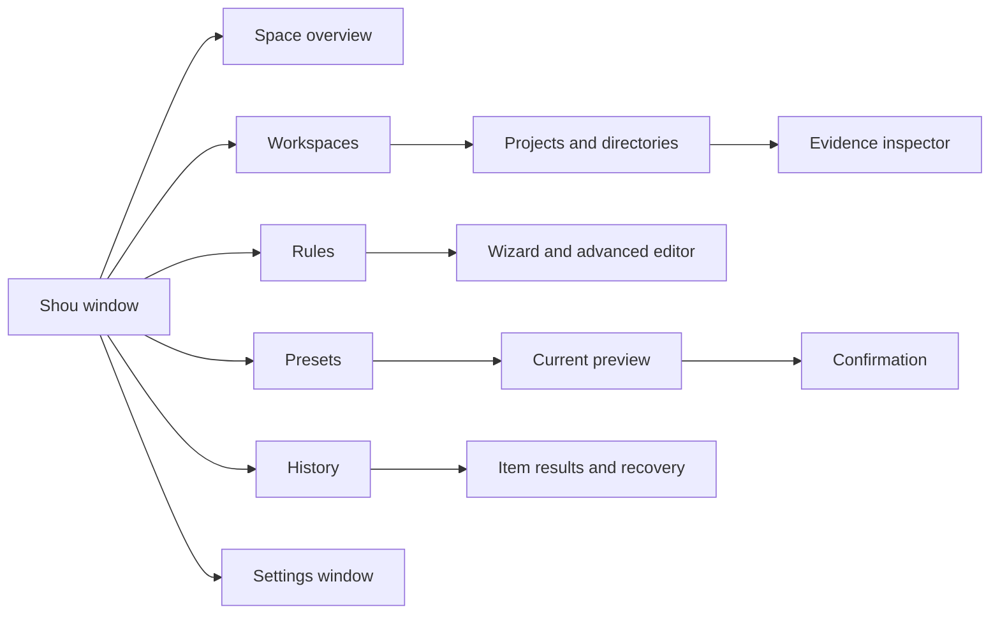

# Native macOS experience

English | [简体中文](../zh-CN/product/macos-experience.md)

Status: design draft. Native Swift, primarily SwiftUI with AppKit where required.

## 1. Design goals

Use system windows, semantic colors, materials, typography, SF Symbols, and standard controls. Prioritize inspectable paths, appropriate information density, keyboard access, and concrete action labels. Avoid custom window buttons and layouts that obscure desktop conventions. Color alone must not communicate risk.

## 2. Information architecture

Add uninstall/startup navigation only when implemented; do not present unavailable primary actions as functional.

## 3. Window layout

Use a standard title bar and toolbar, `NavigationSplitView`, a sortable `Table` or verified AppKit table, and an optional inspector. Suggested initial size is approximately 1100 × 760 pt; determine the minimum through usability tests.

| Region | Content |
| --- | --- |
| Toolbar | Add workspace, scan/stop, filter, inspector |
| Sidebar | Overview, workspaces, rules, presets, history |
| Table | Name, estimate, type, project, status, newest modification |
| Inspector | Full path, evidence, rule/version, risk, rebuild prerequisites, exclusions |
| Preview footer | Selected count, estimated size, action, explicit next step |

## 4. Screens and behavior

### Overview and workspace analysis

Show volume availability, last scan, scope, and largest projects/directories. Distinguish eligible, unclassified, excluded, protected, and inaccessible items. An unreadable directory is not `0 B`.

Provide expansion, breadcrumbs, sorting, Finder reveal, path copying, exclusion, and rule creation. Optional treemaps share data and location with the table; clicks do not silently toggle cleanup selection. Keep an accessible list alternative.

### Rule wizard

Scope → purpose and rebuild prerequisites → retention/exclusions → preview → save. Bind existing workspaces rather than request unrestricted paths. Advanced JSON uses the same validation; preserve unsupported editor constructs rather than silently rewriting them.

### Cleanup preview

No default select-all. Display exact paths and sources; merge repeated matches and resolve parent/child conflicts. Use “Move to Trash · N items” and an original native sheet for final review. Changes to selection, rules, exclusions, or action invalidate the previous digest and confirmation.

### History

Separate success, skip, failure, cancellation, and unknown states. Use “Moved to Trash,” not “Space freed.” Permanent removal of this batch is a separate destructive action and confirmation. Enable restoration only after verifying the recorded object.

## 5. Native interactions

Use system file panels and native Settings (`⌘,`). Respect window closing and `⌘W`; quitting or closing during operations must explain progress and stop safely rather than hide ongoing deletion. Provide visible cancellable scans, meaningful focus order, native context menus, and inspectable paths.

Avoid single-key destructive shortcuts. Recovery is a specific operation, not a promise of transactional Undo. Do not read sensitive file contents by default for previews.

## 6. States and wording

| State | Example | Next action |
| --- | --- | --- |
| First use | Select a workspace to inspect storage | Add workspace |
| Scanning | Scanning; 12,400 entries checked | Stop |
| Partial | Some directories could not be read | Inspect errors or reauthorize |
| No match | No items match these conditions | Adjust conditions or inspect large directories |
| Unclassified | Directory purpose is not established | Inspect, exclude, or draft rule |
| Stale plan | Files or rules changed; preview again | Rescan |
| Trashed | Moved to Trash; not permanently removed | Restore or separately remove batch |
| Purged | Permanently removed; cannot be restored | Inspect receipt |

## 7. Accessibility and localization

Provide localized labels for icon buttons, VoiceOver descriptions for selection/progress/errors, keyboard completion of core tasks, and text/icon alternatives to color and charts.

Use String Catalogs, full sentences, placeholders, plural rules, locale-aware formatting, and layout expansion. Preserve exact paths and IDs; support Unicode and long filenames. Bytes are internal integers; UI uses explicitly defined decimal units. See [internationalization](internationalization.md).

## 8. Validation

Use an interactive SwiftUI prototype for split navigation, large-table virtualization, focus, permission failure, partial scans, confirmation, and restoration conflicts. Collect actual interaction and accessibility evidence. Static appearance alone does not establish behavior.
