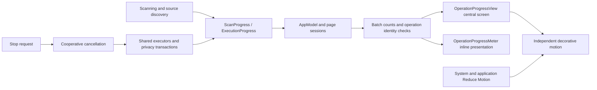
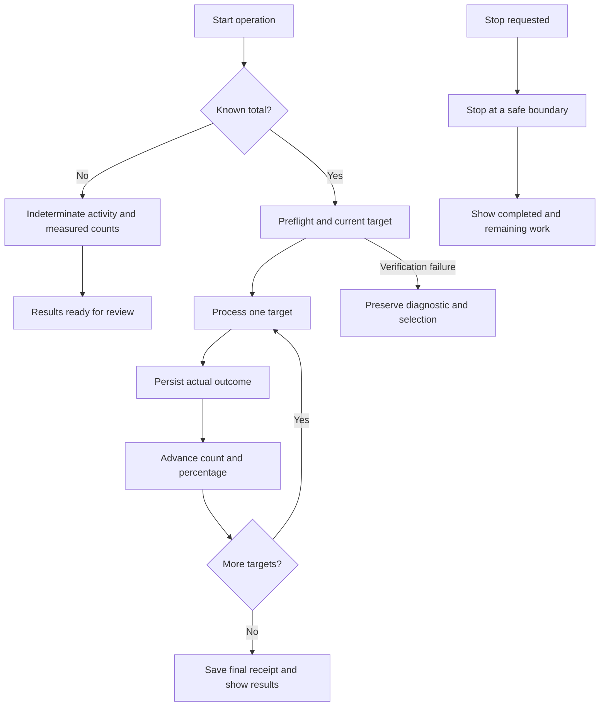
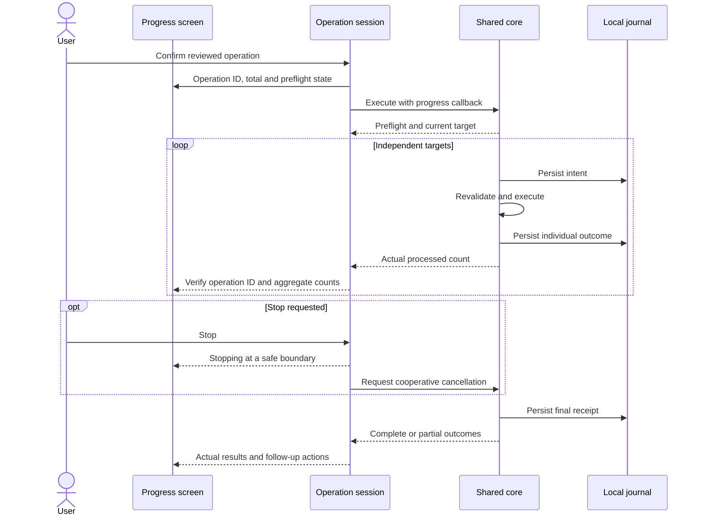

# Operation progress and feedback

English | [简体中文](../zh-CN/product/operation-progress.md)

Scanning, rule cleanup, application uninstall, storage analysis, large-file removal, history restore and privacy cleaning share progress components. Users can see the current action, measured counts and stopping state.

## Display contract

| Workflow | Count source | Presentation |
| --- | --- | --- |
| Smart scan | Sum of the highest observed entry count per location | Cumulative count, phase, current path, indeterminate progress |
| Storage and large-file scan | Entries measured by the read-only scanner | Count, path, elapsed time, indeterminate progress |
| Application scan and component review | Known application set and checked applications | Percentage, processed/total, current application; results stream into the list |
| Rule cleanup, uninstall, direct removal and restore | Reviewed independent targets and durable outcomes | Central progress screen, percentage, processed/total, path and Stop |
| Privacy scan and deletion | Discovered or reviewed database sources and transaction outcomes | Source counts and percentage; browser and profile names only |
| Startup discovery and plan preparation | Total not yet established | Current action, indeterminate progress and Stop |

Percentages describe processed targets in a known set, rather than elapsed time, successful cleanup or reclaimed disk space. A selected directory is one reviewed target. No file-level count is invented when its descendants have no individual progress events. Unknown scan totals remain indeterminate.

Preflight never advances deletion counts. Executors advance counts after persisting individual outcomes; failures and skipped targets are processed outcomes, while completion separately reports success, failure and remaining work. Final receipt handling displays “Finishing cleanup”. Partial results and cancellation never receive a fabricated 100%.

Multi-location cleanup keeps one denominator throughout the operation. Each subsequent plan starts from durable outcomes in the preceding plans, excluding unprocessed tails. Operation identifiers reject stale callbacks, and older counts cannot overwrite newer progress.

## Component architecture

Decorative motion does not drive measured progress. It pauses when stopping, when the window is inactive, or when either Reduce Motion preference is enabled. Native typography, controls, accent color and accessibility identifiers accompany monospaced, transitioning numeric values.

## State flow

## Execution sequence

Privacy counts advance after each independent database transaction, without displaying browsing content, Cookie values or sites. Committed sources retain their outcomes after cancellation; remaining sources are not cleaned. Animation does not change Core or CLI consent, authorization or execution semantics.

## Verification scope

`shou-tests --operation-progress-only` covers batch totals, partial-plan boundaries, integer limits, privacy source progress, committed transactions, cancellation and durable restore boundaries. The installed desktop also requires checks of scanning, execution, stopping, Reduce Motion and runtime language switching. Automated mutation tests use generated data only.

Related: [system architecture](../architecture/system-design.md), [unified cleanup](unified-cleanup.md), [acceptance and testing](../engineering/acceptance-and-testing.md). Third-party references belong in [acknowledgments](../../README.md#acknowledgements).
