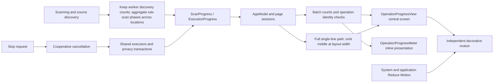
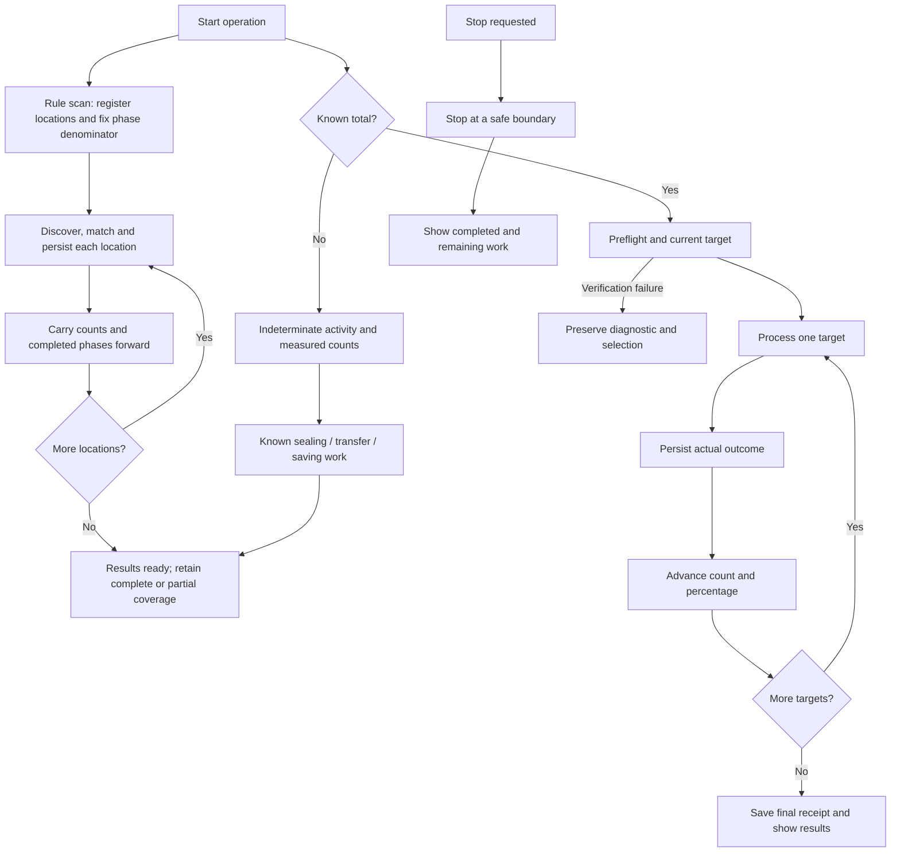
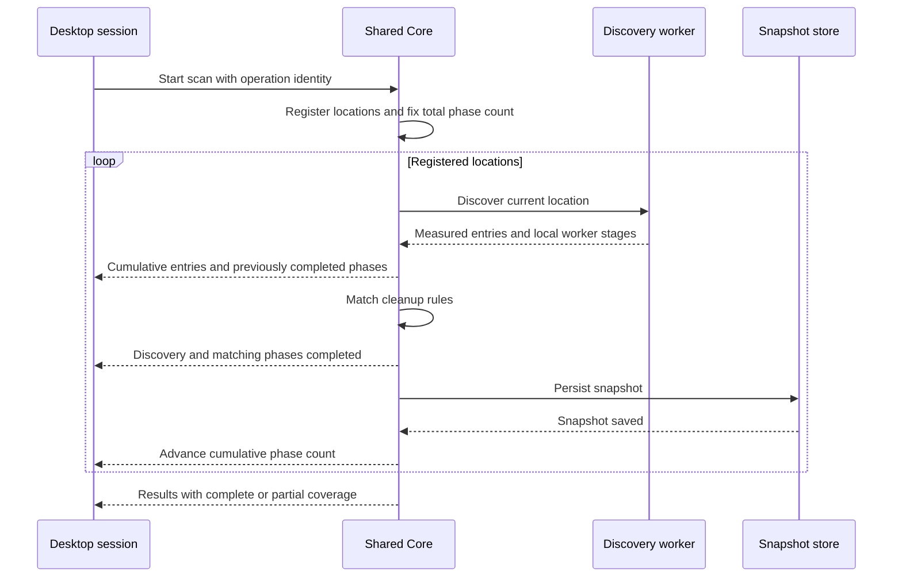
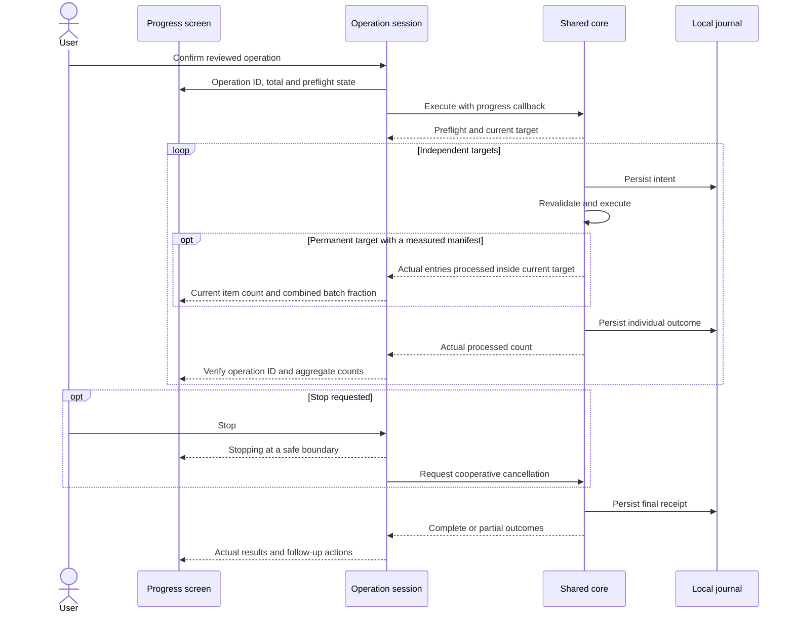

# Operation progress and feedback

English | [简体中文](../zh-CN/product/operation-progress.md)

Scanning, rule cleanup, application uninstall, storage analysis, large-file removal, history restore and privacy cleaning share progress components. Users can see the current action, measured counts and stopping state.

## Display contract

| Workflow | Count source | Presentation |
| --- | --- | --- |
| Smart scan | Core accumulates the highest measured count per location | One cumulative count; overall completed discovery/matching/persistence phases across registered locations; current location and phase as context |
| Single-workspace rule scan | Highest measured discovery count | Unknown discovery stays indeterminate; matching starts at 1/3, persistence at 2/3, and completion follows the saved snapshot |
| Storage and large-file scan | Measured entries; known work during sealing, transfer and saving | Count, middle-truncated path, elapsed time; percentage for a named stage with a known total |
| Application scan and component review | Known application set and checked applications | Percentage, processed/total, current application; results stream into the list |
| Rule cleanup, uninstall, direct removal and restore | Reviewed independent targets and durable outcomes | Central progress screen, percentage, processed/total, path and Stop |
| Privacy scan and deletion | Discovered or reviewed database sources and transaction outcomes | Source counts and percentage; browser and profile names only |
| Startup discovery and plan preparation | Total not yet established | Current action, indeterminate progress and Stop |

Percentages describe processed work in a known set, rather than elapsed time, successful cleanup or reclaimed disk space. A selected directory is one reviewed target. Permanent removal can report actual manifest entries inside the current target; this subprogress is combined with the batch position without marking the target durably complete before its receipt is saved. No file-level count is invented when its descendants have no progress events. Unknown discovery totals remain indeterminate. Sealing, transfer and saving may show their named stage's percentage, including 100% when saving a partial scan; coverage remains explicit and is not a percentage.

Rule scanning uses three completed processing phases per registered location: discovery, rule matching and snapshot persistence. Worker sealing and transfer belong to discovery; their local percentages do not overwrite the overall value. A smart batch fixes its denominator after registration, offsets each location's phase count, and carries discovered entries forward across locations, including a location that fails after reading entries. The failure stays in the result and is not counted as successful coverage. Cancellation does not complete unprocessed phases. The desktop rejects regressive callbacks within the current operation. Its footer and central count use the same cumulative evidence; numeric text changes immediately so frequent events cannot overlap rolling digits. The progress bar can still animate.

Progress paths retain their origin and filename and omit only the middle when space is insufficient. Keep a single ellipsis, use Unicode text boundaries and provide the full original value through hover/accessibility; CLI and bridge data keep complete paths.

Preflight never advances deletion counts. Executors advance counts after persisting individual outcomes; failures and skipped targets are processed outcomes, while completion separately reports success, failure and remaining work. Final receipt handling displays “Finishing cleanup”. Partial results and cancellation never receive a fabricated 100%.

Multi-location cleanup keeps one denominator throughout the operation. Each subsequent plan starts from durable outcomes in the preceding plans, excluding unprocessed tails. Operation identifiers reject stale callbacks, and older counts cannot overwrite newer progress.

## Component architecture

Decorative motion does not drive measured progress. It pauses when stopping, when the window is inactive, or when either Reduce Motion preference is enabled. Native typography, controls, accent color and accessibility identifiers accompany monospaced numbers that update directly, while the progress bar can animate. Short windows use a compact layout that retains percentage, counts, path and Stop. Smart scanning exposes one Stop action and labels its main count as cumulative discovery.

## State flow

## Rule-scan sequence

## Execution sequence

Privacy counts advance after each independent database transaction, without displaying browsing content, Cookie values or sites. Committed sources retain their outcomes after cancellation; remaining sources are not cleaned. Animation does not change Core or CLI consent, authorization or execution semantics.

## Completion page contract

The normal successful path is intentionally short: completion icon, measured bytes or processed count, one sentence describing the outcome, and `Done`. A successful operation does not force the user through History. When an operation is partial, cancelled, failed or still needs verification, the page adds four counters (processed, skipped, failed and needs verification), keeps item details collapsed, and exposes `Scan Again`, `View History` and `Close`.

`Scan Again` starts a new scan for the originating section and builds a new plan from current evidence. It never replays the old plan or assumes that a failed path still exists. `View History` opens the durable receipt with the per-item state and diagnostic. macOS and Windows use the same receipt states and follow-up semantics; only the native presentation controls differ.

## Verification scope

`shou-tests --operation-progress-only` covers batch totals, partial-plan boundaries, integer limits, privacy source progress, committed transactions, cancellation and durable restore boundaries. The installed desktop also requires checks of scanning, execution, stopping, Reduce Motion and runtime language switching. Automated mutation tests use generated data only.

`shou-tests --rule-scan-progress-only` covers worker-stage resets, cross-location cumulative counts and percentages, failed locations, cancellation before completion, registration ordering and existing partial-result behavior.

Related: [system architecture](../architecture/system-design.md), [unified cleanup](unified-cleanup.md), [acceptance and testing](../engineering/acceptance-and-testing.md). Third-party references belong in [acknowledgments](../../README.md#acknowledgements).
