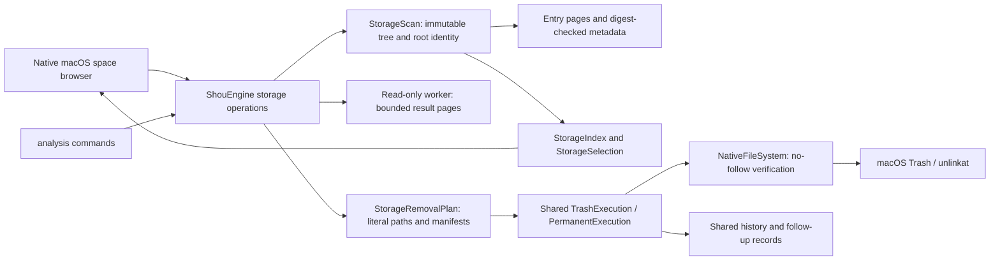
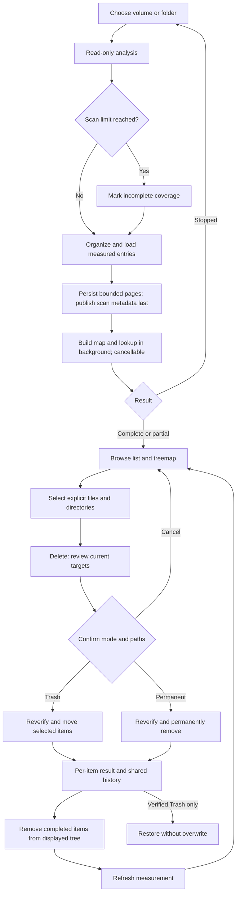

# Space analysis and explicit removal

Space analysis is a primary Shou workflow. It answers “what occupies this disk?” and lets the user remove selected files and directories directly. A cleanup rule is not required. Repeated cleanup remains the responsibility of fixed or Agent-authored rules.

## Product behavior

- Choose a mounted local volume, the home directory, or a folder. The startup disk analyzes its APFS data volume, avoiding duplicate firmlink accounting. This does not claim to measure the sealed system volume or other mounts.
- Start a read-only scan with current path, measured-entry count, elapsed time, and Stop. No invented percentage is displayed. Stopping discards the interrupted worker result and preserves any previous analysis. A budget or access gap returns an explicit partial result.
- Browse a size-sorted directory list and proportional treemap. Single click inspects, double click opens a directory. Back, Forward, Up, breadcrumbs, per-folder filtering, and size/name/file-count ordering support navigation. Space opens native Quick Look, ⌘A selects visible eligible entries, and Escape clears the selection while browsing. Text-field editing keeps its own shortcuts.
- Check individual files or directories in either view. Select All applies to selectable entries in the current filtered folder; Clear Selection applies to the whole selection. Selection persists across navigation. Directory context menus can open Customize with AI with the exact directory in the copied Agent request. Parent selections subsume descendants. Unchecking a covered child preserves its siblings.
- The primary action is Delete Permanently and opens one exact-scope irreversible confirmation. Move to Trash remains an explicit menu alternative; it does not free space. All listed paths and freshly measured size estimates are reviewed before mutation. Creating a removal plan is an internal implementation step, not a separate desktop task.
- Results report individual success, failure, cancellation and unknown outcomes. Completed items disappear from both views. Refresh obtains a new authoritative measurement; pruning completed items is not a fresh scan. History supports verified Trash restoration without overwrite and separately confirmed purge.

## Shared architecture



`StorageSession` owns desktop navigation, selection, progress and cancellation. It does not decide execution eligibility. `ShouEngine` stores snapshots, validates explicit targets and current exclusions, issues a 15-minute confirmation digest, and holds the existing cross-process mutation lease. The platform adapter owns local metadata, bounded traversal, streaming SHA-256 for selected large files, native Trash, no-overwrite restore, and manifest-based permanent removal. No model, Agent runtime, daemon or privileged helper is introduced.

## Flow



## Sequence

```mermaid
sequenceDiagram
  actor User
  participant Desktop
  participant Engine as ShouEngine
  participant Worker as Read-only scan worker
  participant FS as NativeFileSystem
  participant Store as LocalRecordStore
  User->>Desktop: Choose location; Start Scan
  Desktop->>Engine: scanStorage(path, budget, progress)
  Engine->>FS: analysisRootIdentity(path)
  Engine->>Worker: inspect(path)
  Worker-->>Desktop: Current path and entry count
  Worker-->>Desktop: Organizing / loading; exact count and limit state
  Worker-->>Engine: Bounded result pages; TreeSnapshot with coverage gaps
  Engine-->>Desktop: Saving measured analysis
  loop Each entry page of a large analysis
    Engine->>Store: Save bounded page and SHA-256 reference
  end
  Engine->>Store: Publish StorageScan metadata after all pages
  Engine-->>Desktop: Stored evidence
  Desktop->>Desktop: Build map and lookup off the main thread
  Desktop-->>User: List and treemap, or explicit partial coverage
  User->>Desktop: Select items; Delete
  Desktop->>Engine: createStorageRemovalPlan(scanId, paths, mode)
  Engine->>FS: Reinspect only explicit selected targets
  Engine->>Store: Save expiring removal plan
  Engine-->>Desktop: Exact paths, manifests, estimates, digest
  User->>Desktop: Confirm once
  Desktop->>Engine: executeStorageRemoval(planId, digest)
  Engine->>Store: Acquire lease; save execution intent
  loop Each selected item
    Engine->>FS: Recheck root, policy and complete manifest
    Engine->>Store: Save item intent
    Engine->>FS: Trash or permanent removal
    FS-->>Engine: Verified result or explicit failure
    Engine->>Store: Save item outcome
  end
  Engine-->>Desktop: ExecutionReceipt
  Desktop-->>User: Results and updated displayed tree
```

## Data and safety boundaries

`StorageScan` contains its ID, absolute read root, identity, timestamp and `TreeSnapshot`. It is independent of registered rule workspaces. `StorageRemovalPlan` contains the scan ID, root identity, exact disjoint paths, current target manifests, action, expiry, state and digest. It is stored in `storage-plans`; scans are stored in `storage-scans`. Removal receipts use shared history with operation `storage_removal` or `storage_permanent_removal`.

Read access to a disk never grants permission to remove its root. System locations, container roots, credentials, cloud-synchronized trees, Shou records, symbolic-link targets and special files remain protected. User ownership is required for each selected root. Current exclusions in registered workspaces apply to matching selected paths and their measured descendants. Changing a selected target after review prevents that target from being removed. Errors are recorded rather than described as success. Cancellation stops scanning workers or stops execution between journaled items.

Limits are explicit: analysis defaults to 1,000,000 entries, 600 seconds and 128 levels; a removal request accepts up to 5,000 explicit paths. Each target must be completely remeasured before confirmation. Local JSON records are limited to 256 MiB. Analyses above 10,000 entries use bounded entry pages with SHA-256 digests; the scan metadata is published only after every page is durable, and existing single-record scans remain readable. Oversized plans are rejected before persistence. Progress distinguishes measurement, result loading, saving, and map indexing; Stop also cancels indexing at bounded checkpoints. File verification streams content with bounded memory; very large files may take time or exceed the read deadline. Symlinks are measured as opaque entries and cannot be selected as standalone removal targets. Traversal stays on one filesystem and never hydrates cloud placeholders. Hard-link accounting is an estimate; APFS clones, snapshots and Trash mean attributed bytes are not guaranteed reclaimed bytes. Treemap entries beyond the first 160 are grouped as Other Entries; every measured entry remains in the directory list.

## CLI

```sh
shou analysis scan --path "/absolute/local/folder" --json
shou analysis summary --scan-id "storage_…" --json
shou analysis children --scan-id "storage_…" --path "." --limit 50 --json
shou analysis plan --scan-id "storage_…" --path "build" --path "large.bin" --mode permanent --json
shou analysis plan show --plan-id "storage-plan_…" --json
shou analysis remove --plan-id "storage-plan_…" --json
```

Paths in `analysis plan` are literal, scan-relative values, not globs. `--mode permanent` deletes directly; the compatible CLI default is `trash`. `analysis remove` uses the existing controlling-terminal confirmation. A noninteractive Agent can discover, inspect and prepare; it cannot turn JSON output into approval. Partial analysis follows the existing partial envelope and exit code 6. Existing workspace-based `analysis summary` and `analysis children` remain supported.

## Verification

`shou-tests --storage-only` checks selection expansion, root protection, stale-target refusal, partial analysis, current exclusions and newly added descendants, 20 MiB file and directory Trash/restore, permanent removal and history inspection of generated fixtures. `scripts/verify-storage-cli.py` checks discovery, paging, parent/child normalization, file selections, invalid input, explicit partial results and non-TTY refusal without authorizing deletion. Desktop acceptance uses a separate bundle identifier and record store, with generated files only. See [acceptance evidence](../engineering/acceptance-and-testing.md) and [reference acknowledgments](../engineering/reference-design.md).
