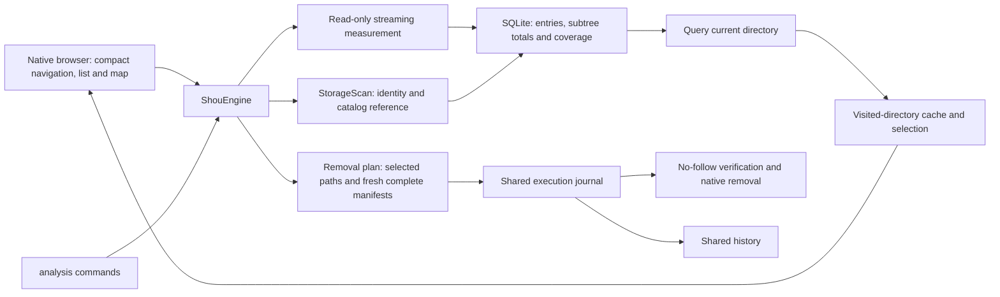
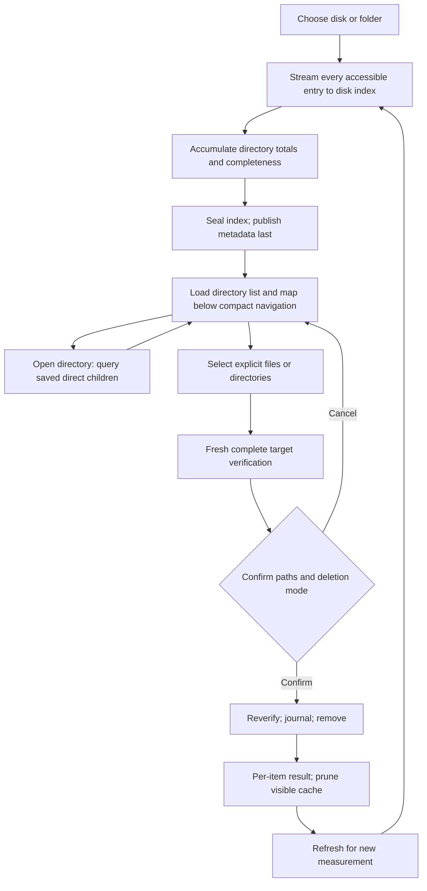
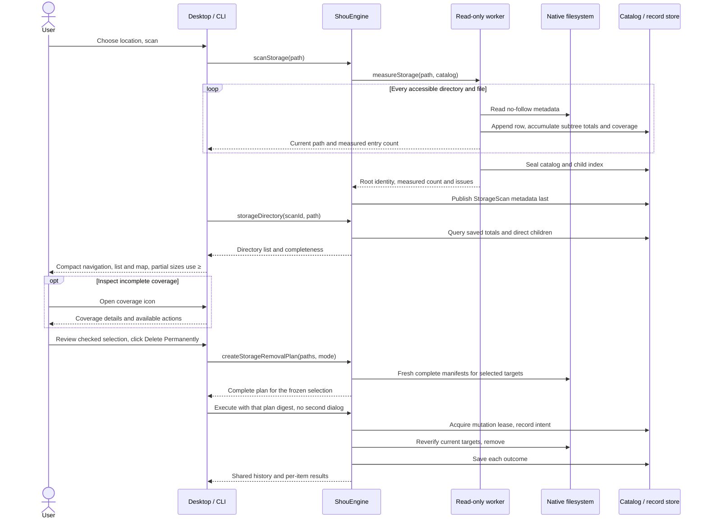
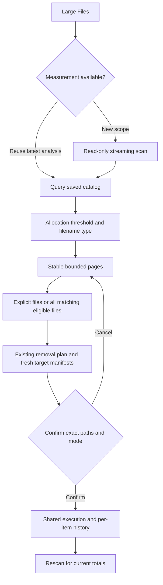
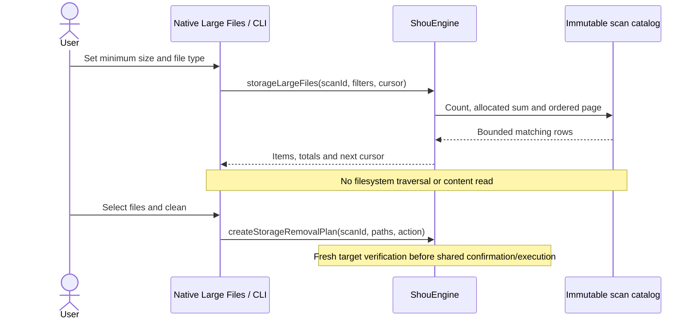

# Space analysis and explicit removal

## Historical comparison

macOS Analysis Actions → Compare Analyses and CLI `analysis history`/`analysis compare` share Core. Users choose an earlier disk index of the same root, inspect immediate-child changes and drill into directories. The sheet follows the [current workspace](../engineering/interface-design.md), wide rows, progressive details and shared resources. Comparison does not scan, select cleanup targets, create plans or modify history. Refresh authoritative measurements after cleanup before comparing.

Require chronological order, matching root path, volume/object identity, owner and case-sensitivity semantics; selected subdirectories must also retain identity. Numeric allocated-byte deltas require both complete scans and complete directory coverage. Replaced objects, one-sided observations and incomplete coverage receive no numeric growth conclusion. New observations do not prove creation; missing observations do not prove deletion. Hard-link attribution, shared blocks and sparse files make sizes estimates rather than reclaimable space.

History reads the current record and at most 127 enumerated entries, 4 MiB per record and 8 MiB total, decoding index metadata without expanding legacy manifests. Directory enumeration has a two-second budget; candidates are ordered by time only within the examined scope, with no claim of covering all latest history after truncation. Legacy, unreadable and cleared indexes remain explicit gaps. Comparison merges binary-name streams in pages of at most 256, examining up to 100000 immediate entries and 10 seconds by default, returning the 50 largest observed changes by magnitude. `limit` accepts 1–100, `max-entries` 1–100000 and `max-seconds` 1–30. Exhausted budgets produce partial results ranked only within the examined scope, not disk-wide growth rankings. No comparison copies are persisted. Cleared indexes return `analysis_unavailable` and require new scans.

[SYNC.md](../../SYNC.md) separately records source, scoped checks, native UI and Windows differences. Windows has independent C# paged history, comparison, CLI and WinUI source; native execution and UI acceptance are recorded separately.

Windows `analysis scan` and the storage page aggregate observations into immutable node pages, reusing private records, digest checks and metadata-last publication without changing scanned targets. These records serve historical observation and never replace current execution evidence. History enumerates at most 4096 directory entries and reads 127 metadata records/8 MiB within five seconds. Comparison reads at most 128 MiB across both catalogs, defaults to ten seconds (1–30 allowed), examines at most 100000 immediate children and returns 50 changes (`limit` 1–100). Read exhaustion returns `resource_limit`/exit `6`; truncated child inspection returns partial results. Incomplete scans have no numeric growth conclusion; missing or invalid pages are rejected. Windows reconstructs bounded observations from pages, rather than offering the macOS SQLite random-access index; explicit scan-record deletion is not enabled.

```sh
shou analysis history --scan-id storage_current --json
shou analysis compare --baseline-id storage_earlier --scan-id storage_current --path . --limit 50 --json
```

Space analysis is a primary Shou workflow. It answers “what occupies this disk?” and lets the user remove selected files and directories directly. A cleanup rule is not required. Repeated cleanup remains the responsibility of fixed or Agent-authored rules.

Simple/Detailed switching, extension aggregates, nested maps and same-snapshot agent context are tracked in the [space analysis design](../engineering/space-analysis-agent-design.md). First use defaults to Simple; later visits remember the choice. Switching reuses the current scan and preserves paths, filters and checked items. Both views support direct cleanup and agent handoff. Copy for AI is available directly in both views and writes a local evidence report plus an analysis request to the clipboard. It does not invoke a model or upload data.

## Product behavior

- Choose a mounted local volume, the home directory, or a folder. The startup disk analyzes its APFS data volume, avoiding duplicate firmlink accounting. This does not claim to measure the sealed system volume or other mounts.
- Start a read-only scan with the shared file-convergence animation, one middle-truncated path and Stop. Show a measured percentage only for a stage with a known total; detailed counts and elapsed time are omitted. Stopping discards the interrupted worker result and preserves any previous analysis. A budget or access gap returns an explicit partial result.
- Browse a size-sorted directory list and proportional treemap. Single click inspects, double click opens a directory. Back, Forward, Up, breadcrumbs, per-folder filtering, and size/name/file-count ordering support navigation. Space opens native Quick Look, ⌘A selects visible eligible entries, and Escape clears the selection while browsing. Text-field editing keeps its own shortcuts.
- The page title lives in the native toolbar. A single 42-point row contains navigation, breadcrumbs, the coverage icon, Refresh and Start Over. Coverage details open on demand; after removal, the Refresh tooltip explains that sizes need measuring again. The list and treemap fill the remaining height. Windows native presentation is planned under its implementation contract.
- Check individual files or directories in either view. Select All applies to selectable entries in the current filtered folder; Clear Selection applies to the whole selection. Selection persists across navigation. Directory context menus can open Customize with AI with the exact directory in the copied Agent request. Parent selections subsume descendants. Unchecking a covered child preserves its siblings.
- The action bar shows only the selected count, size estimate, Clear Selection and a large red Delete Permanently button, without repeating paths. The checked list/map defines the reviewed scope; the button tooltip and accessibility hint explain irreversibility. Clicking it confirms that exact scope and proceeds through validation and execution without another dialog or selection step. Move to Trash remains in a separate adjacent menu; it does not free space. The click freezes the paths and action; an internal complete-manifest plan is prepared and reverified before mutation. Validation failures never expand the scope or trigger automatic retries.
- Results report individual success, failure, cancellation and unknown outcomes. Completed items disappear from both views. Refresh obtains a new authoritative measurement; pruning completed items is not a fresh scan. History supports verified Trash restoration without overwrite and separately confirmed purge.

## Shared architecture



`StorageSession` caches visited directories and loads file lists on demand, without a full-volume UI dictionary. `ShouEngine` owns immutable analysis records, directory queries and explicit removal validation. The platform streams local metadata and subtree totals to a shared SQLite index. Removal independently obtains complete target manifests and reuses native mutation, locking, journals and history. This implemented scan/removal path needs no model, daemon or privileged helper. Next-stage built-in cleanup AI consumes its evidence and reuses the same confirmation/execution contracts; see [integration design](../engineering/embedded-ai-investigation.md).

Permanent removal reuses native handles for the current directory ancestry, rechecking each attachment before mutation instead of reopening an absolute path for every file. New files, replaced directories and links still prevent out-of-scope mutation. Preflight and removal retain the same action title; preflight never advances deletion counts. The first actual removed entry reports immediately, followed by throttled updates. Individual permission or ordinary I/O errors are recorded while other manifest entries and later selected targets continue. Incomplete directories remain, and results report partial completion with bounded failure details. Identity changes, link replacement, cancellation, unknown outcomes and journal failures still stop the affected execution.

## Flow



## Sequence



## Data and safety boundaries

`StorageScan` stores the ID, absolute root, identity, timestamp, coverage, measured entry count and optional `catalog_id`. Private `storage-catalogs` hold SQLite indexes; `storage-scans` hold small JSON records published only after the index is sealed. Every measured file is retained. File rows store a name and parent ID; full directory paths are stored once. Subtree totals accumulate during traversal, and the hard-link set stays on disk. Each node exposes `is_complete`; partial directory sizes use `≥` without invalidating fully measured siblings. Legacy inline and digest-paged records remain readable, with directory coverage derived from `completedPaths`; old records are not rewritten. `StorageRemovalPlan` still binds exact paths, fresh complete manifests, mode, expiry and confirmation digest. The space index is never deletion authorization.

Read access to a disk never grants permission to remove its root. System locations, container roots, credentials, cloud-synchronized trees, Shou configuration and execution/recovery records, symbolic-link targets and special files remain protected. Direct, single-link regular `.sqlite` files in the record store's `storage-catalogs` directory are rebuildable indexes: Space Analysis and Large Files allow explicit selection for permanent deletion or Trash through the existing confirmation, including indexes referenced by old plans or used by the current analysis. The record-store and catalog directories remain protected. Preparation freshly measures an index; execution still verifies its exact manifest and identity. Removing an index makes dependent analyses and pending plans unavailable, with an explicit rescan message; deleting the current index clears the corresponding browsing and selection caches in both pages. Small scan metadata, plan replay protection and independent history manifests remain, including recorded Trash recovery. User ownership is required for each selected root. Current exclusions in registered workspaces apply to matching selected paths and their measured descendants. Changing a selected target after review prevents that target from being removed. Errors are recorded rather than described as success. Cancellation stops scanning workers or stops execution between journaled items.

Default analysis has no file-count cutoff. Operational bounds are one hour, 512 directory levels and a 4 GiB disk index. Unreadable, changed, cross-volume and cloud boundaries are explicit coverage gaps. An index write failure terminates the unpublished analysis; cancellation also publishes no new record. Directory completeness is independent; unmeasured bytes are unknown, not zero. Removal still accepts at most 5,000 literal paths, and every target must pass the existing bounded, complete manifest and content checks. Local JSON records retain their 256 MiB limit. Explicit CLI scan budgets retain bounded legacy snapshots and digest-paged records. Symlinks are not followed; cloud placeholders and mount boundaries are visible, non-removable opaque rows and do not hydrate content. Sizes use `st_blocks × 512`, counting hard links once in traversal order. APFS clones, snapshots and Trash mean attributed bytes are not guaranteed reclaimed bytes. The Simple map groups entries beyond 160 tiles. Detailed uses up to 8,192 nodes, 32 levels and 256 children per directory, expanding the largest areas first with a shared extension palette and up to 2,048 aggregates attributing omitted descendant files to their closest displayed directory. Clipboard context uses a separate 512-node budget. All measured entries remain accessible in paginated directory lists. Successful removal prunes the display cache; Refresh obtains a new authoritative measurement.

Index construction needs free disk space through the final sorting and sealing stage. SQLite storage exhaustion reports `storage_full` with numeric SQLite diagnostics, rather than claiming index corruption; the desktop provides localized guidance to free space or scan a smaller folder. Both row-writing and sealing failures discard only the unpublished index and retain earlier analyses. A failed scan is labeled separately from a user-requested stop. No automatic retry, deletion or fallback to incomplete cleanup evidence is introduced.

## CLI

```sh
shou analysis scan --path "/absolute/local/folder" --json
shou analysis summary --scan-id "storage_…" --json
shou analysis children --scan-id "storage_…" --path "." --limit 50 --json
shou analysis plan --scan-id "storage_…" --path "build" --path "large.bin" --mode permanent --json
shou analysis plan show --plan-id "storage-plan_…" --json
shou analysis remove --plan-id "storage-plan_…" --json
```

Paths in `analysis plan` are literal, scan-relative values, not globs. `--mode permanent` deletes directly; the compatible CLI default is `trash`. `analysis remove` uses the existing controlling-terminal confirmation. A noninteractive Agent can discover, inspect and prepare; it cannot turn JSON output into approval. Partial analysis follows the existing partial envelope and exit code 6. Existing workspace-based `analysis summary` and `analysis children` remain supported.

## Verification

`shou-tests --storage-only` checks selection expansion, root protection, stale-target refusal, partial analysis, current exclusions and newly added descendants, 20 MiB file and directory Trash/restore, permanent removal and history inspection of generated fixtures. `scripts/verify-storage-cli.py` checks discovery, paging, parent/child normalization, file selections, invalid input, explicit partial results and non-TTY refusal without authorizing deletion. Desktop acceptance uses a separate bundle identifier and record store, with generated files only. See [acceptance evidence](../engineering/acceptance-and-testing.md) and [reference acknowledgments](../engineering/interface-design.md).

Default `analysis scan` uses the full disk-backed index. Explicit `--max-entries` or `--max-seconds` selects the compatible bounded snapshot path. `analysis summary` includes the measured entry count; each node from `analysis children` includes `is_complete`.

On macOS, measurement batches regular-file metadata with `getattrlistbulk` only when all identity fields are present, retains `fstatat` for directories and links, and falls back to stat-based enumeration on unsupported or incomplete bulk data. Traversal passes known parent row IDs to SQLite to avoid repeated path parsing and parent queries. A 65,536-row per-directory bulk-buffer threshold chooses the fallback; it does not truncate the scan. These optimizations preserve exact metadata and allocated-size accounting. [Access guidance](installation-and-access.md) runs before broad scans and records protected boundaries honestly.


## Large files across folders

The native **Large Files** page queries ordinary files across an entire saved analysis, without requiring a cleanup rule. Start a new read-only scan or explicitly reuse the latest unchanged Space Analysis result. The two pages keep separate selections.

- The default scope is the startup disk, matching Space Analysis. macOS analyzes its APFS data volume; users can explicitly choose another volume, home directory or folder.
- Default minimum allocation: 50 MiB. Native filters offer 50/100/500 MiB and 1 GiB; the CLI accepts an integer byte threshold.
- Types: all, video, audio, image, archive, document, AI model, and other. Types use filename extensions only; they do not inspect contents. Disk images, installers and ambiguous raw binaries remain Other.
- Order: charged allocation descending, then full relative path in binary UTF-8 order. Hard links follow the saved scan's accounting.
- Type and threshold changes query saved evidence. Pages contain at most 500 rows and a cursor bound to the scan and filters. No whole-volume UI dictionary is required.
- Row selection, loaded-row selection, **Select All Matching Files**, Clear Selection, Quick Look, Finder and path copying are available. Selecting all walks every query page and selects only eligible files; it is cancellable and publishes the selection only after finishing.
- The bottom action shows the authoritative selected count, allocation estimate and actions without repeating paths; the permanent-removal button provides an irreversible warning. Clicking its large permanent-removal button confirms and validates execution without another dialog; Trash remains optional. Both use the existing fresh-manifest validation, execution journal and history.
- Leaving and returning to the page loads a completed scan if needed, while preserving already loaded filters and selection. Cancelled result reads remain visibly unfinished and can be resumed; reusing an analysis exposes progress and Stop.
- After removal, completed rows disappear. The page requests a new scan before showing updated totals. The original catalog remains immutable. An inaccessible location stays a coverage gap rather than zero bytes.





CLI example:

```sh
shou analysis scan --path "$HOME" --json
shou analysis large-files --scan-id "storage_example" --minimum-bytes 52428800 --type ai-model --limit 100 --json
```

Pass returned relative paths to `analysis plan`. Query results do not authorize execution; existing CLI confirmation rules still apply. A partial scan returns its measured matches and original coverage issues.

Copy for AI requests serious investigation of major consumers and separate rule IDs for independent decisions. Preview, enable or preserve each separately. After the Agent imports disabled drafts, use Review AI Rules… → Review & Clean… → Enable & Scan This Rule, adjust files, then use existing confirmation. No receipt means no verified cleanup; inspect failures and remaining relevant scope afterwards. See the [space analysis and Agent design](../engineering/space-analysis-agent-design.md).
