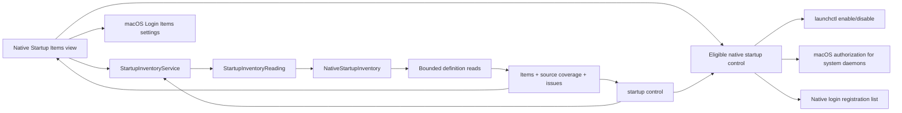
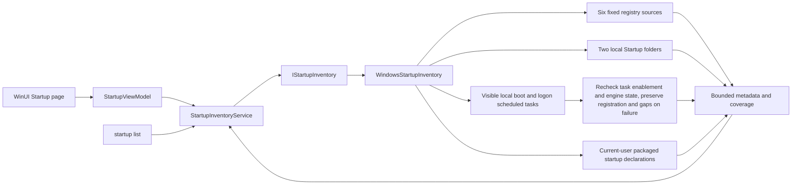
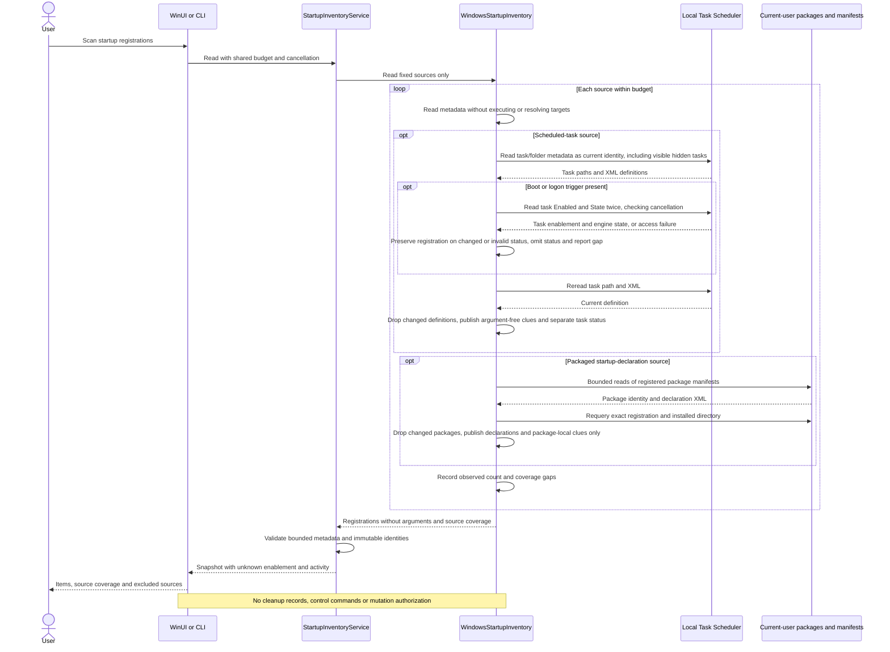

# Startup items

English | [简体中文](../zh-CN/product/startup-items.md)

The macOS native page groups startup registrations by verified application path and provides state counts, All / Enabled / Disabled / Leftovers filters, search, inline controls and expandable details. Direct controls cover eligible LaunchAgents, third-party system daemons and native application login registrations. Unsupported registrations retain a macOS Settings entry point. Windows sources, controls and verification boundaries are described below.

## User workflow

Open Startup Items to read launchd definitions and available login registrations. Search by application, publisher, label, definition path or executable. Expand an application to inspect each registration, its configured and runtime states, source and trigger clues; copy paths or reveal them in Finder. Apple system definitions remain optional under Startup Options. Scan Again reads fresh metadata; Stop requests cooperative cancellation. Existing results remain visible during a refresh.

Controls prepare a confirmation listing the exact affected definitions. Enable and Disable change launchd overrides in the current user’s GUI domain; Remove moves eligible, user-owned definitions to Trash through the existing verified filesystem adapter. These actions do not terminate processes. The platform rechecks source, parent, owner, file identity, contents and label, and verifies the resulting override or Trash operation. The catalog is refreshed after every attempted batch, including partial failures.

Eligible root-owned definitions directly inside `/Library/LaunchDaemons` use a fixed `launchctl enable/disable system/<label>` operation with macOS administrator authorization. Apple definitions remain protected. Native login controls insert or remove the exact local third-party application from the current account’s login list; complete snapshots and identity checks precede mutation, and a fresh snapshot verifies the result. BTM application records use the native list as their active-state authority; a BTM-only fallback remains read-only.

A missing executable is a leftover only when local filesystem evidence establishes absence. Inaccessible paths, unresolved executables, links and offline volumes remain unknown. Similar names do not merge application identities. Mixed groups are shown separately from fully enabled or disabled groups; unknown state is never shown as disabled. Login Items Settings uses the public `SMAppService.openSystemSettingsLoginItems()` API.

## Coverage and privacy

| Source | Default | Evidence |
| --- | --- | --- |
| `~/Library/LaunchAgents` | Included | Current-user definitions |
| `/Library/LaunchAgents` | Included | All-user agent definitions |
| `/Library/LaunchDaemons` | Included | All-user daemon definitions |
| `/System/Library/LaunchAgents`, `/System/Library/LaunchDaemons` | Optional | Apple system definitions |
| Active Login Items | Included when the native shared list is available | Complete native snapshot; eligible exact applications support enable/disable |
| Background application records | Included when BTM v13 is readable | Bounded data-only property-list parser; unavailable versions/permissions remain explicit |
| Embedded application helpers | Outside this scan | Inspect in System Settings |

`complete` means the requested definition sources were inspected. It does not mean all macOS startup registrations were enumerated. Missing sources, permission gaps, malformed definitions and budget limits retain distinct coverage. A failed read is not a claim that no startup item exists.

Reads use directory descriptors, reject ancestor and leaf links, reject special files and compare file metadata after reading. Each definition is limited to 256 KiB. Default traversal is 2,000 entries and five seconds, with cancellation/deadline checks between operations. These checks cannot interrupt an uninterruptible kernel filesystem call. Arguments and environment values are not retained or returned; the executable is only the Program field or first ProgramArguments value when it is an absolute printable path. The state queries return only allow-listed status values. Successful override queries fall back to the definition’s Disabled default when no override exists; failed queries remain unknown. BTM reads reject unrecognized archive versions and never instantiate archived classes. Discovery does not invoke a state-changing command.

## Ownership and flow



Core owns the portable result, pure application grouping/filtering and control contract. The platform adapter owns source paths, definition parsing, physical reads, native registrations and the authorization boundary. The desktop owns search, native presentation, confirmation and settings navigation. Discovery and control do not open the cleanup record store and cannot create cleanup plans.

## Windows startup contract

Status: read-only C# Core, Platform, CLI and WinUI source implemented, including Task Scheduler boot/logon tasks and current-user packaged startup declarations; native acceptance pending. Eligible current-user scheduled-task controls have a separate source implementation with a disabled public gate; other controls and native acceptance remain pending.

### Sources and facts

| Source | Scope and observation |
| --- | --- |
| HKCU `Software\Microsoft\Windows\CurrentVersion\Run` and `RunOnce` | Current user; shared key, read through the 64-bit registry view |
| HKLM keys at the same paths, 64-bit and 32-bit views | Four system-wide sources; views remain distinct |
| `Environment.SpecialFolder.Startup` | Current-user Startup folder, including supported local redirection |
| `Environment.SpecialFolder.CommonStartup` | Shared Startup folder |
| Local Task Scheduler | Tasks visible to the current identity with a `BootTrigger` or `LogonTrigger`, including visible hidden tasks; trigger users are not filtered or inferred |
| Current-user registered package manifests | `desktop` / `uap5` `windows.startupTask` declarations; excludes frameworks, resource packages and bundles; activation/registration is not inferred |
| Other scheduled tasks, other users' private sources, actual packaged-task activation/enablement | Not included; explicit limitations, not a claim of no registrations |

`StartupInventoryService` validates one immutable observation of all ten supported sources. `StartupItem` has a source-bound registration ID, name, optional absolute executable/definition paths and structured issues. Registry value-name and scheduled-task identifier identity ignore case; folder registrations retain observed paths, while packaged declarations bind the exact package version, application ID and a case-sensitive TaskId digest. Task paths are scheduler identifiers and confer no filesystem access. Similar names do not establish application ownership or merge registrations. Effective enablement remains `unknown`, process activity is `not_observed`, orphan status is null and `control_available=false`. A registration, manifest declaration or executable clue does not establish that Windows will run the item.

Reads never expand environment variables or execute registered commands. A registry value is limited to 8 KiB of UTF-16 data and reread before publication. Only an unambiguous absolute `.exe`/`.com` path is extracted; arguments are discarded before entering Core. Quoted paths may contain spaces; ambiguous unquoted paths, relative names, network paths and environment references remain unresolved. Host executables do not identify the application passed in their arguments.

Folder reads inspect direct entries on supported local NTFS/ReFS, reject reparse/unsupported objects and ancestors, and compare the source directory before/after enumeration. They skip directories and `desktop.ini`. Other regular files retain registration metadata; `.lnk` and other associated files are not opened or resolved. Only direct `.exe`/`.com` files expose their own executable path. No target existence, process or publisher inference is made.

Scheduled tasks use local Task Scheduler 2.0 Automation under the current identity and traverse folders. Each folder opening, child-folder entry and inspected task consumes the shared entry budget, including non-startup tasks; traversal stops at depth 32. COM proxies belong to and are released by the native worker. No tasks are run, registered or modified. Task paths and XML are reread before publication. Changed collection counts, access failures, invalid definitions and depth/entry limits produce coverage gaps. This is not an atomic system snapshot: same-count replacements and changes after the final reread remain possible.

Each XML definition is limited to 256 Ki characters after COM returns; COM string allocation precedes this check. Parsing prohibits DTDs, external entities and custom class instantiation, and requires the standard task namespace. Only exactly one `Exec` action with one `Command` supplies a literal local absolute `.exe`/`.com` clue; multiple actions, COM handlers, environment references and other targets remain unresolved. Arguments, descriptions, working directories, user identifiers and raw XML never enter Core or output. Enabled flags, triggers and account conditions do not establish effective enablement or activity.

For recognized boot/logon tasks, Platform reads the public `RegisteredTask.Enabled` and `RegisteredTask.State` properties. When two consecutive observations agree and subsequent path/XML rechecks still match, `scheduled_task` carries boolean `enabled` and `state=unknown|disabled|queued|ready|running`; it is null for other sources or unobserved tasks. Core rejects this field on other sources and rejects out-of-range states. Enablement concerns the task itself and state concerns its engine-reported instances; neither establishes startup trigger, account, network or power eligibility, or whether application processes remain running.

Changed status, access/COM failures or invalid values discard the status while preserving a definition-rechecked registration. Item and source issues report `scheduled_task_status_changed`, `scheduled_task_status_unavailable` or `scheduled_task_status_invalid`; source coverage becomes partial. A changed path or definition discards the entire registration. Cancellation is checked between property reads, and non-startup tasks do not query status. Rechecks cannot detect changes between identical observations or after the final reread. UI details label these values as Task Scheduler reports and explain the startup/application distinction; refresh never fills a new observation's unknown status from an older snapshot.

Packaged declarations locate `AppxManifest.xml` through current-user results of `PackageManager.FindPackagesForUser`. Reads use a fixed package-local filename, bounded handle reads, reject ancestor/leaf reparse points and compare file metadata before/after reading, without requesting more privileges. Read-only manifests may be regular hard-linked files; rule files still require a single link. Each manifest is limited to 4 MiB and prohibits DTDs and external entities. Only application-level `desktop` / `uap5` startup extensions beneath the Windows 10 foundation namespace are parsed; other startup-extension namespaces produce coverage gaps. Before publication, the exact package registration and installed directory are queried again; changed packages publish no candidates.

Packages, applications, extensions and startup declarations each consume the shared entry budget, including frameworks/resources/bundles and rejected entries. Exhaustion prevents opening the next manifest. Enumeration may prefetch one package metadata object; XML parsing work is bounded by the byte limit, and the observation is not an atomic system snapshot. Executable clues prefer extension `Executable`, otherwise the application value, and accept only package-relative `.exe`/`.com` paths. Variables, resource references and arguments are not expanded, and target existence is not checked. `ms-resource:` names fall back to TaskId, or application ID for long IDs. TaskId supports up to 32,767 characters while identity digests remain bounded. Raw XML, arguments and capability declarations never enter Core or output.

Manifest `Enabled` / `ImmediateRegistration` values are declarations and do not establish current-user activation or consent. Public `StartupTask.GetForCurrentPackageAsync` only concerns the caller's own package; Shou does not use it to impersonate another package or inspect private enablement databases. Packaged results therefore report declaration discovery and unknown state, without control authorization.

### Budget and entry points

The shared default budget is 2,000 inspected entries and five seconds; maximums are 10,000 entries and 60 seconds. Counts include rejected/ignored entries. Missing, partial, unavailable and uninspected sources remain distinct. A timed-out worker retains its scheduler slot; at most two native workers run, and cancellation cannot force a blocked kernel or COM read to return. If a failed source consumed an unknown number of entries, later sources are not read using that uncertain remainder and report `entry_budget_unknown`; previously completed sources remain available. Directory reads use bounded prefetch, so in-flight metadata reads may exceed the published inspected count.

`complete` applies only to the ten named sources, visible tasks and package-manifest declarations, not all system tasks, actual packaged-task activation or a consistent point-in-time snapshot. Every result states the excluded sources and unknown enablement/activity. Discovery does not open cleanup storage or create a plan.

```sh
shou startup list --json
shou startup list --source current-user-run --search Example --limit 50 --json
shou startup list --source scheduled-tasks --limit 50 --json
shou startup list --source packaged-startup-tasks --limit 50 --json
```

Optional inputs are `--source`, `--search`, `--offset`, `--limit`, `--max-entries` and `--max-seconds`. Source values are `current-user-run`, `current-user-run-once`, `machine-run64`, `machine-run32`, `machine-run-once64`, `machine-run-once32`, `current-user-startup`, `common-startup`, `scheduled-tasks` and `packaged-startup-tasks`. Source filtering queries the observed snapshot; it does not expand the budget or skip earlier sources. Search is at most 256 printable characters; pages contain 1–500 items. Each CLI call observes fresh sources; offset pages across separate calls are not a stable cursor. Partial coverage returns exit 6; external cancellation returns 130. Arguments for enabling/removing registrations are rejected.

The Windows page searches, filters by source and pages one in-memory snapshot. Refresh preserves the previous list and marks it as previous until a new result arrives. Cancellation, failure and superseded requests cannot publish a stale result as a new observation. Native layout, accessibility and cancellation still require Windows evidence.





Future controls for other sources must bind one exact registration and current configuration, reverify and confirm, and use verified public OS interfaces without guessing private enablement formats. The read-only chain provides no control authorization. See [Microsoft's Run/RunOnce contract](https://learn.microsoft.com/en-us/windows/win32/setupapi/run-and-runonce-registry-keys), [Task Scheduler](https://learn.microsoft.com/en-us/windows/win32/taskschd/task-scheduler-start-page) and [GetTasks hidden-task flags](https://learn.microsoft.com/en-us/windows/win32/taskschd/taskfolder-gettasks).

Packaged sources reference [desktop:StartupTask](https://learn.microsoft.com/en-us/uwp/schemas/appxpackage/uapmanifestschema/element-desktop-startuptask), [uap5:StartupTask](https://learn.microsoft.com/en-us/uwp/schemas/appxpackage/uapmanifestschema/element-uap5-startuptask) and the [current-package StartupTask API](https://learn.microsoft.com/en-us/uwp/api/windows.applicationmodel.startuptask.getforcurrentpackageasync).

Task status references [RegisteredTask.Enabled](https://learn.microsoft.com/en-us/windows/win32/taskschd/registeredtask-enabled), [RegisteredTask.State](https://learn.microsoft.com/en-us/windows/win32/taskschd/registeredtask-state) and [TASK_STATE](https://learn.microsoft.com/en-us/windows/win32/api/taskschd/ne-taskschd-task_state). These API references and Mac logic tests do not establish native Windows COM, permission or UI acceptance.

### Scheduled-task switch review and control

Status: Core, Platform, Presentation, CLI and WinUI source implemented. GUI and CLI share `WindowsStartupControlMutation.PublicExecutionAvailable=false`; only read-only review is publicly available, with task changes disabled.

Review binds one exact boot/logon task. Both security-descriptor owner and literal XML `Principal.UserId` must match the current actor SID, with `InteractiveToken` and explicit `RunLevel=LeastPrivilege`. Reject `\Microsoft` and descendants, group principals, account-name resolution, duplicate fields and observation gaps. Missing RunLevel is not eligibility evidence. A declaration does not guarantee runtime privileges, which also depend on Windows conditions such as UAC. Other account identities, task XML, arguments and descriptions never enter records; retain only actor SID, eligibility booleans and an opaque definition digest. Only the task's own `Settings/Enabled` is excluded from that digest; changes to actions or other settings invalidate review.

`StartupControlReviewer` opens no storage and returns a five-minute in-memory review. Execution reinspects the exact task and digest, then requests current-entry confirmation of its task/action. Confirmation lasts at most one minute and never outlives the review. The service acquires the existing cross-process mutation lease, rechecks again, persists `applying` intent and only then sets public `RegisteredTask.Enabled`. It does not run, stop, register or delete tasks, request elevation, or change registry, shortcuts or packaged tasks. Disabling leaves running instances alone; enabling does not guarantee trigger eligibility.

After dispatch, await the actual result and reread identity, definition and switch. `completed` requires a returned setter plus unchanged identity/definition and the requested switch; uncertainty remains `unknown`, without automatic retry, rollback or restoration. Stop prevents dispatch when possible; after dispatch it retains the lease until the result returns. Any durable intent blocks replay. Journal errors retain the operation ID; no record does not prove no change. Reading a record never restores execution eligibility. WinUI clears executable review at dispatch, retains lookup, prevents selection/navigation during mutation and requests stop-and-wait for normal closing; forced termination is outside this guarantee.

See the [Windows command guide](../engineering/windows.md#scheduled-task-switches) and [flow and sequence](../architecture/workflows-and-sequences.md#windows-scheduled-task-switches). Real generated-task COM, owner security descriptors, permissions, concurrent replacement, interruption, terminal confirmation and WinUI require separate native acceptance; Mac simulations do not establish control support.

API references: [Enabled](https://learn.microsoft.com/en-us/windows/win32/taskschd/registeredtask-enabled), [GetSecurityDescriptor](https://learn.microsoft.com/en-us/windows/win32/taskschd/registeredtask-getsecuritydescriptor), [Principal.LogonType](https://learn.microsoft.com/en-us/windows/win32/taskschd/principal-logontype) and [RunLevel](https://learn.microsoft.com/en-us/windows/win32/taskschd/principal-runlevel).

Scheduled-task control has a [generated-task-only native acceptance entry](../engineering/windows.md#native-startup-control-acceptance-with-generated-tasks). It accepts no existing task targets, never runs tasks and skips by default. Windows execution, races/interruption, permissions, terminals and UI remain pending; source or Mac checks do not establish control support.
